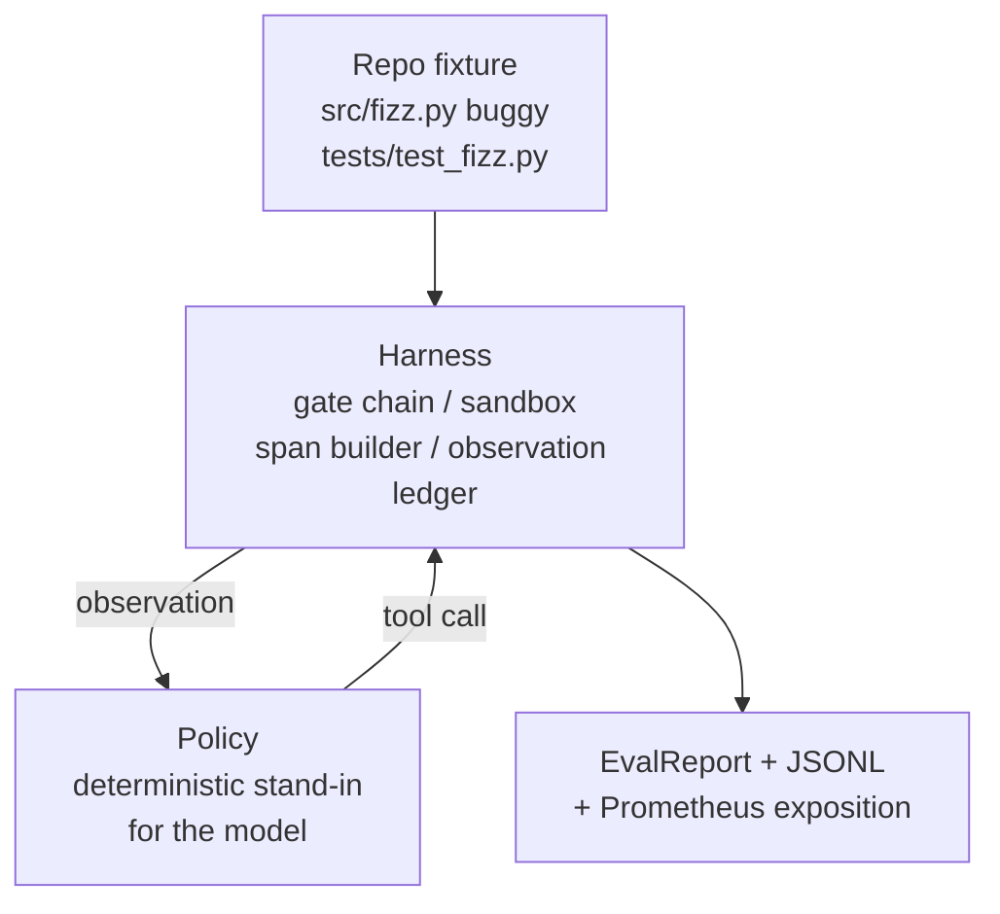
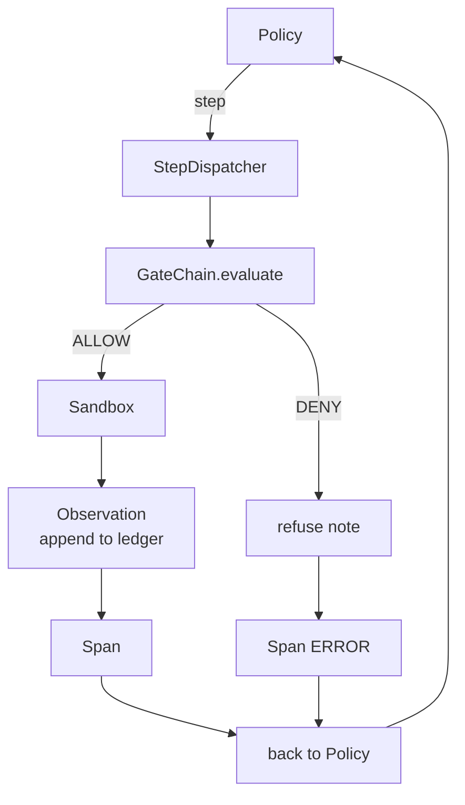

# 캡스톤 29 교훈: 에 종말부터 종말까지 코딩 에이전트

> A 트랙의 보수를 이 수업은 게이트 체인, 샌드박스, eval 하네스, 그리고 OTel를 하나의 작동 코딩 에이전트로 꿰매어 다 파일 파이썬 프로젝트에서 실제 (작은, 고정 규모의) 버그를 수정합니다. 에이전트는 LLM가 아닌 결정적인 정책입니다. 대체로 수업이 재생 가능해지며, 모든 시간 동안 이 흥미로운 부분임을 보여줍니다. 계약은 동일합니다. 실제 모델이 정책 에 꽂혀 있습니다.

**Type:** Build
**Languages:** Python (stdlib)
**Prerequisites:** Phase 19 · 25 (verification gates), Phase 19 · 26 (sandbox), Phase 19 · 27 (eval harness), Phase 19 · 28 (observability), Phase 14 · 38 (verification gates), Phase 14 · 41 (workbench for real repos), Phase 14 · 42 (agent workbench capstone)
**Time:** ~90 minutes

## 학습 목표

- 게이트 체인, 샌드박스, eval 리너스, 그리고 스펜 빌더를 하나의 에이전트 루프로 구성합니다.
- 고정 버그를 수정하기 위해 read_file, run_tests, write_file를 사용하는 결정적 정책을 구현하십시오.
- 전 세계 단계 예산과 종전 경행에 걸쳐 관찰 토큰 예산을 시행한다.
- 전체 OTel GenAI 추적 및 Prometheus 측정을 전체 실행에 게재하십시오.
- 검증 대리인은 법적인 도구에 대해 0개의 게이트 트리프로 12단계 미만으로 정비를 해결합니다.

## 문제

대부분의 에이전트 디모는 고립적으로 작동합니다. 모래 상자 자체, 평가 리너스 자체, 스탠 에미터 자체. 그들은 괜찮습니다. 그것들을 구성하고 이 표시됩니다.

문 사슬은 "허락"이라고 하지만 모래 상자는 사슬이 예상하지 못한 이유로 거절합니다. 검증기록은 통과를 기록하지만 OTel 스탠스는 게이트가 사용했다고 주장하는 도구를 거부했다고 합니다. 프로메테우스 카운터는 한 번 증가해야 할 때 두 번 증가합니다. 관측 예산이 초과됐지만, 그 대리인은 계속 계속됐어요. 왜냐하면 그 예산은 체인에서 추적됐고, 모래 상자는 몰랐기 때문이죠.

이 수업은 전체 트랙의 통합 테스트입니다. 에이전트는 다음 네 가지 일을 해야 합니다. 프로젝트를 읽고 테스트를 실행하고 테스트 실패에서 버그를 식별하고 수정 작업을 작성하고 테스트를 다시 실행하고 중지합니다. 모든 작업은 게이트 체인을 통해 진행됩니다. 모든 도구 실행은 모래 상자를 통해 진행됩니다. 모든 단계는 랜에 포장됩니다. eval 하네스는 끝에서 모든 것을 점수합니다.

## 개념



에이전트의 정책은 5개 주의 공제입니다

`SURVEY`: 에이전트가 프로젝트 목록을 읽습니다. 다음 상태는 RUN_TESTS입니다.

`RUN_TESTS`테스트 명령은 에이전트가 실행합니다. 테스트가 통과되면 상태 기계가 성공적으로 멈춥니다. 그렇지 않으면 다음 상태는 INSPECT입니다.

`INSPECT`: 에이전트가 실패한 소스 파일을 읽습니다. 다음 상태는 수정입니다.

`FIX`: 에이전트가 수정된 파일을 작성합니다. 다음 상태는 VERIFY입니다.

`VERIFY`테스트 명령은 다시 실행됩니다. 테스트가 통과되면 성공 중지합니다. 그렇지 않으면 실패로 중지합니다.

각 상태는 도구 호출과 일치합니다. 모든 도구 호출은 게이트 체인을 통과합니다. 도구 호출이 거부되면 에이전트는 거부를 추적하고 중지합니다.

장치 버그는 1개씩 장치`fizz.py`. 결정적 정책은 regex를 통해 테스트 실패 메시지에서 버그를 감지하고 수정된 파일을 발송합니다. LLM로 정책을 대체하는 것은 사용 계약에 변화를 일으키지 않습니다.

```figure
cg-harness-weave
```

## 건축



수업은 자기결정되어 있습니다. 이전 수업의 모든 원시적인 것은 최소한의 규모로 재시행됩니다.`main.py`(gate, sandbox, ledger, span) 그래서 수업은 형제자매를 수입하지 않고 실행됩니다. 이름들은 수업 25-28과 정확히 일치합니다. 그래서 개념적인 지도가 명확합니다.

## 당신이 건설할 것은

`main.py`배:

1. 최소 배너스 원시, 수업 25~28과 같은 이름으로 복사:`GateChain``Sandbox``ObservationLedger``SpanBuilder``MetricsRegistry`- 그래
2. `CodingAgentPolicy`클래스: 5개의 주와 함께 하는 상태 기계
3. `Repo`보조: 기 기 기 기 기 기 기 기 기 기
4. `AgentRun`클래스: 폴리스를 운전하고, 배너스를 통해 배포하고,`AgentRunReport`- 그래
5. 뭉쳐 있는 장치 (`fixture_repo/`) src/fizz.py, tests/test_fizz.py, 그리고 eval 리네스에 대한 예상/ 트리와 함께.
6. 데모: 정책의 끝에서 끝까지 실행, 단계별 추적을 인쇄, 승인을 확인, 측정값을 인쇄.

묶인 고정치는 수업 27의 작업 구조와 같은 모양입니다. 버그 파일과 테스트 파일. 테스트 실패 메시지는 결정적인 정책을 식별하기에 충분한 정보를 포함합니다. 실제 LLM는 동일한 작업을 느려지고 더 넓은 회수로 수행하지만, 배너스의 기대를 변경하지 않습니다.

## 왜 정책은 LLM가 아닌지

실제 LLM는 API 키, 네트워크 호출 및 검증할 수 없는 스토카스틱성을 필요로 합니다. 배열은 수업에 관심이 있는 부분입니다. 결정적인 정책에 부딪히는 것은 수업이 외부 의존성 0을 가진 모든 개발자 노트북에서 실행되도록 하고 테스트 스위트가 정확한 단계 계산을 주장하도록 합니다.

수업의 정책은 LLM 에이전트가 하는 일의 엄격한 부분집합입니다. 정책은 레포를 읽고, 실패 테스트를 보고, 라인을 식별하고 수정을 발행합니다. LLM는 동일한 을 통해 동일한  계약으로 진행합니다. 회계도 동일합니다.

## 데모에서 보여지는 내용

엔드-투-엔드 데모는 출국 시점에 다섯 가지를 확인하고 테스트 스위트는 프로그래밍 방식으로 다시 확인합니다.

정책은 12단계 이하의 시간 안에 문제를 해결했습니다.

관찰 예산은 결코 초과되지 않았습니다.

제로 게이트 거부는 법적 도구에 발사되었습니다.

각 단계에는 그 대응한 기간이 있습니다.

프로메테우스 전시에는`tools_called_total{tool="read_file"}`입문 및`tool_latency_ms`히스토그램

## 이 코스가 A 트랙의 나머지 부분과 어떻게 얽혀있는지

이 교훈은 통합입니다. 25 교훈은 게이트 체인을 썼습니다. 26 교훈은 샌드박스를 썼습니다. 27 교훈은 eval 하네스를 썼습니다. 28 교훈은 관찰성을 썼습니다. 29 교훈은 그들이 시스템으로 작동한다는 것을 증명합니다. 실제 에이전트 하네스는 여기에서 확장됩니다.

## 실행

```bash
cd phases/19-capstone-projects/29-end-to-end-coding-task-demo
python3 code/main.py
python3 -m pytest code/tests/ -v
```

데모는 단계별 추적, 최종 평가 보고 및 프로메테우스 노출을 인쇄합니다. 출력 코드는 0입니다. 테스트는 정책 상태 전환, 합성 도구 호출에 대한 게이트 거부, 묶인 장치의 엔드-투-엔드 실행 및 단계 예산 변수를 포함한다.
