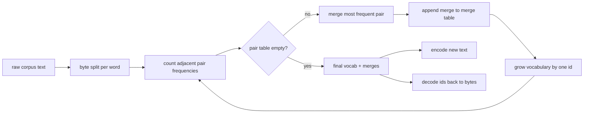
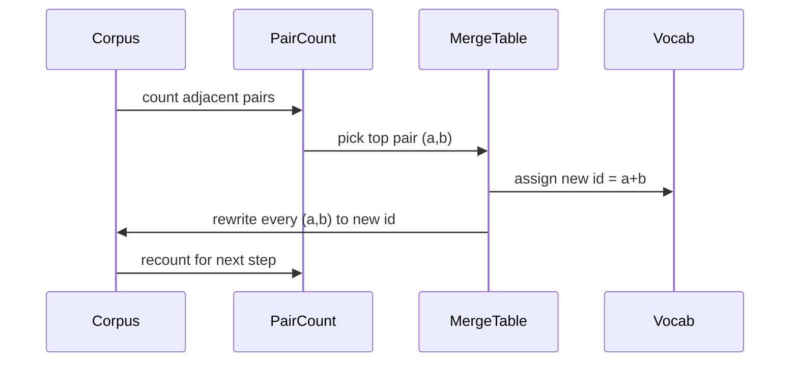

# BPE 토큰 시초

> 바이트를 입력하고, 아이디를 입력하고, 아이디를 다시 동일한 바이트로 입력하고, 모든 현대 텍스트 모델이 여전히 시작되는 토큰을 만들죠.

**Type:** Build
**Languages:** Python
**Prerequisites:** Phase 04 lessons, Phase 07 transformer lessons
**Time:** ~90 minutes

## 학습 목표
- 바이트-파어 코딩 어휘를 배열하여 가장 빈번한 인접한 상징쌍을 반복적으로 합쳐서 원본 텍스트 코퍼스에서 코딩합니다.
- 결정적인 융합 테이블을 구현하고 신선한 텍스트에 적용하여 하위 단어 ID의 스트림을 생성합니다.
- ID와 정보 손실 없이 ID로 돌아가는 임의 UTF-8 입력
- 특별 토큰을 저장하고 보호 (`<|endoftext|>``<|pad|>`) 를 통해 훈련과 디코딩을 생존할 수 있습니다.
- 바이트 수준의 알파벳이 일반 용도의 토큰화용에 적합한 층이 되는 이유

```figure
cap-bpe-merge
```

## 프레임

언어 모델은 텍스트를 볼 수 없습니다. 정수들을 볼 수 있습니다. 문자열에서 정수 목록으로의 지도가 토큰이 됩니다. 이 계층을 잘못하면 훈련 실행의 모든 손실 곡선은 잘못된 것을 측정합니다.

일반 텍스트 모델의 하위 단어 토큰의 지배적인 가족은 바이트-쌍 코딩입니다. 아이디어는 작습니다. 알려진 알파벳에서 시작하십시오. 훈련 코퍼스에서 가장 자주 나타나는 인접적인 상징 쌍을 찾으십시오. 새로운 상징으로 통합하십시오. 어휘가 목표 크기를 달성하기까지 반복하십시오. 새로운 텍스트를 코딩하는 것은 동일한 순서로 동일한 결합 목록을 반복합니다.

우리는 바이트 레벨 변형을 만들 것입니다. 알파벳은 유니코드 코드 포인트가 아닌 256 원본 바이트입니다. 그 선택은 알려지지 않은 토큰으로 떨어지지 않고 UTF-8 입력물을 처리 할 수 있도록 합니다.

## 파이프라인



훈련면과 추론면은 merge 테이블을 공유합니다. 공유는 계약입니다. 추론에서 merge 순서를 변경하면 다른 ID 스트림을 해독합니다.

## 바이트 알파벳

첫 번째 256 ID는 0x00에서 0xFF까지의 원본 바이트에 예약되어 있습니다. 이는 모든 입력 문자열이 어떤 융합이 일어나기 전에 어휘에서 표현될 수 있음을 보장합니다. 바이트 블록 후에 우리는 특별한 토큰에 대한 작은 범위를 예약합니다. 훈련 루프는 이러한 ID를 융합 목표로 제안하지 않습니다. 왜냐하면 우리는 그들을 전 융합 스트림에서 완전히 멀리 두기 때문입니다.

프리토케니저는 훈련이 보기 전에 백공간과 점점 경계에 코퍼스를 나눕니다. 그 분할이 없으면 BPE 융합 단계는 단어 경계를 넘어서 합병을 기꺼이 배우게 될 것이고 어휘는 전체 일반적인 문장으로 가득 차게 됩니다. 분할과 함께 합병은 단어 안에 남아서 결과가 일반화됩니다.

## 훈련 루프

각 훈련 단계에 대해 루프는 세 가지 일을 합니다. 그것은 코퍼스에서 모든 단어를 걸어 다니며, 단어 자체가 나타나는 빈도에 따라 중량된 각 인접한 동행 기호의 빈도가 얼마나 되는지 계산합니다. 그것은 가장 높은 수를 가진 쌍을 선택합니다. 그것은 그 쌍의 모든 발생을 단일 새로운 상징으로 다시 작성합니다. 그 아이디는 어휘의 다음 자유 슬롯입니다. 그 다음에는 합병을 기록합니다.



각 단계의 비용은 상징 순서 목록으로 표현되는 몸집의 크기에 선형적입니다. 백만 단어와 10천 개의 목표 어휘에 대해, 순서가 수 초 안에 완료되기 때문에 상징 순서가 융합에 따라 줄어들게 됩니다.

## 신선한 텍스트를 암호화

인퍼런스는 융합 카운터를 호출하지 않습니다. 그것은 학습된 순서와 동일한 순서로 융합 테이블을 적용합니다. 새로운 단어에 대한 코더는 바이트 분할에서 시작합니다. 그것은 가장 낮은 순위 융합 (제작되는 가장 오래된 것) 을 위해 현재 순서를 스캔합니다. 그것은 융합을 수행합니다. 다시 스캔합니다. 루프는 융합이 융합되지 않은 상태에서 종료됩니다.

순위 순위는 코딩을 결정적인 것으로 만들고 같은 입력에서 훈련 행동을 일치시키는 속성입니다. 먼저 배운 합치는 테이블의 상단에 위치하고 먼저 적용됩니다. 같은 위치에서 두 개의 합성이 적용될 수 있다면, 낮은 순위가 승리합니다.

## 특별 토큰

특별한 토큰은 바이트 스트림이 만들 수 없는 아이디입니다. 우리는 손으로 예약합니다. 이 수업에 2개가 충분합니다.

- `<|endoftext|>`훈련 전과중에 문서를 분리합니다. 모델에 "새로운 문서는 여기서 시작됩니다. 이전 문서의 맥락이 빠져들지 않도록하십시오".
- `<|pad|>`짧은 순서들을 채우면 배트가 정사각형 텐서로 되어 훈련 중에 손실 마스크가 숨기게 됩니다.

코더는 입력에 특별한 토큰을 허용하기 위해 깃발을 받아들이고 깃발을 꺼내서 문자열을 `<|endoftext|>`그리고`<|pad|>`표기판이 켜져 있는 상태에서 문자 문자 문자열은 그들의 예약된 아이디에 매핑되어 어떤 합병도 되지 않습니다.

## 반여행 보증

암호화 후 암호화 후 입력 바이트를 정확하게 반환해야 합니다. 암호화 후 각 아이디의 바이트 확장을 순서대로 연결합니다. 모든 아이디는 원형 바이트 또는 이전에 알려진 두 개의 아이디의 합계이기 때문에, 재발적 확장은 항상 원형 바이트로 끝납니다. 암호화 후 해당 바이트가 표기하는 UTF-8 문자열을 반환합니다.

이 수업의 테스트 스위트는 보이지 않는 문장, 유니코드 에모지 문장, 문자 그대로의 문장을 포함하는 문장을 검사합니다.`<|endoftext|>`토큰

## 이 교훈이 하지 않는 것

그것은 가장 큰 생산 토큰 시식품의 스타일로 레전스-운동 된 프리토케니저를 만들지 않습니다. 여기의 프리테키니저는 작은 백색 공간과 점문분열입니다. 작은 교육체육체에 합병을 하는 것이 충분하고, 나머지 수업 체인과의 계약은 동일하게 유지됩니다. 다음 수업에서는 토큰이 블랙박스처럼 취급되고 그 위에 슬라이딩 윈도우 데이터 세트를 구축합니다.

이 방법은 쌍 카운터를 병렬화 하지 않습니다. 파이썬의 몇 천 단어의 코퍼스 위에 있는 루프는 sani보다 훨씬 짧은 시간에 끝납니다. 더 큰 코퍼스에서는 명백한 움직임은 단어당 쌍을 병렬로 계산하고 줄이는 것입니다.

## 코드를 읽는 방법

`main.py`네 개의 객체를 정의합니다.`BPETokenizer`어휘, 융합 테이블, 특수 표기 테이블을 포함합니다. `train`훈련 루프입니다.`encode`이 방법은 추론 경로입니다.`decode`아래쪽에 있는 데모는 작은 토큰라이저를 내장된 코퍼스에 훈련시키고, 긴 문장을 암호화하고, 아이디를 다시 복제하고, 둘 다 인쇄합니다.`code/tests/test_bpe.py`반정편 속성, 특별 토큰 예약, 그리고 융합 순서를 

데모를 실행하세요. 그 다음 데모에서 목표 어휘의 크기를 300에서 600로 변경하고, 수직 문장의 암호 된 길이가 어떻게 떨어지는지 확인하십시오. 그 곡선은 BPE 압축 곡선입니다.
