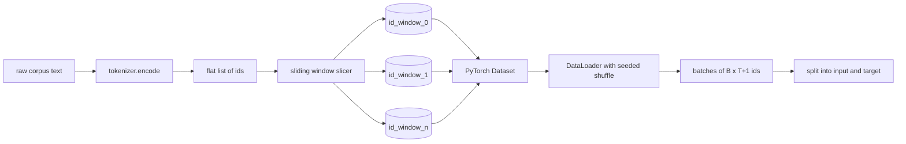
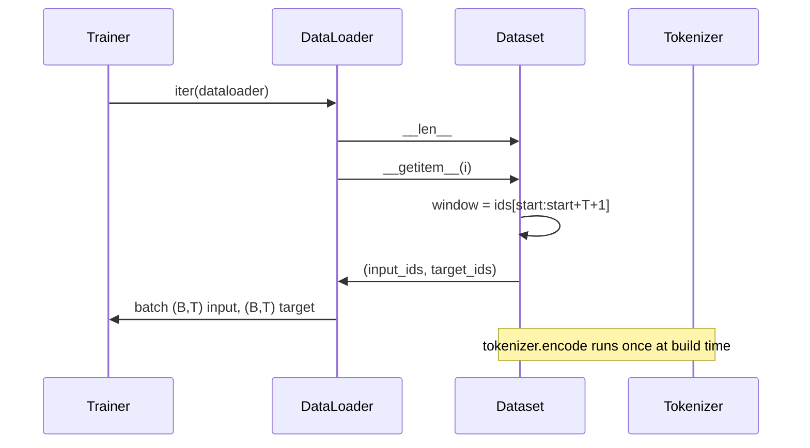

# 슬라이딩 윈도우로 토큰화된 데이터셋

> 예능전기 실행은 토큰 아이디에서 그라디언트로 함수입니다. 이 수업은 아이디를 공급하는 컨베이어를 만듭니다.

**Type:** Build
**Languages:** Python
**Prerequisites:** Phase 04 lessons, Phase 07 transformer lessons, Lesson 30 of this phase
**Time:** ~90 minutes

## 학습 목표
- 토큰 ID의 스트림으로 원본을 변환하여 토큰라이저를 한번 호출하십시오.
- 설정 가능한 초복 단계로 ID 스트림을 고정 길이 창으로 갈라놓습니다.
- 다음 토큰 예측을 위해 입력 및 타겟 텐서들을 반환하는 PyTorch 데이터 세트를 구축하십시오.
- 데이터 세트를 데이터 로더에 매겨서 매시별로 세운 결정적인 믹스를 사용한다.
- 단계, 과잉 및 효과적인 데이터 세트 크기의 타협에 대한 이유

```figure
cap-sliding-window
```

## 프레임

훈련 전 경기는 하나의 토큰 아이디를 한 번에 읽고 모델을 업데이트합니다. 각 배트의 모양은 훈련 계약에 의해 정해집니다. 인과 언어 모델에서는 배트가 `(B, T)`입력 아이디 및 `(B, T)`데이터 파이프라인의 임무는 몇 기가바이트의 원본의 일체에서 수요에 따라 결정적이고 재생 가능한 방식으로 그 계약을 생성하는 것입니다.

이 수업은 파이프라인을 만듭니다. 이전 수업의 토큰화는 텍스트를 긴 평평한 아이디 목록으로 변환합니다. 슬라이딩 창은 목록을 훈련 예제로 잘라냅니다. 사용자 지정 데이터 세트는 예제를 텐서로 노출합니다. 데이터 로더는 그것들을 배팅하고 알려진 씨와 섞습니다.

## 형태 계약

인과성 LM는 모양의 ID를 소비합니다`(B, T)`어디`B`배트 크기와`T`위치에서 목표 `t`입구 위치에서 입력 `t+1`즉 모든 훈련 사례는`T+1`순위적인 예제들 사이의 겹치는 양을 좌우하는 창 단계



썰매기는 뚜의 경계와 결코 겹치지 않습니다. 마지막 창에는 채울 수 있는 ID가 충분하지 않은 경우`T+1`이 을 고 을 고`<|pad|>`이 수업은 빠지게 됩니다.

## 왜 슬라이딩 창이

훈련 전체 (pre-training corpus) 는 긴 ID의 흐름입니다. 모델이 덮이지 않는 창만을 보았다면, 모든 훈련 예제에서는 동일한 것을 가르칠 것입니다.`T`경계를 조정하면 그 경계를 움직이고 모델은 더 다양한 예측-다음 토큰 작업을 볼 수 있습니다.

한 단계의`T`이 이 이 이 이 이 이 이 이 이 이 이 이 이 이 이 이 이 이 이 이 이 이 이 이 이 이 이 이 이 이 이 이 이 이 이 이 이 이 이 이 이 이 이 이 이 이 이 이 이 이 이 이 이 이 이 이 이 이 이 이 이 이 이 이 이 이 이 이 이 이 이 이 이 이 이 이 이 이 이 이 이 이 이 이 이 이 이 이 이 이 이 이 이`T // 2`50%의 초복을 만들어내고 효과적인 데이터 세트를 두 배로 늘립니다.`1`최대 초복을 만들어내며 데이터 세트를 `T`. 비용은 시대별로 더 계산된다. 이점은 더 많은 경계 다양성이다. 대부분의 사전 훈련 경기는 컨텍스트 길이를 동등한 단계를 사용한다. 왜냐하면 코퍼스가 이미 하나의 시대에서 모델이 완성할 수 있는 것보다 훨씬 더 크기 때문에 경계 다양성 논리는 더 약하다.

## 데이터셋 클래스

PyTorch 데이터 세트는 두 가지 요구되는 방법을 가지고 있습니다. `__len__`예를 들어,`__getitem__`한 예 를 텐서 쌍으로 반환 합니다. 우리의 데이터 세트는 암호화된 id 스트림과 단계 를 저장 합니다. 이 항목에 대한 인덱싱은 비행에서 창의 시작을 계산하므로 메모리 비용은 단계가 얼마나 많은 예를 생성하는지 상관없이 id 스트림의 한 복사본입니다.



한 번씩 돌리는 일은 내부에서 일어난다`__getitem__`데이터셋이 반환됩니다`(input, target)`어디`input = window[:-1]`그리고`target = window[1:]`둘 다 파이토크 긴 텐서인데 훈련 루프에서는 진리로 취급합니다

## 결정적 믹스

`shuffle=True`PyTorch 무작위 생성기에서 읽습니다.`torch.Generator`시대로 시드하면 실행이 재개될 때마다 같은 믹스를 얻습니다. 이 속성은 하나의 하이퍼파라미터에서만 차이가 있는 두 실행을 비교할 때 중요합니다. 씨드 없이 두 실행은 데이터를 다른 순서로 볼 수 있으며 손실 곡선은 변경과 관련이없는 이유로 차이가 있습니다.

이 수업의 씨앗 계약은 간단합니다.`epoch_seed = base_seed + epoch_index`.기본 씨앗은 건설 시 전달된다. 시대 지수는 각 시대의 꼭대기에 트레이너에 의해 증가한다. 같은 기본 씨앗을 다시 실행하면 항상 같은 순서를 볼 수 있습니다.

## 배트 샘플링

PyTorch의 기본 샘플러는 대체 기능을 사용하지 않는 것으로 짝이 없는 짝을 선택합니다. 이것은 사전 훈련에 필요한 것입니다. 작은 데이터 세트에 대한 정밀 조정에 대해서는 계약이 동일합니다. DataLoader는 전화로 짝을 모으고 짝을 모으고 짝을 연결합니다.`__getitem__` `B`모든 예제들이 같은 길이를 가지고 있기 때문에,

교훈은 계속됩니다`num_workers=0`생산에서 노동자들은`__getitem__`우리의 파이프라인에서는 대부분 비작업이 가능하죠. 왜냐하면 작업은 메모리에 있는 텐서의 한 조각일 뿐이죠. 하지만 동일한 데이터셋 API는

## 수 수록 예제

길이의 ID 스트림에`N`, 맥락 길이가`T`그리고 한 발걸음`S`, 예제 수는 `max(0, 1 + (N - (T + 1)) // S)`. 수업은 데이터 세트에 있는 정적 방법으로서 그 계산을 노출시켜서 트레이너가 반복 없이 시대별로 전체 단계를 계산할 수 있습니다.

## 이 교훈이 하지 않는 것

디스크에서 스트리밍되는 것은 아닙니다. 코퍼스는 메모리에 완전히 암호화되어 단일 텐서로 유지됩니다. 몇 백만 개의 ID의 코퍼스는 백 메가바이트 미만이며 수업에 적합한 모양입니다. 디스크 스트리밍은 저장소를 교체하여 플러그인하는 별도의 문제이지만 데이터셋 계약을 유지합니다.

여러 문서들을 처리하지 않습니다. 코퍼스는 하나의 연속적인 ID 스트림으로 취급됩니다. 다음 문서 경계는 삽입하여 암호화됩니다.`<|endoftext|>`이 모델은 한계를 예측하는 것을 배우게 됩니다.

## 코드를 읽는 방법

`main.py`두 개의 클래스와 한 명의 보조를 정의합니다.`SlidingWindowDataset`PyTorch 데이터 세트입니다.`make_dataloader`시드된 생성기를 가진 구성된 DataLoader를 반환합니다. `_encode_corpus_to_ids`아래쪽에 있는 데모는 작은 토큰라이저를 생성하고, 내장된 코퍼스를 암호화하고, 데이터 세트와 데이터 로더를 구성하고, 한 배치를 인쇄하고, 모양 계약을 주장합니다.`code/tests/test_dataset.py`창수수의 공식, 1개로 이동하는 속성, 결정적 믹스,

디모를 실행하세요. 그 다음 16에서 32로 컨텍스트 길이를 변경하고 시대별 예제 수가 어떻게 떨어지는지 보세요. 그 숫자는 시대별 단계 예산입니다.
