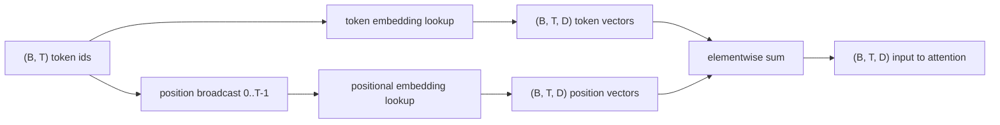
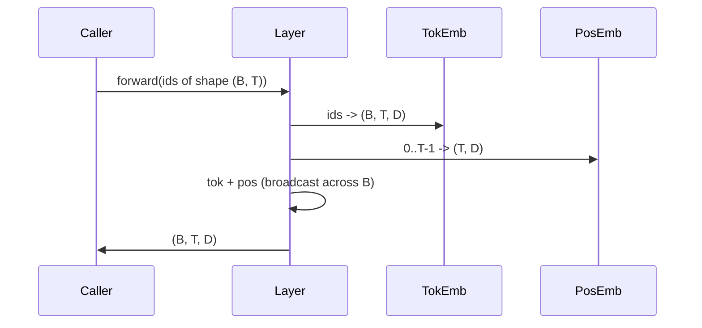

# 표지판 및 위치 삽입

> ID는 정수입니다. 모델은 벡터를 원합니다. 두 개의 검색 테이블이 그 사이에 위치 중 하나를 선택하면 모델이 배울 수 있는 것을 형성합니다.

**Type:** Build
**Languages:** Python
**Prerequisites:** Phase 04 lessons, Phase 07 transformer lessons, Lessons 30 and 31 of this phase
**Time:** ~90 minutes

## 학습 목표
- 토큰을 내장한 검색 테이블을 구축하여 단어 재고 ID를 덩어리 벡터로 매핑합니다.
- 위치에 따라 지목된 위치 배포 검색 테이블을 구축하십시오.
- 매개 변수 없이 위치에 의해 지표된 고정된 시누사이드 위치 임베디션을 구축합니다.
- 트랜스포머 블록에 대한 단일 입력으로 토큰 및 위치 임베디션을 구성합니다.
- 길이의 일반화와 매개 변수 수수에 대한 모순과 모순이 학습되었습니다.

```figure
cc-embedding-lookup
```

## 프레임

모델의 토큰 아이디와 첫 번째 접촉은 토큰 내장 매트릭스 내 줄 검색이다. 매트릭스는 단어 ID에 한 줄과 모델 차원에 한 열을 가지고 있다. 검색은 모델의 나머지 부분이 아이디의 의미로 취급하는 벡터를 반환한다. 백프롭은 앞 패스에서 사용된 줄을 업데이트한다. 훈련 과정에서 그 줄의 기하학은 방향의 유사성을 코딩하는 것을 배우게 된다.

토큰 아이디만 있으면 순서가 없습니다. 모델은 위치 1가 위치 17와 다르다는 것을 알려주는 두번째 신호가 필요합니다. 그 신호의 두 가지 지배적인 선택은 학습된 위치 임베디션 (제2 검색 테이블, 위치마다 한 줄) 과 고정된 시누사이드 위치 임베디션 (변수 없는 수학 공식) 이다. 선택은 결과를 낳습니다. 학습된 테이블은 매개 변수이며 모델이 훈련된 최대 컨텍스트 길이가 제한됩니다. 시노수이드 테이블은 이론적으로 매개 변수 없는 것이고 공식은 모든 위치로 확장됩니다.`SinusoidalPositionalEmbedding``max_context_length`그리고 그`forward`이 한계를 넘어서는 경우 두 모듈 모두 여기서 최대 컨텍스트 길이를 강화합니다. 테이블이 덱스 할 만큼 큰 경우에도 모델은 여전히 훈련 길이를 넘어서는 데 어려움을 겪을 수 있습니다.

이 수업은 두 가지 모두 구성하고 다음 수업의 관심 블록을 위한 하나의 입력으로 토큰을 내장하여 구성합니다.

## 형태 계약

임베디션 단계에 입력되는 것은 모양의 토큰 ID의 무대입니다 `(B, T)`출력량은 모양의 텐서입니다`(B, T, D)`어디`D`모델 차원입니다. 모든 배트 요소는 같은 컨텍스트 길이를 가지고 있습니다.`T`모든 위치가 같은 벡터 차원을 가지고 있습니다`D`- 그래



합성자는 합이 아니라 합이 됩니다. 합은 계속됩니다.`D`네트워크에 걸쳐 일정하고 모델이 각각의 계층에서 토큰 의미 또는 위치가 지배하는지 여부를 특징별로 결정하도록 합니다.

## 토큰 임베디션 매트릭스

토큰 임베디션은 모양의 매개 변수 `(V, D)`어디`V`PyTorch는 그것을`nn.Embedding(V, D)`. init에서 항목은 작은 가우시안에서 추출됩니다. 전통적으로 평균 0와 표준 경각심을 약`0.02`트랜스포머 스케일 모델에서는 정확한 init가

앞을 통과하는 것은 단일 인덱싱 작업입니다.`(B, T)`int64 ID를 `(B, T, D)`배열을 모으는 것 으로 떠다니는 것. 뒤로 가는 길 은 앞 가는 길 에서 만져 온 길 으로만 그레디언트를 축적 한다. 배열 에 나타나지 않은 두 줄 은 그 단계 에 0 그레디언트를 받는다.

미묘한 세부 사항. 모델의 끝에있는 토큰 임베디션과 출력 투사체는 종종 무게를 공유합니다. 그렇게 되면 모든 후진 패스는 출력 측면을 통해 임베디션의 모든 행을 만납니다. 여기서 교훈은 두 가지 모두 별도의 모듈로 노출되지만 동일한 매트릭스는 전체 모델에서 두 역할을 수행 할 수 있습니다.

## 학습된 위치적 임베디션

학습된 위치적 임베디션은 2번째입니다`nn.Embedding`모양의`(max_context_length, D)`검색은 위치 ID로 표시됩니다`0, 1, 2, ..., T-1`. 앞 패스는 배치를 가로지르는 위치 벡터를 전송합니다.

학습 테이블의 단점은 위치에서 질문할 수 없다는 것입니다`T`모델이 위치까지만 훈련된 경우`T-1`이 시스템을 이용하는 생산 디코더 모델들만 구조에 최대 컨텍스트 길이를 넣고 더 긴 입력값을 처리하지 않습니다.

## 시노수이드 위치 임베디션

시노수이드 위치 포지셔널 임베디션은 위치에서 벡터로 함수입니다. 위치 `p`그리고 특징`i`생산

```python
angle = p / (10000 ** (2 * (i // 2) / D))
emb[p, 2k]     = sin(angle)
emb[p, 2k + 1] = cos(angle)
```

함수는 매개 변수를 가지고 있지 않습니다. 각 위치에는 고유한 벡터가 있습니다. 파장의 길이는 특징 차원마다 기하학적으로 다릅니다. 따라서 낮은 차원은 대략적인 위치를 암호화하고 더 높은 차원은 미세한 위치를 암호화합니다.

선택의 결과로 나타나는 재산`sin`그리고`cos`함께 위치에서 벡터`p + k`위치에서 벡터의 선형 함수입니다`p`이 모델은 "5개의 토큰을 다시 보아라"를 표현하기 위해 별도의 매개 변수가 필요하지 않습니다.

수업은 전체 시노수형 테이블을 구성 시 한 번 계산하고 앞으로의 시간에 그것을 지표합니다.

## 구성

입력 파이프라인은 세 가지 일을 순서대로 합니다. 토큰 아이디를 읽어 보세요. 토큰 벡터를 찾아보세요. 위치 벡터를 추가하세요. 수를 반환하세요.



합계 단계에서의 방송은 `(T, D)`이 이 이 이 이 이 이 이 이 이 이 이 이 이 이 이 이 이 이 이 이 이 이 이 이 이 이 이 이 이 이 이 이 이 이 이 이 이 이 이 이 이 이 이 이 이 이 이 이 이 이 이 이 이 이 이 이 이 이 이 이 이 이 이 이 이 이 이 이 이 이 이 이 이 이 이 이 이 이 이 `(1, T, D)`압축이 끊어지자

## 반조 분석

이 수업은 두 가지 변형을 동일한 입력에 적용하고 두 가지 진단 결과를 인쇄합니다.

첫 번째는 매개 변수 수입니다. 학습된 변수는 추가합니다.`max_context_length * D`시노사이드 변수는 0을 더합니다.

두 번째는 이웃 위치에서 임베디션 사이의 코시네 유사성입니다. 시누사이드 변이는 기능이 연속하기 때문에 부드럽고 예측 가능한 붕괴를 가지고 있습니다. 초기화 시 배운 변수는 줄이 독립적으로 그려지기 때문에 거의 무작위 유사성을 가지고 있습니다. 훈련 후, 학습된 변종은 일반적으로 유사한 부드러운 구조를 개발하지만 데이터를 통해 그 구조를 발견해야합니다.

## 이 교훈이 하지 않는 것

로페 (RoPE) 또는 알리비 (AliBi) 를 구축하지 않습니다. 이것은 생산 트랜스포머의 현대적 선택입니다. 둘 다 여기에 임베디션과 같은 모양 계약을 따르습니다 (형의 벡터에 위치 의존적인 변환을 적용합니다)`(B, T, D)`) 하지만 그들은 입력보다 주의-예산 단계에 적용됩니다. 다음 수업은 주의 블록을 구축하고, 선택적 확장 중 하나는 로터리 로 질의-키 프로젝션에 접어 넣는 것입니다.

그것은 임베디션을 훈련시키지 않습니다. 훈련은 손실을 필요로 합니다. 이는 모델 출력을 필요로 합니다.

## 코드를 읽는 방법

`main.py`세 개의 모듈을 정의합니다.`TokenEmbedding`                            `nn.Embedding(V, D)`-`LearnedPositionalEmbedding`                            `nn.Embedding(L, D)`-`SinusoidalPositionalEmbedding`테이블을 미리 계산하고 버퍼로 노출합니다.`EmbeddingComposer`로켓 임베디션과 포지셔널 임베디션을 결합시켜 줍니다. 아래쪽에 있는 데모는 모양, 매개 변수 수와 이웃 위치 유사성 진단을 인쇄합니다.`code/tests/test_embeddings.py`핀 모양, 방송 동작, 매개 변수 수와 시노스무형 공식

디모를 실행하고 모델 차원을 변경합니다`D`64에서 32까지의 파장의 변수를 관찰합니다.
