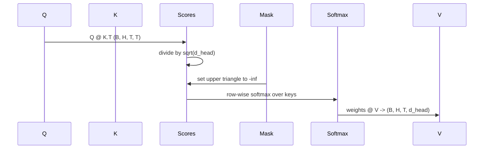

# 여러 머리 의 자기 관심

> 한 선형 투명, 3개의 시선, H 평행 머리, 한 마스크.

**Type:** Build
**Languages:** Python
**Prerequisites:** Phase 04 lessons, Phase 07 transformer lessons, Lessons 30 through 32 of this phase
**Time:** ~90 minutes

## 학습 목표
- H 헤드로 나뉘어 있는 단일 선형 계층으로 배팅된 쿼리/키/값 투영을 구현한다.
- 정규화와 d형 처리로 점 점 점 제품 주의를 계산한다.
- 미래의 위치에 대한 관점을 방지하는 인과적 마스크를 적용하십시오.
- 각 머리에 대한 고정된 입력과 각 머리가 보는 것에 대한 이유를 확인합니다.
- 장난감 작업에 작은 주의를 기울여서 헤드 전문화되면서 손실이 떨어지는 것을 지켜보세요.

```figure
cap-multihead-attention
```

## 프레임

주의는 토큰의 표현이 같은 순서에서 다른 토큰에서 정보를 끌어낼 수 있는 기능이다. 자기주의는 질의, 키, 값이 모두 같은 입력에서 유래된다는 것을 의미합니다. 멀티 헤드란 프로젝션은 H 평행주의 문제로 나뉘어 있고 그 출력이 연결되어 다시 프로젝션됩니다.

효율적인 구현 패턴은 1개의 선형 계층으로`D` `3 * D`그리고 3개의 시선으로 갈라지고, H 크기의 머리로 재구성됩니다.`D // H`매뮬, 소프트맥스, 그리고 중량 수치는 텐서 작업으로 이루어집니다. 그래서 머리는 가속기에 병렬로 실행됩니다.

이 수업은 블록을 구성합니다. 또한 인과적 마스크를 추가합니다. 그래서 동일한 코드는 디코더만 사용하는 언어 모델의 관심 계층과 작동합니다. 다음 수업은 블록을 완전한 트랜스포머로 쌓아두고 수업이 훈련합니다.

## 형태 계약

입력값은`(B, T, D)`출력량은`(B, T, D)`마스크는`(T, T)`블록 내부에서 중간 텐서들은 모양을 가지고 있습니다`(B, H, T, d_head)`어디`d_head = D // H`- 제약은`D % H == 0`- 그래

```mermaid
flowchart LR
    A["(B, T, D) input"] --> B[Linear D -> 3D]
    B --> C["split into Q, K, V"]
    C --> D["reshape to (B, H, T, d_head)"]
    D --> E["scores = Q @ K.T / sqrt(d_head)"]
    E --> F[apply causal mask]
    F --> G[softmax over keys]
    G --> H["context = weights @ V"]
    H --> I["reshape to (B, T, D)"]
    I --> J[output Linear D -> D]
    J --> K["(B, T, D) output"]
```



두 선형 층 (QKV 투명 및 출력 투명) 은 블록의 유일한 매개 변수입니다. 마스크, 소프트맥스, 매트무얼 및 리모플은 모두 매개 변수 없는 것입니다.

## QKV 분할

순진한 구현은 각각 Q, K, V에 대한 세 개의 분리된 선형 계층을 가지고 있습니다. 효율적인 것은 출력하는 단일 계층을 가지고 있습니다.`3 * D`이 두 가지는 수학적으로 동등합니다. 왜냐하면 3개의 별도의 매트릭스 곱셈이`(D, D)`무게는 정확히 1개의 매트릭스 곱셈을 a`(3D, D)`그 중에서도 무겁게 쌓여

효율적인 버전은 가속기가 3개 대신 1개의 매뮬을 시작하기 때문에 더 빨라집니다. 또한 세 개의 하위 매트릭스가 동일한 매개 변수 텐서에서 살고 있기 때문에 함께 초기화 할 수 있기 때문에 초기화하기가 더 쉽습니다.

## 머리는 다시 형성됩니다

분할 후, Q, K, V의 각은`(B, T, D)`H 평행 주의력 문제를 만들려면`(B, T, H, d_head)`그리고 `(B, H, T, d_head)`. 머리의 차원은 이제 대량 차원과 함께 위치해 있어 PyTorch는 각 머리의 관심을 대량으로 처리합니다`B * H`독립적인 사례

d_head 차원은 마지막에 남아있어 점수가 일치합니다`Q @ K.transpose(-2, -1)`이 모든 것은`(B, H, T, T)`1인당 주의율

## 규모가

점수는 `sqrt(d_head)`이 확장 없이 점점 제품들은`d_head`이 기하급수적 기하급수적 기하급수적 기하급수적 기하급수적 기하급수적 기하급수적 기하급수적 기하급수적 기하급수적 기하급수적 기하급수적 기하급수적 기하급수적 기하급수적 기하급수적 기하급수적 기하급수적 기하급수적 기하급수적 기하급수적 기하급수적 기하급수적 기하급수적 기하급수적 기하급수적 기하급수적 기하급수적 기하급수적 기하급수적 기하급수적 기하급수적 기하급수적 기하급수적 기하급수적 기하급수적 기하급수적 기하급수적 기하급수적 기하급수적 기하급수적 기하급수적 기하급수적 기하급수적 기하급수적 기하급수적 기하급수적 기하급수적 기하급수적 기하급수적 기하급수적 기하급수적 기하급수적 기하급수적 기하급수적 기하급수적 기하급수적 기하급수적 기하급수적`sqrt(d_head)`머리 크기에 따라 점수의 변수가 거의 일정합니다.

## 인과적 마스크

디코더만 사용하는 언어 모델은 다음 토큰을 예측할 때만 과거를 조건으로 할 수 있습니다. 마스크는 그것을 강요합니다. 구체적으로, 소프트맥스 이전에,`(T, T)`점수 행렬은 음수 무한으로 대체됩니다. softmax 이후 그 위치들은 무게가 0이 됩니다.



마스크는 건설 중에 버퍼로 등록되어 모델과 동일한 장치에 살고 gradient 그래프의 일부가 되지 않습니다. 마스크는 블록이 볼 수있는 최대 컨텍스트 길이를 커버합니다. 앞으로는 왼쪽 위쪽을 잘라냅니다.`(T, T)`코너

## 출력 투명

각 헤드 컨텍스트 벡터 이후`(B, H, T, d_head)`, 우리는 다시 `(B, T, H, d_head)`, `(B, T, D)`, 그리고 최종 `(D, D)`선형 투명: 출력 투명으로 모델이 헤드를 섞게 됩니다. 그것 없이는 H 헤드는 나중에 레이어를 통해 다시 결합될 것이고 블록은 인위적으로 제한될 것입니다.

## 주의력중량 검사

이 교훈은`return_weights=True`앞 패스 위에 있는 플래그. 설정되면 블록은 각 머리별 주의력 무게를 반환합니다.`(B, H, T, T)`이 디모는 짧은 입력으로 한 머리의 무게의 열지도를 인쇄하여 원시 삼각형 구조와 각 위치 중점을 볼 수 있습니다.

훈련된 모델에서는 각 머리마다 다른 패턴을 학습한다. 어떤 머리들은 직전에 있는 기호에 관심을 기울이고 있다. 어떤 머리들은 순서 시작에 관심을 기울이고 있다. 어떤 머리들은 거의 균일하게 관심을 퍼뜨린다. 검사 할ックは 그 해석성 작업의 입점이다.

## 훈련 시범

아래쪽에 있는 데모`main.py`주의 블록을 작은 LM 헤드로 연결하고 전체 작업을 반복 작업에 훈련시킵니다. 입력의 각 줄은 컨텍스트 전체에 복제되는 단일 무작위 ID입니다. 목표가 하나로 이동된 입력입니다. 따라서 모델은 다음 토큰이 이전 토큰과 동일하다는 것을 배워야합니다. 손실은 크로스 엔트로피입니다. H = 4, D = 32, T = 12, 그리고 64의 어휘와 함께, 손실은 무작위 (~`log(64) ~ 4.16`) 아래로 내려가서 `1.0`CPU에서 3년 넘게 사용되었습니다.

데모의 목적은 유용한 모델을 훈련시키는 것이 아니라, 블록의 모든 조각을 통해 gradients의 흐름을 확인하는 것입니다. 그리고 그 해답이 명백한 문제에 대해 머리가 무언가를 배울 것입니다.

## 이 교훈이 하지 않는 것

이 모델은 리얼 모델의 트랜스포머 레이어 (transformer layer) 는 2층 MLP가 이어져 있고, 둘 다에 잔여 연결과 레이어 규범이 있습니다. 다음 수업은 그 내용을 추가합니다.

이 블록은 회전 또는 AliBi 위치 코딩을 구현하지 않습니다. 두 가지 모두 같은 블록에서 QKV 투사 단계에 적용되지만 별도의 교육 단위입니다. 여기에 구축 된 블록은 매트무일 이전에 Q와 K를 변환함으로써 어느 하나와 호환됩니다.

KV 캐시를 실시하지 않습니다. 앞 패스에서 키와 값을 캐싱하는 것은 자동 퇴행 디코딩을 빠르게 만드는 최적화입니다. K 및 V 텐서에서 모양 계약을 변경하지만 Q에 속하지 않습니다. 그것은 추론 수업에 속합니다.

## 코드를 읽는 방법

`main.py`정의합니다`MultiHeadSelfAttention`- 그래 이 클래스는 2개의 선형 층과 등록된 마스크 버퍼를 가지고 있습니다. 앞으로의 패스 프로젝트, 리모델링, 점수, 마스크, 소프트맥스, 웨이트, 리모델링, 그리고 다시 프로젝트. 아래의 데모는 토큰 및 위치 임베디션과 LM 헤드로 관심을 끌고 세 시대 동안 복사 작업을 훈련시키고 손실 곡선과 헤드 당 주의 온도 지도를 인쇄하는 작은 모델을 만듭니다. `code/tests/test_attention.py`모양 계약, 인과관계 속성, 소프트맥스 속성, 헤드-스플릿 속성, 그리고 기하류 흐름

디모를 실행하고, 더 높여`n_heads`4~8 (관리)`d_model=32`그래서`d_head=4`) 그리고 열지도가 바뀌는 것을 관찰하십시오.
