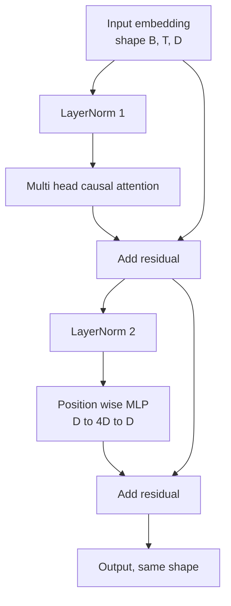
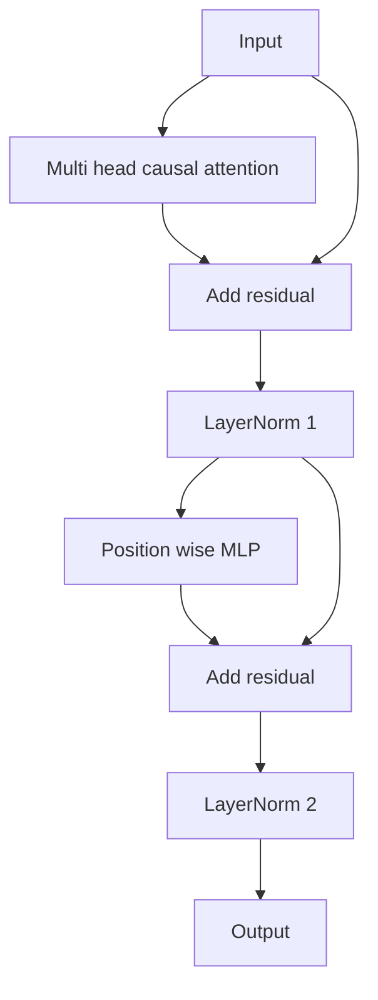

# 트랜스포머 블록은 처음부터

> 한 블록은 모든 현대 디코더 LLM의 단위입니다. 계층 규범, 다층 주의, 잔류, MLP, 잔류. LN 전 변종은 온화 없이 안정적으로 훈련합니다. LN 후 변종은 원래 종이 배송한 것입니다. 이 수업은 양쪽을 함께 구축하고, 일반적인 학습 속도에서 12 층 스택에서 어느 것이 살아남는지를 보여줍니다.

**Type:** Build
**Languages:** Python
**Prerequisites:** Phase 19 lessons 30 to 33 (tokenizer, embeddings, attention math, batched data loader)
**Time:** ~90 minutes

## 학습 목표

- PyTorch에서 4개의 움직이는 조각에서 트랜스포머 블록을 만들 수 있습니다. 레이어노름, 멀티 헤드 인과적 관심, 잔여 연결, 위치 현명한 MLP.
- 레이어노르스를 두 가지 구성 (LN 전과 LN 후) 에 배치하고 왜 온화 없이 안정적으로 열차하는지 설명하십시오.
- 여러 머리 주의를 통해 인과적 마스크를 구현하여`i`토큰을 볼 수 없습니다`j > i`- 그래
- 12층 스택에 있는 양 변수를 통해 기하급수 흐름을 추적하고 손 흔들지 않고 결과를 읽어보십시오.
- 다음 수업에서 124백만 개의 매개 변수를 GPT로 집어넣을 때 블록을 다시 드롭-인 단위로 사용하십시오.

## 문제

트랜스포머는 한 블록 반복입니다. 블록을 한 번 잘못하면 12번 반복하면 첫 번째 시대에서 분할된 모델을 배포하거나 나머지 시간 동안 더워닝 해킹이 필요합니다. 이 수업에서 볼 수 있는 두 가지 실패 방식은 이국적이지 않습니다. 학습자가 처음으로 블록을 순진하게 쌓는 순간 나타납니다. 하나는 미래에 대한 관심층입니다. 다른 하나는 레이어노르름이 심도에서 잔류 신호를 소화할 수 없는 곳에 배치되어 있습니다.

이 블록은 두 개의 잔여 경로와 두 개의 정상화 위치가 있습니다. 올바른 위치를 선택하면 나머지 스택은 단지 회계입니다.

## 개념

모든 디코더만 변환기 블록은 형태의 텐서를 갖는 함수입니다`(batch, sequence, embedding)`그리고 같은 모양의 텐서를 반환합니다. 내부에는 두 개의 하층이 작업을 수행합니다.



이것은 전 LN 변종입니다. 레이어노름은 하위 계층보다 먼저 잔류 지부 안에 위치하고 있습니다. 잔류 연결은 비정상화된 신호를 전으로 이동합니다.

LN 이후의 변종은 잔류 추가 후 LayerNorm로 이동합니다.



형태는 동일합니다. 훈련 행동은 그렇지 않습니다. LN 후, 잔여 경로를 통해 다시 흐르는 경각지대가 LayerNorm를 통과해야합니다. 깊이 12에서 학습 속도`3e-4`이 기하급수적 기하급수적 인 기하급수적 인 기하급수적 인 기하급수적 인 기하급수적 인 기하급수적 인 기하급수적 인 기하급수적 인 기하급수적 인 기하급수적 인 기하급수적 인 기하급수적 인 기하급수적 인 기하급수적 인 기하급수적 인 기하급수적 인 기하급수적 인 기하급수적 인 기하급수적 인 기하급수적 인 기하급수적 인 기하급수적 인 기하급수적 인 기하급수적 인 기하급수적 인 기하급수적 인 기하급수적 인 기하급수적 인 기하급수적 인 기하급수적 인 기하급수적 인 기하급수적 인 기하급수적 인 기하급수적 인 기하급수적 인 기하급수적 인 기하급수적 인 기하급수적 인 기하급수적 인 기하급수적 인 기하급수적 인 기하급수적 인 기하급수적 인 기하급수적 인 기하급수적 기하급수적 기하급수적 기하급수인 기하급수인 기하급수적 기하급수적 기하급수인 기하급수인 기하급수인 기하급수적 기하급수인 기하급수적 기하급수적 기하급수적 기하급수적 기하급수적 기하급수적 기하급수적 기하급수적 기하급수적 기하급수적 기하급수적 기하급수적 기하급수적 기하급수적 기하급수적 기하급수적 기하급수적 기상상상상상상상상상상상상상상상상상상상상상상상상상상상상상상상상상상상상상상상상상상상상상상상상상상상상상상상상상상상상상상상상상상상상상상상상상상상상상상상상상상상상상상상상상상상상상상

### 여러 머리 주의가 원인

주의 하위층은 입력값을 쿼리, 키, 값 텐서로 세 가지 방식으로 투입합니다. 각 텐서들은`(B, T, D)` `(B, H, T, D/H)`어디`H`점점점점점점점점점점점점점점점점점점점점점점점점점점점점점점점점점점점점점점점점점점점점점점점점점점점점점점점점점점점점점점점점점점점점점점점점점점점점점점점점점점점점점점점점점점점점점점점점점점점점점점점점점점점점점점점점점점점점점점점점점점점점점점점점점점점점점점점점점점점점점점점점점점점점점점점점점점점점점점점점점점점점점점점점점점점점점점점점점점점점점점점점점점점점점점점점점점점점점점점점점점점점점점점점점점점점점점점점점점점점점점점점점점점점점점점점점점점점점점점점점점점점점점점점점점점점점점점점점점점점점점점점점점점점점점점점점점점점점점점점점점점점점점점점점점점점점점점점점점점점점점점점점점점점점점점점점점점점점점점점점점점점점점점점점점점점점점점점점점점점점점점점점점점점점점점점점점점점점점점점점점점점점점점점점점점점점점점점점점점점점점점점점점점점점점점점점점점점점점점점점점점점점점점점점점점점점점점점점점점점점점점점점점점점점점점점점점점점점점점점점점점점점점점점점점점점점점점점점점점점점점점점점점점점점점점점점점점점점점점점점점점점점점점점점점점점점점점점점점점점점점점점점점점점`softmax(Q K^T / sqrt(d_k))`1개 머리, 상부 삼각형을 음수 무한으로 마스크하고, 마스크를 softmax로 적용하고,`V`머리들은 다시 하나의 묶음으로 묶여 있습니다`(B, T, D)`마스크는 모델의 원인으로 만드는 유일한 조각입니다. 마스크를 잊어버리고,

### MLP

위치 현명한 MLP는 각각의 토큰에 동일한 두층 네트워크를 독립적으로 적용합니다. 숨겨진 너비는 임베딩 너비의 4배이며, 활성화는 GELU이며, 두 번째 선형에 따라 드롭업이 발생합니다. MLP 내부에서 토큰이 서로 대화하지 않습니다. 모든 토큰 혼합은 주의를 기울입니다.

### 잔여 연결은 두 가지 일을 합니다.

이 블록은 12 층을 통해 gradient path를 확장시켜서 gradient path를 깊이로 추가로 만들며, gradient norm을 스칼라에 유지한다. 또한 각각의 블록은 전체적인 교체보다는 실행되는 표현에 대한 추가 업데이트를 배울 수 있게 한다. 두 효과 모두 블록 스칼라가 발생하는 이유이다.

```figure
cc-transformer-block
```

## 건설 해

`code/main.py`이 도구는

- `class LayerNorm`학습 가능한 규모와 전환, 편향된 eps, 토큰 벡터에 적용됩니다.
- `class MultiHeadAttention``num_heads``head_dim = d_model // num_heads`, 용해된 QKV 투명, 등록된 인과성 마스크, 주의 및 잔류 중퇴.
- `class FeedForward`2개의 선형 층으로 GELU 활성화,
- `class TransformerBlock``pre_ln`두 변종 사이에 전환되는 플래그
- 6층 전-LN 스택과 6층 후-LN 스택을 동일한 입력과 인쇄로 구축하는 데모 (a) 출력 모양, (b) 한 번의 후퇴 통과 후 임베딩에서 기하급수 규범.

실행하세요:

```bash
python3 code/main.py
```

출력: 양 스택의 모양 검증, gradient 규범이 옆으로. pre-LN 스택의 임베디션 gradient은 같은 학습 속도에 post-LN 스택보다 큰 규모의 순서입니다. 이는 온화 없이 pre-LN 열차의 경험적 신호입니다.

## 

- `torch`소리 수학, 오토그라드, 그리고`nn.Module`- 수강
- 아니`transformers`- 전무가 없는데, 원시적인 것에서 구현된 블록입니다.

## 야생에서의 생산 패턴

세 가지 패턴은 교과서 블록을 배포할 수 있는 것으로 만듭니다.

**Fused QKV projection.**3개의 라인하이 레이어마다 3개의 커널 런칭과 3개의 매머스가 소요됩니다.`3 * d_model`한 발사에서 동일한 작업을 수행하고, 마지막 축을 따라 출력을 나눕니다. 융합 경로는 모든 가속기에 더 빨라지고 GPT-2, LLaMA, 그리고 Mistral의 참조 구현과 일치합니다.

**Registered causal mask buffer.**마스크는 최대 컨텍스트 길이에만 달려 있습니다.`register_buffer`, 앞을 통과하는 각각의 활성 창을 잘라내고, 호출에 대한 할당을 건너뛰기. 이것을 잊으면 마스크가 긴 맥락에서 할당하는 온점으로 변합니다.

**Dropout in two places, not three.**드롭우트는 주의 softmax (주의 드롭우트) 과 MLP (저립 드롭우트) 의 두 번째 선형에 속한다. 잔액에 대한 드롭우트는 그 깊이에서 기하급수 흐름을 허용하는 첨가 정체성을 깨고 있다. 일부 초기 구현은 이것을 잘못 알고 있으며 부서지기 쉬운 훈련으로 지불했습니다.

## 사용 하 고

- 이 수업의 블록은 수정 없이 수업 35의 GPT 집합에 바로 연결됩니다.
- LN 전 변종은 모든 현대 오픈 웨이트 LLM가 사용하는 것입니다. LN 후 변종은 원래 2017 주의 종이 사용했습니다. 두 가지를 아는 것은 당신이 만날 수 있는 모든 디코더 아키텍처를 읽을 수 있습니다.
- GELU를 SiLU로 바꾸면 LLaMA 가족 활성화가 됩니다. LayerNorm을 RMSNorm로 바꾸면 LLaMA 가족 정상화가 됩니다. 같은 골격입니다.

## 운동

1. `bias=False`블록의 모든 선형에 표시합니다. 현대 오픈 웨이트 LLMs는 선형 층에 편향없이 배포됩니다. 12 층 768 덤프 모델에서 얼마나 많은 매개 변수를 저장하는지 측정합니다.
2. 대체`nn.LayerNorm`손으로 롤된 RMSNorm과 출력 모양이 변하지 않았는지 확인합니다.
3. 첫 번째 머리 중 주의 무게를 반환하는 깃발을 추가합니다`(B, T, T)`수. 수자 (softmax) 이후 상위 삼각형의 0을 확인하기 위해
4. 정신 건강 검사를 만들어서`(2, 16, 384)``H=6`양 변수와 주장을 통해 미래 출력들이 다르다는 것을 주장합니다 (예를 들어,`not torch.allclose`) 무게가 동일하게 초기화되어 있고, dropout는 0으로 설정되어 있을 때

## 주요 용어

| Term | What people say | What it actually means |
|------|-----------------|------------------------|
| Pre-LN | "Pre norm" | LayerNorm inside the residual branch, before each sublayer; the residual carries the unnormalized signal |
| Post-LN | "Post norm" | LayerNorm after the residual add; what the 2017 paper shipped and what needs warmup |
| Causal mask | "Triangle mask" | The upper triangle of the attention logits set to negative infinity so token i cannot read token j when j is greater than i |
| Fused QKV | "Combined projection" | One linear of width 3D instead of three linears of width D; one kernel, one matmul |
| Residual stream | "Skip connection" | The unnormalized tensor that flows top to bottom through every block; what each block adds to |

## 더 많은 읽기

- 이 블록 아래의 주의 수학에 대한 7단계 수업 02 (신주의 초점부터)
- 단계 7 수업 05 (완전 트랜스포머) 같은 골격의 코더 디코더 버전에 대한
- 이 블록이 연결하는 훈련 절차에 대한 10 단계 수업 04 (프레임 미니 GPT)
- 19단계 수업 35 (이 트랙) 이 이 블록 중 12개를 GPT 모델로 쌓아 놓습니다.
