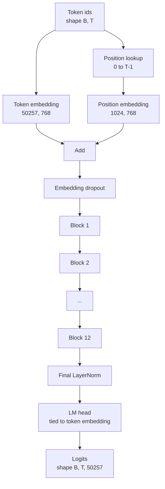
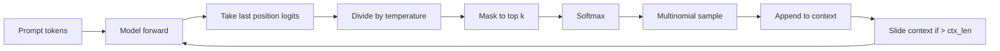

# GPT 모델 집합

> 12개의 블록이 쌓여 있고, 토큰 임베디션, 학습된 위치 임베디션, 최종 레이어노름, 그리고 묶인 언어 모델 헤드. 즉 전체 124 백만 매개 변수 GPT 모델입니다. 이 수업은 그 조각들을 노동자 계급으로 집합하고, 모델이 참조 124M 모양과 일치하는지 확인하기 위해 매개 변수를 계산하고, 다중량 샘플링, 온도 및 톱-k와 텍스트를 생성합니다.

**Type:** Build
**Languages:** Python
**Prerequisites:** Phase 19 lessons 30 to 34
**Time:** ~90 minutes

## 학습 목표

- 34 수업에서 트랜스포머 블록을 전체 GPT 모델로 구성합니다. 토큰 임베디션, 위치 임베디션, N 블록, 최종 레이어노름, 언어 모델 헤드.
- 124백만 개의 매개 변수 구성을 재현: 어휘 50257, 컨텍스트 1024, 768, 12 개의 머리, 12 개의 층을 삽입합니다.
- 언어 모델 헤드 웨이트를 토큰 임베디션에 연결하고 왜 이 규모에서 약 3천8백만 개의 매개 변수를 저장하는지 설명합니다.
- 멀티모니얼 샘플링, 온도 확장 및 톱-k 단축으로 문서를 입력하여 스크라이딩 창으로 컨텍스트 길이를 유지합니다.
- 매개 변수 수와 12 4M 목표에 대한 전진 통과 비용을 측정합니다.

## 문제

트랜스포머 블록은 자체적으로 아무것도 하지 않습니다. 당신은 벡터로 토큰 ID를 변환하고 위치 정보를 혼합하고, 스택을 통해 실행하고, 어휘 로그티로 다시 프로젝을 해야 합니다. 이 네 가지 단계 중 하나를 잊고 모델은 앞뒤로 이동하지 못하거나 위치 정보를 이동하거나 말할 수 없습니다.

모델의 형태도 중요합니다. 참고 GPT-2 작은 것은 124 백만 매개 변수 정확히 위 구성. 숫자는 마법이 아닙니다. 50257 곱하기 768을 함축하는 단어표는 표입니다. 위치 1024 × 768는 위치 테이블입니다. 약 7백만개의 매개 변수에서 12개의 블록은 각각 84백만개입니다. 마지막 머리는 무게를 묶음으로써 표본 테이블을 재사용한다. 조각들을 합하면 124백만 달러가 됩니다. 매개 변수 수치가 참조와 일치하지 않는 모델을 만드는 것은 당신이 뭔가 잘못 연결했다는 신호입니다.

## 개념



토큰 아이디는 토큰 벡터로 변한다. 위치 아이디는 위치 벡터로 변한다. 두 개의 요소는 스택을 통해 추가되고 전송된다. 최종 레이어노름은 모든 현대 변종에서 살아남은 블록 밖에 있는 하나의 조각이다. LM 헤드는 토큰 임베딩 매트릭스를 재사용한다. 이것이 중량 결합이라는 의미입니다.

### 무게 묶음

토큰 임베디션은 모양이 있습니다`(vocab, d_model)`. 언어 모델 헤드는 `d_model`다시 `vocab`.이 둘은 서로 다른 변수입니다. 두 개의 변수를 묶는 것은 말 그대로 같은 매개 변수 텐서입니다. 두 번 사용됩니다. 50257 및 d_model 768에서 매트릭스는 3800만 매개 변수입니다. 묶이지 않고 두 번 지불합니다. 묶은 것은 한 번 지불합니다. 그리고 당신은 또한 약간 더 깨끗한 기하 신호를 얻습니다. 임베디션과 헤드 업데이트가 함께 있기 때문에.

### 위치 임베디션은 학습되며, 시누스형이 아닙니다

GPT-2는 학습된 위치 임베디션을 배포합니다. 위치 테이블은 한 매개 변수 모양 `(1024, 768)`. 모델은 모든 포워드에서 0에서 T-1까지의 위치를 찾아보고 토큰 임베디션에 검색을 추가합니다. 이것은 위치 계획 중 가장 간단합니다 (RoPE, ALiBi, T5 상대적 편향은 대안입니다) 그리고 124M 참조에서 사용하는 것입니다.

### 생성: 온도, 상위 k, 다중

생성은 자동 퇴행성입니다. 모든 단계에 모델은 모든 위치에서 전체 어휘에 대한 로그티를 반환합니다. 마지막 위치를만 취하고 온도에 따라 나눕니다. 선택적으로 상위 k 로그티를 제외한 모든 것을 마스크하여 음부 무한, 확률을 얻기 위해 소프트맥스를 얻으며, 결과 분포에서 하나의 토큰을 샘플링합니다.



3개의 버튼, 3개의 다른 행동. 0에 가까운 온도는 탐욕으로 붕괴됩니다. 1개의 온도는 모델의 자연 분포와 일치합니다. 1개의 온도는 탐욕입니다. 1개의 온도는 긴 꼬리를 필터링합니다.

```figure
cc-gpt-assembly
```

## 건설 해

`code/main.py`이 도구는

- `class GPTConfig`124M 기본값을 가진 데이터 클래스: `vocab_size=50257``context_length=1024``d_model=768``num_heads=12``num_layers=12``mlp_expansion=4``dropout=0.1``use_bias=True``weight_tying=True`- 그래
- `class GPTModel`토큰 임베디션, 포지션 임베디션, 임베디션 드롭아웃, 12 `TransformerBlock`s, 최종 LayerNorm, 그리고 `lm_head`깃발이 설정될 때 기호에 삽입되는 것과 연결되는
- A`count_parameters`고유 매개 변수 수를 반환하는 보조자 (그러므로 무게 결합은 수에서 존중됩니다).
- A`generate`온도, 상위 k, 다중함수, 그리고 슬라이딩 창 맥락을 하는 함수
- 모델을 구축하고, 참조 124M 옆에 매개 변수 수를 인쇄하고, 파이프라인의 끝을 끝으로 표시하기 위해 고정된 명령에서 짧은 순서를 생성합니다.

실행하세요:

```bash
python3 code/main.py
```

출력: 124M 참조와 함께 매개 변수 수, 무작위 명령어에서 생성된 토큰 ID, 그리고 LM 헤드 및 토큰 임베디딩이 결합이 시작될 때 저장소를 공유한다는 확인.

데모를 빠르게 유지하기 위해 스크립트는 또한 작은 구성 (`d_model=64``num_layers=2`) 끝에서 끝으로 생성된 토큰 순서열을 인라인으로 인쇄합니다. 124M 구성은 구축되지만 매개 변수 수와 한 번 앞으로 통과만 수행됩니다.

## 

- `torch`텐서 수학, 오토그라드, 모듈 파이프링
- `code/main.py`지역적으로 수업 34에서 같은 블록 패턴을 재시행합니다.

## 야생에서의 생산 패턴

3가지 패턴은 실행하는 모델과 배가 되는 모델의 차이를 만듭니다.

**Initialize the residual projections small.**주의의 출력 투과와 MLP의 두 번째 선형은 모두 잔류 덧셈에 직접 공급된다. 다른 선형과 같은 표준 경각심을 가진 것을 초기화하면 깊이와 함께 성장하는 잔류 흐름이 발생하고 최종 레이어노르мыг 뜨거운 정권으로 밀어냅니다.`1 / sqrt(2 * num_layers)`이 두 개의 투명에서 잔류 흐름은 12개의 층을 통해 상식 범위에서 유지됩니다.

**Cache the position id tensor, do not recompute.** `torch.arange(T)`모든 전향에 새로운 메모리를 할당합니다.`__init__`최대 맥락에서, 초청당 첫 T 항목을 슬라이드하고, 할당자 회로 여행을 건너뛰십시오.

**Tie weights at parameter level, not just by copying.**설정`lm_head.weight = token_embedding.weight`텐서와 공유하는 경우 복사하는 경우 그렇지 않습니다. 최적화자는 한 매개 변수를 업데이트하고 오토그라드 그래프는 한 축적이 필요합니다. 복사하면 머리가 임베디션에서 멀어지고 무게 결합은 당신에게 아무것도 구입하지 않습니다.

## 사용 하 고

- 이 수업의 모델 클래스는 다음 수업의 모델 클래스와 같은 모양입니다.
- 학습된 위치를 RoPE로 배열하면 블록이나 머리를 만지지 않고 LLaMA 가족으로 만들어집니다.
- GELU를 SiLU와 LayerNorm을 RMSNorm로 교체하면 LLaMA 가족의 나머지 변경 사항이 있습니다.
- 생성 기능은 이 모델뿐만 아니라 모든 로그티스 소스와 작동합니다. 37 수업에서 미리 훈련된 GPT-2 파일에서 로그티스를 끌어내고 동일한 생성 루프를 재사용할 수 있습니다.

## 운동

1. LM 헤드를 토큰 임베디션에서 해제하고 매개 변수를 다시 계산해 델타가 50257 곱하기 768 = 3800만
2. 학습된 위치 임베디션을 공사 당시 계산된 시노수이드 테이블로 교체하십시오. 모델이 여전히 앞으로 나아가고 있는 것을 확인하고 매개 변수 수치가 786,432으로 떨어집니다.
3. `greedy=True`샘플링을 건너뛰고 argmax를 선택하는 세대에게 플래그.
4. `repetition_penalty`prompt 또는 생성된 역사의 모든 토큰의 로그티를 softmax 이전 일정으로 나눈 버튼. 고정된 prompt에서 1 이상의 값이 출력에서 반복 수를 줄이는 것을 표시합니다.
5. 추가`top_p`(핵) 샘플링 `top_k`. 두 줄의 확인 , 보관된 토큰의 확률의 합이`top_p`- 그래

## 주요 용어

| Term | What people say | What it actually means |
|------|-----------------|------------------------|
| Weight tying | "Tied embeddings" | The LM head and the token embedding share the same parameter tensor; saves vocab times d_model parameters and matches the GPT-2 reference |
| Position embedding | "Learned positions" | A separate table of shape (context length, d_model) added to token vectors; learned end to end |
| Sliding window context | "Context cap" | When the prompt plus generated tokens exceed the context length, drop the oldest tokens so the active window fits |
| Top-k sampling | "K truncation" | Keep the K logits with the highest values, mask the rest to negative infinity, softmax over the remainder |
| Temperature | "Sampling temperature" | Divide logits by T before softmax; T less than 1 sharpens, T equal to 1 keeps the natural distribution, T greater than 1 flattens |

## 더 많은 읽기

- 이 모델이 쌓은 블록에 대한 19단계 수업 34
- 19단계 레슨 36이 트레이닝 루프로 이 모델을 크로스 엔트로피 손실로 운반합니다.
- 19단계 37강습이 바로 이 구조에 미리 훈련된 GPT-2 무게를 로딩하는 데
- 다음 토큰 예측의 수학을 위한 7단계 수업 07 (GPT 인과적 언어 모델링)
- 같은 건축에 대한 원래 교육 절차에 대한 10단계 수업 04 (프레임 미니 GPT)
