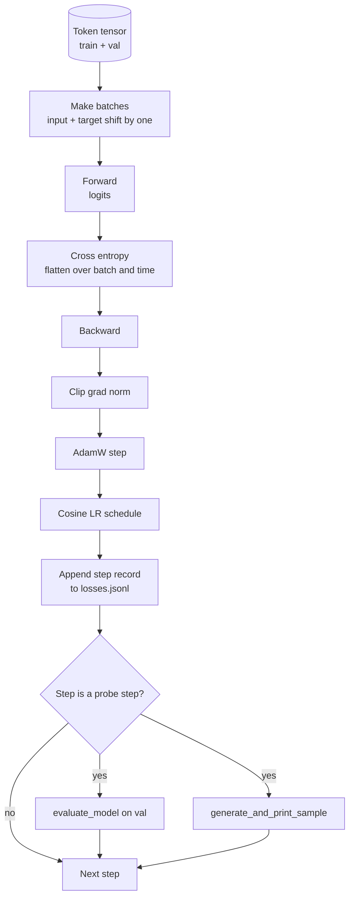

# 훈련 순환 및 평가

> 측정하지 않는 루프는 거짓말하는 루프입니다. 이 수업은 GPT 모델을 움직이는 훈련 루프를 구축합니다.`calc_loss_batch`보조자,`evaluate_model`  `generate_and_print_sample`K 단계마다 질적 탐사를 하고, 그 후에도 손실을 적어낼 수 있는 JSONL 로그를 만들 수 있습니다. 같은 골격은 여러분이 만들 수 있는 모든 디코더 LLM를 훈련시킵니다.

**Type:** Build
**Languages:** Python
**Prerequisites:** Phase 19 lessons 30 to 35
**Time:** ~90 minutes

## 학습 목표

- 다음 토큰 예측을 위해 올바른 입력과 목표 조화를 통해 크로스 엔트로피 손실을 계산하는 훈련 루프를 구축하십시오.
- LayerNorm 또는 bias tensors에 적용되지 않고 무게 텐서에 적용된 무게 해소를 통해 AdamW를 구성합니다.
- 선형 온화와 코시네 붕괴를 가진 학습 속도 일정을 구현하고, 시간이 지남에 따라 결과 LR를 읽으십시오.
-                                `evaluate_model`따라서 평가 손실은 실행 중 비교할 수 있습니다.
- K 단계마다 양성 샘플을 생성합니다`generate_and_print_sample`손실 곡선보다 먼저 분리를 파악하기 위해서
- 단계 손실에 따라 JSONL에 계속하여 훈련 로그를 재충전, 플래트 및 배달할 수 있습니다.

## 문제

손실을 인쇄하고 다른 것을 하지 않는 훈련 스크립트는 세 가지 방법으로 실패합니다. 그것은 적절한 이유로 손실이 감소하는지 말할 수 없습니다 (모델은 훈련 세트를 과장할 수 있고 결코 배우지 않을 수 있습니다). 이 시스템은 경각심을 시작하는지 알 수 없습니다 (손실은 한 단계 증가하고 회복하거나 한 단계 추락할 수 있습니다). 모델이 무엇을 배웠는지 알 수 없습니다 (손실은 스케라어, 생성된 샘플은 기항입니다). 세 가지 실패는 모두 루프 측정이 되지 않는 한 숨겨져 있습니다.

이 수업의 루프는 3가지 방법으로 측정됩니다. 훈련 배치를 매 단계로 잃습니다. K 단계마다 걸린 배치를 매 단계로 잃습니다. K 단계마다 고정된 프롬프트에서 생성된 연속입니다. 훈련 로그는 JSONL에 착륙합니다. 그래서 유물은 루프의 증언입니다.

## 개념



두 개의 명백하지 않은 조각은 손실 조율과 AdamW 붕괴 분화입니다.

### 손실 조율

모델은 모든 위치에서 다음 토큰을 예측합니다. 입력 배치가 토큰이라면`[t0, t1, t2, t3]`, 목표 배트는`[t1, t2, t3, t4]`. 크로스 엔트로피는 평면 모양으로 계산됩니다`(batch * seq, vocab)`평평한 목표에 대항하여`(batch * seq,)`시기를 잊어버리고 모델을 훈련시켜서 스스로 예측할 수 있게 합니다.

### 아담W 붕괴 분화

무게 붕괴는 무게 텐서들을 정규화하지만 정상화 스케일이나 편향을 하지 않는다. 레이어노름 스케일에 붕괴를 넣으면 스케일이 천천히 0으로 떨어지고 정상화를 깨뜨린다. 편향에 붕괴를 넣는 것은 수학적으로 무해하지만 주기의 낭비이다. 표준 분단은: 매트릭스 모양의 텐서 (선형 무게, 임베딩 테이블) 는 붕괴를 받게 된다. 스케일이나 전환처럼 보이는 모든 것은 그렇지 않다.

### 온화+코시네스 스케줄

온화화 시점은 학습 속도를 0에서 목표까지 몇 백 단계로 높이고 최적화 상태가 채집할 시간이 있습니다. 코시네 붕괴는 나머지 단계에 대한 학습 속도를 0으로 떨어뜨립니다. 그래서 마지막 단계는 작은 단계 크기의 무게를 정밀하게 조정합니다. 이 조합은 오픈 웨이트 LLM 훈련에서 가장 흔한 일정은 첫 번째 수천 단계와 마지막 수천 단계의 대부분의 깨지기 쉬운 순간을 제거하기 때문입니다.

### 실시된 평가

`evaluate_model`검증 분할에서 일정한 수의 패치를 실행하고 손실을 축적하고, 패치 수를 나누고 반환합니다. 기하급수 없습니다. 이 없습니다. 같은 씨앗과 같은 분할을 주어 한 번 동안 복제 할 수 있습니다. 훈련 손실 옆에 유지된 손실을 보고하는 것은 과잉 부착을 감지하는 방법입니다.

### 초기 신호로서 질적 샘플링

훈련 손실이 잘 떨어지는 하지만 생성된 샘플이 모두 같은 표본이 깨지는 모델. 손실 곡선이 평평해 보이지만 생성된 샘플이 일관된 단어로 날카롭게 만들어지는 모델은 학습입니다. 질 탐사선은 전체 곡선을 읽는 것보다 더 빨리 실행되며 스칼라가 놓친 모드를 잡습니다.

```figure
cap-training-loop
```

## 건설 해

`code/main.py`이 도구는

- `make_batches(token_ids, batch_size, context_length)`긴 텐서를 입력과 목표쌍으로 나누는
- `calc_loss_batch(model, inputs, targets)`이 부분은 앞뒤로, 평평하게, 그리고 다시 스칼라 크로스 엔트로피를 돌려줍니다.
- `evaluate_model(model, val_loader, max_batches)`그 결과, 그 결과, 그 결과, 그 결과, 그 결과, 그 결과, 그 결과, 그 결과, 그 결과, 그 결과로, 그 결과로, 그 결과로, 그 결과로, 그 결과로, 그 결과로, 그 결과로, 그 결과로, 그 결과로, 그 결과로 인한 손실이 다시 발생하게 됩니다.
- `generate_and_print_sample(model, prompt, max_new_tokens)`이 함수는 고정된 프롬프트에 수업 35 세대의 함수를 실행하고 결과를 인쇄합니다.
- `build_param_groups(model, weight_decay)`이 두 그룹의 AdamW 매개 변수 목록을 생성합니다.
- `cosine_with_warmup(step, warmup_steps, total_steps, max_lr, min_lr)`주어진 단계에 LR를 반환하는
- `train(...)`이 순환을 계속하고, 계속 유지합니다`outputs/losses.jsonl`, 그리고 평가 손실과 샘플을 각 `eval_every`단계
- 작은 단계에 걸쳐 합성 데이터를 기반으로 작은 모델을 훈련시키는 데모, JSONL 로그를 작성하고, 검증 포인트에서 평가 손실과 샘플을 인쇄합니다.

실행하세요:

```bash
python3 code/main.py
```

출력: 각 단계 손실 라인, 평가 손실 각 탐사 단계, 생성된 샘플 각 탐사 단계, 그리고 최종 `outputs/losses.jsonl``json.loads`줄당

## 

- `torch`오토그라드, 최적화 및 모듈
- `main.py`35  교훈 을 다시 적용 합니다`GPTModel`그리고 지역적으로 지원 모듈.

## 야생에서의 생산 패턴

세 가지 패턴은 교과서 ループ을 하루아침에 실행할 수 있는 것으로 만듭니다.

**Gradient norm clipping is non negotiable.**나쁜 배트 (비정상적 데이터, LR 스피크, 숫자 가장자리 케이스) 는 훈련 시간을 지워버리는 거대한 기하급수성을 생성합니다. `torch.nn.utils.clip_grad_norm_(params, max_norm=1.0)`그 후`backward`그리고 이전`step`최적화 기능을 안전한 범위에서 유지합니다. 절단 값은 자유 매개 변수입니다. 대부분의 설정에서 살아남는 기본 매개 변수입니다.

**Resumable JSONL logging, not pickled state.**단계별 손실 기록`{"step": int, "train_loss": float, "lr": float}`JSONL의 라인은 내구성입니다. 모든 충돌은 읽을 수 있는 유물을 남기고, 당신은 그랩, 당신은 파이썬의 30 라인을 통해 기획할 수 있습니다, 그리고 당신은 마지막 단계를 읽음으로써 훈련을 재개할 수 있습니다.

**Eval batches drawn from a fixed slice.**검증 토큰은 스크립트 시작 시, 비행 시 아니라 배트로 나눌 수 있습니다. 재생성은 eval 배트가 실행에서 실행에 동일하다는 것을 따라 달라집니다. 그렇지 않으면 두 실행 사이의 eval 손실을 비교하면 배트 믹스와 모델만큼 크기를 측정합니다.

## 사용 하 고

- 이 수업의 루프는 124M 모델을 실제 데이터에 훈련시키는 것과 같은 뼈대입니다.`datasets`-형 로더로 루프가 변하지 않고 실행됩니다.
- JSONL 로그 는 훈련 실행 을 증거 로 바꾸는 결과물 이다. 다음 수업 은 새로 훈련 된 체크포인트 를 미리 훈련 된 체크포인트 와 비교 하기 위해 사용 한다.
- 질적 샘플 탐사는 스칼라 손실이 대체할 수 없는 모든 것을 포착합니다.

## 운동

1. 추가`weight_decay_groups()`규모와 편향 매개 변수를 확인하는 단위 테스트가 붕괴되지 않는 그룹에 착륙하고 선형 및 임베디션 중량은 붕괴 그룹에 착륙합니다.
2. 작게 된 텍스트 파일에서 바이트로 합성 무작위 토큰을 교체하여 디모가 읽을 수 있는 내용으로 작동하도록 합니다. 생성된 샘플은 파일에 존재하는 문자를 사용하여 확인합니다.
3. `min_lr``max_lr`코시네 스케줄과 재사진
4. 체크포인트만 빼면`eval_every`JSONL 로그에 추가되는 단계.`resume_from`모델 상태와 최적화 상태를 재충전하는 플래그
5. 손실 옆에 단계 매출 (초당 토큰) 로그 및 안정된 밴드에서 유지되는 것을 확인합니다.

## 주요 용어

| Term | What people say | What it actually means |
|------|-----------------|------------------------|
| Loss alignment | "Shift by one" | Input tokens at positions 0..T-1, target tokens at positions 1..T; cross entropy is computed on flattened shapes |
| Decay split | "Two groups" | AdamW receives matrix shaped tensors with weight decay and scale or bias tensors with none |
| Warmup | "Ramp" | The learning rate climbs from zero to its target over a fixed number of steps so the optimizer state can populate |
| Eval batches | "Held out batches" | A fixed slice of the validation token tensor, sliced once at script start, used identically every probe |
| Qualitative probe | "Sample print" | A short generation from a fixed prompt printed every K steps to catch failure modes loss alone hides |

## 더 많은 읽기

- 루프 드라이브 모델에 대한 19단계 교훈 35
- 19단계 수업 37: 예전에 훈련된 무게를 같은 모델에 로딩하는 방법
- 실제 데이터에 관한 절차에 대한 10단계 수업 04 (프레임 미니 GPT)
- 단계 10 수업 10 (평가) 크로스 엔트로피 손실을 넘어 더 넓은 평가 표면
