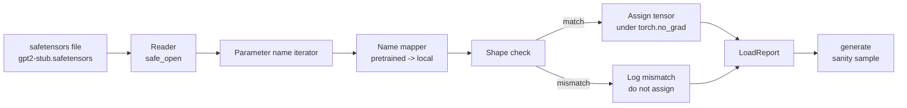

# 예전에 훈련 된 무게 를 부하

> 124 백만 파라미터 모델을 처음부터 훈련시키는 것은 예산 결정입니다. 출판된 체크포인트를 로드하는 것은 화요일입니다. 이 수업은 세페텐서 파일에서 미리 훈련된 GPT-2 스타일 무게를 35 수업에서 정확한 아키텍처로 로드합니다. 파라미터 이름 지도를 조각으로 걸어, 그리고 정신은 로드가 작동했다는 것을 증명하는 연속을 생성합니다. 네트워크, 제 3자 로더, 불투명한 마법은 없습니다.

**Type:** Build
**Languages:** Python
**Prerequisites:** Phase 19 lessons 30 to 36
**Time:** ~90 minutes

## 학습 목표

-                                                                                                                                                                                                                                                                      `safetensors`파이썬 라이브러리와 텐서 이름과 모양을 확인해 보세요.
- 각 사전 훈련된 매개 변수 이름을 수업 35 GPT 모델 내 매개 변수에 매핑합니다.
- 발표된 GPT-2 무게와 이 트랙의 모델 사이에 차이가 있는 두 개의 이름 협정을 처리합니다: `wte/wpe/h.N.attn.c_attn/c_proj`그리고`mlp.c_fc/c_proj`지역적 이름과 비교해`tok_embed/pos_embed/blocks.N.attn.qkv/out_proj`그리고`mlp.fc1/fc2`- 그래
- 무게 할당이 일어나기 전에 명확한 오류와 모양의 부합을 감지하고 거부합니다.
- 로드 된 무게와 짧은 연속을 생성하고 토큰이 무작위로 초기화 된 배포에서 온 것을 확인합니다.

## 문제

출판 된 무게는 당신의 아키텍처에 맞게 패키지되지 않습니다. 그들은 원래 구현 사용 된 이름들을 가지고 있습니다. 사전 훈련 된 파일은 `transformer.h.0.attn.c_attn.weight`모양의`(2304, 768)`당신의 모델은 `blocks.0.attn.qkv.weight`모양의`(2304, 768)`(다른 레이아웃 컨벤션에서 동일한 매트릭스) 또는 모델 사용 `nn.Linear`이 매트릭스는 매트릭스를 저장합니다. 동일한 매개 변수는 세 가지 미묘하게 다른 아이덴티티 (명, 모양, 바이트 레이아웃) 로 표시되며 로더는 세 가지 모두 조화를 이루어야 합니다.

이 이 을 을 을 을 을 을 을 을 을 을 을 을 을 을 을 을 을 을 을 을 을 을 을 을 을 을 을 을 을 을 을 을 을 을 을 을 을 을 을 을 을 을 을 을 을 을 을 을 을 을 을 을 을 을 을 을 을 을 을 을 을 을 을 을 을 을 을 을 을 을 을 을 을 을 을 을 을 을 을 을 을 을 을 을 을 을 을 을 을 을 을 을 을 을 을 을 을 을 을 을 을 을 을 을 을 을 을 을 을 을 을 을 을 을 을 을 을 을 을 을 을 을 을 을 을 을 을 을 을 을 을 을 을 `LoadReport`히트, 미스, 그리고 형상 불합의를 요약하여 무슨 일이 일어났는지 읽을 수 있습니다.

## 개념



이름 지도가 문자열에서 문자열에 대한 기능입니다. 모양 확인은 1 if입니다. 할당은 내부에서 발생합니다 `torch.no_grad()`그래서 오토그라드는 화물을 추적하지 않습니다. 보고서에는 모든 이름의 결과가 있습니다.

### GPT-2 이름 붙인 협약

출판된 GPT-2 무게는 다음과 같은 이름으로 생깁니다:

| Pretrained name | Shape | Meaning |
|-----------------|-------|---------|
| `wte.weight` | (50257, 768) | Token embedding |
| `wpe.weight` | (1024, 768) | Position embedding |
| `h.N.ln_1.weight` | (768,) | LayerNorm 1 scale at block N |
| `h.N.ln_1.bias` | (768,) | LayerNorm 1 shift at block N |
| `h.N.attn.c_attn.weight` | (768, 2304) | Fused QKV linear weight |
| `h.N.attn.c_attn.bias` | (2304,) | Fused QKV linear bias |
| `h.N.attn.c_proj.weight` | (768, 768) | Attention output projection |
| `h.N.attn.c_proj.bias` | (768,) | Attention output projection bias |
| `h.N.ln_2.weight` | (768,) | LayerNorm 2 scale |
| `h.N.ln_2.bias` | (768,) | LayerNorm 2 shift |
| `h.N.mlp.c_fc.weight` | (768, 3072) | MLP fc1 weight |
| `h.N.mlp.c_fc.bias` | (3072,) | MLP fc1 bias |
| `h.N.mlp.c_proj.weight` | (3072, 768) | MLP fc2 weight |
| `h.N.mlp.c_proj.bias` | (768,) | MLP fc2 bias |
| `ln_f.weight` | (768,) | Final LayerNorm scale |
| `ln_f.bias` | (768,) | Final LayerNorm shift |

두 가지 놀라움을 계획해야 합니다.`c_attn``c_proj``c_fc`선형은 매트릭스에서 어떤 `nn.Linear.weight`기대. 로더가 할당 중 이식합니다. LM 헤드 는 파일 에 전혀 없습니다. 모델 은 무게 을 기반으로 합니다.`wte`, 그래서 머리는 1번의 별명을 붙여서 설정됩니다`wte`땅이

### 지역 이름 의 대회

이 트랙의 모델은 설명적인 이름을 사용한다:

| Local name | Meaning |
|------------|---------|
| `tok_embed.weight` | Token embedding |
| `pos_embed.weight` | Position embedding |
| `blocks.N.ln1.scale` | LayerNorm 1 scale at block N |
| `blocks.N.ln1.shift` | LayerNorm 1 shift |
| `blocks.N.attn.qkv.weight` | Fused QKV |
| `blocks.N.attn.qkv.bias` | Fused QKV bias |
| `blocks.N.attn.out_proj.weight` | Attention output projection |
| `blocks.N.attn.out_proj.bias` | Output projection bias |
| `blocks.N.ln2.scale` | LayerNorm 2 scale |
| `blocks.N.ln2.shift` | LayerNorm 2 shift |
| `blocks.N.mlp.fc1.weight` | MLP fc1 |
| `blocks.N.mlp.fc1.bias` | MLP fc1 bias |
| `blocks.N.mlp.fc2.weight` | MLP fc2 |
| `blocks.N.mlp.fc2.bias` | MLP fc2 bias |
| `final_ln.scale` | Final LayerNorm scale |
| `final_ln.shift` | Final LayerNorm shift |

지도가 고정된 기능이고, 수업은 로더가 반복하는 명령으로 전달합니다.

### 톱니 

실제 GPT-2 무게는 0.5 GB입니다. 데모는 그것들을 다운로드하지 않습니다. 그것은 첫 번째 실행에 작은 안전 센서 장치를 생성합니다. 정확한 GPT-2 이름 컨벤션과 모양은 d_model 192에서 12 블록 모델에 적합합니다. 768 대신. 이 장치는 로더의 모든 코드 경로를 실행할 올바른 구조를 가지고 있습니다. 실제 파일로 고정된 장치를 교환하고 로더는 변경없이 작동합니다.

```figure
cc-weight-remap
```

## 건설 해

`code/main.py`이 도구는

- 35번 교훈의 작은 복사본`GPTModel`그래서 이 교훈은 자기결정된 것입니다.
- `make_pretrained_to_local(num_layers)`각층에 대한 항목을 확장하는
- `load_safetensors(model, path)`이 방법은 이름을 반복하여 지도를 만들고, 모양을 확인하고, conv1d 스타일의 무게를 옮기고,`torch.no_grad()`  `LoadReport`- 그래
- `make_stub_safetensors(path, cfg)`정해진 이름의 컨벤션이 있는 고정 파일을 생성합니다.
- `outputs/gpt2-stub.safetensors`첫 번째 실행에, 새로운 모델을 구축하고, 무작위 init에서 생성된 연속을 캡처하고, 스탭을 로드하고, 다른 연속을 캡처하고, 둘 다 인쇄하고, 두 가지가 다르다는 것을 확인합니다 (부하는 실제로 모델을 변경했습니다).

실행하세요:

```bash
python3 code/main.py
```

출력: 고정 경로, 이름별 로드 로그, a `LoadReport`요약, 부하 전과 부하 후의 연속 및 고의 잘못된 단 하나의 텐서에 대한 모양의 부합이 고정 장치에 주입되어 실패 경로가 실행됩니다.

## 

- `safetensors`디스크 형식 및 스트리밍 리더를 위한
- `torch`모델과 과제 수학에 대한
- 아니`transformers`아니`huggingface_hub`네트워크 통화를 하지요

## 야생에서의 생산 패턴

세 가지 패턴으로 로더가 당신이 만들지 않은 무게와 접촉을 생존하게 합니다.

**Always validate the file before any assignment.**파일을 열고, d형과 모양으로 모든 텐서 이름을 나열하고, 모양 확인을 통해 전체 지도를 실행하고, 성공 후에만 할당을 시작합니다. 반 로드 된 모델은 침묵 실패 기계입니다.

**Log every assignment with the source name and the destination name.**어떤 것이 잘못되었을 때, 로그는 어떤 텐서가 어디에 착륙했는지 알려줍니다. 대안은 헥스 덤프를 읽는 것입니다.`LoadReport`이 수업의 데이터 클래스 `loaded``missing``unexpected`그리고`shape_mismatch`목록과 종말에 요약을 인쇄합니다.

**The LM head is a weight tying alias, not a separate copy.**설정`model.lm_head.weight = model.tok_embed.weight`로딩 후`tok_embed`이 카노닉 패턴입니다. 이 매트릭스를 새 으로 복사합니다.`lm_head.weight`매개 변수 연결이 끊어지고 매개 변수 수를 두 배로 늘립니다.

## 사용 하 고

- 로더는 사전 훈련된 이름 붙인 컨벤션을 사용하는 모든 안전 센서 파일에서 작동합니다. 실제 GPT-2 파일 (소형 / 중형 / 큰 / xl) 는 코드 변경 없이 작동합니다. 모델 구성만 다릅니다.
- 동일한 패턴은 LLaMA, Mistral, Qwen 무게에 적용됩니다. 이름 지도를 업데이트하면 모양 확인과 보고서는 동일합니다.
- 로드 후의 정신성 생성은 빠른 게이트입니다. 로드 후 샘플이 사전 로드 샘플과 비슷하다면, 로드는 모델을 변경하지 않았으므로 매핑은 모든 텐서를 조용히 놓쳤다.

## 운동

1. `dtype`각 텐서를 타겟 d 타입에 던지는 로더에 대한 argument (`bfloat16``float16``float32`) 임무를 수행하는 동안`float32`모델은 `bfloat16`그리고 여전히 생산합니다.
2.  추가`expected_layers`체크포인트를 로드하는 것을 거부하는 주장`h.N`지수는 모델과 일치하지 않습니다 `num_layers`- 그래
3. 로더를 레슨 35 세대 기능에 연결하고 옆으로 두 개의 샘플을 생성하십시오.
4. 수출 경로를 추가: 미리 훈련된 이름 붙인 컨벤션을 사용하여 현재 모델 상태를 신선한 세페텐서 파일로 작성하고 로더를 돌아보며 보고서는 0 개의 모양 불합이 있음을 확인합니다.
5. 확장`NAME_MAP`LLaMA 이름의 컨벤션을 처리하기 위해 (bias, RMSNorm, fused qkv 레이아웃) 그리고 생성된 LLaMA 고정된 스터브에 로더를 다시 실행합니다.

## 주요 용어

| Term | What people say | What it actually means |
|------|-----------------|------------------------|
| Name map | "Key remapping" | The function from pretrained tensor names to local parameter names; usually a literal dict with one entry per layer index expanded over a loop |
| Shape mismatch | "Bad shape" | The pretrained tensor exists under the mapped name but its dimensions disagree with the local parameter; the loader refuses to assign and logs the pair |
| Transpose-on-load | "Conv1d layout" | Published GPT-2 stores attention and MLP projections in the transpose of what nn.Linear expects; the loader transposes during assignment |
| Weight tying alias | "Shared LM head" | Setting model.lm_head.weight = model.tok_embed.weight so the head and embedding share storage; the head is not in the file because of this |
| Load report | "Coverage summary" | A small dataclass that tracks loaded, missing, unexpected, and shape_mismatch lists; printing it is how you tell whether the load succeeded |

## 더 많은 읽기

- 19단계 35강습은 무게를 받는 건축에 대한 것입니다.
- 19단계 36강습 훈련 루프에서 같은 모양의 체크포인트를 생성합니다.
- 단계 10 수업 11 (분량화) 메모리 부족 시 부하중량과 어떻게 해야 하는지에 대한
- 10단계 수업 13 (완전 LLM 파이프라인을 구축)
