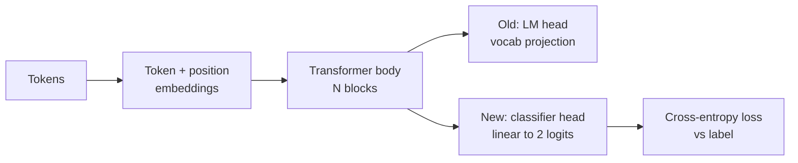
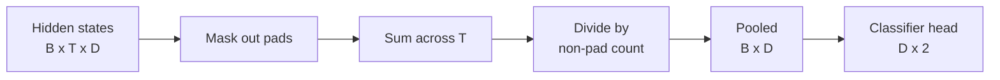
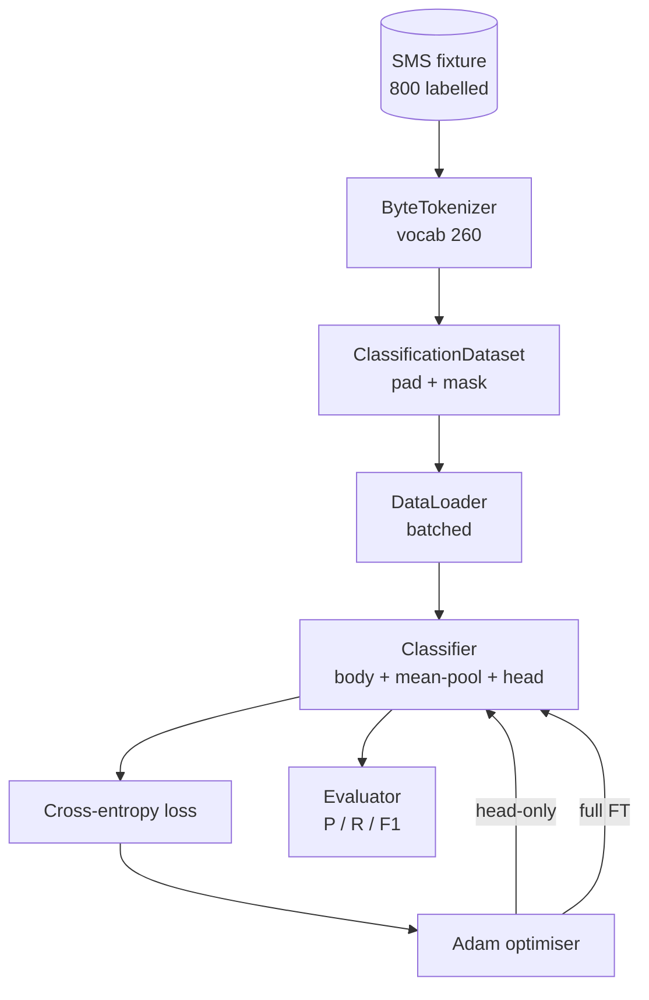

# 캡스톤 교훈 38: 분류자 머리 교환에 따라 정렬

> B 트랙의 첫 번째 끝돌 사전 훈련된 언어 모델은 자기주의 블록의 덩어리입니다. 스팸과 햄을 원하면 머리가 틀렸지만 몸은 대부분 옳습니다. 이 수업은 머리를 찢어, 두 개의 클래스 선형 층을 합성된 표현에 붙여 두 가지 다른 방법으로 분류자를 훈련시킵니다. 마지막 층만, 그리고 완전한 미세조절. 정밀성, 회수력, F1가 정해진 분할에 있습니다. 각 전략이 당신에게 무엇을 가져다 주는지 그리고 그 비용이 얼마나 든지를 알게 됩니다.

**Type:** Build
**Languages:** Python (torch, numpy)
**Prerequisites:** Phase 19 lessons 30-37 (NLP LLM track: tokenizer, embedding table, attention block, transformer body, pre-training loop, checkpointing, generation, perplexity)
**Time:** ~90 minutes

## 학습 목표

- 언어 모델 헤드를 다시 시사하는 것이 필요없이 분류 헤드로 교체한다.
- 두 가지 훈련 체제를 시행한다. 냉동 체 (머리만) 와 완전한 정렬, 하나의 훈련 루프를 공유한다.
- 토큰라이저에 대한 인식이 있는 데이터 파이프라인을 구축하여 패드를 매스하고 패딩을 마스크하고 주의력을 분산합니다.
- 정밀 계산, 회수, F1 그리고 원자 로그티에서 혼란 매트릭스
- 매개 변수 수, 훈련 시간, 그리고 전용실 사이의 타협에 대한 이유.

## 문제

당신은 일반적 코퍼스에 작은 트랜스포머를 미리 훈련시켰습니다. 출력 헤드에서는 1000 토큰의 어휘에 마지막 숨겨진 상태를 프로젝합니다. 이제 스팸 또는 햄이라는 800 개의 SMS 메시지가 있습니다. 그리고 바이너리 분류기를 원합니다. 세 가지 옵션이 있습니다.

잘못된 선택은 800가지 예제에서 새로운 분류자를 처음부터 훈련시키는 것입니다. 미리 훈련된 모델의 몸은 이미 유용한 구조를 암호화합니다. 단어 정체성, 위치, 간단한 공생. 그것을 던져버리는 것은 그것을 만든 계산을 낭비합니다.

두 가지 올바른 옵션은 체질이 얼어붙은 머리 교환, 체질이 훈련 가능한 머리 교환이다. 머리로만 훈련하는 것은 빠르고, 메모리에 거의 자유롭다, 그리고 거의 이 작은 데이터로 과잉되지 않습니다. 완전한 미세조정은 느려지고, 작은 데이터에 과잉 적용할 수 있지만, 하류 영역이 사전 훈련 코퍼스에서 유도될 때 더 높은 정확성을 달성합니다.

이 수업은 두 가지를 모두 구성하고, 같은 장치에서 비교할 수 있습니다.

## 개념



모델은 함수입니다`f_theta(tokens) -> hidden_states`머리는 기능입니다`g_phi(hidden) -> logits`머리를 교환하는 것은 계속 유지한다는 뜻입니다`theta`그리고 대체`g_phi`몸의 매개 변수는 비싼 부분이고 머리는 하나의 선형 층입니다.

두 개의 훈련 가능한 파라미터 세트가 중요합니다.

- `theta`(신체): 각 주의 블록에 수만 개의 무게가 있습니다.
- `phi`(머리):`hidden_dim * num_classes`무게 + 편향

머리에만 훈련하면 그레디엔트를 계산합니다`phi`그리고 그들을 니다`theta`PyTorch은 설정으로`requires_grad=False`그러면 최적화자는 머릿만 볼 수 있고 몸은 얼어붙습니다.

전체 을 통해 을 다시 흐르게 합니다. 몸의 무게는 분류 목표에 맞게 이동합니다. 작은 데이터를 잊는 위험은 재앙입니다. 신체의 사전 훈련은 과잉 소음으로 씻겨집니다.

## 합성 의 문제

분류자는 하나의 벡터, 하나의 도큰이 아니라 하나의 벡터로 분류할 필요가 있습니다. 세 가지 일반적인 선택은

- **Mean pool**: 순서 전체에 숨겨진 상태를 평균, 주의 마스크에 의해 중화.
- **CLS pool**: 특별 토큰을 준비하고 그 출력을만 사용하세요.
- **Last-token pool**: 마지막 비-패딩 토큰을 사용하세요. GPT 클래스 분류가 하는 일이죠.

이 수업은 명시적인 주의 마스크 중량과 평균 합성을 사용합니다. 그것은 가장 간단하며, 염기 길이를 통해 안정적인 신호를 제공합니다. 그리고 CLS 토큰을 미리 훈련시키는 것이 필요하지 않습니다.



## 자료

800개의 SMS 메시지가, 400개의 스팸메일과 400개의 햄메이드가 균형 잡힌`code/main.py`. 생성기는 고정된 씨앗을 사용하며 템플릿을 선택하고 슬롯 필러를 대체하고 5에서 25 토큰 사이의 메시지를 전송합니다. 실제 데이터 세트는 이 장치가 하지 않는 소음을 가지고 있습니다. 장치의 핵심은 재생 가능성입니다.

데이터 분배 80/20: 640 열차, 160 테스트. 분배는 분배되어 테스트 세트가 50/50 균형을 유지하도록합니다. 알려진 균형이있는 견고한 세트는 정확성과 회수력을 정직한 숫자로 읽을 수 있습니다.

## 측정

양성 클래스 (spam) 로 1급의 바이너리 분류:

- `TP`: 예측 스팸, 그것은 스팸이었습니다.
- `FP`: 예상 스팸, 이었다.
- `FN`: 예상된 햄, 스팸
- `TN`: 예상된 햄, 햄이었다.

3가지 주요 기준:

- `precision = TP / (TP + FP)`스팸으로 표시된 메시지의 몇 퍼센트가 실제로 있습니까?
- `recall = TP / (TP + FN)`실제 스팸 중, 모델 플래그의 비율은 몇 퍼센트?
- `F1 = 2 * P * R / (P + R)`이 둘의 합동적인 평균입니다.

혼동 매트릭스는 4개의 계산을 2x2 그리드로 인쇄합니다. 데모는 두 훈련 정제에 대해 이것을 stdout로 작성합니다.

```figure
cap-classifier-head-swap
```

## 건축



이 몸은 의도적으로 작은 트랜스포머입니다. 화사기 260, 숨겨진 64, 4 헤드, 2 블록, 최대 순서 32. CPU에서 90 초 이내에 두 정체를 공감하도록 훈련시킬 만큼 작습니다.`pretrain_quick`보조는 5 번의 LM 훈련을 같은 장치의 텍스트에 수행하여 신체에 비비용적인 출발점을 제공합니다. 이것은 교훈을 자립적으로 유지합니다.

## 당신이 건설할 것은

실행은 하나의 `main.py`+ 하나의 테스트 모듈 (`code/tests/test_main.py`)

1. `ByteTokenizer`: 지도, 아이디에 바이트, 패드 아이디를 예약합니다.
2. `Block`: 다중 헤드 주의를 가진 트랜스포머 블록과 전력층.
3. `LMBody`: 토큰 + 위치 임베디션 + 블록 스택. 숨겨진 상태를 반환합니다.
4. `MeanPool`: 매스크 중량 평균 순차 축
5. `Classifier`: 몸, 풀, 선형 머리. 몸은 모든 정권에서 같은 예입니다.
6. `freeze_body`그리고`unfreeze_body`: toggle `requires_grad`몸의 매개 변수
7. `train_classifier`: 하나의 공유 루프. 모델과 어떤 매개 변수 그룹에 따라 구성된 최적화 장치를 수용합니다.
8. `evaluate`: 테스트 세트를 실행하고 반환합니다 `Metrics(precision, recall, f1, confusion)`- 그래
9. `run_demo`: 몸을 잠시 훈련시켜서 머리로만 훈련하고 평가하고,

## 비교 가 중요 한 이유

머리에만 훈련하는 방식은 보통 더 빨리 훈련하고 더 우아하게 부착된다. 이 장치에서는 일반적으로 0.9 가까이의 정확도를 볼 수 있으며, 머리에만 훈련한 20 년 후 0.85 가까이의 정확도를 기억합니다. 완전한 정렬은 대략 3 배 더 오래 걸리며, 무작위 씨앗에 따라 몇 점 내에 떨어집니다.

이 수업은 우승자를 선택하지 않습니다. 숫자와 비용을 읽는 것을 가르쳐줍니다. 800개의 예제와 작은 몸집에서, 머릿만 올바른 선택입니다. 80,000개의 예제와 큰 몸집에서, 완전한 정렬이 결실을 맺기 시작합니다. 이 수업에서 얻는 계약은 API입니다.`train_classifier`함수는 둘 다 처리하고, 스위치는 하나의 호출입니다.

## 목표 를 달성

- 세 번째 정제를 추가하여 마지막 블록만 해제합니다. 이것은 때때로 부분적인 미세조라고 불립니다. 전체 FT보다 비용이 적게 들며 머리만 학습하는 것보다 더 많이합니다.
- 학습률 스케줄을 추가합니다. 머리에 코시네 스케줄과 신체에 더 작은 상수율은 일반적인 생산 설정입니다.
- 학습된 관심 풀 (중앙의 풀) 을 대신하여 학습된 질문 하나로 작은 관심층을 사용하십시오. 이것은 종종 더 긴 순서에서 평균 풀을 이길 수 있습니다.

실행은 당신을 을 줄 수 있고 테스트는 계약을  수 있고 숫자는 당신이 밀어 넣어야 합니다.
