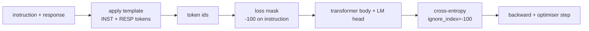
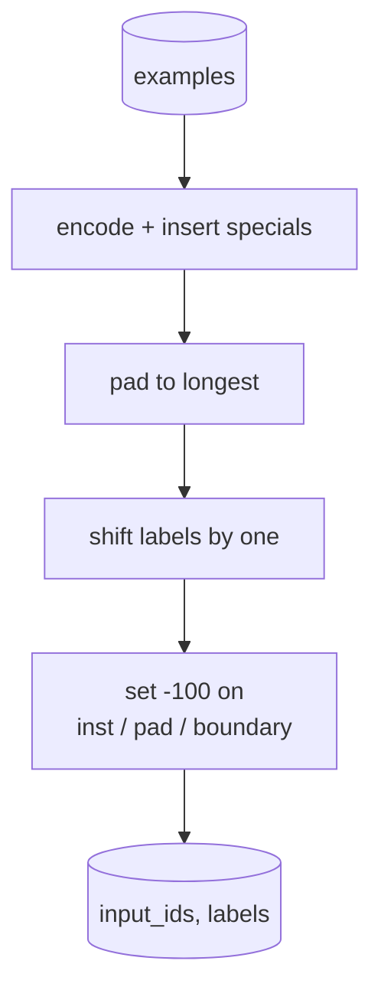
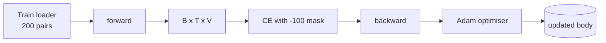

# 캡스톤 교훈 39: 감독 된 미세한 조율 으로 명령 조율

> 미리 훈련된 기본 모델은 순서를 확장할 수 있지만 명령에 따라서는 안 된다. 감독된 미세조정은 이것을 해결하는 가장 작은 변화입니다. 모델에 명령과 원하는 응답의 예제를 주며, 신체가 응답 표지판을 예측하도록 훈련합니다. 트릭은 손실이 응답을 계산하는 것이 아니라 명령이 되는 것입니다. 이 수업은 명령 토큰을 어 어 어 어 어 어 어 어 어 어 어 어 어 어 어 어 어 어 어 어 어 어 어 어 어 어 어 어 어 어 어 어 어 어 어 어 어 어 어 어 어 어 어 어 어 어 어 어 어 어 어 어 어 어 어 어 어 어 어 어 어 어 어 어 어 어 어 어 어`ignore_index=-100`, 200개의 명령과 응답 쌍을 훈련시키고, 정확한 일치를 사용하여 유지된 분할을 평가합니다.

**Type:** Build
**Languages:** Python (torch, numpy)
**Prerequisites:** Phase 19 lessons 30-37 (NLP LLM track: tokenizer, embedding table, attention block, transformer body, pre-training loop, checkpointing, generation, perplexity)
**Time:** ~90 minutes

## 학습 목표

- 명령어 응답 데이터를 결합하여 명시적인 경계 토큰으로 단일 인과 계열으로 구성합니다.
- 명령 토큰을 마스크하는 콜라이트 함수를 구축하여 크로스 엔트로피가 응답 토큰만 계산합니다.
- SFT 목표 아래 작은 트랜스포머 몸을 훈련시키고 eval 메트릭의 움직임을 지켜보세요.
- 반응 시작 경계를 존중하는 탐욕적이고 온도 샘플을 가진 생성을 구현하십시오.
- 생성된 완성물에 대한 정확한 일치를 계산합니다.

## 문제

다음 토큰 예측에 훈련된 기본 모델은 명령이 무엇인지 전혀 모릅니다. 문자열을 보여주십시오.`"What is the capital of France?"`그리고 그 질문은 계속될 수도 있고 새로운 문장을 발명할 수도 있습니다. 모델은 언어를 가지고 있지만 형식 계약은 없습니다.

SFT 계약은 문자열 템플릿입니다. 모든 훈련 예제는 세 영역을 가진 단일 순서로됩니다.

```text
<INST> What is the capital of France? <RESP> The capital of France is Paris.
```

경계 토큰은 훈련 시간에 예약된 특별 토큰입니다. 모델은 모든 것을 배웁니다`<RESP>`기본 모델의 다음 토큰 목표는 여전히 적용됩니다. 그것은 단지 모든 예제가이 모양을 가지고있는 코퍼스에서 훈련됩니다.

하지만 한 가지 문제가 있습니다. 만약 전체 순서대로 바닐라 크로스 엔트로피 손실을 공급한다면, 당신은 모델이 명령 토큰을 예측하는 훈련을 하고 있습니다. 명령은 주어집니다. 당신은 그 위치에서 0 gradient를 원합니다. 수정은 마스크입니다.

## 개념



`ignore_index``torch.nn.functional.cross_entropy`. 목표 위치가 `ignore_index`파이토치의 협약은`-100`. 콜라트 함수는 두 개의 텐서를 생성합니다:`input_ids`(전체 순서) 그리고`labels`(이하`input_ids``-100`)

모델은 전진 패스 중에 전체 순서를 볼 수 있습니다. 주의가 명령에 집중할 수 있습니다. 손실은 응답 토큰만 계산합니다. 이것은 정확히 당신이 원하는 것입니다. 명령에 대한 조건, 응답을 예측합니다.

## 자료

200개의 명령-응답 쌍이 결정적으로 생성됩니다`main.py`6가지 작업 유형을 포함합니다.

- 사실적인 단발 (X의 수도)
- 수학적
- 목록 추출
- 한 문장 요약
- 코드 (프린트, 분류)
- 정의

각 작업에는 템플릿 명령어와 결정적 응답이 있습니다. 이것은 의도적으로 간단합니다. 정확한 일치는 부서지기 쉽고 수업은 올바른 답이 특정 문자열이있는 고정 장치를 사용합니다. 실제 SFT 데이터 세트는 흐릿한 측정치가 필요합니다. 원리는 동일합니다.

분할은 160 열차, 40 시험입니다. 테스트 세트는 모든 6 가지 작업 유형을 포함하고 있으므로 카테고리별 정확한 일치를 보고할 수 있습니다.

## 표기 및 패딩

토큰이 3개의 특별함으로 바이트 레벨입니다.

- `INST_ID = 256`: 교육 지역이 시작되는 것을 나타냅니다.
- `RESP_ID = 257`: 명령과 응답 사이의 경계를 나타냅니다.
- `PAD_ID = 258`: 변수 길이의 배치를 위한 

순서로는`[INST] inst_bytes [RESP] resp_bytes [PAD]*`. 기 기능:

1. 각각의 예시를 상징합니다.
2. 배트의 모든 예시를 배트의 가장 긴 순서로 습니다.
3. 건축물`labels`=`input_ids`1개로 이동 (사유성 LM 목표) 으로,
   - 명령 영역은 `-100`- 그래
   - 이 대체된 이 대체된`-100`- 그래
   - `RESP_ID`경계에 있는 위치 자체는 `-100`(모델은 경계표시를 예측하는 데 훈련되지 않습니다. 그것은 다음을 예측합니다.)



시위란 일반적인 인과적 트릭입니다. 위치`i``input_ids`위치 예측`i+1`그래서`labels[i] = input_ids[i+1]`(입입에서 마지막 위치가 떨어지고 목표에서 첫 번째 위치가 떨어지는) 마스크는 이동 후 올바른 위치에 착륙하도록 적용됩니다.

## 교육



루프는 표준 PyTorch SFT 루프입니다. 아담, 학습 속도는 3e-4에서 1e-3, 이 고정에서 10~20 시대를 중심으로, 스케줄러가 없습니다. 모델은 두 분 이내에 CPU에서 konvergence를 훈련하기에 충분히 작습니다.

5차 에파마다 루프는 소규모의 평가 패스를 실행하고, 정밀한 일치를 인쇄합니다. 1차 에파에서 0.0에서 15차 에파에서 0.85까지 정밀한 일치가 올라가는 것을 보는 것은 수업의 보람입니다.

## 세대

평가 시 모델은 명령어 표본을 얻습니다`[INST] inst_bytes [RESP]`그리고 도켓을 생성합니다.

- 순서로 도달합니다`max_len`또는
- 모델은 특별한 스톱 유리스틱을 발사한다: 2개의 연속 문장을 끝내는 바이트 (`.``!``?`)

수업은 탐욕적인 디코딩과 선택적 온도 샘플러를 배포합니다. 정확한 일치는 탐욕을 사용합니다. 왜냐하면 온도가 측정값을 스토카스틱하게 만들 것이기 때문입니다. 실제 시스템은 종종 샘플을 취하고, 그 다음 미묘하게 판단합니다. 그 파이프 라인은 수업 41.

## 정확한 일치 평가

정확한 일치는 가장 엄격한 텍스트 메트릭이다. 예측 된 응답 문자열은 정상화된다 (하위자, 스트립 화이트스페이스, 붕괴 두 번째 공간) 그리고 참조 응답과 비교하면 동일한 방식으로 정상화된다. 메트릭은 1 또는 0입니다. 예를 들어 합수는 평균입니다.

실제 SFT 파이프라인은 토큰 레벨 F1 (강제 41) 와 판사 모델과 정확한 일치를 보충한다. 정확한 일치는 명확하기 때문에 유용하다. 0.7라고 말하면, 테스트 명령어의 정확히 70%는 캐릭터에 대한 황금 응답 문자를 생성했습니다.

```figure
cc-sft-loss-mask
```

## 당신이 건설할 것은

실행은 하나의 `main.py`더 많은 테스트를

1. `InstructionTokenizer`: 바이트 레벨의 코더, 특별함들을 예약하고 있습니다. 명령어 사전 또는 전체 쌍을 코딩합니다.
2. `make_dataset`: 고정된 씨앗을 가진 6개의 작업 유형에서 200쌍을 생성합니다.
3. `SFTDataset`: 수익금`(input_ids, labels)`예를 들어, 이미 마스크를 준비한 것.
4. `sft_collate`: 역동적인 , 배트 텐서를 구성, 세트 `-100`명령과 패드 위치
5. `TinyGPT`: 트랜스포머 몸과 묶여 있거나 풀려난 LM 머리가
6. `train_sft`: SFT 루프, 시대별 평가 해킹
7. `generate`: 유러미스 (Stop Heuristic) 를 사용하여 탐욕적이거나 샘플링된 사전에서 인과적 해독
8. `exact_match`: 표준화 된 문자열 비교, 반환이 부동 `[0, 1]`- 그래
9. `run_demo`: 데이터를 수집하고, 20 시대를 통한 열차를 구축하고, 평가하고, 각 카테고리별 분단을 인쇄하고, 성공에 대해 0을 출발합니다.

## 왜 마스크가 중요할까요?

마스크가 없으면 손실은 명령 토큰을 대상으로 삼는다. 모델은 명령어를 예측하는 법을 배우게 됩니다. 이것은 다른 목표이고 두 가지 방법으로 더 나쁜 모델을 만들어냅니다. 첫째, 모델 용량은 사용자가 항상 제공하는 입력들을 재구성하는 데 낭비됩니다. 둘째, 응답 손실은 그라디언트 합에 있어서 작습니다. 왜냐하면 명령 토큰이 대부분의 배트에서 응답 토큰을 넘어서기 때문입니다. 당신이 관심있는 부분에 대한 최적화의 효과적인 학습률은 당신이 의도한 것보다 낮습니다. 마스크는 색이 아니라 목표입니다.

## 목표 를 달성

- 학습률의 온화와 코시노 붕괴가 이어지는 것을 추가합니다.
- 토큰 당 손실 기록을 추가하고 훈련에 대한 손실 곡선을 표시하십시오. 초기 시대는 템플릿 토큰이 지배한다는 것을 알아보십시오 (`<RESP>`, 일반적인 전자) 와 후기 시대는 실제 답 표본에 의해 지배됩니다.
- BLEU-1 또는 chrF로 eval을 확장합니다. 정확한 일치는 동일한 답을 가진 문장을 생성하는 모델을 과소평가합니다.
- 멀티 턴 포맷을 가진 채팅 템플릿을 추가하고 후속 작업을 포함하는 고정된 장치에 훈련하십시오.

구현은 형식 계약, 마스크, 루프를 제공합니다. 기본 모델에서 명령어 추종자로의 객관적 변화는 하나의 콜라이트 함수입니다.
