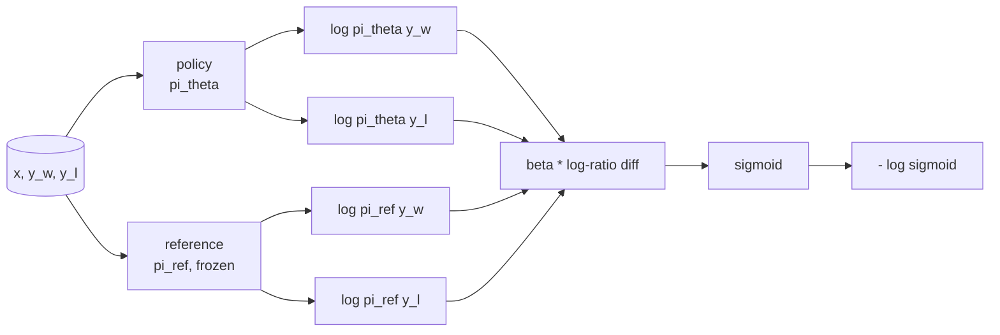
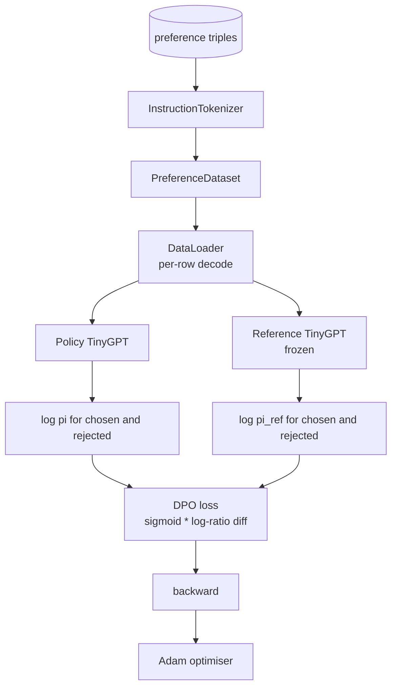

# 캡스톤 강좌 40: 처음부터 직접적인 선호도 최적화

> 보너스 모델과 PPO는 고전적인 RLHF 스택입니다. DPO는 그 덩어리를 하나의 감독된 손실로 붕괴시킵니다. 이 수업은 보상-차별 정체성에서 DPO 손실을 도출하고, 작업 참조 모델과 정책 모델을 배포하고, 토큰 당 로그 확률을 계산하고, 선택된 및 거부된 완성물의 선호도 고정에 작은 트랜스포머를 훈련시킵니다. 테스트는 손실 수학과 gradient 방향을 어 놓습니다. 그래서 구현이 종이에 일치한다는 것을 알 수 있습니다.

**Type:** Build
**Languages:** Python (torch, numpy)
**Prerequisites:** Phase 19 lessons 30-37 (NLP LLM track: tokenizer, embedding table, attention block, transformer body, pre-training loop, checkpointing, generation, perplexity)
**Time:** ~90 minutes

## 학습 목표

- DPO 손실을 스케일 로그 비율 차이에 대한 시그모이드로 추출하고 암시적인 보상과 연결합니다.
- 얼어붙은 참조와 훈련 가능한 정책으로 참조 모델 + 정책 모델 쌍을 구축하십시오.
- 두 모델에서 염기 레벨 로그 확률을 계산하여 프롬프트 토큰을 숨기십시오.
- `(prompt, chosen, rejected)`3배로 증가하고, 선택된 로그-프로브가 거절된 것과 비교해 상승하는 것을 관찰합니다.
- 손실 수학, 기하급수 표시 및 참조 변함수등에 대한 테스트와 함께 핀 행동

## 문제

SFT 모델은 사용가능합니다. 명령어를 따르지만 출력은 불균형적이지만, 일부 완성도는 명확하고, 일부는 말 그대로 또는 잘못된 것입니다. 또한 소규모의 선호도 쌍의 데이터 세트가 있습니다. 같은 프롬프트에 대해, 사람이 한 완성도를 선택하고 다른 것을 거부하는 것으로 표시합니다.

전통적인 RLHF 대답은 두 단계의 파이프라인입니다. 선호도에 대한 보상 모델을 훈련하십시오. PPO로 보상과 정책을 최적화하십시오. 이것은 효과가 있지만 비용이 많이 들습니다. PPO 동안 메모리에 두 가지 모델, 참조 근처에 정책을 유지하는 KL 제어, 보상 모델이 부서지기 때문에 보상 해킹.

DPO는 두 단계를 하나의 감독 손실로 대체합니다. 보상 모델은 절대 명시적으로 존재하지 않습니다. 정책은 선호도 쌍에 직접 훈련되며, 명시적인 KL 형벌을 SFT 참조에 적용합니다. 브래들리-테리 선호도 모델에 따라 동일한 최적 솔루션, 훨씬 적은 코드.

## 개념

브래들리 테리 모델부터 시작해`x`그리고 두 번의 완성도`y_w`(선택) 그리고`y_l`(금지된) 인간에게 가장 선호되는 확률`y_w`이

```math
P(y_w > y_l \mid x) = \sigma\big( r(x, y_w) - r(x, y_l) \big)
```

어디`r`RLHF는 먼저 적합합니다`r`우선 순위에서,`pi`최대한으로`r`KL 안크로:

```math
\max_{\pi} \; \mathbb{E}_{x, y \sim \pi} \big[ r(x, y) \big] - \beta \, \mathrm{KL}(\pi \,\|\, \pi_{\text{ref}})
```

DPO 추리에서 최적의 정책이`pi*`이 목표에 따라 `r`이 부분의 본문은

```math
\pi^*(y \mid x) = \frac{1}{Z(x)} \, \pi_{\text{ref}}(y \mid x) \exp\!\left( \frac{r(x, y)}{\beta} \right)
```

                     `r`이 부분의 본문은

```math
r(x, y) = \beta \big( \log \pi^*(y \mid x) - \log \pi_{\text{ref}}(y \mid x) \big) + \beta \log Z(x)
```

`log Z(x)`두 가지 용어는 동일합니다`y_w`그리고`y_l`(이것에 따라 달라집니다)`x`아니`y`), 따라서 선호도 차이를 계산할 때 취소됩니다.

```math
\begin{aligned}
r(x, y_w) - r(x, y_l) = \beta \big( &\log \pi_\theta(y_w \mid x) - \log \pi_{\text{ref}}(y_w \mid x) \\
&- \log \pi_\theta(y_l \mid x) + \log \pi_{\text{ref}}(y_l \mid x) \big)
\end{aligned}
```

브래들리-테리 시그모이드에 교체하고 선호 부對에 대해 부정적인 로그 확률을 가져가십시오.

```math
\begin{aligned}
L_{\text{DPO}}(\theta) = -\mathbb{E}_{(x, y_w, y_l)} \Big[
  \log \sigma\big( \beta \big( &\log \pi_\theta(y_w \mid x) - \log \pi_{\text{ref}}(y_w \mid x) \\
  &- \log \pi_\theta(y_l \mid x) + \log \pi_{\text{ref}}(y_l \mid x) \big) \big)
\Big]
\end{aligned}
```

이것은 손실입니다. 예를 들어, 하나의 스칼라에 대한 시그모이드입니다. 네 개의 로그 확률에서 계산됩니다. 별도의 보상 모델이 없습니다. PPO가 없습니다. 손실에 KL 용어는 없습니다. KL 제약은 폐쇄형 추리로 구워집니다.



## 진전 의 표지

훈련 전에 유용한 정신 건강 검사를 해 보세요.`log pi_theta(y_w | x)`이 부분의 본문은

```math
\frac{\partial L_{\text{DPO}}}{\partial \log \pi_\theta(y_w \mid x)} = -\beta \big(1 - \sigma(z)\big)
```

어디`z`이 값은 모두 부정적입니다.`z`, 즉: 선택된 완료에 대한 정책의 로그 확률을 높이는 것은 손실을 감소시킵니다.`log pi_theta(y_l | x)`긍정적이죠. 거절된 로그 확률을 높이는 것은 손실을 증가시킵니다. 훈련은 선택된 것을 위로, 거절된 것을 아래로 밀어냅니다. 참조는 얼어붙습니다. 그것은 움직이지 않습니다.

## 자료

12개의 선호도는 배움과 함께 배움으로 배움합니다.`(prompt, chosen, rejected)`. 선택된 완료는 짧고 정확하다. 거부된 것은 말 그대로, 주제 밖 또는 잘못된 것이다. 쌍은 레슨 39 (자본, 수학적, 목록) 과 같은 작업 가족을 다루고 있으므로 SFT 기반에서 시작된 정책은 합리적인 출발점을 가지고 있습니다.

이 장치는 의도적으로 작습니다. DPO는 생산 중 수십만 개의 쌍에서 작동합니다. 여기서 중요한 것은 손실 수학과 루프가 작은 데이터 세트에 끝에서 끝으로 실행되며 선택과 거부 로그-프로그 격차가 눈에 띄게 증가합니다.

## 참조 변함

DPO 구현은 참고 모델을 신중하게 처리해야 합니다. 참고 모델은 SFT 모델입니다.

- 참조 매개 변수는 결코 gradients를 받지 않습니다.
- 참고 로그 확률은 시대 간 변하지 않습니다.
- 정책은 참조와 같은 무게에서 시작됩니다.`theta`참고문헌과 학습된 업데이트가 됩니다. 정책의 초기화와 관련한 참고문헌의 복사본이 정해진 시작입니다.)

시행은 다음과 같이 이를 시행합니다.

- 참고 자료를 `torch.no_grad()`앞을 통과하는 동안
- 설정`requires_grad=False`모든 기준 매개 변수에 대해
- 정책의 구성은 `policy.load_state_dict(reference.state_dict())`참고 자료가 작성된 후

```figure
cap-dpo-preference
```

## 건축



모델은 레슨 39 (독독호기, 인과적, 바이트 토큰라이저) 에서 사용된 TinyGPT와 동일합니다. 참조와 정책은 구조를 공유하고, 정책의 무게는 훈련 중의 참조에서 유동하지만 참조는 고정되어 있습니다.

## 당신이 건설할 것은

실행은 하나의 `main.py`더 많은 테스트를

1. `InstructionTokenizer`: 바이트 토큰라이저`INST`그리고`RESP`특급, 수업 39과 같은 모양
2. `TinyGPT`이 강의는 39번을 건너뛰더라도 독자적인 것입니다.
3. `make_preferences`: 12번을 반환합니다`(prompt, chosen, rejected)`3배나 더
4. `sequence_log_prob`: 모델, 프롬프트 프리픽스, 그리고 완료를 보면, 완료에 대한 다음 토큰 로그 확률의 합을 반환합니다 (프롬프트 포지션 기여가 없습니다).
5. `dpo_loss`: 4개의 로그 확률을 `beta`,는 예를 들어 손실 텐서와 기록에 대한 암시적인 보상 델타를 반환합니다.
6. `train_dpo`: 정책 및 참조에 따라 선택 및 거부 로그-조사를 계산하는, 손실을 적용하고, 아담 단계를 단계
7. `evaluate_margins`: 정책의 어느 시점에서든지 선택된 평균 거부된 로그 확률 지위를 반환합니다.
8. `run_demo`: 작은 열차 전차에서 리퍼런스와 정책을 구축하고, 무게를 복사하고, 30 단계에 걸쳐 열차를 만들어, 각 단계 손실과 지위를 인쇄하고, 성공에 대해 0을 넘는다.

## 왜 DPO가 작동하는지

DPO는 수학적 관점에서 브래들리-테리 선호 모델에 따라 보상의 매개 변수를 할 때까지 RLHF와 동등합니다.`r(x, y) = beta * (log pi(y|x) - log pi_ref(y|x))`                         `x`, 즉 차이점을 취소합니다. 폐쇄형 정책은 명시적인 보상 모델을 건너뛰도록 합니다. KL 제한은 구조적으로 적용됩니다.`pi``pi_ref`로그 비례가 커지고 시그모이드가 포화되는데, 이 비례가 너무 멀리 이동하면 그 기하급수가 수그러들게 됩니다.

## 목표 를 달성

- 로그 확률 합에 길이 정상화를 추가: 완료 길이로 나눌 수 있습니다. 길이 편향은 모델이 절대적으로 더 큰 로그 확률 때문에 더 짧은 완료를 선호하는 알려진 DPO 실패 모드입니다.
- 손실의 IPO 변종을 추가: sigmoid + log을 로 교체`(z - 1)^2`- 고정된 장치의 공감대를 비교해 보세요.
- 하드 선택된 거부된 라벨과 균일한 0.5 사이의 간섭을 하는 라벨 부드러운 매개 변수를 추가합니다.
- 참조를 더 작은 값싼 모델로 교체하십시오 (지식 정유 맛).

실행은 손실과 참조 변함수와 훈련 루프를 제공합니다. 수학은 교훈입니다. 코드는 수학을 구체화합니다.
