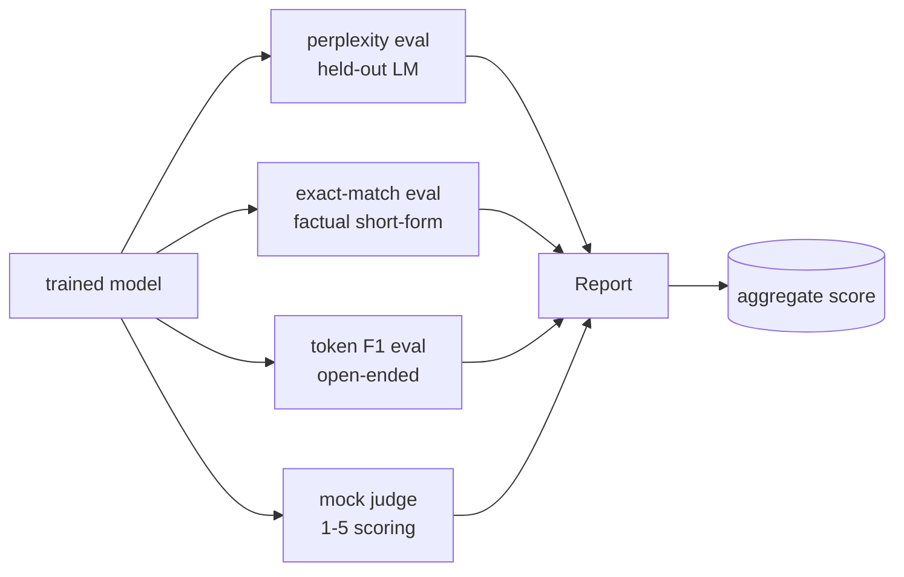
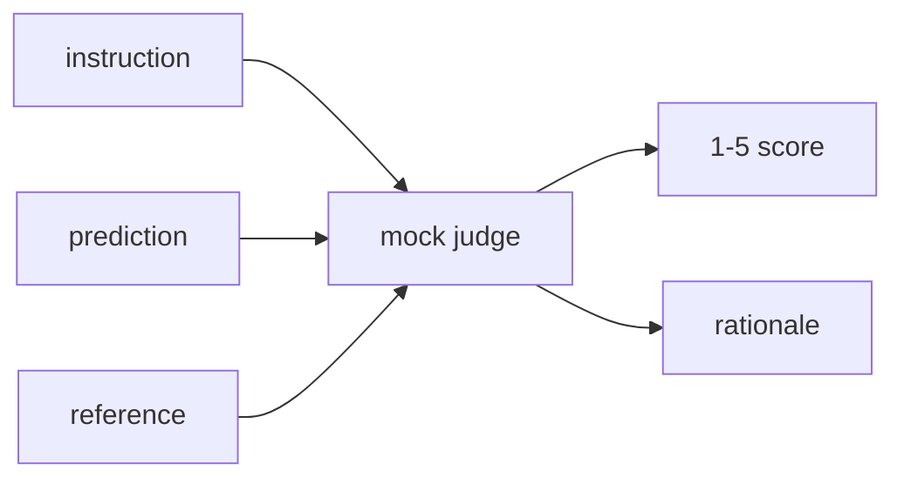
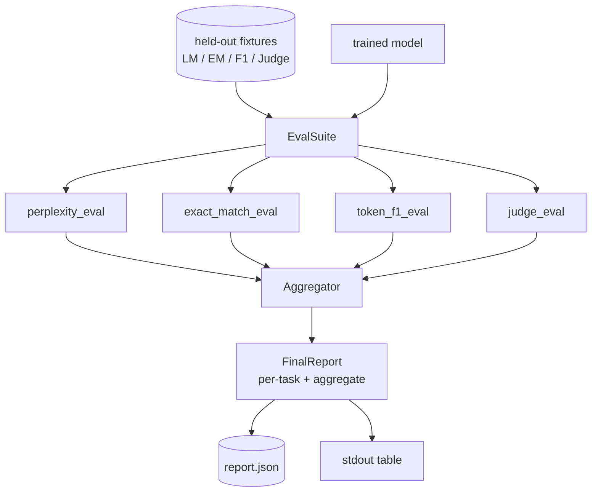

# 캡스톤 교훈 41: 완전한 평가 파이프라인

> 훈련은 손실 곡선을 통해 모니터링 할 수 있는 부분입니다. 평가는 당신이 디자인해야 할 부분입니다. 이 수업은 어떤 훈련된 언어 모델을 이용한 통일된 평가 파이프라인을 구축하고, 그 위에 네 가지 이질적인 평가들을 실행하고, 결과를 각 작업 보고서로 집합하고, 로컬 가짜 LLM-as-judge를 배포하여, 루프는 네트워크 없이 실행됩니다. 네 가지 평가들은 각 운송 모델이 필요로 하는 차원을 다루고 있습니다. 언어 모델링 (가장 복잡함), 짧은 형태 정확성 (정확 일치), 개방형 유사성 (토큰 F1) 및 질적 점수 (판사).

**Type:** Build
**Languages:** Python (torch, numpy)
**Prerequisites:** Phase 19 lessons 30-37 (NLP LLM track: tokenizer, embedding table, attention block, transformer body, pre-training loop, checkpointing, generation, perplexity)
**Time:** ~90 minutes

## 학습 목표

- 작은 트랜스포머에서 마스크된 토큰을 계산하는 복잡한 계산을 해보세요.
- 짧은 형태의 사실적 요청에 대해 정확한 일치 평가를 실행하십시오.
- 예측된 문자열과 참조 문자열 사이에 표준화로 토큰 레벨 F1를 계산한다.
- 1-5의 스케일에서 모델 출력을 점수를 주는 지역 법무대사 판사 모형을 만들죠.
- 4개의 평가들을 하나의 중량 보고서로 통합하여 각 작업에 대한 분할을 한다.

## 문제

하나의 메트릭은 언어 모델을 설명하지 않습니다. 혼란은 모델이 언어 분포에 얼마나 잘 어울리는지 말하지만 질문에 대답하는지에 대해서는 아무 것도 말하지 않습니다. 정확한 일치는 모델이 금줄을 생산하는지 여부를 알려줍니다. 하지만 올바른 구문을 처벌합니다. F1 토큰은 환호를 용서하지만 잘못된 내용과 가사적 중복으로 속이는 것입니다. 법정판사로서의 LLM는 질적 차원을 담고 있지만 비용이 많이 들고 Stochastic입니다.

실제로 원하는 파이프라인에는 네 가지 모두 있습니다. 각 평가는 다른 방면이 놓친 방면을 다루고 있습니다. 각은 그 메트릭을 위해 형성된 다른 미세먼지에서 실행됩니다. 최종 보고서는 각 작업 수와 합수를 옆으로 표시합니다. 그래서 리뷰어는 모델이 어떤 타협을 하는지 한 눈에 볼 수 있습니다.

이 수업은 그 파이프라인을 끝에서 끝으로 하나의 파일로 만듭니다.

## 개념



각 eval는 의 함수입니다`(model, dataset) -> EvalResult`. 결과는 측정 값, 검사 할 수 있는 각 예제 세부 사항 및 집합물의 이름 등을 포함하고 있습니다. 파이프 라인은 어떤 평가들을 실행하고 어떻게 무게를 가할 것인지 알려주는 구성과 함께 구성됩니다.

## 혼란, 제대로 계산

혼란은`exp(mean negative log-likelihood per token)`이 시행은 두 가지 함정에 걸립니다.

- 평균은 실제 토큰 위치 위에 있어야 하며, 배트 * 순서 위에 있어야 한다. 패딩 토큰은 명칭에서 배제되어야 한다. 그렇지 않으면 혼란은 더 잘 보일 것이다.
- 모델은 다음 토큰을 예측하고 위치로 로그인합니다`i`위치에서 기호를 예측합니다`i+1`여기서 실수들은 침묵합니다. 손실은 여전히 계속되고 있지만, 측정은 의미가 없습니다.

eval는 `-log p(token)`패드 아닌 위치와 패치 단표 수를 나누는 후 끝에서 나눌 수 있습니다. 이것은 평균 패치 혼란보다 수적으로 안전합니다 (단계 순서 중량을 미치지) 그리고 교과서 정의에 맞습니다.

## 정밀 일치, 정상화

리네스는 예측과 참조 모두 비교하기 전에 정상화합니다.

- 작자
- 백공간을 둘러싼 스트립
- 내부 백공간 붕괴는 하나의 공간으로 이어집니다.
- 후속 기둥 지문 (`.``!``?`) 양쪽 모두 점문으로만 차이가 있는 경우

정상화는 실제에서 정확한 일치가 유용하게 작용합니다.`"Paris"`옳습니다.`"Paris."`또한 옳습니다.`"  paris  "`또한 맞습니다. 메트릭은 여전히 표준화 후 답이 동일한 문자열이어야 합니다.

## F1 로켓, 올바른 방향으로

토큰 F1은 토큰 가방에 계산된 정확성과 회수의 조화적 평균입니다.

1. 예측과 참조를 정상화 (정확 일치와 같은 규칙)
2. 각각의 토큰 목록에 나눌 수 있습니다 (백공간 토큰화).
3. 다중 세트 교차점을 계산해 보세요.
4. 정확성 = `intersection_count / len(pred_tokens)`- 기억하세요`intersection_count / len(ref_tokens)`F1 = 합동 평균

예측과 참조 모두 빈 경우 F1는 1 (백성 일치) 이다. 오직 하나만 빈 경우 F1는 0. 이 패턴은 SQuAD 평가 참조와 일치하며 문장 간 안정적인 숫자를 생성한다.

## 지역 모호 법무법인 판사

실제 판사는 API 뒤에 있는 경계 모델입니다. 이 수업을 위해 판사는 오프라인에서 실행해야 합니다. 가짜 판사는 명령어, 모델의 예측 및 참조를 받아서 점수를 반환하는 결정적인 점수자입니다.`{1, 2, 3, 4, 5}`1선 논리적인 근거를 더해줍니다.

- 5 표준화된 예측이 표준화된 기준에 해당하는 경우
- 4 만약 예측과 참조 사이의 토큰 F1가 적어도 0.8이면
- 3 만약 F1 로켓이 `[0.5, 0.8)`- 그래
- 2 만약 F1 로켓이 `[0.2, 0.5)`- 그래
- 1개는 그렇지 않습니다.

이건 진짜 판사가 아니라면 맞아요. 하지만, 진짜 모델로 바꾸면, 그 기능이 달라질 겁니다.



## 집합

합계는 표준화된 평가 점수들의 중량 평균이다. 각 평가는 자신의 숫자를 `[0, 1]`이 부분의 본문은

- 혼란: 정상화`1 / (1 + log(perplexity))`1에서 1까지의 복잡성, 무한도에서 0까지의 복잡성
- 정밀 일치: 이미 `[0, 1]`- 그래
- F1 로켓: 이미 들어왔습니다`[0, 1]`- 그래
- 판사: 5으로 나눈다

무게는 구성 가능합니다. 기본 혼합은 0.2 미묘함, 0.3 정확한 일치, 0.3 토큰 F1, 0.2 판사입니다. 무게의 선택은 제품 결정입니다. 수업은 버튼을 노출하여 실험을 할 수 있습니다.

```figure
cg-eval-quadrant
```

## 건축



`EvalSuite`각 개별 평가는`(model, tokenizer, dataset, config)`그리고 다시 `EvalResult`- `Aggregator`결과들을 수집하고 최종 보고서를 제작합니다. 데모는 테이블을 인쇄하고 하류 CI가 섭취할 수 있는 JSON 복사본을 작성합니다.

## 당신이 건설할 것은

실행은 하나의 `main.py`더 많은 테스트를

1. `TinyGPT`: 수업 38~40에 사용된 디코더만 사용하는 구조가 포함되어 있어 수업이 따로 있습니다.
2. `InstructionTokenizer`: INST/ RESP/ PAD 특급을 가진 바이트 토큰라이저
3. 4개의 장착 장치: LM 코퍼스, EM 세트, F1 세트, 판사 세트. 20개의 예제 각각, 결정적.
4. `perplexity_eval`: 수익금`EvalResult`혼란 값과 토큰 손실 histogram를 가지고 있습니다.
5. `exact_match_eval`: 평균 EM 및 예본별 기록을 반환합니다.
6. `token_f1_eval`: 토큰 F1 평균 및 예제별 기록을 반환합니다.
7. `mock_judge`그리고`judge_eval`: 예제당 점수와 논리, 집합 전체의 평균 점수.
8. `Aggregator.normalise`: 일기별 표준화 규칙
9. `Aggregator.aggregate`: 중계 평균 및 집계 보고
10. `run_demo`: 작은 모델을 짧게 훈련시키고, 네 가지 평가들을 실행하고, 보고서 표를 인쇄하고 JSON를 작성하고, 성공에 대해 0을 빠져나갑니다.

## 보고서를 읽는 것

보고서에는 세 층이 있습니다. 상위에는 합계 점수입니다. 아래에는 4 개의 각별 수 있습니다. 아래에는 진단에 대한 각 예제 분산입니다. 실패한 CI 실행은 일반적으로 합계를 원하지만 회귀를 쫓는 리뷰어는 모델이 어떤 입력에 잘못되었는지 확인하기 위해 각 예제 분산을 원합니다.

JSON 덤프는 안정적인 키를 사용하므로 CI 래시보드는 버전의 트렌드 라인을 표시할 수 있습니다. 예쁜 인쇄된 테이블은 훈련 실행 후 터미널을 바라보는 사람들을위한 것입니다.

## 목표 를 달성

- 캘리브레이션 평가: 모델의 소프트맥스 확률이 정확성과 일치합니까? 신뢰에 따라 버킷 예측 및 버킷 당 경험적 정확성을 보고하십시오.
- 강도 평가: 각 예제를 방해 (타이포, 패라프라지, 디스트랙터) 로 태그하고 방해당 측정적 하락을 보고한다.
- HTTP 호출 뒤에 있는 실제 모델로 가짜 판사를 교체하십시오. 함수 서명은 변하지 않습니다.
- 과제별 체중 학습을 추가하십시오: 고정 무게 대신 모델에 대한 목표 선호 순서에 무게를 조정하십시오.

구현은 네 가지 eval, aggregator, 그리고 보고서를 제공합니다. 실제 평가 파이프라인들은 상단에 더 많은 차원을 층으로 만듭니다. 패턴은 동일합니다. eval당 하나의 함수, 하나의 aggregator, 하나의 보고서.
