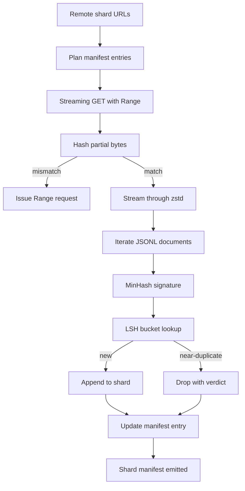

# 큰 코퍼스 다운로더

> 언어 모델을 훈련시키는 것은 첫 번째 횡단 과정이 시작되기 훨씬 전에 시작됩니다. 이 코퍼스는 디스크에 착륙하고, 압축되고, 배제되고, 주소로 처리되어야 합니다. 네트워크가 4%로 떨어지기 전에, 이 수업은 압축된 셔트를 끌어내는 스트리밍 다운로더를 만들고 Zstandard을 통해 비행기를 통해 압축을 해소하고, MinHash을 통해 거의 복제된 지문자국을 만들고, 지역에 민감한 해시링을 통해 셔트를 작성하고, 파이프라인 나머지 사람들이 신뢰할 수 있는 셔트 매니페스트를 작성합니다.

**Type:** Build
**Languages:** Python
**Prerequisites:** Phase 19 lessons 30-37
**Time:** ~90 minutes

## 학습 목표

-                                                                                                                                                                                              `urllib`그리고 `zstandard`전체 파일을 메모리에 버핑하지 않고
- HTTP를 입력하여 부분 다운로드를 재개합니다 `Range`확인된 바이트 오프셋에 대한 요청
- 문서마다 미인하시 서명을 만들어서 LSH로 어 넣어서 거의 두 배기가 충돌할 수 있습니다.
- 내용 해시, 바이트 크기와 문서 수와 dedup 판결을 가진 셔드 매니페스트를 발부하십시오.

## 문제

200GB의 코퍼스에서 처음 훈련하면 네트워크가 41%로 떨어지고 스크립트가`urllib`예외. 두 번째 번은 78%로 떨어집니다. 99%로 루프를 세 번 다시 작성했습니다. 첫 번째 분부터 설계해야 할 두 가지 실패는 부분 다운로드 재개정 및 복제 문서 제거입니다. 둘 다 잘 알려진 솔루션을 가지고 있습니다. 둘 다 일정한 방법으로 건너뛰기 때문에 파이프라인 1 라인으로 시작됩니다.`requests.get`이빨이 자란다고 부르죠.

리뷰는 HTTP 문제입니다. 서버는 존중해야 합니다.`Range`, 클라이언트는 디스크에 있는 기록에 대한 검증된 오프셋을 추적해야 하며, 검증된 오프셋은 프로세스 사망에 살아남아야 합니다. 오프셋과 파일이 한 바이트까지 떨어져 있다면, 다시 다운로드가 쓰레기를 작성하고 코퍼스가 토큰화 중에만 표시되는 방식으로 손상됩니다.

분배가 증인이 되는 문제입니다. 정확한 해시 분배는 거의 두 배가 되는 것을 놓치고 있습니다. 같은 위키백과 기사에는 세 가지 다른 보일러 플레이트 발자국, 다른 라이선스 헤더와 같은 코드 파일, 모든 링크에 추적 매개 변수를 가진 동일한 블로그 게시물이 표시됩니다. MinHash 더 LSH는 이 모든 것을 하위선형 비용으로 잡습니다. 비용은 문서당 한 서명, 서명당 한 버킷 검색입니다.

## 개념



###  스트리밍`urllib`

표준 도서관`urllib.request.urlopen`파일 같은 객체를 반환합니다.`zstandard.ZstdDecompressor().stream_reader`그리고 바이트가 네트워크에서 디컴프레서로 입력되어 문서 반복자로 흘러나오는데, 압축된 셔드나 메모리에서 압축된 셔드를 구현하지 않는다. 유일한 메모리 비용은 라인 버퍼, 현재 문서의 MinHash 서명, LSH 인덱스이다.

### `Range`

다운로더는 에 2개의 파일을 작성합니다.`.partial.json`체크포인트, 체크포인트 기록`verified_bytes``expected_size``sha256_prefix`(제1차 `verified_bytes`바이트) 와 소스 URL. 시작 시 다운로드자가 체크포인트를 읽고 다시 계산합니다.`sha256_prefix`디스크에 있는 바이트를 통해 재정된 해시가 일치하는 경우에만 재개합니다. 해시가 잘못되면 부분적인 것이 폐기되고 다운로드가 바이트 0에서 다시 시작됩니다. 검증된 바이트가 확인되기 때문에 침묵 부패는 불가능합니다.

### 미네하시 + LSH

미인하쉬는 고정된 공간에서 두 집합의 자카드 유사성을 추정한다. 문서의 집합은 텍스트의  (복합 n-그램) 이다. 서명은`k`최소 해시 값, 독립적인 해시 함수마다 하나. Jaccard 유사성을 가진 두 문서 `s`확률이 높습니다`s`서명의 어느 하나에 대해서도 합의하는 것

LSH는 `k``b``r`각 행, 어디`k = b * r`. 두 개의 문서가 적어도 한 대역에서 충돌할 확률이 높습니다.`1 - (1 - s^r)^b`, 즉 `s`당신은 `(b, r)`일반적인 코퍼스 디듀프의 임계점은`s = 0.8`, LSH 연구 문학이 도달하는`k = 128``b = 32``r = 4`- 그래

### 계약으로 표시된 갱신

다운로더의 유일한 내구성 출력은 매니프입니다. 매니페스트는 각 셔드별로 URL, 압축된 바이트 수, 문서 수, dedup 후 고유 문서 수, 그리고 최종 셔드 파일의 sha256를 포함합니다. 하류 토큰화는 디렉토리 목록이 아닌 매니페스트를 읽습니다. 이 빠진 경우 또는 sha256가 잘못되면, 매니프트는 다음 단계에 시작하기를 거부하도록 말합니다. 매니페스트는 "데이터 다운로드"와 "데이터 다운로드 및 검증 가능" 사이의 결정적인 가장자리입니다.

```figure
cap-corpus-downloader
```

## 건설 해

`code/main.py`이 도구는

- `ShardPlanner`- 셔드 URL 목록을 읽고 계획된 매너스트 항목을 생성합니다.
- `StreamingDownloader`- `urllib`선택적으로 `Range`, 일시적인 파일에 글을 쓰고,`.partial.json`모든 점검점과 재개편에 Sha256 표본을 확인합니다.
- `ZstdDocIterator`- 파일 같은 스트림을 `zstandard.ZstdDecompressor`그리고 한 줄에 한 문서를 내놓습니다.
- `MinHasher`- `k`- 시 씨의 고정된 가족을 사용하는 문자열의 구성 요소 서명
- `LSHIndex`- 밴드별 서명, 충돌 보고서를
- `Dedup`- 각 문서를 표시하기 위해 해시어와 인덱스를 결합합니다 `keep`또는`near_duplicate`일치하는 셔드 아이디와 함께
- `ManifestWriter`- 각 셰어 통계를 수집하고 작성합니다`manifest.json`- 그래

파일의 하단에 있는 데모는 디스크에 작은 합성 코퍼스를 만들고,`zstandard`, `file://`URL, 복제, 그리고 매니페인을 인쇄합니다.

실행하세요:

```bash
python3 code/main.py
```

스크립트는 0에서 나오고, 명백한 요약을 인쇄합니다.

## 생산 패턴

네 가지 패턴이 이 교훈을 실제 몸으로 확장합니다.

**Checkpoint before write.**`.partial.json`꼭 그럴 거야`fsync`-ed는 바이트가 셰어에 첨가되기 전에 셰어에 첨가됩니다. 그렇지 않으면 전력 손실이 순서를 뒤집습니다. 디스크에 셰어 바이트, 체크포인트가 없으면 다음 리뷰는 확인된 바이트가 더 적은 것으로 믿고, 복제 된 후자 바이트는 파일을 손상시킵니다. 체크포인트 먼저, 다음으로 작성합니다. 이것은 미리 작성하는 로그와 동일한 학문입니다.

**Sharded LSH index.**전체 코퍼스에서 단일 LSH 인덱스는 200 GB 규모의 RAM에 적합하지 않습니다. LSH 인덱스를 첫 번째 밴드 해시로 파티션하고 디스크에 파티션을 저장하고 새로운 서명이 착륙하는 파티션을 만 참조하십시오. 비용은 문서당 추가 디스크 1 개 읽기입니다. 이점은 LSH 인덱스가 더 이상 하드 메모리 천장이 아니라는 것입니다.

**Tombstone, not delete.**은 복사본은 판결문과 함께 기재판서에 기록됩니다`near_duplicate`그 문서의 갱신 아이디를 삭제하면 이중본과 보관자 사이의 연결이 사라지고, 토브스톤링은 감사 트레일을 보존하고, 하류 통과가 임계값에 대해 생각을 바꾸게 합니다.

**Per-shard sha256 in the manifest, plus a manifest sha256.**매니페스트 자체는 콘텐츠 해시를 얻습니다. 하류 단계에서는 매니페스트 해시를 확인합니다. 분자 입문에 신뢰하기 전에. 이 없이는 매니페스트는 침묵한 공격 표면입니다. 단일 파일을 편집할 수있는 공격자는 전체 파이프라인을 손상시킬 수 있습니다.

## 사용 하 고

생산 패턴:

- **Resume on every CI run.**CI 런어는 일시적이기 때문에 다운로더는 모든 런에 새로운 디스크를 가져다가 캐시나 원격에서 복구해야 합니다.`--cache-dir`제1급 깃발입니다.
- **Dedup before tokenization.**토큰화는 비싸다. 같은 문서에 두 번 실행하면 같은 손실 곡선에서 두 배가 비싸다. Dedup은 토큰화의 하류가 아니라 하류입니다.
- **Manifest as merge gate.**훈련 실행은 고정된 커밋에서 manifest sha256를 읽습니다. 새로운 데이터 세트 버전은 새로운 커밋 커밋을 필요로 합니다. 코드와 데이터 사이의 연결은 민속이 아닙니다.

## 선박

`outputs/skill-corpus-downloader.md`실제 프로젝트에서 다운로드자를 공급하는 URL, 체크포인트 디렉토리가 어떻게 구성되어 있는지, 의 폭과`(k, b, r)`이 수업은 엔진을 배워줍니다.

## 운동

1. `--shingle-width`플래그 및 측정 dedup 판결의 폭이 3, 5, 9에서 어떻게 변화하는지 측정합니다. 선택한 기본값을 방어합니다.
2. zstd 옆에 gzip 지원을 추가하여 마법 바이트를 스노프하십시오. 다운로더는 호출자가 코덱을 지정하도록 요구해서는 안됩니다.
3. `--resume-only`확인 지점이 없는 경우 새로 다운로드 시작을 거부하는 모드. CI에서 사용 가능한 한 한 실행을 실수로 200 GB를 다시 끌어당기는 것을 방지하기 위해.
4. LSH 지수를 셰프 또는 sqlite 파일로 이동하고 내 메모리의 변종에 대한 처리량을 측정합니다.
5. 시작 시 manifest sha256 체크를 추가합니다. 디스크에 있는 manifest이 manifest hash에 동의하지 않는 경우 다운로드가 닫히지 않을 것입니다.`manifest.lock`- 그래

## 주요 용어

| Term | What people say | What it actually means |
|------|-----------------|------------------------|
| Shard | "A file" | A self-contained slice of the corpus with its own sha256, used as the unit of resume and dedup |
| MinHash signature | "Fingerprint" | A `k`-component sketch of a set, where each component is the minimum of one independent hash over the set |
| LSH band | "Bucket" | A group of `r` signature components used as a single bucket key for collision detection |
| Verified bytes | "Resume offset" | Bytes on disk whose sha256 prefix matches the checkpoint; the only safe offset to resume from |
| Manifest | "The index" | The single durable record of what the downloader produced, including content hashes |

## 더 많은 읽기

- [RFC 7233](https://datatracker.ietf.org/doc/html/rfc7233)- HTTP 범위 요청, 리뷰 프로토콜
- [Zstandard format specification](https://datatracker.ietf.org/doc/html/rfc8478)- 스트리밍 압축을 안전하게 만드는 프레임 형식
- [MinHash](https://en.wikipedia.org/wiki/MinHash)- 이 수업에서 사용하는 서명 가족
- [Locality-sensitive hashing](https://en.wikipedia.org/wiki/Locality-sensitive_hashing)- 추출률 뒤에 있는 배포제도는
- 19 · 43 단계 - HDF5 토큰화된 코퍼스는 다운로더를 먹이
- 19 · 44 단계 - 코시네 스케줄
- 19 · 45 단계 - 일정을 소비하는 AMP 루프
