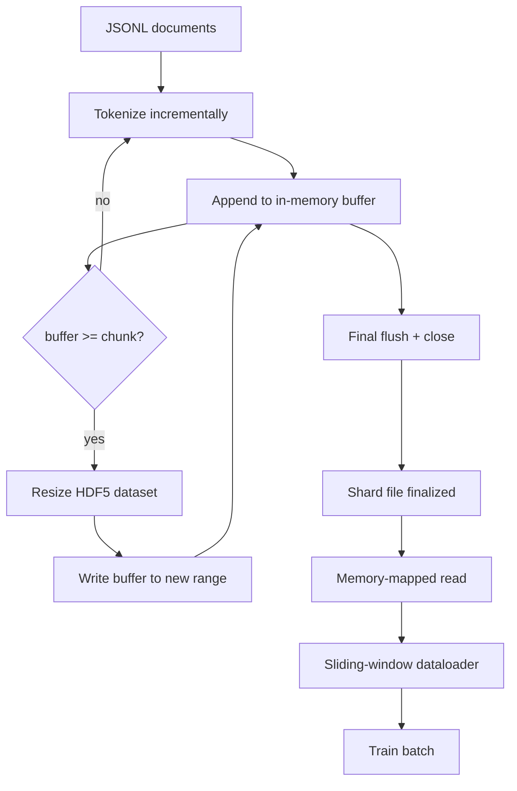

# HDF5 토큰화된 코퍼스

> 다운로드된 코퍼스는 트레이너가 라인 속도에서 스트리밍 할 수 있는 레이아웃에 착륙해야 합니다. 디스크에 있는 JSONL는 16개의 데이터 로더 작업자를 살아남지 못한다. HDF5는 크기를 변경할 수 있는, 조각된 정수 데이터 세트를 가지고 있습니다. 이 수업은 스트리밍 토큰화를 크기를 조정할 수 있는 HDF5 데이터 세트로 구축하고, 여러 파일에서 조각된 글쓰기를, 훈련 시간에 메모리 지도로 읽으며, 올바른 패키지로 고정된 길이의 순서를 생성하는 슬라이딩 윈도우 데이터 로더를 구축합니다.

**Type:** Build
**Languages:** Python
**Prerequisites:** Phase 19 lessons 30-37
**Time:** ~90 minutes

## 학습 목표

- 결정적 쪼개림으로 크기를 변경할 수 있는 HDF5 정수 데이터 세트에 문서를 스트리밍하십시오.
- 여러 HDF5 파일로 쓰기를 분해하여 오류가 제한되어 평행성이 가능하도록 합니다.
- HDF5의 페이지 캐시 지원된 조각 레이아웃을 통해 토큰을 다시 읽어 보세요. 그래서 데이터 로더는 배치 버퍼에 배치 시간에만 복사합니다.
- 정해진 길이의 훈련 순서를 명시한 포장 규칙으로 발송하는 슬라이딩 윈도우 데이터 로더를 구현한다.

## 문제

현대적인 언어 모델 교육은 수십 명의 노동자들에게 초당 수십만 개의 샘플에서 토큰을 읽습니다. 디스크에 JSONL는 첫 번째 냉정 캐시 페이지 오류로 사망합니다. JSON 파서가 느리고 문서 경계가 주소화되지 않으며 "4,217,884" 샘플을 찾는 것은 파일을 스캔하는 것이 필요합니다. 심지어 잘 압축되는 파케트는 트레이너가 기둥을 원하지 않기 때문에 잘 맞지 않습니다.$O(1)$무작위 접근

HDF5은 쪼개져 있고, 크기를 바꿀 수 있고, 전체 숫자만 있는 데이터 세트를 제공하므로, 그 쪼개지는 읽기 시간에 페이지 캐시 친화적일 수 있습니다. 트레이너는 쪼개져 있는 쪼개지를 요청합니다.`tokens[3,200,000 : 3,200,8192]`HDF5은 페이지 캐시에서 요청된 하이퍼랩을 새로 할당된 NumPy 배열에 복사합니다. 비용은 직원당 한 개 오픈 파일 핸들 및 크기의 페이지 캐시 발자국입니다. 이는 JSONL 해독 비용과 비교하면 소홀합니다.

제작 문제는 글쓰기 측면을 정직하게 만드는 것입니다. 크기를 확장할 수 있는 데이터 세트는 악용하기 쉽습니다. 한 번에 한 문서를 작성하면 HDF5 파일이 사용할 수 없을 정도로 분해됩니다. 모든 문서를 한 크기로 작성하면 프로세스 사망으로 전체 조각이 사라집니다. 올바른 규제는 버퍼-그후-확장입니다. 버퍼 크기는 덩어리 크기와 일치하며, 쪼개진 글은 파일로 작업량을 나누고, 충돌이 최대 한 덩어리를 잃게 됩니다.

## 개념



### 크기를 측정할 수 있는 HDF5

토큰 데이터 세트는 `maxshape=(None,)`그리고 고정된`chunks=(chunk_size,)`. 이 길이를 가진 NumPy 배열에 있는 토큰을 버핑하여 수익을 기록합니다 `chunk_size`. 버퍼가 채워지면 데이터 세트가 정확히 `chunk_size`그리고 버퍼는 새로운 범위로 쓰인다. 쪼개기의 끝에서 잔존 버퍼는 마지막 부분 범위로 쓰인다. 모든 글은 마지막을 제외하고는 인접하고 쪼개져 있습니다.`token_count`의 HDF5 속성에서

### 조각으로 된 글

단일 HDF5 파일은 단일 실패점이다. 파이프라인은 패럴로 셔트를 작성한다. 단계 19 수업 42의 각 입력 셔트는 한 HDF5 출력 셔트를 생성한다.`shards.json`지표 기록, 각 셔드, 파일 경로, 토큰 수, 문서 수, 그리고 토큰 상의 sha256`shards.json`글로벌 오프셋을 계산하고 코퍼스 검증

### 메모리 지도로 읽은 것

교육 시간에 각 근로자는 HDF5 파일의 자신의 비중을 열 `swmr=True``tokens[start:stop]`HDF5의 쪼개리 레이아웃은 쪼개리 가 뜨겁다면 페이지 캐시 백업 판독이 됩니다. 작업자는 전체 파일을 결코 재현하지 않습니다. 쪼개리 가 데이터 로더의 쪼개리 버퍼에 복사되며, 데이터 로더는 쪼개리 시간에 쪼개리 메모리의 훈련 텐서로 복사합니다. 핫 경로는 쪼개리 전환당 한 시스템 호출이 있습니다. 나머지는 RAM 액세스입니다.

### 슬라이딩 윈도우 데이터 로더

데이터 로더는 훈련 순서 길이를 아는 유일한 단계입니다. 그것은 글로벌 토큰 스트림에서 무작위 시작 지표를 선택합니다.`window_size + 1`토큰과 수익금`(input, target) = (tokens[:-1], tokens[1:])`문서 경계는 적용되지 않습니다. 창은 두 문서에 걸쳐 두 개의 문서를 명시적으로 `boundary_token_id`이 모델은 분리기를 사용하는 것을 배우기 위해 두 가지 중 하나를 사용한다. 이것은 표준 포장 규칙입니다. 이것은 초보자도 잊는 규칙이기도 합니다.

```figure
cc-hdf5-corpus
```

## 건설 해

`code/main.py`이 도구는

- `Tokenizer`- 바이트 레벨의 결정적 토큰화`encode(text) -> list[int]`그리고`vocab_size`- 그래
- `HDF5ShardWriter`- 크기를 변경할 수 있는 정수 데이터 세트를 열고, 덩어리 크기로 지표를 버버하고, 크기를 변경하고, 고정 크기의 단계로 작성하고, 기록`token_count`그리고`sha256`HDF5 속성 close
- `ShardedTokenizationPipeline`- 입력 문서들을 반복하여 작성자에게 로우팅하고,`shards.json`지표
- `MmapTokenStore`- 메모리 지도를 통해 읽은 셰드 파일을 열고, 글로벌 오프셋을 계산하고, 단일 셰드를 노출합니다`get_slice(start, stop)`API
- `SlidingWindowDataloader`- 글로벌 스트림에서 무작위로 창을 선택하고 수익을 냅니다`(input_ids, target_ids)`피 매트리

파일의 하단에 있는 데모는 작은 메모리 코퍼스를 만들고, 두 개의 셔트를 토큰화하고, 메모리 지도를 통해 열고, 10 배트를 위한 데이터 로더를 실행하고,

실행하세요:

```bash
python3 code/main.py
```

스크립트는 0으로 나와 조그만 수를 인쇄합니다.

## 생산 패턴

네 가지 패턴이 이 교훈을 실제 훈련으로 확장합니다.

**Chunk size equals the typical read.**트레이너가 읽는다`window_size + 1`표본별 토큰. HDF5 조각을`window_size`그리고 읽기는 페이지 캐시와 맞물려 있습니다. 부합된 조각은 매출량을 절반으로 줄이고, 왜냐하면 각각의 샘플은 두 조각을 만납니다.

**Token count in attributes, not in the dataset.**데이터 세트의 후면 조각은 부분적으로 가득 차 있을 수 있습니다. 왜냐하면 조각 크기가 문서 경계를 나누지 않기 때문입니다. 실제 `token_count`데이터 세트에 HDF5 속성으로 표시하고, 그 값에서 독자를 줄여서, 이를 사용하지 않으면 독자는 0을 예측하는 것을 학습합니다.

**Sharded sha256 with parallel verification.**각 셔드는 토큰 바이트에 대한 고유의 sha256를 가지고 있습니다. 트레이너는 훈련 시작 전에 모든 셔트를 병렬로 확인할 수 있습니다. 잘못된 sha256는 16 시간 후에 3 시대를 넘어 일찍 실행에 실패합니다.

**`swmr=True` on both sides, with `libver="latest"` on the writer.**단일 작성자-중독자 모드는 작성자가 `libver="latest"`, 모든 데이터 세트를 미리 생성하고, 설정`file.swmr_mode = True`그 후 작가가 전화해야 합니다`dataset.flush()`각 크기를 변경한 후, 읽기 작업자 (오픈 `swmr=True`) 를 참조하십시오.`libver="latest"`또는 구조 변경 후 SWMR를 활성화 하는 것은 "파일 잠겨있다" 오류의 일반적인 원천이다.

## 사용 하 고

생산 패턴:

- **One HDF5 per source shard.**다운로더 (강좌 42) 는 URL당 한 샷을 발송하고, 토큰화 (이 강좌) 는 소스 샷당 한 HDF5를 발송하고, 1:1 지도가 리수미 및 부분 실패 복구를 비약적으로 만든다.
- **Boundary token id.**경계표는 토케니저 단어의 일부이며 데이터 로더가 주입하는 유일한 표본이다. 모델이 무시해야 할 경우 훈련 손실은 경계표시를 숨깁니다. 그렇지 않으면 순서 분리자로 사용하는 것을 배우게됩니다.
- **`shards.json` as the source of truth.**새로운 셔드를 추가하는 것은 HDF5를 작성하고 sha256를 계산하고 항목을 추가하는 것을 의미합니다. 트레이너는 시작 시 한 번 파일을 읽고 디렉토리 목록에 만지지 않습니다.

## 선박

`outputs/skill-hdf5-tokenized-corpus.md`실제 프로젝트에서 어떤 토큰이 파이프라인을 공급하는지, 어떤 조각 크기가 트레이너의 창과 일치하는지,`shards.json`버전 제어에서 살고 있습니다. 그리고 데이터 로더 작업자들이 파일들을 통해 분해되는 방식입니다. 이 수업은 엔진을 배양합니다.

## 운동

1. `--compression gzip`HDF5 라이터에 표시하고, 디모 코퍼스에서 처리비용을 측정합니다. 선택한 기본값을 방어합니다.
2. 슬라이딩 윈도우 데이터 로더에 결정적 씨앗을 추가하고 동일한 씨앗을 생산하는 두 번의 실행을 확인합니다.
3. `--validate`각 쪼개리를 읽고, Sha256을 토큰에 다시 계산하고,`shards.json`훈련이 시작되기 전에 CI가 이걸 확인해야 합니다.
4. 창 크기의 절반, 그리고 두 배에 해당하는 조각 크기의 데이터 로더 출력을 비교하고 페이지 캐시 효과를 보고하십시오.
5. `--max-document-tokens`글쓰기 시간에 매우 긴 문서를 줄이는 깃발.

## 주요 용어

| Term | What people say | What it actually means |
|------|-----------------|------------------------|
| Resizable dataset | "Append-only" | An HDF5 dataset with `maxshape=(None,)` that grows via `resize` calls in chunk-sized strides |
| Chunked layout | "How HDF5 stores it" | Fixed-size on-disk pages that the kernel can memory-map and the dataloader can read contiguously |
| `swmr` mode | "Read-while-write" | Single-Writer-Multiple-Reader mode that lets dataloader workers share the file safely |
| Shard index | "shards.json" | The durable index of all token shards with offsets and content hashes |
| Sliding window | "Training sample" | A fixed-length slice of the global token stream that the trainer pairs with its shift-by-one target |

## 더 많은 읽기

- [HDF5 chunking documentation](https://support.hdfgroup.org/documentation/hdf5/latest/hdf5_chunking.html)- 이 수업에서 사용된
- [h5py user guide](https://docs.h5py.org/en/stable/)- HDF5에 대한 파이썬 결합
- [NumPy memory mapping](https://numpy.org/doc/stable/reference/generated/numpy.memmap.html)- 읽기 측면의 원시 HDF5가 h5py를 통해 노출됩니다
- 19 · 42 단계 - 이 수업에서 출력하는 도표가 되는 다운로드
- 19 · 44 단계 - 이 데이터 로더를 소비하는 코시네스 스케줄
- 19 · 45 단계 - 훈련 단계를 마무리하는 AMP 루프
