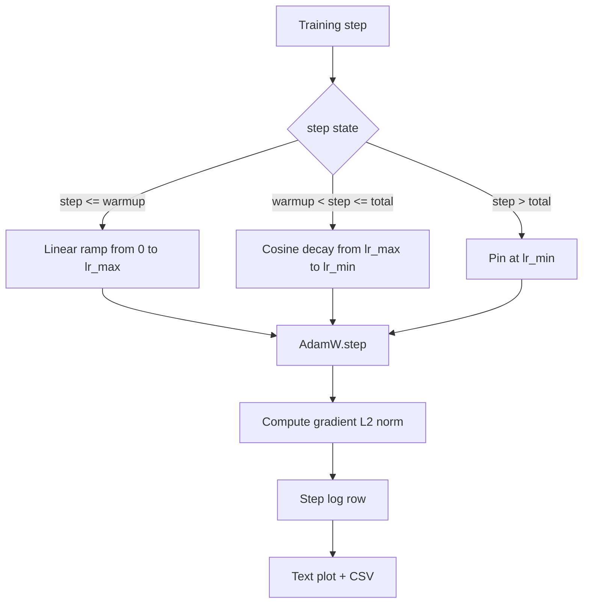

# 코시네 LR 선형 온화

> 학습률 스케줄은 손실 함수 다음으로 중요한 결정입니다. 코시네스 붕괴와 선형 온화와 함께 하는 AdamW는 언어 모델 훈련의 현대 기본 방식입니다. 왜냐하면 그것은 모델이 취약한 첫 번째 천 개정 중에 작은 효과적인 단계 크기를 볼 수 있게 해주고, 구성된 최고로 올라가고, 순조롭게 0으로 돌아갑니다. 이 수업은 그 스케줄을 만들고 훈련 단계에 대한 곡선을 그려내고 스케줄 옆에 있는 기하급수 규범을 기록하고 스케줄이 온화, 최고, 붕괴 경계를 존중한다는 것을 증명합니다.

**Type:** Build
**Languages:** Python
**Prerequisites:** Phase 19 lessons 30-37
**Time:** ~90 minutes

## 학습 목표

- 선형 온화화로 코시노 학습 속도 스케줄에 연결된 AdamW 최적화 장치를 구현합니다.
- 라인 중 부동 점 추락 없이 모든 단계에 일정의 정확한 값을 계산한다.
- 로그 그라디언트 L2 표준은 학습 속도와 함께 학습 건강이 관찰될 수 있도록 합니다.
- 시선이 읽을 수 있는 텍스트 플래그와 모든 도구가 사용할 수 있는 CSV로 스케줄을 돌려주십시오.

## 문제

첫 1000번의 훈련 업데이트가 가장 큰 소리입니다. 모델의 무게는 초기화에 가깝습니다. 최적화기 2순간 평가가 안정되지 않았습니다. 그라디언트 규범은 크고 소란하다. 이러한 업데이트를 통해 학습률이 최고 수준에 도달하면 모델은 완전히 다른 방향으로 이동하거나 손실 평판으로 정착하면 결코 탈출하지 않습니다. 두 가지 잘 알려진 수정 사항은 19단계 수업 45의 주제인 gradient clipping와 작은 시작과 상승하는 학습 속도 스케줄입니다.

코시네스와 온난화 시범은 세 가지 영역으로 이루어져 있습니다.`warmup_steps`학습률은 0에서 구성된 최고까지 선형적으로 확장됩니다 `lr_max`- 발걸음부터`warmup_steps`발걸음`total_steps`학습 속도는 코시네 곡선의 상반 부분을 따라`lr_max` `lr_min`- 그 후`total_steps`학습률은 `lr_min`그래서 과잉으로 치는 잘못된 트레이너는 침묵으로 일정을 벗어날 수 없습니다.

제작 문제는 일정이 하나씩 잘못되는 것이 쉽다는 것입니다. 일정이 하나씩 잘못되는 것은 일차로 훈련 경기에 6시간 동안 학습률이 나타나고 모델이 과잉 적응을 시작하는 순간 1% 너무 높거나 너무 낮습니다. 일정이 한계에 철저히 테스트되지 않는 한 보이지 않습니다.

## 개념



### 온화 수식

`step``[0, warmup_steps]``warmup_steps > 0`, 학습률은`lr_max * step / warmup_steps`- 퇴행자`warmup_steps = 0`이 경우 "온난화"가 되지 않는 것으로 취급됩니다.`lr_max`0 단계에 들어가면 즉시 코시네 붕괴를 일으킨다.`warmup_steps = 0`스케줄을 확인하는 것은 여전히 사용할 수 있는 곡선을 생성합니다.

### 코시네 공식

`step``(warmup_steps, total_steps]`학습률은`lr_min + 0.5 * (lr_max - lr_min) * (1 + cos(pi * progress))`어디`progress = (step - warmup_steps) / max(1, total_steps - warmup_steps)`- `step = warmup_steps`코시네는 `cos(0) = 1`, 즉`lr_max`, 정확히 온난화 최종점과 일치합니다.`step = total_steps`코시네는 `cos(pi) = -1`, 즉`lr_min`, 붕괴의 최종 지점에 정확히 일치합니다.

두 최종점에서의 연속성은 우연이 아닙니다. 이 때문에 일정은 하나의 기능으로 구현됩니다.`step`, 세 가지 다른 함수가 붙여진 것처럼 아닙니다. 붙여진 스케줄은 첫 번째 한계를 잃습니다.`lr_max`변했습니다.

### 전체 단계에 따라 바닥

`step > total_steps`학습률은 계속 유지됩니다`lr_min`. 계약은 명시적 이다: 일정은 오류가 발생하지 않으며 추출되지 않습니다. 그것은 바닥에 고 훈련자가 경고를 기록 할 수 있습니다. 훈련의 연장 필요 트레이너는 일정을 변경합니다 `total_steps`루프가 아니라

### 급격한 기준으로 추축된

스케줄은 훈련 건강의 절반이다. 기하급수적 기준은 다른 절반이다. 훈련 루프는 각 단계에 각각 기록한다. 격차적인 훈련 실행은 손실이 발생하기 전에 기하급수적 기준의 절감을 보여줍니다. 잘 조정된 온화화는 속도와 선형적으로 규범을 상승시키는 것을 유지합니다. 너무 공격적인 최고가 온화 후 높은 규범으로 나타납니다. 디스크에 있는 데이터 세트는`step, lr, grad_l2_norm, loss`CSV는 유일한 유연한 기록입니다.

```figure
cap-cosine-warmup
```

## 건설 해

`code/main.py`이 도구는

- `CosineWithWarmup`- 무국부 기능`lr(step) -> float`구성된 일정에 대한
- `TrainState`- 모델을 포장,`AdamW`최적화, 그리고 일정을 하나의 단계 기능으로
- `TrainState.step`- 1번 앞선, 1번 후진을 실행하고, L2 경진 기준을 기록하고, 적용됩니다`lr(step)`최적화 장치로
- `plot_schedule_ascii`- 시선이 읽을 수 있는 텍스트 플래그로 스케줄을 표현합니다.
- `write_schedule_csv`- 학습률과 함께 각 단계에 한 줄을 내보내야 합니다.

파일의 하단에 있는 데모는 작은`nn.Linear`모델은 고정된 입력 배치를 통해 20 단계에 걸쳐 열차를 수행하고, 단계별 학습 속도, 굴곡 규격 및 손실을 인쇄합니다. 일정은 시각적 정신 검사를 위한 텍스트 음표로도 표시됩니다.

실행하세요:

```bash
python3 code/main.py
```

스크립트는 0에서 출발하고 각 단계 훈련 로그를 더하고 스케줄 플롯을 인쇄합니다.

## 생산 패턴

네 가지 패턴은 일정을 생산 유물으로 끌어올립니다.

**Schedule lives in a config, not in code.**트레이너가 읽는다`warmup_steps``total_steps``lr_max``lr_min`git에 전념된 YAML 또는 JSON 구성에서. 스케줄은 구성 내용이 주관되어 있기 때문에 재생될 수 있으며, 스케줄은 PR 차이의 일부이기 때문에 감사 할 수 있습니다.

**Step counter is monotonic and decoupled from epochs.**일부 프레임워크는 데이터 세트가 쪼개지거나 데이터 로더가 다시 시작될 때 단계와 시대를 혼동합니다. 일정은 `global_step`훈련자의 체크포인트에서, 지역 카운터에서 아닌, 올바른 스케줄 위치에서 다시 실행이 계속됩니다. 왜냐하면 단계 카운터는 내구적인 축이기 때문입니다.

**Schedule plot in the run directory.**모든 훈련 경기는`outputs/lr_schedule.png`이 수업에서는 텍스트 플롯을 실행 디렉토리에 넣습니다. 디렉토리를 스키하는 리뷰어는 아무것도 다시 실행하지 않고도 일정을 건강하게 확인할 수 있습니다. 이것은 PR 시간에 잘못된 설정 된 일정을 버그 클래스를 잡습니다.

**Log row schema is fixed.** `step, lr, grad_l2_norm, loss`아래로 내려오는 노트북이나 대시보드는 스케마를 읽습니다. 버전을 지 않고 열의 이름을 변경하면 기존의 모든 대시보드가 무효화됩니다.

## 사용 하 고

생산 패턴:

- **Sweep peak before sweeping anything else.** `lr_max`가장 민감한 버튼입니다. 먼저 작은 모델에 스캔하세요.`lr_max`모델 크기와 함께 약하게 확장되므로 작은 모델 스윙은 강력한 전초입니다.
- **Warmup is a fraction of total steps, not an absolute count.**2,000 단계 가 있는 2억 단계 가 한 달 달리는 거의 즉시 최고점 에서 시작 됩니다. 같은 수 가 있는 20,000 단계 가 한 달 은 10% 가 더 따뜻 하게 됩니다.
- **`lr_min` is non-zero on purpose.**이 층은 10%`lr_max`긴 꼬리 동안 최적화 기사가 학습을 유지합니다.`lr_min = 0`스케줄은 플롯에서 멋지게 보이는 훈련 곡선을 생성하고 실제로 훈련이 끝나지 않은 모델입니다.

## 선박

`outputs/skill-cosine-warmup.md`실제 프로젝트에서 어떤 구성 요소가 스케줄을 가지고 있는지, 글로벌 카운터가 어떤 트레이너 단계에서 읽혀지고 있는지, 그리고 어떤 것을 설명 할 수 있습니다.`lr_max`스파이가 배포된 값을 생산했습니다. 이 교훈은 엔진을 배포합니다.

## 운동

1. 스케줄의 역수곱근 변형을 추가하고 200단계 장난감 훈련 경주에서 비교해 보세요. 어느 곡선은 최종 손실을 낮게 만듭니다?
2. `--restart`2차 온난화를 추가하는 깃발`total_steps / 2`- 장난감 실행 중 따뜻한 재발전이 좋아지거나 해지하는지 방어합니다.
3. 일정이 연속하다는 단위 테스트를 추가: 각 단계에 대해 `[0, total_steps]`차이점`|lr(step+1) - lr(step)|``lr_max / warmup_steps`- 그래
4. 일정을 `torch.optim.lr_scheduler.LambdaLR`이 강의는 간단한 단계 함수를 사용해서 팩은 어떻게 변할까요?
5. `--plot-png`                            `matplotlib`. 수업의 텍스트 플래그나 PNG가 CI 실행에 더 나은 기본인지 방어합니다.

## 주요 용어

| Term | What people say | What it actually means |
|------|-----------------|------------------------|
| Warmup | "Slow start" | Linear ramp from zero to `lr_max` over the first `warmup_steps` updates |
| Cosine decay | "Smooth drop" | Upper-half cosine curve from `lr_max` to `lr_min` over the remaining steps |
| Floor | "After training" | The fixed `lr_min` value the schedule pins at past `total_steps` |
| Gradient norm | "L2 of grads" | The Euclidean norm of the concatenated gradient vector, logged each step |
| Global step | "Schedule axis" | A monotonic step counter that survives restarts and drives the schedule |

## 더 많은 읽기

- [Loshchilov and Hutter, SGDR: Stochastic Gradient Descent with Warm Restarts (arXiv 1608.03983)](https://arxiv.org/abs/1608.03983)- 코시네 스케줄의 참조 서류
- [Loshchilov and Hutter, Decoupled Weight Decay Regularization (arXiv 1711.05101)](https://arxiv.org/abs/1711.05101)- 아담W의 참고문헌
- [PyTorch torch.optim.lr_scheduler](https://docs.pytorch.org/docs/stable/optim.html#how-to-adjust-learning-rate)- 단계 기능이 프레임워크 스케줄러와 어떻게 구성되는지
- 19 · 42 단계 - 이 스케줄이 소비되는 다운로더
- 19 · 43 단계 - 데이터 로더
- 19 · 45 단계 - 경각지대 절단 및 AMP, 루프의 다음 층
