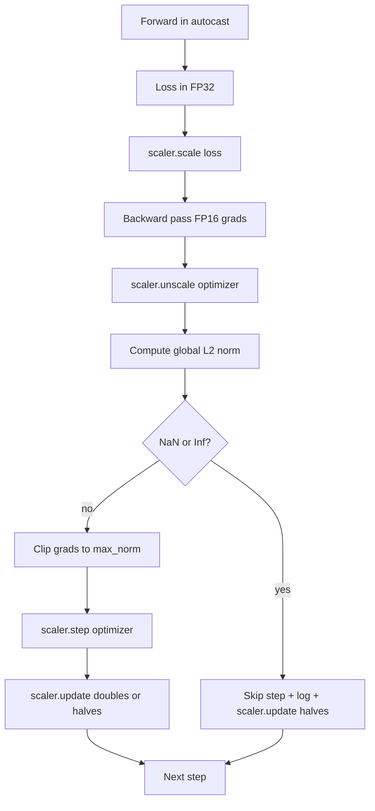

# 단계적 으로 절단 하고 혼합 된 정확성

> 이전 수업의 최적화와 스케줄은 gradients가 정상이라고 가정합니다. 보통 그렇지 않습니다. 단 한 번의 나쁜 배트는 3배 정도가 높은 기하급수치를 높일 수 있습니다. 혼합 정밀 훈련은 손실 측면에 FP16 과잉을 도입함으로써 이것을 증폭시킵니다. 이 수업은 생산 훈련이 할 수 없는 두 가지 안전벨트를 구축합니다. 구성된 글로벌 L2 표준에 대한 gradient clipping, 그리고 NaN와 Inf를 감지하고, 단계를 깨끗하게 건너뛰고, 형사학에 대한 확장 요소를 기록하는 자동 캐스트와 GradScaler와 혼합 정밀 루프.

**Type:** Build
**Languages:** Python
**Prerequisites:** Phase 19 lessons 30-37
**Time:** ~90 minutes

## 학습 목표

- 설정된 임계값을 초과할 때 모든 매개 변수 기하와 클립을 통해 글로벌 L2 규범을 계산한다.
- 자동 캐스트에 훈련 단계를 더해 GradScaler를 넣어서 FP16 앞과 뒤로 통과하는 것이 압류를 생존할 수 있습니다.
- 손실 또는 기하급수에서 NaN 및 Inf를 감지하고 최적화 단계를 건너뛰고 건너뛰기를 기록하십시오.
- GradScaler의 확장 요소를 모든 단계에 보고하여 긴 순서로 점프를 즉시 볼 수 있습니다.

## 문제

어제 순수하게 실행된 훈련은 8217단계로 수직으로 가는 손실 곡선을 만들어냅니다. 범인은 한 배가 있는데 그 gradient 표준은 4,200입니다. 최적화기는 절단 없이 이전 시간 동안 모델이 배운 모든 것을 재설정하는 단계를 적용합니다. L2 클립이 표준 1.0에 있는 글로벌 클립으로, 동일한 배트는 단위 표준 업데이트를 기여하고, 손실은 트렌드 라인에 유지되고, 실행은 생존합니다.

혼합 정밀 훈련은 FP16에서 앞선 패스와 후진 패스의 대부분을 계산함으로써 출력을 2-3배로 밀어냅니다. 비용은 FP16의 적도 범위가 좁다는 것입니다. FP16에서 과잉 흐르는 전형적인 기하급수는 Inf로 평가되며, 이는 다음 층을 통해 NaN로 번식하며, 다음 최적화 단계에서 모든 무게를 NaN로 설정합니다. PyTorch의 GradScaler는 후진 통과 전에 큰 확장 요소로 손실을 곱하고 최적화 단계 전에 같은 요소로 gradients를 나눕니다. 만약 어떤 기하급수도 미분기 시간에 Inf 또는 NaN이 된다면, 스칼러는 단계를 건너뛰고 스칼링 요소를 반으로 줄일 수 있고, 이전 N 단계가 깨끗하다면, 스칼러는 그 요소를 두 배로 늘린다. 훈련 과정에서 인수는 FP16 범위에서 허용되는 가장 높은 값을 찾습니다.

빌드 문제는 두 가지를 올바르게 연결하는 것입니다. 크립 (clipe) 는 unscale (unscale) 하기 전에 그리고 문턱은 스케일 (scale) gradients에 있습니다. 크립 (clipe) 는 unscale (unscale) 에 따라 그리고 GradScaler (grad) 에 대한 동작 순서가 중요합니다. 올바른 순서는 다음과 같습니다.`scaler.scale(loss).backward()`그럼`scaler.unscale_(optimizer)`그럼`clip_grad_norm_`그럼`scaler.step(optimizer)`그럼`scaler.update()`다른 순서가 침묵으로 깨진 루프를 만들어냅니다.

## 개념



### 글로벌 L2 표준

글로벌 L2 표준은 매개 변수 표준이 아니라, 동계차원 벡터의 유클리드 표준이다. PyTorch는 이것을`torch.nn.utils.clip_grad_norm_(parameters, max_norm)`함수는 "우리는 모든 단계에서 절단하고 있다"라는 진단에 필요한 자연적 값과 절단된 값을 모두 기록할 수 있도록 미리 절단된 기준을 반환합니다.

### 자동 캐스트 및 GradScaler

`torch.amp.autocast(device_type)`FP16에서 선택적으로 지원 가능한 운영 (매트무일 클래스 대부분의 운영) 을 실행하는 컨텍스트 매니저입니다. `torch.amp.GradScaler(device_type)`이 두 가지 요소는 함께 설계되어 있으며, 다른 하나는 없는 것이 테스트에서 발견해야 하는 구성 오류입니다.

수업은 CPU 자동 캐스트를 사용하므로 CI에서 실행되는 것입니다. 동일한 패턴은 변경하여 CUDA에 문자 그대로 전송됩니다.`device_type="cpu"` `device_type="cuda"`. CPU에 있는 GradScaler은 스터브 (CPU 오토캐스트는 이미 기본으로 BF16에서 작동하고 손실 확장이 필요하지 않습니다), 하지만 수업에는 호출 사이트가 포함되어 있으므로 전선이 GPU 루프와 동일합니다.

### NaN 및 Inf 검출

두 가지 장소에서 발견이 이루어집니다. 첫째, 손실 자체는 확인됩니다.`torch.isfinite`후퇴하기 전에 Inf 또는 NaN 손실은 유용한 기하급수 발생하지 않으며 최적화 장치에 들어가지 않고 skip됩니다.`scaler.unscale_(optimizer)`수업은               `has_non_finite_grad(...)`그리고 어떤 Inf 또는 NaN를 점프로 취급합니다. 두 가지 검사는 함께 앞과 후반 패스 실패 모드를 모두 포함합니다.

### 확장 요인 진단

스케일링 요소는 GradScaler의 내부 상태입니다.`scaler.get_scale()`그리고 학습 속도와 기하급수 규범 옆에 기록합니다. 건강한 실행은 스컬링 요소가 2의 힘으로 올라가는 것을 보여줍니다.`2^17`또는`2^18`. 잘못된 동작 실행은 높은 값과 낮은 값 사이에 변하는 요소를 나타냅니다. 이는 모델의 기하급수가 때때로 범위 내에서 있고 때로는 그렇지 않다는 신호입니다.

```figure
grad-clip-monitor
```

## 건설 해

`code/main.py`이 도구는

- `clip_global_l2_norm`-  `torch.nn.utils.clip_grad_norm_`이 방법은 클립 전과 클립 후의 규범을 모두 반환합니다.
- `has_non_finite_grad`- NaN와 Inf를 위한 gradients를 스캔하는 보조기
- `AmpTrainState`- 모델을 포장,`AdamW`최적화, GradScaler, 그리고 자동 캐스팅 장치.`step(inputs, targets)`전체 절단, 확장, 그리고 NaN 파이프라인을 니다.
- `StepLog`그리고`SkipLog`- 단계별로 구성된 기록
- 작은 걸 훈련시키는 데모`nn.Linear`20 단계에 걸쳐 모델, 5 단계의 기하급수에 Inf을 주입하여 점프 경로를 수행하고, 결과 로그를 인쇄합니다.

실행하세요:

```bash
python3 code/main.py
```

스크립트는 0에서 출발하여 각 라인을 태그한 각 단계 로그를 인쇄합니다`STEP`또는`SKIP`; 적어도 한 줄은 a`SKIP`- 그래

## 생산 패턴

4개의 패턴은 루프를 생산 훈련 단계로 끌어올립니다.

**Skip counter as an alert, not a log line.**훈련 경주마다 몇 가지 점프가 생생하다. 한 시대마다 수백 점프가 어려운 경고입니다. 모델은 FP16 체제에서 유지될 수 없으며 루프는 침묵으로 실패하고 있습니다. 수업은 1,000 단계의 롤링 점프 속도를 추적하고 생산에서 5% 이상의 속도로 페이지가 될 것입니다.

**Clip threshold lives in the config.** `max_norm = 1.0`언어 모델 훈련의 현대적 기본입니다. 먼저 작은 모델에 스캔하십시오. 더 큰 임대値は 모델을 진정으로 어려운 배트에서 회복하도록 합니다. 더 작은 임대値は 더 큰 손실 곡선의 비용으로 최악의 경우를 제한합니다. 임대値は 수업 44의 스케줄과 같은 YAML 또는 JSON 구성에 속합니다.

**Norm log goes to a CSV with the schedule.**CSV 기둥은`step, lr, grad_l2_pre_clip, grad_l2_post_clip, loss, skipped, skip_reason, scaler_scale`. 파일을 열는 리뷰어는 일렬, 그라디언트 스토리, 스케일링 요소 및 점프 결과 (그 이유와 함께) 를 한 줄에 볼 수 있습니다. 파일들 간의 열을 분할하는 것은 잘못된 분석의 요리법입니다.

**`scaler.update()` runs every step, even on skip.**깨끗한 단계에서는 스칼러는 비-인프 카운터를 읽고, 증가시켜, 아마도 계수를 두 배로 증가시킵니다. 건너뛰는 단계에서는 스칼러는 계수를 반으로 나누고 카운터를 다시 설정합니다. 잊습니다.`update()`스피프 경로에는 "스컬링 팩터가 변하지 않는다"라는 버그가 있습니다.

## 사용 하 고

생산 패턴:

- **Autocast device matches optimizer device.** `torch.amp.autocast(device_type="cuda")`GPU 훈련에 관한 것`torch.amp.autocast(device_type="cpu")`CPU를 섞는 장치들은 침묵형 오류를 발생시켜 손실 곡선으로 나타납니다.
- **Loss check before backward.** `torch.isfinite(loss).all()`한 번만 단축하면, 비용은 무시할 수 없고, NaN 손실에 대한 절약은 훈련 단계입니다. 항상 실행하세요.
- **`set_to_none=True` in `zero_grad`.**gradients를 으로 설정합니다`None`0 대신, 최적화 장치가 영향을 받지 않은 파라미터 그룹을 위한 계산을 건너뛰도록 합니다. 설정은 무료 처리량 향상과 약간의 버그 표면 감소입니다.

## 선박

`outputs/skill-clip-amp.md`실제 프로젝트에서 훈련 단계에서 사용하는 클립 문턱과 자동 캐스팅 장치, 버전 제어에서 단계별 CSV가 어디에 살고 있으며, 생산 점프-레이트 경고 문턱이 무엇인지 설명합니다. 이 교훈은 엔진을 배포합니다.

## 운동

1. 합성 Inf 주사를 실제 손실 스피크로 교체하고 (그조의 목표 1e8로 곱) 점프 경로 트리거를 확인하십시오.
2. `--bf16`FP16 대신 자동 캐스트를 BF16로 전환하는 모드. BF16는 FP16보다 더 넓은 기하급수 범위를 가지고 있으며 거의 손실 확장이 필요하지 않습니다. 같은 데모에서 점프 비율이 0으로 떨어지는 것을 확인합니다.
3. 그라디언트 클립 랩이 클립 전과 클립 후의 규범을 올바르게 반환하는 단위 테스트를 추가하십시오.
4. 로킹 윈도 스피프 레이트 계산과 CLI 플래그를 추가하여 레이트 속도가 100 단계 연속으로 구성된 임계값을 초과하면 실행이 실패합니다.
5. 로프를 연결하여 정통 CSV를 작성 (`step, lr, grad_l2_pre_clip, grad_l2_post_clip, loss, skipped, skip_reason, scaler_scale`) 를 확인하고 각 줄이 끝나고 빨래를 통해 파일의 Ctrl-C를 유지합니다.

## 주요 용어

| Term | What people say | What it actually means |
|------|-----------------|------------------------|
| Global L2 norm | "Clip target" | Euclidean norm of the concatenated gradient vector across all trainable parameters |
| autocast | "Mixed precision" | Selective FP16 (or BF16) execution of eligible operations inside a `with` block |
| GradScaler | "Loss scaler" | Helper that multiplies the loss before backward and inverse-scales gradients before the optimizer step |
| Skip | "Bad step" | An optimizer step refused because the gradient or loss was non-finite; the scaler halves the factor |
| Scaling factor | "Scaler state" | The GradScaler's current multiplier; doubles after clean stretches and halves on every skip |

## 더 많은 읽기

- [Micikevicius et al., Mixed Precision Training (arXiv 1710.03740)](https://arxiv.org/abs/1710.03740)- 원래의 손실 규모의 제안
- [Pascanu, Mikolov, Bengio, On the difficulty of training recurrent neural networks (arXiv 1211.5063)](https://arxiv.org/abs/1211.5063)- 경각지방 절단 기준 종이
- [PyTorch torch.amp.GradScaler](https://docs.pytorch.org/docs/stable/amp.html)- 이 수업에 포함된 스칼러 API
- [PyTorch torch.nn.utils.clip_grad_norm_](https://docs.pytorch.org/docs/stable/generated/torch.nn.utils.clip_grad_norm_.html)- 이 수업에서 사용하는 원시적인 절단
- 19 · 42 단계 - 큐퍼스가 루프를 공급하는 다운로더
- 19 · 43 단계 - 루프에서 소비되는 데이터 로더
- 19 · 44 단계 - 이 루프가 구성하는 스케줄
