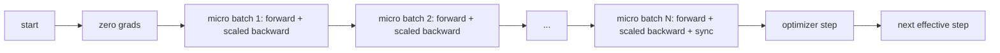
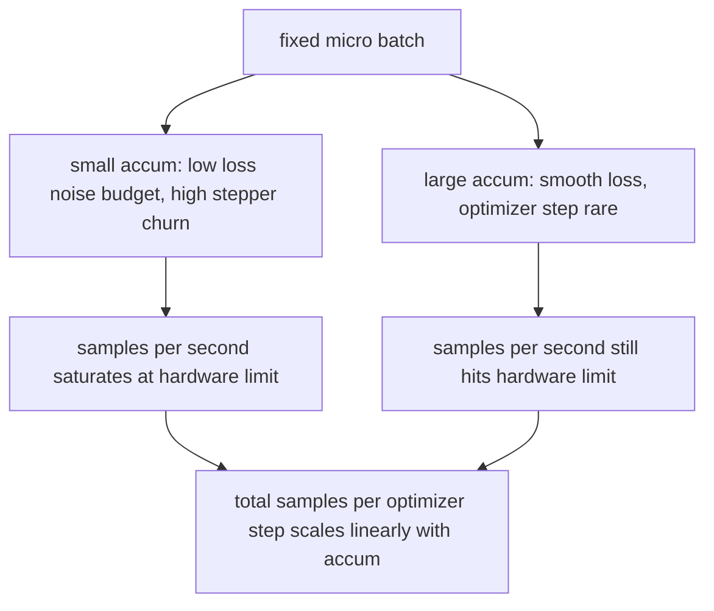

# 점진적 축적

> 효율적인 배치를 할 수 없는 한 배치를 한 번에 한 배로 훈련 시키십시오. 손실을 측정하고, 최적화 단계를 유지하고, gradients를 쌓아 올리도록 하십시오.

**Type:** Build
**Languages:** Python
**Prerequisites:** Phase 19 lessons 42 to 45
**Time:** ~90 minutes

## 학습 목표

- 유효 배트 아이덴티티를 추출한다: `effective_batch = micro_batch * accum_steps`- 그래
- 미세 배트당 손실 스케일링을 실시하여 축적된 기하급수가 단일 전체 배트 후진과 일치합니다.
- 마지막 마이크로 패치 (최후 단계 동기화) 까지 최적화 시인kronization를 건너뛰십시오.
- 효과적인 패치 곡선에 대한 출력을 읽어내며 감소하는 수익을 설명하십시오.

## 문제

512의 효과적인 배치를 훈련시키고 싶네요. 왜냐하면 손실 곡선은 더 부드럽고 최적화 단계가 그 규모에서 더 합리적이기 때문입니다. 책상 속속기는 32개의 예를 가지고 있습니다. 배치를 두 배로 늘리는 것은 선택이 아닙니다. 모델의 절반을 줄이는 것은 선택이 아닙니다. 2017년에 이 필드가 시도한 트릭은 16개의 뒤로 통과를 실행하고, 매개 변수 버퍼 안에 gradients가 축적되고, 그리고 수치가 목표에 도달했을 때만 최적화기를 단계로 내딛는 것입니다.

더 큰 배트에서 손실이 더 이상 같은 수가 될 수 있습니다. 순진하게 합친 16 개의 미니 배트의 크로스 엔트로피는 전체 배트의 손실의 16 배입니다. 확장하지 않으면 경사 방향이 옳지만 크기는 잘못되고 최적화 단계는 16 배가 너무 크습니다. 수정은 한 분배입니다. 수정 또한 잊기 쉽습니다.

## 개념



계약은 짧습니다.

- 각 마이크로 배트 손실은 `accum_steps`이전`backward()`. 피토크는 그라디언트를 합쳐서`param.grad`기본값으로, 분배는 실행 금액을 올바른 스케일로 다시 밀어냅니다.
- 최적화 단계가 마지막 마이크로 패치가 뒤로 물러나면 효과적인 패치마다 한 번 발사합니다. 축적 중 단계가 모든 매개 변수를 좌우합니다.
- 최적화자 상태 (momentum buffers, Adam moments) 는 미세조합에 한 번이 아니라 효과적인 단계마다 한 번 진행됩니다. 전수 이동 평균은 그렇지 않으면 잘못된 주파수를 보고 일정을 통해 불립니다.
- 단일 장치에서 이것은 회계입니다. 다급 클러스터에서 동일한 패턴은 최종적인 미세 배치를`no_sync`그라디엔트를 건너뛰는 맥락은 모든 감소; 마지막 마이크로 배트는 네트워크 비용을 N 배로 지불하는 대신 한 번에 전체 축적된 그라디엔트를 감소시킵니다.

### 코드에서 적립 증명

```python
loss = criterion(model(x_full), y_full)
loss.backward()
opt.step()
```

이 값은

```python
for x, y in chunks(x_full, y_full, n):
    scaled = criterion(model(x), y) / n
    scaled.backward()
opt.step()
```

이 함수의 끝에서 축적된 기하급수 버퍼는 단일 전체 배트 후진으로 생성되는 같은 텐서입니다. 수업 코드는 1e-4에서 1e-4 이하의 최대-abs 차이로 이것을 주장합니다.`equivalence_check`- 그래

### 비용의 차이는

각 마이크로 패치가 1개 앞선 1개 뒤진 비용으로 저장된 메모리를 시간으로 교환합니다.`outputs/accum-curve.json`유효 배치가 고정된 마이크로 배치에서 성장함에 따라 어떤 일이 일어나는지 보여줍니다:



무료 점심은 없습니다.`accum_steps`최적화 단계마다 벽 시간을 두 배로 늘립니다. 변화하는 것은 gradient 추정의 변동입니다. 같은 벽 예산에서 최적화 단계가 적었지만 각각의 단계들은 더 많은 샘플에 평균되었습니다. 문학은 큰 배트와 작은 배트를 다른 최적화 문제로 취급합니다. 여기서 교훈은 기계적, 통계적인 것이 아닙니다.

```figure
cc-grad-accumulation
```

## 건설 해

`code/main.py`이 미술품은 세 가지 기능을 합니다.

### 단계 1: 동등성 검증

`equivalence_check()`같은 씨를 사용하여 동일한 네트워크의 두 개의 복사본을 만듭니다. 하나는 16 샘플 패치를 한 번 앞으로 통과하는 것을 볼 수 있습니다. 다른 하나는 손실을 4 으로 나눈 4 샘플 조각을 볼 수 있습니다. 함수는 최적화 단계 이전의 기하급수 버퍼와 그 다음의 매개 변수를 비교합니다. 주장은`max_abs_diff < 1e-4`- 그래

### 단계 2: 마지막 단계에 동기화 패턴

`train_one_optimizer_step`미세조합을 걸고 있습니다. 마지막을 제외하고는 모든 미세조합에`no_sync_context(model)`. 단일 프로세스에서 컨텍스트는 노-오프입니다. DDP에서는 모든 감소 gradient이 건너뛰는 곳입니다.`sync_counter`우리는 no_sync 범위를 얼마나 많은 번이나 떠난지를 기록합니다. N 마이크로 배치에 대한 계산은 N가 아닌 1개의 효과적인 단계에 대한 것입니다.

### 단계 3: 출력 곡선

`sweep_effective_batches`동일한 모델을 고정된 마이크로 패치와 축적 단계 목록으로 실행합니다. 각 설정에 대해 로그:

- `samples_per_sec`: 벽 시간으로 나뉘어 볼 수 있는 샘플의 총
- `median_step_ms`: 효과적 단계당 50번째 percentile
- `sync_calls`: 집단 점
- `avg_loss`: 스웨이의 최적화 단계의 평균

생산량은 `outputs/accum-curve.json`그리고 노트북에서 재사용 가능합니다.

실행하세요:

```bash
python3 code/main.py
```

스크립트는 동등함 디프리프, 그 다음 스파이 테이블, 그리고 JSON 경로를 인쇄합니다.

## 사용 하 고

생산 훈련에서, gradient 축적은 한 번 뒤에 살고 있습니다. PyTorch의 패턴은`accumulation_steps = effective_batch // (micro_batch * world_size)`여기서 사용이 금지된 프레임워크는 동일한 루프를 지만 단계들은 동일합니다. 손실을 확장하고, 최종 미생물에 동기화하지 않고, 축적하고, 한 단계가 됩니다.

야생에서 3가지 패턴이 있습니다.

- 마이크로 패치 크기는 장치 메모리를 포화하기 위해 선택됩니다. 작은 것은 가속 주기를 낭비합니다. 큰 것은 충돌합니다.
- 효과적인 배치는 학습률 일정에서 선택됩니다. 큰 효과적인 배치는 확장된 학습률과 온화가 필요합니다. 이것은 2017 년부터 논의된 선형 확장 규칙입니다.
- 누적 수치는 두 개의 버튼과 데이터 로더를 다시 작성하지 않고 실행 시점에 자유롭게 조정할 수있는 유일한 버튼 사이의 다리입니다.

## 선박

`outputs/skill-gradient-accumulation.md`레시피를 캡처하여 동료가 새로운 repo에 떨어뜨릴 수 있습니다:`accum_steps`, 최종 미크로에서 최적화 시인크를 건너뛰고, 효과적인 패치당 한 번 최적화 단계로 이동하여, 효과적인 패치에 대한 출력을 JSON로 기록하여 거래가 가시합니다.

## 운동

1. 으로 다시 `--num-steps 100`그리고 실제 배치를 대비하여 초당 표본을 찍습니다. 곡선은 어디에 평평하게 됩니다?
2. 잘못된 스케일 변형을 추가하고 (분할이 없습니다) 단계 1에서 참조에 대한 변수 difr을 표시합니다.
3. SGD를 AdamW로 교환하고 최적화 상태의 진전을 확인하는 것은 효과적 단계마다 한 번이 아니라 마이크로 배트마다 한 번이 아닙니다.
4. 실제를 소개해 주세요`DistributedDataParallel`         `no_sync_context`시그_콜이 유효 배트당 N-1로 떨어지는 것을 확인합니다.
5. 동등성 검사를 수정하여 두 개의 다른 마이크로 스플릿 (2 x 8 vs 4 x 4) 을 비교하고 휴식을 취하는 데 필요한 용납성을 설명하십시오.

## 주요 용어

| Term | What people say | What it actually means |
|------|-----------------|------------------------|
| Micro batch | The batch you forward | The slice that fits in memory in a single forward pass |
| Accum steps | Backward passes per step | Number of backwards summed before one optimizer step |
| Effective batch | The batch | Micro batch times accum steps times data parallel world size |
| Loss scaling | Divide by N | Per-micro-batch division so summed gradients match full batch |
| Sync on last | Skip the rest | Only run the gradient collective on the last backward in the window |

## 더 많은 읽기

- PyTorch 문서`DistributedDataParallel.no_sync`마지막 단계에 시크로나시팅 트릭의 제작 버전에 대해
- 고얄 등은 2017년에, 큰 배트 훈련에 대한 선형 스케일링에 대해, 효과적인 배트에 대한 관심의 정통적인 이유입니다.
- PyTorch의 문제 추적기는 혼합 정밀성 비중화와 gradient 축적 상호작용에 관한 것입니다.
- 19단계 수업 42~45은 이 수업이 가정하는 모델, 데이터 로더, 최적화 및 트레이너 스카프라드를 다루고 있습니다.
- 19단계 수업 47은 체크포인트와 재개 과정을 다루고 있어 긴 축적 경기가 벽 시계 뚜을 살아남을 수 있습니다.
