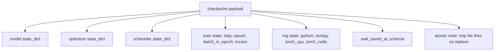
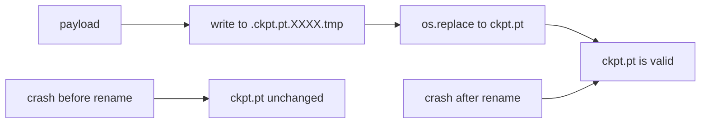
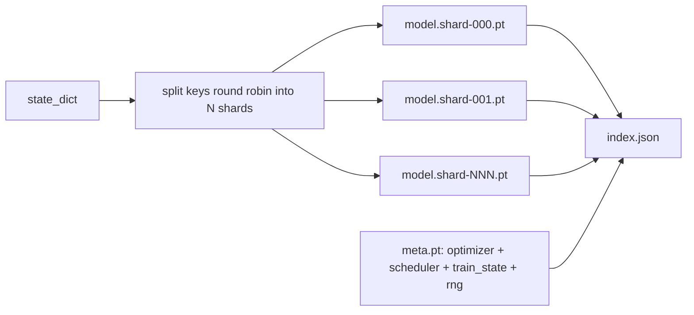

# 체크포인트 저장 및 재개

> 기차가 중단되는 경우, 시범이 계속되도록 하고, 시범점이 계속되도록 합니다. 모델, 최적화, 스케줄러, 손실 역사, 단계 카운터, RNG 상태를 원자력으로 저장하여, 시범이 언제든 유효한 파일을 디스크에 남겨두고 있습니다.

**Type:** Build
**Languages:** Python
**Prerequisites:** Phase 19 lessons 42 to 45
**Time:** ~90 minutes

## 학습 목표

- 전체 훈련 상태를 하나의 유용 로드로 포착하여 새로운 프로세스에 재충전할 수 있습니다.
- 원자 저장과 함께 쓰기-temp를 구현하고 이름을 변경하여 충돌은 결코 반 작성된 파일을 남기지 않습니다.
- 파이썬, NumPy, PyTorch의 RNG 상태를 복원하여 재개 후 손실이 끊이지 않는 기본 라인에 일치하도록합니다.
- 한 파일로 더 이상 맞지 않는 모델에 대한 셔드 체크포인트 레이아웃을 구축하고, 해시 검증된 셔드 및 JSON 인덱스를 사용합니다.

## 문제

18시간 동안 훈련을 맡았어 벽속기 봉기는 4시간입니다. 클러스터가 11시에 다시 시작됩니다. 왜냐하면 여러분의 급여급 이상의 누군가가 커널 업그레이드를 승인했기 때문입니다. 체크포인트 없이 다시 시작하세요. 재개 과정 없이도 처음 11시간 동안 학습하는 최적화 상태를 잃게 됩니다. 그래서 모델 중량이 살아남았다고 하더라도, AdamW 순간은 사라지고 다음 단계는 훈련 궤도가 이미 지나간 방향으로 서둘러 있습니다.

올바른 유물은 계속하기 위해 필요한 모든 것을 담은 단일 파일입니다: 모델 매개 변수, 최적화 상태, 스케줄러 상태, 음반의 손실 역사, 현재 단계와 시대 및 시대 및 배트-인-시대 카운터, 그리고 모든 무작위성 소스의 RNG 상태. RNG 상태가 없으면 재개된 손실 곡선은 다른 곡선입니다. 같은 모델, 같은 데이터, 다른 믹스, 다른 롭아웃 마스크, 다른 번호가 래시보드

Atomic save는 계약의 다른 절반입니다. 최종 파일 이름에 입력하는 것은 충돌 중 작성이 손상된 파일을 남기고, 재개편은 쓰레기를 읽습니다. 같은 디렉토리에 일시적인 파일로 입력하고 이름을 변경하면 충돌 중 작성이 이전 좋은 파일을 손상되지 않은 상태로 남기고, 변경된 이름은 POSIX 파일 시스템에서 원자입니다.

## 개념



### 5개의 국가 덩어리

| Bucket | Why it matters |
|--------|----------------|
| Model | Weights and buffers; what the model is. |
| Optimizer | Momentum and adaptive moments; without these the next step is a different optimization problem. |
| Scheduler | Where the learning rate is on its curve; cosine schedules in particular care. |
| Train counters | Step, epoch, batch-in-epoch, plus the loss history that draws the dashboard. |
| RNG state | Determinism for dropout, data shuffling, and any sampling inside the model. |

### 원자력 저장



두 가지 규칙: 첫째, 임시 파일은 목표와 동일한 디렉토리에서 살고 있으므로 변경명은 동일한 파일 시스템 내에서 유지됩니다. 장치 간 변경명은 원자적이지 않습니다. 둘째, 임시 이름은 시도마다 독특하므로 두 명의 작가가 발자국을 하지 않습니다.

### 쪼개진 체크포인트

모델이 커지면 단일 파일의 유용 부하가 너무 커서 빠르게 로드 될 수 없고, 너무 커서 검사할 수 없으며, 네트워크가 중간 읽기 중에 고개를 끄는 경우 너무 고통스럽습니다.



이 지수는 셔드 수를 기록하고, 각 셔드의 sha256 및 메타 파일의 sha256를 기록합니다. 해시 부합이 발생하면 로더가 크게 실패합니다. 셔드는 다른 물리적 디스크에 착륙 할 수 있습니다. 메타는 작고 먼저 읽습니다.

### 서사진은 중기 계속됩니다

다음 시대를 시작으로 몇 분에서 하루까지 폐기물을 처리하는 서사진입니다.`(epoch, batch_in_epoch)`RNG 상태를 더하여, 로드 후 훈련 루프는 현재 시대에서 이미 소비된 배치를 지나 무작위 숫자 생성기를 빠르게 진행하고`batch_in_epoch`. 수업 코드는 정확히 그렇게 합니다. 주장은 1e-4 내의 끊이지 않는 기본 라인과 재개 후 손실 궤도가 일치한다는 것입니다.

```figure
cc-atomic-checkpoint
```

## 건설 해

`code/main.py`4개의 원시형과 데모 드라이버를 제공합니다.

### 단계 1: RNG 상태를 캡처하고 복원

`capture_rng_state`파이썬의 명령어로`random.getstate`, NumPy의`np.random.get_state`, 그리고 PyTorch CPU와 CUDA RNG 바이트. 각 조각은 단순한 파이썬 숫자, 튜플, 목록으로 저장됩니다.`tolist()`), 그래서 3 단계의 로더는 임의의 객체를 풀지 않고 다시 읽을 수 있습니다. `restore_rng_state`CPU 텐서는 PyTorch의 RNG가 사용하는 Uint8 바이트 버퍼입니다.

### 2단계: 원자력 저장

`atomic_save`타겟 디렉토리에 있는 임시 파일로 유용한 로드를 작성하고,`os.replace`마지막 이름을 바꾸어 놓습니다.`atomic_write_json`분해된 지수에 대해서도 똑같이 합니다.

### 3단계: 전체 체크포인트 반여행

`save_checkpoint`모델, 최적화, 스케줄러, 기차 상태, RNG를 하나의 명령으로 포장합니다. `load_checkpoint`다시 돌려서 `TrainState`. 스케마 필드는 업그레이드 할크입니다. 미래의 형식의 변경은 버전 문자열과 로더를 눌러줍니다.

`load_checkpoint`전화`torch.load(..., weights_only=True)`- A`.pt`파일은 이고, 신뢰할 수 없는 파일을 풀는 건`weights_only=False`파일 이름의 코드 무엇이든 실행합니다. 무게만 로더는 텐서와 원시 컨테이너를 받아들이고 다른 모든 것을 거부합니다. 그래서 단계 1은 RNG 상태를 순수한 목록에서 유지합니다.`ValueError`사용 대신`assert`왜냐하면`python -O`스트립은 주장합니다. 타르 2.6 또는 더 새로운 것을 사용하십시오.`weights_only=True`알려진 우회 (CVE-2025-32434) 를 가지고 있어서, 이 수업의 보증은 2.6부터만 유지된다.

### 단계 4: 조각 된 변종

`save_sharded_checkpoint`N 셔드에서 매개 변수 키를 둥글게 고, 각각의 셔드에서 자체적인 원자 저장 기능을 가지고 작성하고, 최적화 및 스케줄러 및 트레인 상태의 메타 파일을 작성하고, 셔드 sha256s로 JSON 인덱스를 작성합니다. `load_sharded_checkpoint`합병하기 전에 모든 갱단들을 확인하고 체크포인트 디렉토리 밖에서 해결되는 갱단 경로를 거부합니다.

### 단계 5: 재개시 demo

`run_resume_demo`작은 모델을 훈련합니다`total_steps`, 에서 체크포인트를 저장합니다`interrupt_at`, 다음으로 계속됩니다. 두 번째 프로세스는 체크포인트를 복원하고 나머지 단계를 실행합니다. 함수는 중단 포인트 이후 두 손실 궤도 사이의 최대 절대 차이를 반환합니다. RNG를 복원하면 차이가 0 또는 부동소수점 소음입니다.

실행하세요:

```bash
python3 code/main.py
```

단일 파일과 쪼개진 디모는 모두 1e-4 아래의 최대 차이를 주장합니다.`outputs/resume-demo.json`- 그래

## 사용 하 고

제작 훈련은 트레이너의 일부로 선박 체크포인트를 쌓습니다. 형태는 동일합니다. 모델 + 최적화 + 스케줄러 + 카운터 + RNG, 원자로 작성되어, 가장 최신의 단계를 쉽게 찾을 수 있도록 이름 붙여졌습니다. 쪼개진 레이아웃은 평행 읽기와 큰 모델 로딩을 지원합니다. index.json는 그 작업을 수행합니다.

4가지 패턴을 적용해야 합니다.

- **Load with `weights_only=True`.**공유 드라이브나 다운로드에서 가져온 체크포인트는 신뢰할 수 없는 입력입니다. 무게가 있는 로더는 재개되는 기계에서 악성 파일을 실행하지 못하게 합니다.
- **Schema is a string in the payload.**이 형태가 없으면 오래된 노선을 깨지 않고는 형식을 진화시킬 수 없습니다.
- **Sha256 every shard.**침묵으로 단축된 다운로드는 최악의 종류의 오류입니다. 로더가 빠르게 실패하거나 늦게 실패합니다.
- **Keep checkpoint cadence honest.**N 단계와 모든 시간 분을 저장하세요. 그 중 짧게는 얼마든지요. 그렇지 않으면 큰 단계가 충돌하면 모든 작업의 창을 낭비합니다.

## 선박

`outputs/skill-checkpoint-save-resume.md`새로운 훈련 스크립트의 레시피입니다: 유용용 로드 모양, 원자 쓰기, RNG 캡처, 조각된 지표.`save_checkpoint`주기적인 저장소에서, 와이어 `load_checkpoint`시작 시, 그리고 달리는 죽음에서 살아남는다.

## 운동

1. 돌 돌 돌 돌 돌 돌 돌 돌 돌 돌 돌 돌 돌 돌 돌 돌 돌 돌 돌 돌 돌 돌 돌 돌 돌 돌 돌 돌 돌 돌 돌 돌 돌 돌 돌 돌 돌 돌 돌 돌 돌 돌 돌 돌 돌 돌 돌 돌 돌 돌 돌 돌 돌 돌 돌 돌 돌 돌 돌 돌 돌 돌 돌 돌 돌 돌 돌 돌 돌 돌 돌 돌 돌 돌 돌 돌 돌 돌 돌 돌 돌 돌 돌 돌 돌 돌 돌 돌 돌 돌 돌 돌 돌 돌 돌 돌 돌 돌 돌 돌 돌 돌 돌 돌 돌 돌 돌 돌 돌 돌 돌 돌 돌 돌 돌 돌 돌 돌 돌 돌 돌 `.weight`vs `.bias`) 각 레이아웃은 언제 선호할 수 있습니까?
2. 마지막 K 점검점을 유지하기 위해 저장 루프를 확장하고 오래된 점들을 절단하십시오. 디스크가 작을 때 오른쪽 K는 무엇입니까?
3. `--ckpt-every-seconds`벽 시계 간격에서 저장을 유발하는 플래그, 단순히 단계 계산이 아닙니다.
4. 시작 시 실행되는 체크섬 확인 경로를 추가하고 디렉토리의 모든 체크포인트를 스캔하고 어떤 점들이 손상되었는지 보고합니다.
5. `migrate_v1_to_v2`함수는 이용 로드에 새로운 필드를 추가하고 스키마 문자열을 뭉치게 합니다.

## 주요 용어

| Term | What people say | What it actually means |
|------|-----------------|------------------------|
| Atomic save | "Write and pray" | Write to a temp file in the same directory, then os.replace into the target name |
| State dict | "The weights" | Model parameters and buffers, keyed by parameter name |
| Sharded checkpoint | "Big model file" | Multiple files, one per shard, plus a meta file and a JSON index with sha256s |
| RNG state | "Random seed" | Captured state for python random, numpy, torch CPU, torch CUDA; not just the seed |
| Mid-epoch resume | "Restart" | Fast-forward the RNG and continue from the next batch in the same epoch |

## 더 많은 읽기

- POSIX`rename`원자력성 이론의 의미론은`os.replace`그 이유는
- PyTorch 문서`torch.save`그리고`torch.load`,`map_location`       `weights_only`신뢰할 수 없는 파일을 로드하는 데
- 19단계 수업 46은 이 수업의 체크포인트의 유용 부하가 생존하는 gradient 축적을 다루고 있습니다.
- 19단계 수업 48은 이 계획에 해당하는 국가 규정 형식을 가진 배포 된 포장지를 포함한다.
- 리눅스 커널`fsync`원자력 명칭 변경에 대한 지속가능성 보장에 대한 문서
