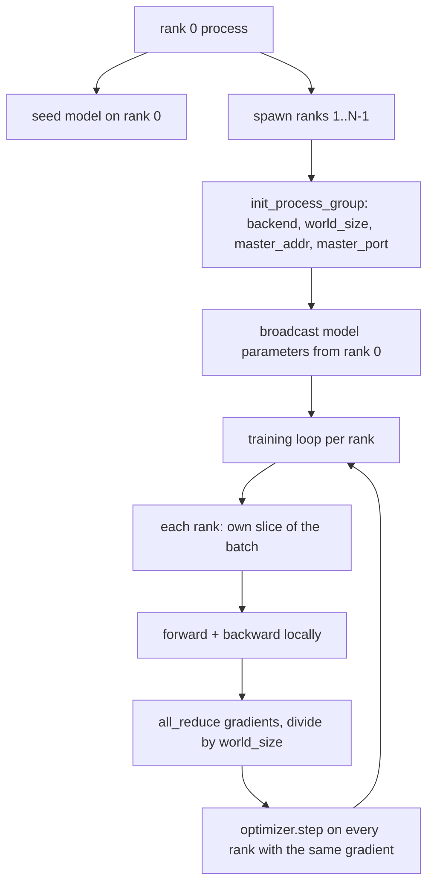
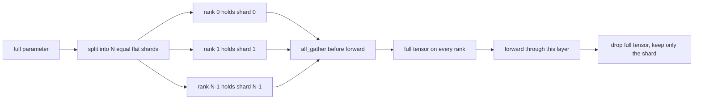

# 분산 데이터 패럴 및 FSDP

> 다급 훈련은 두 개의 집단과 하나의 규칙입니다. 시작 시 매개 변수를 방송하고, 뒤로 한 번 그레디언트를 평균하고, 어떤 단계에 있는지에 대해 계급이 동의하지 않도록 해줍니다.

**Type:** Build
**Languages:** Python
**Prerequisites:** Phase 19 lessons 42 to 45
**Time:** ~90 minutes

## 학습 목표

- N 순위에서 프로세스 그룹을 `gloo`백엔드, 특별한 하드웨어가 없습니다.
- 건설 시 매개 변수를 방출하고 후진을 완전히 감소시키는 최소한의 DDP 팩을 구현하십시오.
- 순위당 gradients의 전체 감소가 concatenated 입력에서 단일 프로세스 gradient에 일치한다는 것을 증명한다.
- 스케치 FSDP 파라미터 조각: 각 순위는 슬라이드를 가지고 있으며 전용 텐서가 앞으로 통과하기 위해 수집되고 그 후에 떨어집니다.

## 문제

모델은 하나의 장치에 적합합니다. 데이터 세트는 그렇지 않습니다. 최적화 예산은 초당 N 곱하기 예를 보고 싶어한다고 합니다. 첫 번째 레버는 데이터 병렬입니다. 각 순위는 다른 패치의 다른 슬라이드에 동일한 모델을 실행하고, 최적화 단계 전에 평균 기하급수입니다. 두 번째 레버는 FSDP: 모델은 하나의 장치에도 적합하지 않으므로 각 순위는 모든 매개 변수의 분수를 보유하고 있으며 앞으로 통과하는 동안 전체 텐서 층으로 층으로 재구성합니다.

이 문제 는 회계 에 있다. 매개 변수 가 순위 를 가로 질러 이동 한다면 실행 은 침묵 으로 부패 합니다. 그 정도 를 평균 할 경우 하지만 손실 을 내지 않으면 래시보드 는 거짓 합니다. 집단적 인 백엔드가 토폴로지 에 동의 할 수 없다면 실행 은 영원히 매달립니다. 해결 방법은 집단 을 한 번 만 손으로 작성 하는 것 이며, 복제 할 수 없는 래퍼 를 결코 신뢰 하지 않는 것 이다.

이 수업은 CPU에서 실행됩니다. CUDA는 가정되지 않습니다.`gloo`모든 PyTorch 제작 및 수용하는 백엔드 선박`torch.multiprocessing`노동자; 동일한 코드 `nccl`구조가 변하지 않고 다중GPU 노드에서

## 개념



### 중요한 두 집단

| Collective | What it does | When |
|------------|--------------|------|
| `broadcast` | Copy a tensor from one rank to all others | Parameter init, scheduler state, any one-to-all sync |
| `all_reduce` | Sum (or mean, or max) a tensor across all ranks, every rank gets the result | Gradient averaging after backward |
| `all_gather` | Each rank contributes a tensor, every rank gets the concatenation | Logits collection, FSDP parameter unshard |

DDP 계약은`broadcast`건설 및`all_reduce`후진으로 돌아간 후 FSDP 스케치에 추가됩니다`all_gather`각 층이 앞으로 통과하기 전에

### 계층 평균이 일치하는 단일 프로세스 계층

N 순위에서 B 예제 배열에 훈련된 모델은 N*B 배열에 단일 프로세스 훈련과 같은 기하급수성을 생성해야 합니다. 트릭은 순위별 기하급수들을 합하여 N로 나누는 것은 평균 손실 기하급수성을 제공합니다. 이는 평균 감소와 교차 엔트로피가 전체 배열에서 생성하는 것입니다. 수업 코드는 이것을 증명합니다.`max-abs-diff < 1e-3`수동 전량 감소 기하급수와 참조 단일 프로세스 기하급수 사이에

### FSDP 스케치



메모리 승리는 정확합니다. 매개 변수별 순위 메모리 1 N로 떨어집니다. 비용은 모든 앞으로 통과로 지불되는 집합입니다. 생산 FSDP는 이전 계층의 계산과 집합을 덮고 있기 때문에 벽 시계 비용은 순진 회계 예측보다 훨씬 작습니다. 수업은 모든 매개 변수에 대한 반회로 수행하고 재구성이 원본과 비트-평합니다.

### CPU와 한 백엔드

CUDA는 생산 목표이지만 CPU에서 동일한 코드 경로가 있습니다.`gloo`CPU의 집단 백엔드입니다.`nccl`GPU에 대량 순서로 표시되지만 API 표면은 동일합니다. 수업의 프로세스 그룹은`backend="gloo"`그리고 순위가 니다`torch.multiprocessing`그보다는`torchrun`; 둘 다 같은 곳에 끝난다 `torch.distributed`여러 GPU 노드에서 유일한 변화는`backend="nccl"`, 장치 텐서, 그리고`torchrun`발사할 수 있습니다.

```figure
cg-allreduce-ring
```

## 건설 해

`code/main.py`이 유물은 실행 가능한 유물입니다.

### 단계 1: 프로세스 그룹을 소개합니다

```python
os.environ["MASTER_ADDR"] = "127.0.0.1"
os.environ["MASTER_PORT"] = str(port)
dist.init_process_group(backend="gloo", rank=rank, world_size=world_size)
```

`MASTER_ADDR`그리고`MASTER_PORT`모든 순위가 같은 호스트에서 동일한 포트를 다이얼합니다. 수업은 여러 개의 라인이 동일한 기계를 공유할 때 충돌을 피하기 위해 결합 및 폐쇄 트릭을 통해 무료 포트를 선택합니다.

### 2단계: 건설 중 방송

`MinimalDDP.__init__`모든 매개 변수와 버퍼와 호출을 `dist.broadcast(tensor, src=0)`0 순위 값은 정통적 init이 됩니다. 이 없으면 각 순위가 자신의 씨를 시작하여 순위가 단계 1에서 떨어져 있습니다.

### 단계 3: 뒤로 물러나서 모든 기하급수 감소

```python
def all_reduce_grads_(module, world_size):
    for p in module.parameters():
        if p.grad is None:
            p.grad = torch.zeros_like(p.data)
        dist.all_reduce(p.grad.data, op=dist.ReduceOp.SUM)
        p.grad.data.div_(world_size)
```

모든 순위는 동일한 평균 기하급수와 끝납니다. 최적화 단계는 이제 모든 순위에서 동일한 입력의 함수입니다. 그래서 매개 변수는 실행 내내 동기화됩니다.

### 4단계: 동등성을 증명

`manual_all_reduce_matches_single_process`같은 모델을 순위 0에서 구축하고 모든 감소 후의 기하급수와 단일 프로세스가 동부 입력에서 계산할 수 있는 기하급수와 비교합니다. 최대-abs-diff은 1e-8 정도입니다.

### 단계 5: FSDP 회전 여행

`fsdp_round_trip_sketch`각 매개 변수를 평면화하여 `world_size`, 슬라이드, 모든 집합, 그리고 캔드. 각 순위 재구성 원본과 같습니다. 이것은 쪼개지지 않은 단계입니다. 역 (앞으로 다시 쪼개지는) 는 모은 텐서에서 한 조각입니다.

실행하세요:

```bash
python3 code/main.py
```

기본 세계 크기는 2입니다. 두 개의 CPU 프로세스가 생성되고, 서로 대화를 통해`gloo`, 그리고 출력 0`outputs/ddp-demo.json`순위별 매개 변수 합, 모든 감소 후 기하급수 기준, FSDP 회전 결과 및 수동 대 참조 기하급수 차이

## 사용 하 고

생산 훈련 스택은 동일한 원시들을 호출합니다.`DistributedDataParallel`추가: 모든 감소와 뒤집어있는 후진 추락 , 버킷 모든 감소, 여러 작은 추락을 하나의 집단으로 결합하는`no_sync`본문 46에서 사용 된

PyTorch의 FSDP는 추가합니다: 각 계층에 대한 평평한 매개 변수 조회, 따라서 각 순위는 하나의 인접한 버퍼를 보유하고 있습니다. 다음 계층의 셔틀이 현재 계층의 계산과 겹쳐지고, 셔틀을 위한 선택적 CPU 오프로드입니다.

형태는 동일합니다. 시작 시 방송, 후퇴 후 감소, 더 이상 적합하지 않을 때 셔드 매개 변수.

## 선박

`outputs/skill-distributed-fsdp-ddp.md`새로운 교육 스크립트의 레시피를 가지고 있습니다.`gloo`CPU 및`nccl`GPU에 대해, 모델을 DDP 껍질에 포장하여 건설 시 방출하고 후반으로 줄이는 FSDP 스케치에서 모든_gather 패턴으로 선택적으로 패러다임을 조각합니다.

## 운동

1.                 `--world-size 4`그리고 패람 스프레드가 1e-3 이하로 유지되는 것을 확인합니다.
2. 수동 평균을 로 교체합니다.`dist.all_reduce(op=dist.ReduceOp.AVG)`시간차를 측정해 보세요.
3. DDP 팩에 후반 을 추가하여 모든 줄이는 것은 후반의 나머지 부분과 겹치며 벽 시계 개선도를 측정합니다.
4. FSDP 재분열 단계를 실행: 앞으로 통과 후, 전체 텐서를 다시 로컬 셰어드로 교체하십시오. 순위별 메모리 드롭을 확인합니다.
5.  백엔드를 로 전환`nccl`CUDA 상자에 표시된 경우 환경 변수가 변하고 변수가 변하지 않는 것을 알아보십시오.

## 주요 용어

| Term | What people say | What it actually means |
|------|-----------------|------------------------|
| Backend | "gloo or nccl" | The library that implements the collective ops; gloo is CPU, nccl is GPU |
| World size | "Total ranks" | Number of processes in the group; the group is the unit collectives operate on |
| Rank | "Worker id" | Process identifier within the group, zero indexed |
| All-reduce | "Sum the grads" | Sum a tensor across all ranks, every rank ends with the same result |
| Unshard | "Gather the params" | Reconstruct the full tensor from per-rank slices via all_gather |

## 더 많은 읽기

- 피토르크`torch.distributed`이 강의에 기초한 집단 의미론의 문서화
- `gloo`도서관의 집단 목록, CUDA 지원된 형태와 동일합니다 `nccl`원시적인 것
- DDP를 모두 감소시키는 gradient 축적 패턴에 대한 19 단계 수업 46`no_sync`- 그래
- DDP와 FSDP 경로를 살아남은 체크포인트 레이아웃에 대한 19단계 수업 47
- 여기서 그려진 파라미터 조각의 생산 구현을 위한 PyTorch FSDP 문서
