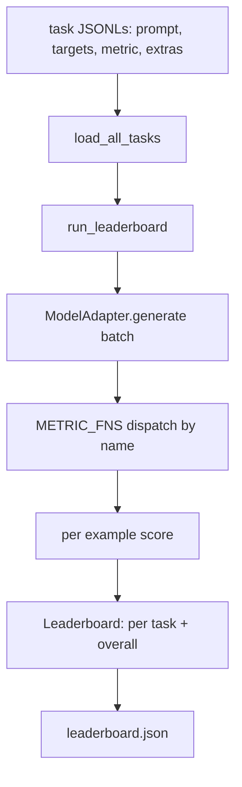
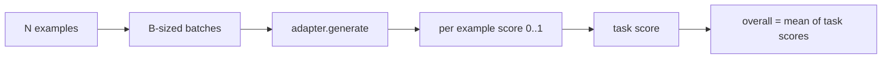

# 언어 모델 평가 

> 정의할 수 없는 작업에 잘 맞는 모델은 우연히 잘 되는 모델입니다.

**Type:** Build
**Languages:** Python
**Prerequisites:** Phase 19 lessons 42 to 45
**Time:** ~90 minutes

## 학습 목표

- 작업을 JSONL 파일로 정의합니다`prompt``targets``metric`, 그리고 선택적으로`extras`예를 들어
- 정확한 일치, RGB F1, 실행 가능한 체크, 복수 선택, 하위 문자열 포함
- 작업별 예제를 배팅하고 교환 가능한 모델 어댑터로 전송하는 런어를 구축하십시오.
- 작업당 점수, 지연시간 및 재생 가능한 전체 평균을 가진 JSON 순위표를 발급하십시오.

## 문제

새로운 언어 모델이 매주 등장합니다. 마케팅은 그것이 잘한다는 주장입니다. 솔직한 질문은: 뭐? 솔직한 대답은 당신이 직접 작성한 랭킹표입니다. 왜냐하면 판매자의 랭킹표는 그들이 조정한 것이기 때문입니다.

리포에 있는 리본이 없으면 두 모델을 비브에 따라 비교합니다. 리본이 없으면 고정된 매트릭을 가진 고정된 작업 세트에 점수를 기준으로 비교합니다. JSON 출력에서 차이를 할 수 있습니다. 리본은 어제 실행과 오늘 실행 사이의 계약입니다. 이 리본이 없으면 회귀가 배포됩니다.

함정이 한 모델에 너무 많이 붙여넣는 것입니다. 정정은 역으로 같은 함정입니다. 15분 안에 읽을 수 있을 만큼 작은 띠, 레포에 전송할 수 있을 만큼 작은 작업, 동료가 이를 감사할 수 있도록 처음부터 매트릭을 작성하고, 어댑터는 모델에 대한 특정 코드가 존재하는 유일한 장소입니다. 어댑터를 바꿔서 랭킹보드가 움직이고, 작업들을 바꿔서 랭킹보드가 움직입니다. 다른 건 움직이지 않아

## 개념



### 작업 특산식

각 예는 하나의 JSONL 라인입니다:

```json
{"id": "arith-00", "prompt": "compute: 2 + 2", "targets": ["4"], "metric": "exact_match"}
```

득점 보조가 필요한 측정값에 대해`extras`부근용무량을 운반한다:

```json
{
  "id": "code-00",
  "prompt": "python: write a function f that doubles its input",
  "targets": ["ok"],
  "metric": "code_exec",
  "extras": {"io_pairs": [[1, 2], [3, 6]]}
}
```

임무는`.jsonl`아래 파일`outputs/tasks/`파일 이름은 작업 이름입니다. 파일의 모든 예제들은 메트릭을 공유합니다.

### 5가지 고정 과제

| Task | Metric | What it tests |
|------|--------|---------------|
| arithmetic | exact_match | Token-level correctness on a deterministic answer |
| summary | rouge_l | Longest common subsequence F1 against a one-line reference summary |
| code-exec | code_exec | Executable test: the predicted function must satisfy a list of input-output pairs |
| multiple-choice | multiple_choice | First letter of the prediction must match an allowed letter |
| generation | substring_contains | Free-form text must contain at least one target substring |

### 메트릭 계약

모든 메트릭은`(prediction, targets, extras) -> float in [0.0, 1.0]`. 은 작업 점수를 얻기 위해 각 예제 점수를 평균하고, 전체 점수를 얻기 위해 작업 점수를 평균합니다.

- `exact_match`: 작문, 붕괴 백색 공간, 평등.
- `substring_contains`: 같은 정상화, 하계 문자열 테스트
- `multiple_choice`: 첫 번째 문자는 위쪽에 있습니다.
- `rouge_l`: LCS 길이 예측과 참조 길이로 나뉘어, 정확성 F1 및 회수.
- `code_exec`: 제한된 이름 공간에서 예측을 실행, 호출 `f(x)`출력입입쌍마다, 일치하는 숫자를 계산합니다.

코드_엑세크 메트릭은 배부드인 이름 공간에서 예측을 실행합니다. 수업 테스트는 `import os`폭발할 수 있는 이유는`os`이름 공간에 있지 않습니다. 코드 예측에서 파일 시스템에 액세스할 수 없습니다.

### 모델 어댑터

```python
class ModelAdapter(Protocol):
    def generate(self, prompts: Sequence[str]) -> List[str]: ...
    @property
    def name(self) -> str: ...
```

어댑터는 입니다. 수업은 배입니다.`ToyAdapter`, 결정적인 패턴 일치하는 5 개의 고정 작업의 모든 명령에 대한 올바른 답을 반환하는. 실제 어댑터는 모델을 호출하고 출력을 반환합니다.

### 달리는

`run_task`배트`batch_size`동시에 명령어와 메트릭 함수에 전송합니다. `run_leaderboard`모든 작업을 수행하고 평균을 합니다.`write_leaderboard`스케마 문자열을 사용하여 JSON를 발송하여 향후 형식의 변경은 래시보드를 침묵으로 깨지 않습니다.



```figure
eval-harness-matrix
```

## 건설 해

`code/main.py`이 유물은 실행 가능한 유물입니다.

### 단계 1: 씨 고정 작업

`seed_fixture_tasks(target_dir)`다섯을 쓴다`.jsonl`파일. 첫 번째 라인`main.py`디렉토리가 빈 상태에서 씨앗을 뿌립니다.

### 단계 2: 로드 작업

`load_all_tasks(task_dir)`모든 것을 읽습니다`.jsonl`그리고 작업 이름에서 명령어를 목록으로 반환합니다`Example`기록, 댓글 라인`#`빈 줄이 생략되어서 기자가 파일을 해설할 수 있습니다.

### 단계 3: 측정값을 구현

각 매트릭은 단위 테스트를 가진 작은 함수입니다. 수업의 테스트 스위트는 정상화, 부분적 중복, 코드 실행 및 안전하지 않은 코드 거부를 포함하는 13 개의 경우를 포함한다.

### 4단계: 경주자를 적어

`run_task`배치를 반복하여 `TaskResult`점수, 정확한 계산, 전체 계산, 그리고 지연.`run_leaderboard`모든 작업을 수행하고`Leaderboard`전체 평균과 비교해 볼 수 있습니다.

### 단계 5: JSON를 발사

`write_leaderboard`이 책상은`--include-per-example`플래그는 각 예제 기록들을 덤프합니다. 그래서 점수가 움직일 때 이전 실행과 비교해서 예측을 구별할 수 있습니다.

실행하세요:

```bash
python3 code/main.py
```

스크립트는 첫 번째 실행에 고정된 장치를 심어주고 장난감 어댑터 (모든 고정된 장치를 올바르게 만드는) 로 점수를 받고, 그리고 작성합니다.`outputs/leaderboard.json`. 장난감 어댑터 전체 점수는 1.0입니다.`test_main.py`같은 배너스가 0.0을 생성하는 것을 보여줍니다. 어댑터가 응답할 수 없을 때.

## 사용 하 고

실제 모델을 연결하려면 어댑터를 써야 합니다.

```python
class HttpAdapter:
    name = "vendor.v1"

    def __init__(self, endpoint, api_key):
        self.endpoint = endpoint
        self.api_key = api_key

    def generate(self, prompts):
        out = []
        for prompt in prompts:
            response = http_post(self.endpoint, prompt, self.api_key)
            out.append(response["text"])
        return out
```

교환`ToyAdapter``HttpAdapter``main()`- , 작업, 측정, 그리고 순위표는 동일합니다.

실제 프로젝트에서 배너스를 운송할 때 세 가지 패턴을 적용해야 합니다.

- **Pin the task files.**json는 해시 을 가진 작업 내용을 가지고 있거나 JSONL를 옆에 가지고 있습니다. 그렇지 않으면 작업 파일이 할 때 점수가 움직이고, 어느 것을 알 수 없습니다.
- **Diff predictions, not just scores.**`--include-per-example`플래그는 모델이 점수가 떨어지는 날 뭐라고 했는지 보여준다.
- **Cap the batch size.**실제 어댑터는 속도 제한을 가지고 있습니다. 작은 배치 크기는 공급업체들 간에 배너스를 호환적으로 유지합니다.

## 선박

`outputs/skill-lm-eval-harness.md`레시피를 가지고 있습니다: JSONL 작업 스펙, 다섯 메트릭스, 교환 가능한 어댑터, 배팅 런어, 스키마 문자열을 가진 JSON 리더보드. 작업 파일은 `outputs/tasks/`이 모든 것들이 실제 프로젝트로 복사되어 시작됩니다.

## 운동

1. 처음부터 작성하는 사용자 지정 메트릭 (BLEU와 같은 겹치기, BLEURT와 같은 참조 점수를, 명확한 계약이 있는 모든 것) 으로 여섯 번째 작업을 추가하십시오.
2. 확장`code_exec`스터우트를 포착하고 예상 스터우트의 목록을 목표로 받아들이기 위해서입니다.
3. 랭킹 표의 차이 명령어를 추가: 2 `leaderboard.json`파일, 어떤 작업이 이동했는지, 얼마나 많은 것을 인쇄합니다.
4. 예를 들어, 캡 래텐시. 어댑터 호출을 타임아웃으로 포장하고, 별도의 표면 `timeouts`순위표의 열
5. 랭킹 표에 sha256를 넣어서 미래의 독자가 동일한 작업을 점수를 확인할 수 있도록 작업 내용을 핑

## 주요 용어

| Term | What people say | What it actually means |
|------|-----------------|------------------------|
| Task spec | "The eval format" | JSONL file with prompt, targets, metric, optional extras per example |
| Metric | "How you score" | Function from (prediction, targets, extras) to a float in [0, 1] |
| Adapter | "The model client" | Object with a generate(prompts) -> list[str] method; the only model-specific code |
| Leaderboard | "The scoreboard" | JSON with per-task scores, total counts, latency, and an overall average |
| Code exec metric | "Run it and check" | Execute the prediction in a restricted namespace, compare against input-output pairs |

## 더 많은 읽기

- 생산 기준에 대한 원래 lm 평가 띠, 훨씬 더 큰 하지만 같은 모양
- HuggingFace의 허구테이블은 같은 계약의 대체적인 실행을 위한 것입니다.
- 19단계 수업 46은 훈련 스택에서 사용되는 기하급수 축적 패턴을 다루고 있습니다.
- 19단계 수업 47에서는 점수를 받는 점검점 형식을 다루고 있습니다. 점검점 해시를 순위표에 붙여넣습니다.
- 19단계 수업 48은 테스트 중인 모델을 생산한 분산 훈련 스택을 포함한다.
