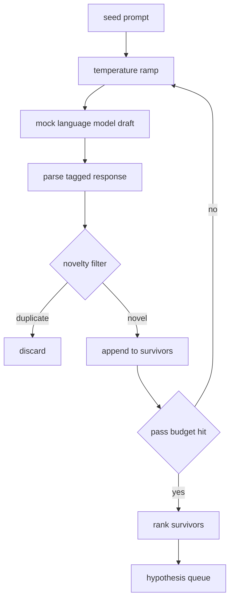

# 가설 생성자

> 같은 질문을 두 번 던지는 연구 에이전트는 토큰을 낭비하고 트릭은 각 드래프트가 새로운 곳에 착륙하도록 강요하는 것입니다.

**Type:** Build
**Languages:** Python
**Prerequisites:** Phase 19 Track A lessons 20-29
**Time:** ~90 minutes

## 학습 목표
- 씨앗의 시사에서 샘플을 가져다가 그 출력을 입력된 가설 기록으로 변환합니다.
- 각 패스에서 샘플링 온도를 램프하여 다음 드래프트가 마지막에서 더 멀리 이동합니다.
- 작은 임베디션 모델과 코시네 거리 문턱을 가진 복제품 근처 필터
- 생존자를 점수함수로 분류해 보세요.
- 모든 단계를 결정적으로 유지하여 동일한 씨앗이 항상 동일한 줄을 생성합니다.

## 왜 생성하고 필터링하는 거죠?

한 모델 한 번 물어보는 계획자는 한 가설을 얻습니다. 작업된 예시에서는 괜찮습니다. 연구 루프에서는 잘못된 모양입니다. 루프는 깊이와 함께 순위화된 줄을 원합니다. 그래서 첫 가설이 실패하면 달리기는 다른 완전한 샘플링 패스를 지불하지 않고 다음을 준비합니다.

두 가지 아이디어가 결합하여 그 줄을 만들어냅니다. 첫째는 온도 램프링입니다. 샘플러를 통과하는 각각의 통과는 온도를 한 덩어리로 높이고, 따라서 후진 초안이 돌아다니도록 권장됩니다. 둘째는 신기술 필터링입니다. 각 초안 후에 생성기는 이전 생존자로부터의 임베디션 거리를 측정하고 클러스터 내부의 모든 것을 거부합니다.

수업은 고정된 명령어에 대해 스크립트 된 토큰 순서를 반환하는 모크 언어 모델을 배포합니다. 모크는 전체 경로를 수행하기에 충분합니다. 씨드 명령어, 온도 램프 적용, 후보자를 분석, 신기술 필터 실행, 순위 줄을 습니다.

## 가설 모양

```text
Hypothesis
  id             : int           (monotonic within a run)
  text           : str           (the claim)
  variables      : list[str]     (what changes between conditions)
  metric         : str           (what the runner will measure)
  baseline_ref   : str | None    (which paper or run the comparison cites)
  draft_pass     : int           (which sampler pass produced this)
  temperature    : float         (the sampler setting at draft time)
  novelty_score  : float         (distance from prior survivors, 0..1)
  rank_score     : float         (weighted sum used for ordering)
```

`variables`그리고`metric`이 필드는 무료 텍스트가 아닙니다. 분석기는 태그된 응답에서 그 필드를 끌어내습니다. 수업 52의 런어는 실험 구성을 만들 때 이 필드를 직접 읽습니다.

`baseline_ref`가설은 선택적이지만 권장됩니다. 수업 53의 평가자는 비교할 수 있는 기준이 필요합니다. 가설이 하나를 생략하면 평가자는 같은 매트릭에 대한 이전 실행으로 다시 떨어집니다.

```figure
cg-novelty-ramp
```

## 건축



이 루프는 바로 앞으로 진행됩니다. 흥미로운 부분은 각 상자가 단단한 계약을 맺고 있다는 것입니다.

## 온도 램프

시작해`t_min`, 끝으로`t_max`, 단계`(t_max - t_min) / (n_passes - 1)`. 각 통과는 현 온도에 샘플링을 호출하여`n_passes``GeneratorConfig.schedule()`. 모킹 모델은 작은 스크립트 응답 탭을 켜고  전환하여 온도를 존중합니다.`(prompt, temp_bucket)`. 은 열 간격으로 작은 온도 변화로 다른 을 선택하여 다른 드래프트를 생성합니다. 생산에서 샘플링은 실제 모델이 될 것입니다.`temperature=t`지나갔어요

기본 스케줄은 6번으로 `0.2` `1.2`6은 새로운 필터에서 거부할 샘플을 지불하지 않고 줄을 채우기 위해 충분합니다.`0.2`모델은 씨를 다시 뿌리죠.`1.2`답은 주제를 벗어나서 분석기능이 실패하는 경향이 있습니다.

## 신기술 필터

각 초안이 분석된 후, 생성기는 텍스트를 삽입하고 모든 수용된 가설에 비교합니다. 삽입은 단위 길이로 정상화된 단어 토큰의 작은 해시 가방입니다. 두 단위 벡터 사이의 코시네 거리 는 `1 - dot(a, b)`. 미적격이 이전 생존자로부터 더 이상이면 미적격이 통과됩니다`novelty_threshold`- 기본값은`0.25`- 그래

해시된 임베디션은 융통형이 아닙니다. 그것은 결정적이고, 0개의 의존성을 가지고 있으며, 명백한 사례를 잡을 수 있을 만큼 충분합니다. 두 개의 드래프트는 대부분의 명사들을 공유합니다. 생산 배포는 작은 문장 모델에서 교환됩니다. 인터페이스는 동일합니다.

## 순위 점수

```text
rank_score = w_novelty * novelty_score
           + w_specificity * specificity_score
           + w_testability * testability_score
```

3개의 하위 점수`novelty_score`이전 생존자로부터 최소 임베디션 거리를 말합니다.`specificity_score`가설의 구체적인 변수들의 수를 목표수와 나눈다. `testability_score`가설이 메트릭과 기본선을 모두 지정한다면 1이고, 메트릭만 있으면 절반이고, 그렇지 않으면 0이 됩니다.

기본 무게는`0.4``0.3``0.3`무게는 생성기 구성에 들어있어서, 아래로 수업을 하면 코드를 지 않고도

## 모호한 언어 모델

```python
class MockLLM:
    def sample(self, prompt: str, temperature: float, seed: int) -> str:
        ...
```

샘플링은 결정적 인 경우`(prompt, temperature, seed)`3번, 모크는 스크립트 응답 테이블을 키로 켜고 있습니다`(prompt_signature, temperature_bucket)`. 테이블에 키의 입력이 없다면 샘플링은 파서에서 실패하는 재발을 반환합니다. 재발 경로가 테스트 중 하나에서 수행됩니다.

씨앗은 반응에 섞여서 같은 것입니다`(prompt, temperature)`다른 씨앗을 가진 쌍은 다른 초안을 만들어냅니다. 테스트에서 우리는 결과를 재생할 수 있도록 씨앗을 꽂습니다. 실제 배포에서 씨앗은 시스템 시계 또는 카운터에서 나옵니다.

## 출력열

출력서는 `Hypothesis`기록은 `rank_score`52강의 달리는 머리를 고 실험을 실행하고 53강의 평가자는 판정을 작성합니다. 판례에서 가설이 잘못되었다고 말하면, 달리는 다음을 습니다.

질서 는 끝 이 있다. 그 는 빈 상태 에 오케스트레이터 는 씨 를 뻗어 줌 으로 다시 발전기를 실행 할 수 있다. 아니면 정지 하고 예산 을 채용 한 상태 로 보고 할 수 있다.

## 코드를 읽는 방법

`code/main.py`정의합니다`Hypothesis``MockLLM``HypothesisGenerator`, 그리고 결정적인 데모를 생성하는`run(seed_prompt)`정렬된 줄을 반환하는 방법; 통과 번호는 에서 읽습니다`GeneratorConfig.n_passes`이 은 을 어 넣는 것 보다 논증으로 전달되는 것 보다 더 낫습니다. 은 을 어 넣는 입니다. 신기술 필터는 하나의 함수입니다. 순위 점수는 하나의 함수입니다. 어떤 것도 에 의존하지 않습니다.`numpy`; 수학을 내장하는 것은 순수한 STDlib이기 때문에 수업은 휴대성이 유지됩니다.

`code/tests/test_generator.py`선형 경로, 복제 거부 경로, 파서 실패 경로, 온도 램프 경로 및 순위 순서를 포함한다.

## 이 슬롯이 어디에

다섯 번째 수업은 줄을 만들어 냅니다. 다섯 번째 수업은 줄을 앞장서서 문헌 검색을 수행하여 확인하거나 반박합니다. 다섯 번째 수업은 같은 머리를 취하고 실제 실험을 수행합니다. 다섯 번째 수업은 두 가지 결과물을 읽고 판결을 작성합니다. 네 가지 수업은 사람이없는 연구 루프를 구성합니다. 인간은 모든 경계에 진입 할 수 있습니다.
