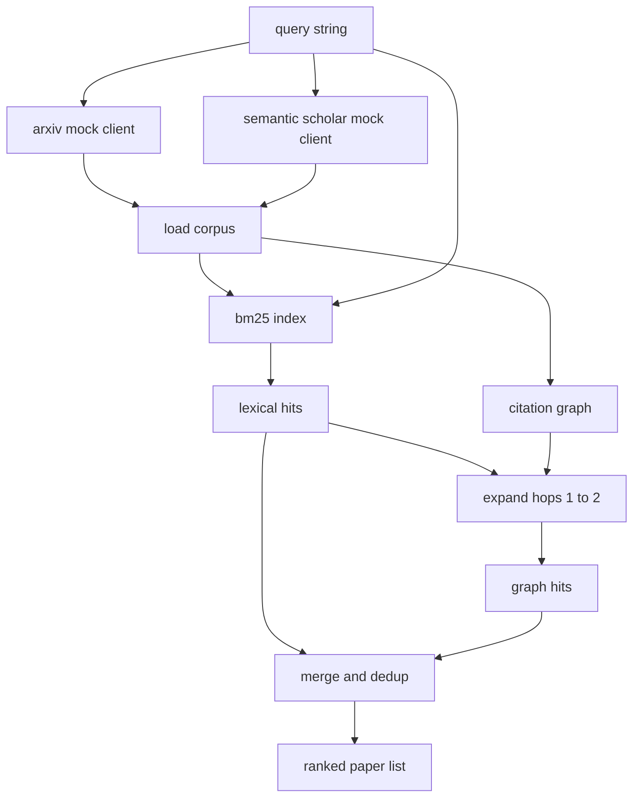

# 문헌 을 찾아내기

> 가설은 저렴합니다. 누군가가 이미 증명했는지 아는 것이 비싼 부분입니다. 경기가 모래 상자를 돌리기 전에 그 질문에 답하는 검색 계층을 구축하십시오.

**Type:** Build
**Languages:** Python
**Prerequisites:** Phase 19 Track A lessons 20-29
**Time:** ~90 minutes

## 학습 목표
- 작은 종이 기록을 모델링하여 루프가 하류로 읽을 수 있는 필드를 표시합니다.
- STDlib 데이터 구조를 가진 추석에 대한 BM25 지수를 구축하십시오.
- 인용 그래프를 통해 표면 논문을 찾아내서
- 이중복합은 레크시컬을 가로지르며 그래프가 안정적인 종이 ID를 통과합니다.
- 하나의 클라이언트 뒤에 두 개의 가짜 외부 API를 꽂아, 실제 엔드포인트가 착륙할 때 상류 호출 사이트가 동일하게 유지됩니다.

## 왜 두번의 검색이 이루어지는지

추석에 대한 키워드 검색은 질의와 같은 어휘를 공유하는 논문을 반환합니다. 그 표면은 대부분 덮여 있습니다. 두건 빼놓은 거야 첫 번째는 기초 논문이 다른 어휘를 사용하는 경우입니다. 예를 들어 "스파르스 관심"에 대한 질의는 "트랜스포머 라우팅에서 블록 선택"이라는 제목의 논문을 놓치고 있습니다. 두 번째는 해당 논문이 알려진 아커를 인용하는 후속이 될 때입니다. 아커를 찾아서 앞으로 나아가는 것이 추상적인 풀을 무력으로 강요하는 것보다 더 효율적입니다.

수업은 두 개의 패스를 구성합니다. 추석에 대한 BM25는 사전적 히트를 잡습니다. 인용 그래프 통과는 한 두 번씩 앞뒤로 놓은 씨앗을 확장합니다. 연합은 종이 ID로 배제되며 작은 결합 스코어로 순위를 제공합니다.

## 종이 모양

```text
Paper
  id          : str           (stable identifier, "p001" for the mock corpus)
  title       : str
  abstract    : str
  year        : int
  authors     : list[str]
  references  : list[str]     (paper ids this paper cites)
  citations   : list[str]     (paper ids that cite this paper)
  source      : str           (which mock api supplied it, "arxiv" or "s2")
```

참조 및 인용 필드는 방향 인용 그래프를 형성합니다. 두 개의 가짜 API는 겹치는 fields을 반환하지만 동일하지 않습니다. 그래서 corpus loader는 그것들을 니다.`id`- 그래

```figure
cg-citation-hops
```

## 건축



검색 클라이언트는 패스와 융합을 모두 소유하고 있습니다. 호출자는 질의를 전달하고 각 항목이 종이 점수 필드를 가지고있는 순위 목록을 얻습니다 (`bm25_score``graph_distance``recency_score``final_score`) 이 순위를 설명합니다.

## BM25는 처음부터

구현은 기본 매개 변수를 가진 표준 Okapi BM25입니다 `k1=1.5``b=0.75`. 지수는 두 개의 사전으로 구성되어 있습니다.`term -> doc_frequency`그리고`term -> list of (doc_id, term_count)`. 문서 길이는 추상서의 표본 수입니다. 평균 문서 길이는 지수 제작 시간에 한 번 계산됩니다. 질의 점수는 질의 용어에 대한 합입니다 `idf * tf_norm`어디`tf_norm`표준 BM25 길이 표준화된 용어 주파수입니다.

표는`lower`그리고는 비자문적으로 나뉘어 있습니다. 그것은 줄기 없습니다. 생산 시스템은 작은 voters에 교환됩니다. 인터페이스는 동일합니다.

```math
\begin{aligned}
\text{idf}(t) &= \log\!\left(\frac{N - \text{df} + 0.5}{\text{df} + 0.5} + 1.0\right) \\
\text{tf\_norm}(t) &= \frac{f \cdot (k_1 + 1)}{f + k_1 \cdot \left(1 - b + b \cdot \text{dl} / \text{avgdl}\right)} \\
\text{score}(d, q) &= \sum_{t \in q} \text{idf}(t) \cdot \text{tf\_norm}(t)
\end{aligned}
```

## 인용 그래프 통행

그래프는 한 번 코퍼스에서 만들어집니다. 앞 가장자리는 논문에서 참조로 이동합니다. 후 가장자리는 논문에서 인용으로 이동합니다. 경로가 두 번 홉으로 뚜렷한 BM25 샷으로 씨앗을 뿌리는 පළලක්입니다.

두 홉은 의도적인 천장이다. 한 홉은 너무 다. 에이전트는 종종 직조 또는 후손을 원한다. 세 홉은 연결된 그래프에서 결과 크기를 날려버리고 주제를 벗어나게 한다. 수업은 홉 한계를 구성 버튼으로 노출시켜 하류 루프가 그것을 강화시킬 수 있습니다.

## 추출 및 순위

두 패스는 겹치는 세트를 반환합니다. 융합 키는 종이 ID에 있습니다. 각 종이에 대한 최종 점수는 중량 혼합입니다.

```text
final_score = w_bm25 * bm25_score_norm
            + w_graph * graph_score
            + w_recency * recency_score
```

`bm25_score_norm`합병된 집합의 최대 BM25 점수로 나뉘는 BM25 점수는 (이하로서 필드는 0에서 1에 살고 있습니다). `graph_score`직사용으로 을 하는 것 같네요`0.6`한 번 뛰면`0.3`두 번 면, 그렇지 않으면 0이 됩니다.`recency_score`코퍼시스 최소 해에서 0에서 최대 1까지의 선형 램프입니다.

기본 무게는`0.5``0.3``0.2`무게는 고정되어 있습니다. 오래된 주제는 최근성을 줄일 수 있지만 빠르게 움직이는 주제는 그것을 높일 수 있습니다.

## 모호한 몸매

이 자료는 100개의 논문으로 만들어졌습니다.`build_corpus()`. 각 논문에는 다섯 가지 주제 중 하나에 대한 수동으로 작성된 제목과 추석이 있습니다. 주의 희소성, 검색 증강, 낮은 순위 어댑터, 데이터셋 디스틸레이션 및 평가 리너지. 참조와 인용은 연결되어있어 각 주제는 몇 가지 교차 주제가있는 연결된 하위 그래프를 형성합니다.

두 개의 가짜 API 클라이언트 (`ArxivMockClient``SemanticScholarMockClient`) 는 동일한 코퍼스에서 읽지만 다른 분야를 노출합니다. Arxiv는 제목, 추상, 년, 저자를 반환합니다. Semantic Scholar는 참조 및 인용을 추가합니다. ID에 대한 검색 클라이언트 조합; 클라이언트 분야 간 의견 충돌 처리는 후속 수업으로 연기됩니다.

## 52 과 53번 교훈 에 나오는 내용

52번 수업의 달리는 사람이`paper.id``paper.title`실험의 맥락으로 추상서의 3개의 문장을 넣습니다.`paper.year`그리고`paper.references`특정 논문에 기본 라인을 부여하는 것

검색 클라이언트는 `RetrievalResult`순위 목록과 각 쿼리 매트릭스: 타격 수, 평균 점수, 최고 점수, 전체 벽 시간. 런어는 이러한 기록을 작성하여 하류 관찰성 패스가 시간이 지남에 따라 품질을 표시 할 수 있습니다.

## 코드를 읽는 방법

`code/main.py`정의합니다`Paper``ArxivMockClient``SemanticScholarMockClient``BM25Index``CitationGraph``RetrievalClient`, 그리고 결정적인 데모. 모인 클라이언트와 코퍼스는 같은 파일에 있기 때문에 수업은 휴대성이 유지됩니다. BM25 구현은 한 클래스, 60 라인입니다. 그래프 통로가 한 방법입니다.

`code/tests/test_retrieval.py`레크시컬 경로, 그래프 경로, 융합, dedup, 빈 질의

## 이 슬롯이 어디에

다섯 번째 수업은 가설을 생성한다. 다섯 번째 수업은 가설이 이미 정해져 있는지 여부를 알기 위해 문헌을 검색한다. 다섯 번째 수업은 그렇지 않은 경우 실험을 실행한다. 다섯 번째 수업은 검색 결과와 실험 메트릭을 모두 읽으며 판결을 작성한다. 검색 클라이언트는 네 단계 중 가장 저렴하며 오케스트레이터에서 먼저 실행된다.
