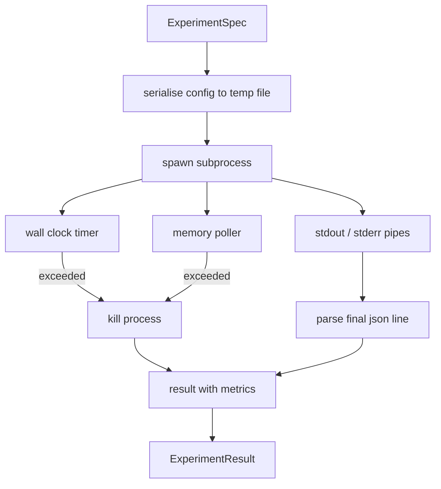

# 실험 런어

> 루프는 측정만큼 정직합니다. 스펙을 가져다가 샌드박스 하위 프로세스에서 실행하고 평가자가 신뢰할 수있는 json 매트릭스 블로프를 발사하는 런어를 구축하십시오.

**Type:** Build
**Languages:** Python
**Prerequisites:** Phase 19 Track A lessons 20-29
**Time:** ~90 minutes

## 학습 목표
- 실험을 입력된 스펙으로 암호화하면 런어는 하위 프로세스로 배열할 수 있습니다.
- 하드 벽 시계 타임아웃과 부드러운 메모리 캡을 가진 하위 프로세스를 시작하고, 둘 다 터미널 조건으로 표면에.
- stdout, stderr, 그리고 구조화된 메트릭스 블랩을 하나의 결과 기록으로 캡처합니다.
- 고정된 기본 스펙에 대해 한 번에 하나의 구성 버튼을 닦는 압축 테이블을 구축하십시오.
- 모든 결과의 결정적 성격을 염기서로 유지하여 평가자가 같은 숫자를 보도록 합니다.

## 왜 하위 과정

연구 루프는 신뢰할 수 없는 코드를 실행합니다. 가설은 샘플러에서 왔으며 실험 스크립트는 같은 경로에서 왔습니다. 프로세스에서 안전한 것으로 취급하는 것은 오케스트레이터를 떨어뜨리는 충돌을 요구합니다. 하위 프로세스는 언어 배가 가장 간단한 고립입니다. 별도의 프로세스, 독립적인 주소 공간, 부모 측면의 신호 핸들.

이 랜서는 전체 샌드박스 구현을 하지 않습니다. c그룹, 세코콤 필터, 네임스페이스 리메핑이 없습니다. 벽 시계 타임아웃, 메모리 성장을위한 투표 루프, 그리고 한쪽 한쪽에서 프로세스를 종료하는 킬 파스입니다. 그것은 더 복잡한 샌드박스 확장마다 실행 시간 계약입니다. 수업은 계약이 한 세션에서 읽을 만큼 작습니다.

## 실험 스펙 모양

```text
ExperimentSpec
  spec_id        : str            (stable id, "exp_001")
  hypothesis_id  : int            (link back to the queue from lesson 50)
  script_path    : str            (path to the python script to run)
  config         : dict           (passed to the script as one json arg)
  seed           : int            (deterministic seed for the experiment)
  wall_timeout_s : float          (hard timeout, killed on exceed)
  memory_cap_mb  : int            (soft cap, polled; killed on exceed)
  metric_keys    : list[str]      (which fields the evaluator will read)
```

스크립트는 디스크에 살고 있으며, 실행자는 스크립트가 읽을 수 있는 임시 파일 경로에 구성을 작성합니다. 스크립트는 스터우트에 하나의 json 라인을 인쇄할 것으로 예상됩니다.`metric_keys`STDOUT에 있는 다른 모든 것은 매트릭스 분석기에서 무시됩니다.

```figure
cg-runner-limits
```

## 건축



은 하나의 주요 방법과 같은 한 클래스입니다. 은 모든  간격에서 한번씩 깨어나서 하위 과정을 읽습니다.`psutil`그 결과, 그 자료가 제공될 경우 PRO 파일 시스템에서 출력되는 동등한 자료가 플랫폼이 노출하지 않는 경우,

## 왜 부드러운 메모리 캡

하드 메모리 캡이 필요해요`resource.setrlimit`포시스 (POSIX) 에서만 작업한다. 수업은 휴대용 접근 방식을 배포한다. 플랫폼에서 거주 세트 크기를 조사하고, 뚜을 초과하면 하위 프로세스를 제거한다. 뚜은 뚜이 부드럽습니다. 뚜은 뚜이 0이 아닌 간격을 가지고 있기 때문에; 프로세스는 뚜을 초과하여 뚜을 사이에 두고 뒤로 떨어뜨릴 수 있습니다. 달리기는 최대 관찰된 RSS를 기록하여 평가자가 경기가 한계에 얼마나 가까이 왔는지 볼 수 있습니다.

프로세스 검사 지원 없이 있는 시스템에서는, 설문조사자가 한 번 경고를 기록하고 스스로 비활성화 합니다. 벽 시계 시간 제한은 여전히 적용됩니다. 수업 테스트는 두 경로를 모두 포함합니다.

## 포착 및 포착

런어는 완료 후 모두 배수된 파이프를 읽습니다. Stdout은 라인 다음 라인을 스캔합니다. 마지막 라인은 필요한 모든 것을 가지고 json로 분석합니다.`metric_keys`이전 json 라인들은 결과에서`intermediate_metrics`; 평가자는 학습 곡선을 위해 이 자료를 사용할 수 있다.

Stderr은 결과로 문자 그대로 캡처됩니다. 런어는 결코 0이 아닌 출력 코드를 올리지 않습니다. 대신 결과에서 코드를 기록합니다. 0이 아닌 출력 모두 표시됩니다.`"crash"`스크립트가 매트릭을 인쇄할 때에도, 평가자는 부분 실행을 기본으로 실패로 간주합니다.

## 추출 표

```python
def ablate(base: ExperimentSpec, knob: str, values: list[Any]) -> list[ExperimentSpec]:
    ...
```

기본 스펙과 버튼 이름을 주어, 보조자는 값당 1 스펙을 반환합니다.`config[knob]`각 스펙은 파생된`spec_id`(`f"{base.spec_id}_{knob}_{value}"`주 는 주 를 다`AblationRunner`그 순서대로 실행하고 다시 `AblationTable`버튼 값으로 키가 되어 있습니다.

왜 한 번씩? 전체 팩토리얼 스와이프는 기하급수적으로 폭발하여 평가자가 해석할 수 없는 결과를 생성합니다. 한 번씩 한 번씩 평가자가 그려낼 수 있는 깨끗한 축을 생성합니다. 수업은 반복되는 단일 버튼 압축으로만 멀티 버튼 스와이를 지원합니다. 호출자가 구성합니다.

## 결정론

각 스펙은 씨를 가지고 있다. 런어는 시드를 구성 디렉트를 통해 스크립트에 전달한다 (`config["__seed"] = spec.seed`       `code/experiments/`이 점에 따라, 강의 53의 평가자는 이 점에 의존한다. 결정론이 없으면 "회복"은 다른 무작위 초기화일 수 있다.

## 가짜 실험 스크립트

수업은 하나의 실험 스크립트를 내놓습니다.`code/experiments/sparsity_experiment.py`. 그것은 실제 스크립트입니다. 구성 파일을 읽고, 무작위 무작위 패스를 사용하여 작은 훈련 실행을 시뮬레이션하고, json 메트릭스 블럽을 인쇄합니다.`sleep_s`테스트 시간 및 `allocate_mb`메모리 러를 테스트하는 

시뮬레이션은 실제적인 훈련이 아닙니다. 그것은 훈련 루프의 모양을 모방하는 수치 계산입니다. 손실 곡선, 최종 혼란, 벽 시간. 수업의 목적은 시뮬레이션이 아니라 달리는 것입니다. 실제 실험 스크립트는 모델을 수입합니다.

## 결과 모양

```text
ExperimentResult
  spec_id              : str
  hypothesis_id        : int
  exit_code            : int
  terminal             : "ok" | "timeout" | "oom" | "crash"
  wall_time_s          : float
  peak_rss_mb          : float | None
  metrics              : dict
  intermediate_metrics : list[dict]
  stdout_tail          : str
  stderr_tail          : str
```

평가자는 `metrics`그리고`terminal`먼저, 터미널이 다른 어떤 경우`"ok"`실험은 실패로 결정되고 평가자의 판단은 자동으로 결정됩니다. 그렇지 않으면 측정값은 의미 테스트를 통과합니다.

## 코드를 읽는 방법

`code/main.py`정의합니다`ExperimentSpec``ExperimentResult``ExperimentRunner``AblationRunner`, 그리고 결정적인 데모. 하위 프로세스 관리는 하나의 클래스. 메모리 팟러는 작은 스레드입니다.

`code/experiments/sparsity_experiment.py`테스트에서 사용되는 모크 실험입니다. 그것은 argv에서 구성 파일 경로를 읽고 완료되면 단일 json 메트릭스 라인을 작성합니다.

`code/tests/test_runner.py`성공 경로, 타임스아웃 경로, 충돌 경로, 압축 테이블, 그리고 두 경주에서 결정론 검사를 다루고 있습니다.

## 이 슬롯이 어디에

수업 50은 가설을 생성합니다. 수업 51은 이미 문학에서 해결된 모든 것을 필터링합니다. 수업 52은 남은 것을 위해 실험을 실행합니다. 수업 53는 결과를 읽고 의미 테스트를 실행하고, 오케스트레이터가 가설 ID에 대한 판결을 작성합니다.
