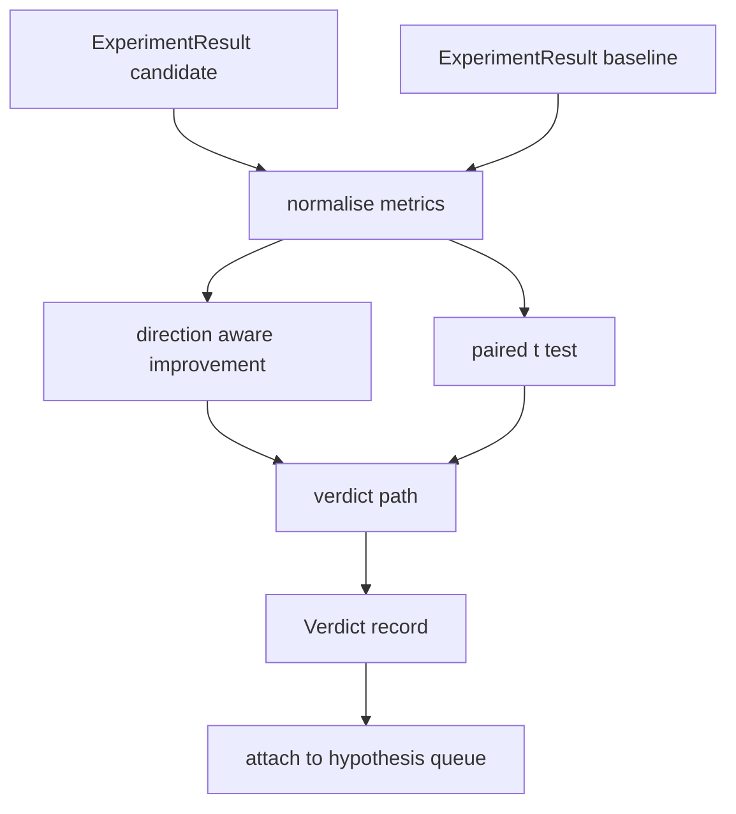

# 결과 평가자

> 경주자 는 숫자를 생성 하고, 평가자 는 그 숫자가 개선, 회귀, 또는 소음인지 결정 합니다. 측정값을 한 줄의 결론으로 바꾸는 판단 경로를 구축 합니다.

**Type:** Build
**Languages:** Python
**Prerequisites:** Phase 19 Track A lessons 20-29
**Time:** ~90 minutes

## 학습 목표
- 방향에 대한 인식 개선과 고정된 임대점을 사용하여 후보 경력을 기준으로 비교하십시오.
- 씨 매트릭에 따라 t 테스트를 처음부터 실행하고 결과 p 값을 읽으십시오.
- 로그 스케일 매트릭을 정상화하여 하류 보고서가 선형 매트릭과 혼합할 수 있도록 합니다.
- 가설에 따라 판결을 내면 50번 수업에서 관현수가 줄을 붙일 수 있습니다.
- 모든 걸 순수하게 해 두면 같은 입력으로 항상 같은 판단을 내리게 됩니다.

## 왜 쌍용 테스트가 필요한지

달리는 사람이 한 번이라도 그 변화가 실제인지 말하지 않습니다. 다른 씨앗과 같은 구성은 다른 복잡성을 제공합니다. 변화의 이유는 소음일 수도 있습니다. 올바른 비교는: 동일한 씨앗과 동일한 데이터, 한 번 후보와 한 번 기본 라인에서 실행되었습니다. 씨앗은 각각 다른 것을 합니다. 그 차이점들의 평균은 효과입니다. 이러한 차이점들의 표준 오류는 노이즈 바닥입니다.

이 수업은 처음부터 테스트를 실행합니다.`scipy.stats`수학은 한 화면으로 읽을 만큼 작습니다.

```text
diffs    = [a_i - b_i for i in seeds]
mean     = sum(diffs) / n
variance = sum((d - mean) ** 2 for d in diffs) / (n - 1)
t_stat   = mean / sqrt(variance / n)
df       = n - 1
p_value  = two_sided_p(t_stat, df)
```

양면 p 값은 정규화된 불완전 베타 함수를 사용합니다. 수업은 레렌츠 계속 분수를 사용하는 작은 구현을 배포합니다. 전체 것은 stdlib 수학의 60 라인입니다.

## 방향성 인식 개선

일부 측정값은 상승 (정확성, 처리량) 으로 향상되고, 다른 측정값은 감소 (손실, 혼란, 벽 시간) 으로 향상된다. 평가자는 `direction`매 매트릭에 있는 필드

```text
if direction == "higher_is_better":
    improvement = (candidate - baseline) / abs(baseline)
elif direction == "lower_is_better":
    improvement = (baseline - candidate) / abs(baseline)
```

개선이 서명됩니다. 더 높은 수치에서 부정적인 개선은 더 나은 측정값을 의미합니다. 후보가 더 나쁜 것입니다. 판결 경로는 표지와 크기를 함께 읽습니다.

평평한 임계 (`improvement_threshold=0.02`이 결정은 p 값에 관계없이 "소음"이 있습니다. 루프는 사용자가 측정할 수 없는 변화에 관심이 없습니다.

```figure
cg-paired-verdict
```

## 건축



평가자는 독립적인 세 개의 계산을 실행하고 판단 경로에서 결합합니다. 각각의 계산은 공유 상태가 없는 순수 함수입니다.

## 로그 정상화

혼란은 손실의 기하급수적 이다. 손실의 0.1 감소는 혼란의 훨씬 더 큰 감소 이다. 두 구성에서 직접적으로 혼란을 비교하는 것은 괜찮지만, 단일 보고서에서 선형 매트릭과 혼합하는 것은 정상화가 필요합니다.

이 수업은 어떤 메트릭을 정상화 할 수 있습니다.`scale`필드는`"log"`로그 공간에서 임의로 적용됩니다. 32에서 28까지의 복잡성의 감소는`log(28) - log(32) = -0.133`더 낮은 값은 2%의 문턱을 훨씬 넘는 더 나은 매트릭입니다.

```text
if scale == "log":
    a = log(candidate)
    b = log(baseline)
else:
    a = candidate
    b = baseline
```

`scale="linear"`(전설) 변환을 건너뛰어

## 씨앗별 쌍용 테스트

수업 52에서 달리는 사람이 한 번씩 마지막 메트릭 블로브를 발사한다. 쌍 테스트에 대해 평가자는 후보자에게 씨앗당 한 번, 기본 라인에서 씨앗당 한 번을 필요로 한다. 오케스트레이터는 두 가지 구성 아래 동일한 실험을 씨앗 목록에 걸쳐 실행하고 평가자에게 두 개의 목록을 제공합니다.`ExperimentResult`기록

평가자 는 씨앗에 따라 그 들 을 짝짓는다 (씨 는`result.metrics["seed"]`) 를 통해 요청된 매트릭을 걸어갑니다. 두 목록에서 씨앗이 일치하지 않으면 평가자는 `PairingError`오케스트레이터가 다시 뛰어야 합니다.

## 판례 형태

```text
Verdict
  hypothesis_id          : int
  metric                 : str
  direction              : "higher_is_better" | "lower_is_better"
  scale                  : "linear" | "log"
  candidate_mean         : float
  baseline_mean          : float
  improvement            : float       (signed, fraction; see direction rules)
  p_value                : float | None  (None if n < 2)
  significance_threshold : float
  improvement_threshold  : float
  verdict                : "improved" | "regressed" | "noise" | "failed"
  rationale              : str
```

판례 경로는 작은 결정 테이블입니다.

```text
1. If any candidate result has terminal != "ok": verdict = "failed"
2. else if |improvement| < improvement_threshold:  verdict = "noise"
3. else if p_value is None or p_value > significance: verdict = "noise"
4. else if improvement > 0:                          verdict = "improved"
5. else:                                             verdict = "regressed"
```

논리적인 것은 단 줄의 인간독성 문장이죠. 오케스트레이터가 가설 ID에 대해 로그 할 수 있습니다.

## 코드를 읽는 방법

`code/main.py`정의합니다`MetricSpec``Verdict``Evaluator`t 테스트는 순수한 stdlib 수학에서 구현되며, numpy는 메트릭 목록과 계산 수단과 변수를 읽기 위해만 사용됩니다.

`code/tests/test_evaluator.py`개선된 경로, 퇴행 경로, 노스 경로 (작은 개선), 노스 경로 (하루 n), 실패한 터미널 경로, 로그 정상화된 경로, 알려진 참조 값에 대한 t 테스트 및 조화 오류를 포함한다.

## 이 슬롯이 어디에

50강은 가설열을 만들어 냈습니다. 51강은 문학이 정해 놓은 모든 것을 필터링했습니다. 52강은 후보와 기본 라인 구성 아래 씨앗을 통해 실험을 실행했습니다. 53강은 그 라인을 읽고 판결을 작성합니다. 오케스트레이터는 네 가지를 함께 꿰매:

```text
for hypothesis in queue:
    literature = retrieval.search(hypothesis.text)
    if literature_settles(hypothesis, literature):
        attach(hypothesis, verdict="settled")
        continue
    candidates = runner.run_all(specs_for(hypothesis))
    baselines  = runner.run_all(baseline_specs_for(hypothesis))
    metric_spec = MetricSpec("perplexity", direction=LOWER, scale=LOG)
    verdict = evaluator.evaluate(hypothesis.id, metric_spec, candidates, baselines)
    attach(hypothesis, verdict)
```

이 수업에는 그 오케스트레이터가 없습니다. 네 가지 수업은 각각의 데이터 클래스를 정의하는 것 이상으로 어떤 덩어리도 없이 구성됩니다.
