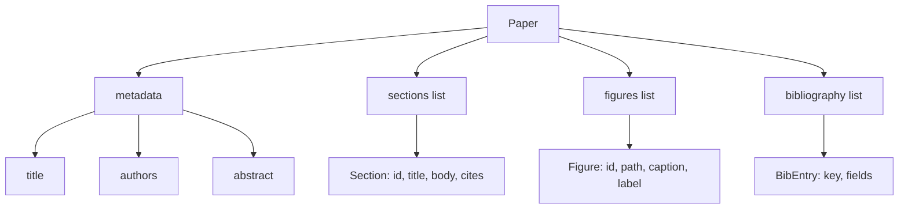
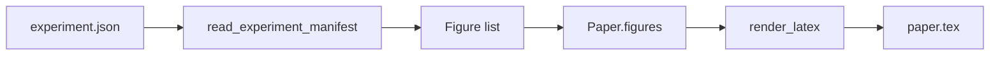
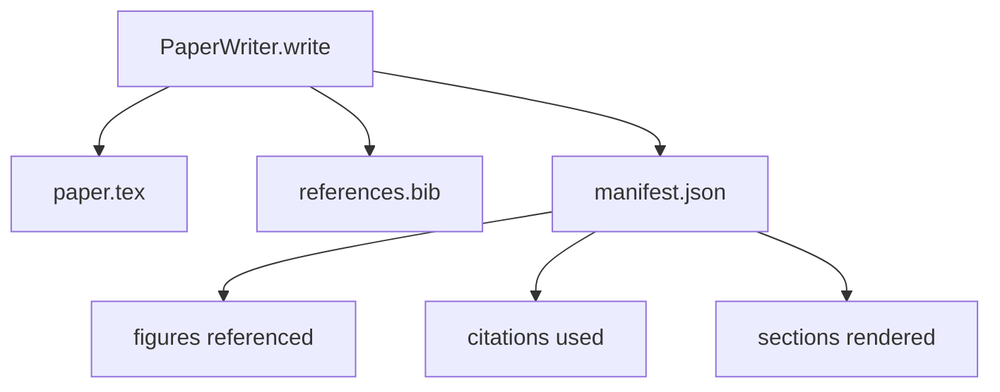

# 논문 작가는

> 라테크스 스켈레톤은 연구자와 타이터 사이 계약이다. 계약이 깨지면 문서가 컴파일되지 않으며 실패가 다. 먼저 스켈레톤을 만들어서 채우십시오.

**Type:** Build
**Languages:** Python
**Prerequisites:** Phase 19 lessons 50-53
**Time:** ~90 minutes

## 학습 목표

- 연구 논문을 알려진 섹션 그래프로 구성된 유물으로 취급하고, 자유형 문서가 아닌
- 어떤 시가 쓰기 전에 추상, 섹션, 그림 슬롯, 문헌 키를 선언하는 LaTeX 골격을 생성하십시오.
- 실험 출력 (길과 캡션) 의 수치를 결정적인 슬롯 메커니즘을 통해 골격에 주입한다.
- 각 부분을 구조화된 스케줄에서 채우는 모모 된 프로사 생성기를 가동하여 모델 없이 띠를 테스트할 수 있습니다.
- 1개 발송`paper.tex`+ a`references.bib`그리고 모든 참조된 숫자와 사용된 인용을 나열하는 매니페스트

```figure
ch-paper-skeleton
```

## 왜 먼저 골격이

문헌 초안은 문헌으로 시작되면서 구조적 부채가 쌓이게 된다. 입문에는 관련 작품에 포함되어야 하는 세 개의 문장이 커진다. 문서는 정의되기 전에 참조된다. 문헌은 같은 논문의 세 개의 키로 끝난다. 작가가 알아차릴 때, 재편 비용은 쓰기 비용보다 높습니다.

뼈대가 이를 역전화시킵니다. 구조는 데이터로 미리 선언됩니다. 섹션은 이름과 순서로 된 슬롯입니다. 숫자는 아이디와 캡션이 있는 슬롯입니다. 도서관 키는 위쪽에 표시되어 있으며, 그 항목들이 가리키는 항목이 있습니다. 시사들은 한 번에 한 번씩 그 슬롯에 생성됩니다. 이 띠는 어떤 시사도 쓰기 전에 모든 그림이 슬롯을 가지고 있고, 인용문마다 항목이 있고, 모든 섹션이 내용 표에 나타난다는 것을 확인할 수 있습니다.

이것은 이전 수업에서 계획, 도구 호출, 추적에 적용된 동일한 학문입니다. 구조는 계약입니다.

## 종이 모양



각 필드는 단순한 파이썬 데이터입니다. 렌더러는 `Paper`라테크스 문자열에 연결합니다. 리네스는 렌더링 전에 종이를 내면적으로 살펴볼 수 있습니다.`\cite{key}`일치하는`BibEntry`- 그래

## 렌더링 계약

렌더링은 세 가지 특성을 보장합니다. 첫째, 골격의 모든 그림 슬롯은`\begin{figure}`양식의 안정적인 표기판을 가진 블록`fig:<id>`둘째, 각 부문은`\section{}`양식의 안정적인 표기 `sec:<id>`그래서 횡성 참조가 작동합니다. 셋째,`\bibliography`블록이 누구의`references.bib`문서에 명시된 항목을 정확히 포함하고, 더 이상, 더 적은 없습니다.

이 중 어느 하나 를 위반 하는 것 은 경고 를 하는 것 이 아니라, 표현 에 대한 오류 입니다. 골격 은 계약 입니다.

## 실험에서 나온 그림 주입

이 트랙의 이전 수업은 JSON의 표현으로 실험 출력을 생산했습니다. 각 행보는 경로와 짧은 자막을 가진 유물 목록을 가지고 있습니다. 종이 작가는 그 행성을 읽고 생산합니다.`Figure`기록



주입은 결정적 이다. 그림 ID는 실험 이름과 단조적인 카운터에서 유래된다. 표본은 매니페스트에서 나온다. 경로는 종이의 출력 디렉토리와 비교하여 정상화되어 있기 때문에 실험 출력이 디스크에 다른 곳에있을 때에도 LaTeX는 컴파일합니다.

## 조롱한 시사 생성자

수업은 모델이 필요없습니다.`MockProseGenerator`한 부분마다 한 줄이 짧아진 모양으로 구성되어 있습니다. 생성기는 이 줄을 두 개의 짧은 문장으로 확장하여 섹션 제목을 엮어줍니다. 생성된 prose는 그 내용을 선언할 때 정확하게 표본과 인용을 나타냅니다.

이것은 작가의 모든 행동을 테스트하기에 충분합니다. 실제 구현은 생성기를 모델 호출으로 교환합니다. 그 주변의 배열은 변하지 않습니다. 이것은 프로사 생성기를 호출가능하다고 선언하는 가치입니다. 테스트는 결정적인 것을 대체하고, 생산은 모델 하나를 대체하고, 나머지 파이프 라인은 동일합니다.

## 시사 출력

작가는 출력 디렉토리에 3개의 파일을 전송합니다.



매니페스트는 하류 평가자 또는 비평가 루프가 읽는 것입니다. 그것은 라텍스를 분석하지 않습니다. 그것은 매니페스트를 읽습니다. 다음 수업, 비평가 루프, 이 매니페스트를 입력으로 받아들이고 피드백 목록을 생성합니다. 그렇기 때문에 매니페스트는 계약의 일부이며 라텍스는 그렇지 않습니다.

## 유효성 게이트

작가는 어떤 파일을 작성하기 전에 네 개의 게이트를 실행합니다.

1. 모든 숫자 아이디는 종이 안에 독특합니다.
2. 모든 부문에서`cites`필드는 문서에 표시된 문헌 키를 참조합니다.
3. 추상 내용은 비공개입니다.
4. 제목은 비공개입니다.

실패한 게이트가 올라갑니다`PaperValidationError`정확한 이유와 함께. 배너스는 실패 모드로 이유를 표면에 내세워줍니다. 부분적으로 쓰이는 것은 없습니다. 세 개의 파일 모두 방출되거나, 전혀 방출되지 않습니다.

## 코드를 읽는 방법

`code/main.py`정의합니다`Paper``Section``Figure``BibEntry``PaperValidationError``MockProseGenerator``PaperWriter`, 그리고`render_latex`기능.`write`메소드는 출력 디렉토리를 가져다가 `paper.tex``references.bib`그리고`manifest.json`- `read_experiment_manifest`도움말은 실험의 행렬 목록을 변환합니다`Figure`기록

`code/tests/test_paper_writer.py`표면: 칸막이 없는 스켈레톤 렌더링, 2개의 섹션과 2개의 숫자를 가진 완전한 렌더링, 실종 인용문, 복제된 숫자 아이디 문, 표면 내용, 그리고 LaTeX 문자열 계약 (모든 섹션에서 `\section{}`, 각 숫자는 `\begin{figure}`)

## 더 나아가

실제 구현에 필요한 두 가지 확장 프로그램입니다. 첫째, 다형 렌더링: 동일한 `Paper`랜더는 블로그 게시물 및 HTML를 위한 랜더로 구성됩니다.`Paper`. 둘째, 인용 부양: 작가는 인용 키에서 BibTeX 항목을 가져옵니다. 이 두 가지 모두 스켈레톤 계약에 영향을 주지 않고 추가 가치를 추가할 수 있습니다.

스켈레톤은 베팅입니다. 섹션, 숫자, 인용은 데이터로 선언됩니다. 슬롯으로 생성된 시사, 라텍스와 함께 발매되는 매니페스트. 다른 모든 개선은 위에 구성됩니다.
