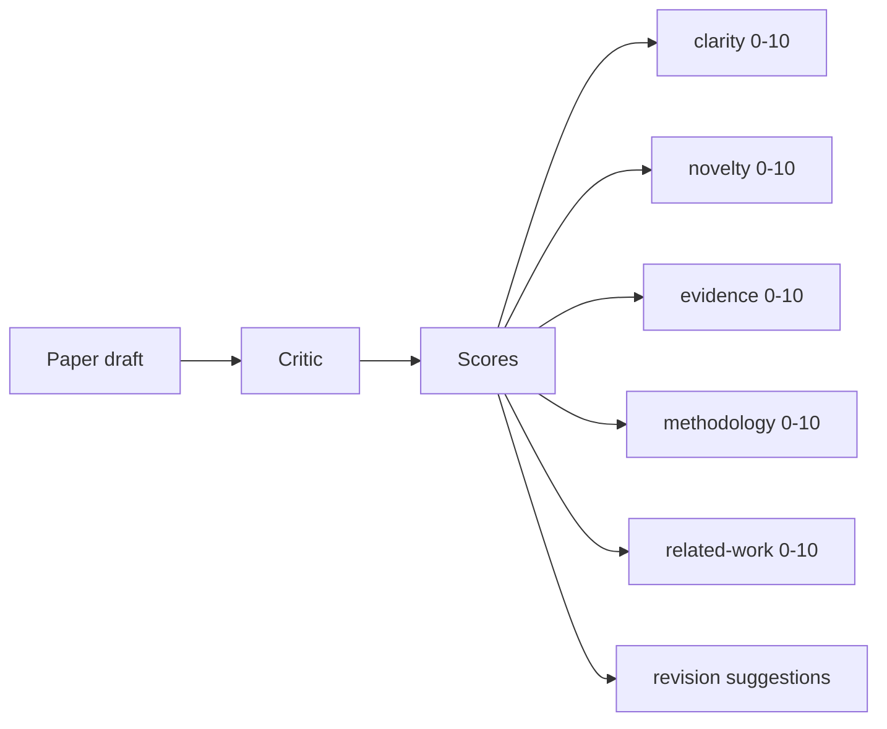
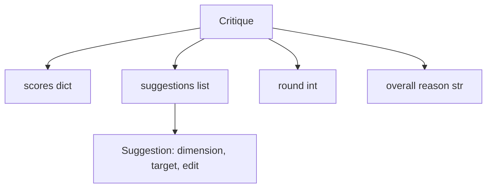
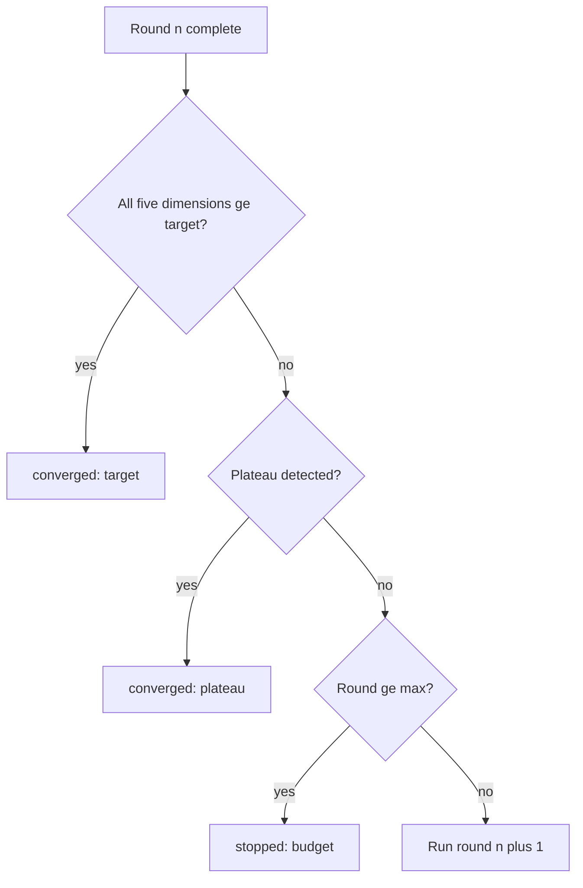
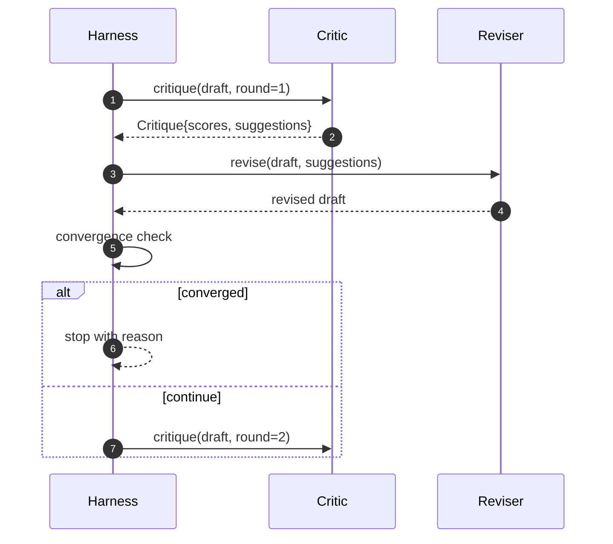

# 비판적 인 루프

> 처음 "좋아 보이네"라고 답하는 평론가들은 깨지고, 항상 "작업이 필요하다"고 답하는 평론가들은 깨지고, 흥미로운 평론가들은 모순이 되고, 그리고 모순을 설계해야 합니다.

**Type:** Build
**Languages:** Python
**Prerequisites:** Phase 19 lessons 50-53
**Time:** ~90 minutes

## 학습 목표

- 명확성, 신기성, 증거, 방법론, 관련 작업 등 5가지 고정된 차원에서 논문 초안을 작성합니다.
- 각 라운드의 비판을 자유형 재편보다는 구조화 된 수정 디프로 적용하십시오.
- 라운드에서 점수를 비교하여 컨버전스를 감지합니다. 평판에서 멈추거나 목표가 달성되거나 예산이 채우지 않습니다.
- 이 경우, 최대 시술 예산으로 제한을 받으면 비통합적인 비평가들은 영원히 실행되지 않습니다.
- 라운드마다 추적을 보내서 래시보드나 다음 단계가 점수를 표시할 수 있습니다.

```figure
ch-critic-converge
```

## 왜 5개의 고정된 차원이

자유형 비평가 (Freeform Critic) 는 제안의 문장을 반환하는 모델이다. 다음 라운드의 개정에서는 문장을 환경적 맥락으로 취급한다. 재편이 비판을 다루는지 여부는 비판이 결코 구조를 가지고 있지 않기 때문에 확인할 수 없습니다.

5차원으로 띠가 계약할 수 있습니다.



스코어 는 벡터 입니다. 은 각 차원을 을 통해 관찰 합니다. 명확성을 높이는 수정이지만 증거를 저장하는 것은 증거에 대한 회귀입니다. 그리고 컨버전스 검사는 그것을 볼 수 있습니다. 모델만 있는 비평가들은 그러한 보장을 제공 할 수 없습니다.

## 크리틱의 형태



각 제안은 개선되는 차원, 목표되는 섹션, 그리고`edit`수정자는 수정자가 적용할 수 있는 명령어이다. 수정자는 호출가능한 명령어이기도 하다. 수업은 수정 명령어를 부가-부로 동작으로 해석하는 결정적 수정자를 배포한다. 모델 기반의 수정자는 프롬프트와 동일한 필드를 해석한다. 계약은 변경되지 않는다.

## 컨버전스 규칙

3가지 조건 중 어느 하나가 불타면 비판 루프는 종료됩니다.



목표가 가장 엄격한 경우: 다섯 가지 차원 (명확성, 신기성, 증거, 방법론, 관련_작업) 의 모든 하나 모두 도달해야합니다`>= target_score`(전반 `8.0`) 로프가 성공하기 전에. 1 가지 약한 차원의 높은 평균은 충분하지 않습니다. 평판 검출은 현재의 라운드 평균을 이전 라운드 평균과 비교합니다. 개선이 아래에서 있다면 `plateau_epsilon`(전반 `0.1`) 2회 연속으로 루프가 `plateau`예산은 라운드 (불선) 에 대한 제한입니다`5`) 및 출구 `budget`- 그래

순서가 중요합니다. 목표가 평판을 이기면 예산이 이기면, 3차 라운드에서 목표가 같은 반복으로 타격을 입으면 평판도 발생합니다.`target`아니`plateau`- 그래

## 왜 평야 탐지가 2차에 걸쳐 진행되는지

일방적인 평판은 잡음이다. 실제 평론가들은 고정된 초안에서도 조금씩 다른 점수를 반환한다. 결정적 점수는 여전히 어떤 제안이 적용되었는지와 어떤 순서로 적용되었는지에 달려 있다. 연속적인 두 차례의 평판 라운드는 그 소리를 필터링한다.

## 이 수업의 결정론적 비판자

수업은 모델이 필요하지는 않습니다. 전송된 비평가는 세 가지 신호에 기초하여 드래프트를 점수를 주는 호출입니다.`originality_tag`논문 메타데이터 (신작) 에 있는 필드.

```text
clarity      grows when the average section body length increases
novelty      grows when originality_tag is set to "high"
evidence     grows when a section's figure_refs is non-empty
methodology  grows when a section titled "Method" exists with body
related-work grows when a section titled "Related Work" exists with body
```

리비저는 각 제안을 목표형 첨부물로서 해석한다. 1 라운드 후, 리너스는 점수가 상승하는 것을 관찰할 수 있다. 테스트는 이 속성을 사용하여 루프가 격차를 줄이는 것을 주장한다.

## 전체 루프 계약



반지는 둥근 카운터, 추적, 그리고 컨버전스 체크를 소유하고 있습니다. 비평가는 점수를 소유하고 있습니다. 수정자는 차이점을 소유하고 있습니다. 세 가지 중 어느 것도 다른 사람의 상태를 만지지 않습니다.

## 트레이스 출력

각 라운드에는 라운드 번호, 점수 벡터, 제안 수와 컨버전스 판례와 함께 하나의 추적 이벤트를 발송합니다. 전체 추적은 최종 드래프트와 함께 반환됩니다. 하류 패시보드는 라운드 당 점수를 표시 할 수 있습니다. 다음 수업, 반복 스케줄러, 가지가 유지 가치가 있는지 결정하기 위해 추적을 읽습니다.

## 나쁜 비판자 들 을 피하는 예산

평론가들은 결코 점수를 개선하지 않는 제안을 내놓으면, 최대의 표정을 제한하는 ループ을 봉쇄합니다.`budget`사용자가 비평가 버그로 읽습니다. 초안 버그가 아닙니다. 대안은 최종 초안만 표면에 내세워서 진단을 숨깁니다.

## 코드를 읽는 방법

`code/main.py`정의합니다`Critique``Suggestion``Critic`프로토콜`Reviser`프로토콜`CriticLoop`, 그리고`make_deterministic_critic_pair`결정적인 비판자와 일치하는 수정자를 반환하는 공장입니다.`Paper`형태가 포함되어 있어 수업이 따로 있습니다.

`code/tests/test_critic_loop.py`커버: 1라운드 이후 단조로운 개선, 정렬된 드래프트에서 목표 공렴, 2라운드 후 평평한 평판 검출, 제안이 개선되지 않을 때 예산의 고갈, 수정자의 제안 적용 및 흔적 모양.

## 더 나아가

실제 구현이 필요한 두 가지 확장 사항: 첫째, 차원 무게: 워크숍의 논문에서는 방법론보다 더 높은 신화를 무게로 하고, 학술지에 반대의 무게를 띠고 있다. 컨버전스 검사는 중량 평균이 된다. 둘째, 짝짓기 평론가: 한 평론가가 점수를 받고, 두 번째 평론가들은 수정자가 보기 전에 제안에 대해 판단한다. 둘 다 추가 가치를 부여하고, 둘 다 같은 내용에 얽혀 있다.`Critique`형태

이 베팅은 점수 벡터입니다. 비판이 구조화되면, 다른 모든 개선, 컨버전스 규칙, 래시보드, 쌍용 비평가, 루프를 변경하지 않고 들어갑니다.
