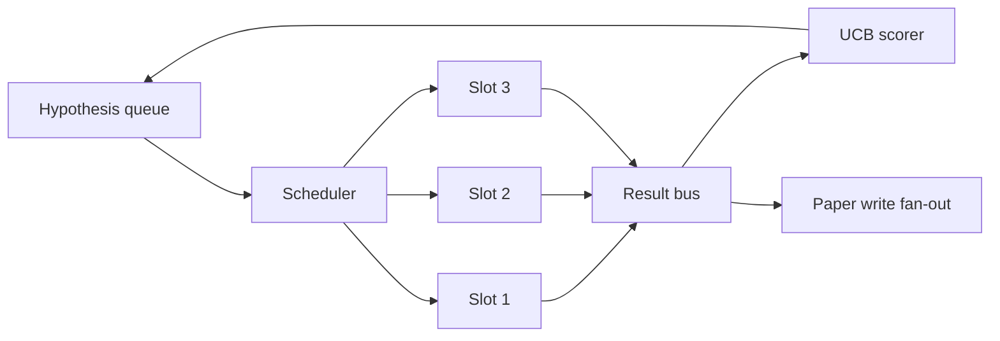
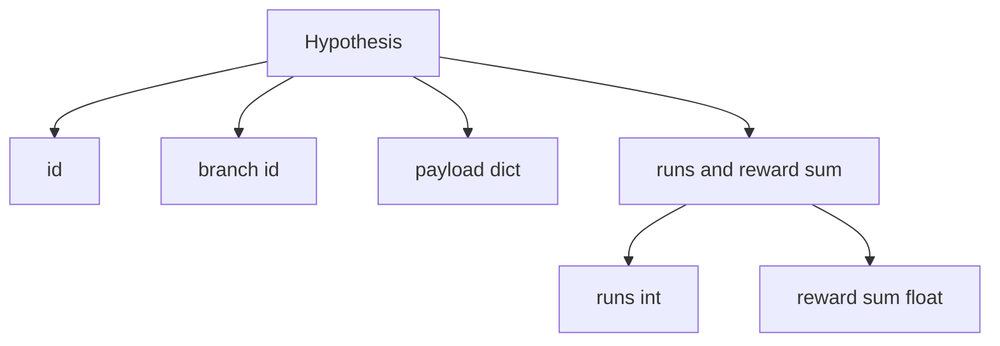
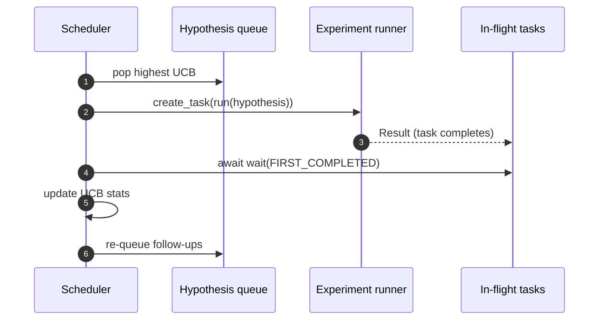

# 반복 스케줄러

> 스케줄러 없이 하는 연구 루프는 환각이 있는 줄을 이루고 있습니다. 스케줄러는 어떤 것을 탐색하는 것을 멈추게 하는지를 결정하는 루프입니다. 그 결정은 전체 게임입니다.

**Type:** Build
**Languages:** Python
**Prerequisites:** Phase 19 lessons 50-53
**Time:** ~90 minutes

## 학습 목표

- 연구 작업 흐름을 가설 큐로 모델링하여 결과물이 다시 윙인 평행 실험 슬롯을 먹여줍니다.
- 아시뉴스와 동시에 여러 실험을 실행하여 스케줄러가 모든 슬롯을 바쁘게 할 수 있습니다.
- 기획자가 탐구를 포기하지 않고 낮은 생산량을 가진 분을 절단할 수 있도록 UCB와 각 가설 분을 점수하십시오.
- 완성된 결과를 종이 작성 단계와 큐 단계로 퍼뜨려서 높은 수익률의 지부가 후속 가설을 낳습니다.
- 분기점 점수와 슬롯 점유율, 그리고 절단 결정으로 반복적인 추적을 표면하십시오.

```figure
ch-ucb-scheduler
```

## 일 목록이 아닌 스케줄러

일평한 작업 목록은 제출 순서로 작업들을 실행합니다. 각각의 작업이 독립적이면 좋습니다. 연구는 독립적이지 않습니다. 실험 3에서 발견된 결과로 실험 4 및 5의 우선 순위가 변경됩니다. 결과를 어 읽고 줄을 다시 순서화하는 스케줄러는 계산 단위당 더 유용한 작업을 수행합니다.

흥미로운 디자인 선택은 점수 규칙입니다. 탐욕한 점수는 항상 현 현 리더를 선택하고 결코 탐구하지 않습니다. 균일한 점수는 결코 착취하지 않습니다. UCB (윗 신뢰 제한) 는 중간 경로입니다.

## 시스템 모양



라인은 가설을 포함합니다. 스케줄러는 슬롯이 풀 때 가장 높은 UCB 가설을 선택합니다. 각 슬롯은 비동기적으로 실험을 실행합니다. 완료된 실험은 결과를 버스에 펴고 있습니다. 버스는 출력 지분에 대한 UCB 통계를 업데이트하고 지분의 생산량이 문턱을 넘으면 종이 작성 단계로 펴고 있습니다.

## 가설 모양



`branch`UCB 통계의 핵심입니다. 여러 가설은 하나의 분자를 공유할 수 있습니다 (분간은 연구 방향이고, 가설은 그 안에서 하나의 실험입니다). `runs`해당 분야에 대한 완료된 실험의 수입니다.`reward_sum`이 두 가지 모두 UCB에서 읽습니다.

## UCB 점수

이 수업에서 사용되는 UCB 공식은 고전적인 UCB1입니다.

```math
\text{ucb}(\text{branch}) = \text{mean\_reward}(\text{branch}) + c \sqrt{ \frac{\ln(\text{total\_runs})}{\text{runs}(\text{branch})} }
```

`total_runs`모든 분야에 걸쳐 완료된 모든 실험의 수입니다.`c`탐사 무게입니다. 수업은 `sqrt(2)`0번의 랜이즈가 되는`+inf`따라서 시험되지 않은 가지 는 항상 먼저 계획 됩니다. 높은 평균 보상 을 가진 가지 는 다른 가지 가 따라갈 때까지 높은 점수를 유지 합니다. 많은 보상 을 받지 않고 여러 번 실행 하는 가지 는 덜 실행 된 대안 으로 인해 은폐 됩니다.

절단 게이트는 채집자로부터 분리되어 있다. 절단 은 평균 보상 이 절대 바닥 아래로 떨어질 때 미래 스케줄에서 가지를 제거한다 (전설 `0.2`) 적어도`prune_after_runs`시험 (전립)`3`) 이 방법은 줄을 다.

## 아시노시오와 병렬 슬롯

스케줄러는 실험을 `asyncio.create_task`. 각 작업은 실험 실행자 (a) 를 실행합니다.`async def`호출가능) 을 반환하는`Result`. 주요 루프는 비행중 작업의 집합을 기다리고 있습니다.`asyncio.wait(..., return_when=asyncio.FIRST_COMPLETED)`그리고 각 완료에 점수를 업데이트를 재생합니다.



3개의 슬롯이 동시에 실행된다. 메인 루프는 결코 하나의 실험을 차단하지 않는다. 스케줄러는 슬롯이 풀리자마자 새로운 작업을 시작하도록 계속합니다.

## 팽창: 종이 트리거

갈래의 평균적인 보상이 넘어가면`paper_threshold`(전반 `0.7`) 그리고 그 지부는 아직 논문을 생산하지 않았다고, 스케줄러는 `paper.trigger`이 강의에서 트리거는 리스트로 캡처되어 테스트가 이를 확인할 수 있습니다.

## 확산: 후속 가설

높은 성과를 내는 결과가 도착하면 스케줄러가 사용자 제공된 `expander`같은 분자에서 하나 이상의 후속 가설을 생성하기 위해 확장자는`Result` `list[Hypothesis]`. 수업은 결정적인 확장자를 배포하여 종이 한계보다 높은 보상을 받는 결과로 두 가지 추적을 만들어냅니다.

## 예산

두 가지 예산은 스케줄러를 탈출 loop에서 보호합니다.

```text
max_experiments    : total count of experiments run across all branches
max_seconds        : wall-clock cap (asyncio time)
```

이 두 가지의 화재는 스케줄러가 새로운 작업을 스케줄링을 중단하고, 비행 중인 작업을 기다리고, 마지막 추적을 반환합니다.`stop_reason`- 그래

## 추적 및 최종 보고

각 스케줄 결정 (, 파견, 결과, 정확, 팬-아웃) 은 하나의 이벤트를 발행한다. 최종 보고서는 각 분야별 통계에, 전체 실행, 전체 벽 시계, 그리고 종이를 유발하는 것을 요약한다. 다음 교훈, 끝에서 끝까지의 데모는 이 보고서를 읽고 종이를 작성하는 사람을 운전한다.

## 코드를 읽는 방법

`code/main.py`정의합니다`Hypothesis``Result``BranchStats``IterationScheduler`, 그리고`make_deterministic_runner`공장은 예측 가능한 보상을 가진 아시뉴스 실험을 하는 런어를 반환합니다.`delay_ms`(전반 `5ms`) 따라서 동시성은 관찰될 수 있습니다.

`code/tests/test_scheduler.py`표지: UCB는 먼저 시험되지 않은 분부를 선택하고, 병렬 슬롯 점유율, 문턱을 넘으면 종이 트리거, 저출산 실험 후 분부를 절단하고, 팽창 후속 가설과 예산 출구 (실험 수량과 벽 시계 모두) 를 선택합니다.

## 더 나아가

실제 실행이 필요한 세 가지 확장입니다. 첫째, 세션 간 UCB 통계에 대한 지속적인: 현재 통계는 메모리에 생기고; 실제 스케줄러가 그들을 체크포인트로 설정하여 재발전으로 이미 지출된 탐구 예산이 보존됩니다. 둘째, 다목적 점수를: 스칼라 보상 대신, 각 결과는 벡터를 발산하고 UCB는 파레토 스타일의 선택자가 됩니다. 셋째, 맥락적 강도: 가설의 조건에 대한 선택 조건 (장, 복잡성) 따라서 유사한 가설은 탐구를 공유합니다.

스케줄러는 연구가 일 목록이 아닌 것이 되는 곳이다. UCB가 연결되고 슬롯이 병렬로 실행되면 다른 모든 개선이 위에 구성됩니다.
