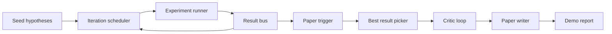
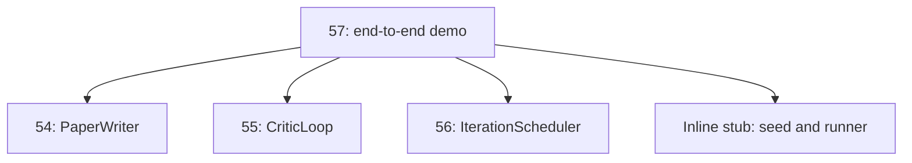
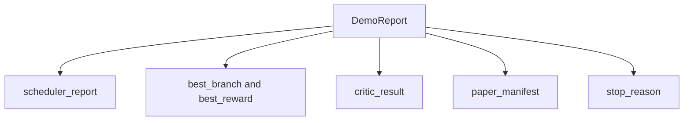

# 끝에서 끝까지 연구 디모

> 데모는 여러분이 이전에 작성한 모든 계약이 작성해야 하는 장소입니다. 그 중 하나가 유출되면, 데모는 그것을 잡는 교훈입니다.

**Type:** Build
**Languages:** Python
**Prerequisites:** Phase 19 lessons 50-53
**Time:** ~90 minutes

## 학습 목표

- 자동연구 루프를 끝에서 끝으로 연결합니다: 가설 씨앗, 실험 실행자, 스케줄러, 비판 루프, 논문 작자.
- 4개의 이전 트랙 D 수업에서 원시적인 내용을 구성하여 단순한 파이썬 수입을 통해 구성하고 프레임워크를 사용하지 않습니다.
- 자율적으로 끝나는 끝으로 루프를 실행하고 각 단계의 출력을 나열하는 단일 데모 보고서를 발송하십시오.
- 데모 결정적인 것을 유지하여 테스트 스위트가 최종 모양을 주장할 수 있습니다.
- 어떤 단계의 계약이 깨지면 명확한 실패 모드를 표면하십시오. 따라서 다음 단계는 깨진 입력으로 실행되지 않습니다.

```figure
ch-research-pipeline
```

## 여기서 구성된



5 단계. 씨는 3 가지 가설의 목록입니다. 스케줄러는 3 개의 병렬 슬롯으로 6 가지 실험을 수행합니다. 버스는 하나 또는 더 종이 트리거를 보고합니다. 선택자는 단일 최고의 결과를 선택합니다. 비판 루프는 그 결과에서 만들어진 드래프트에 반복합니다. 종이 작가는 최종 라텍스, 비텍스 및 매니페스트를 발송합니다.

## 왜 복사하지 않고 수입하는 거야?

모든 초기의 수업은`main.py`공공 데이터 클래스와 기능이 있습니다.`sys.path`이것은 프레임워크 가이어링이 아니라 이전 수업에서 이미 사용된 테스트 파일의 수입과 같습니다.



인라인 스터브는 수업 50 ~ 53를 대신합니다. 작은 씨앗 가설 생성기 및 동기부여 보상 함수입니다. 사용자는 두 개의 수입을 조정하여 그 수업에서 실제 원시로 인라인 스터브를 교환 할 수 있습니다.

## 결정주의 보장

데모는 구성에 의해 결정적이다. 실험 실행자는 이 심어진다. 비평가 루프의 수정기는 고정된 차원을 고정 순서로 걷는다. 종이 작가의 시사 생성기는 수업 54에서 조롱한 것입니다. 스케줄러의 UCB 선택자는 반복 순서로 유대감을 끊고, 무작위로 선택하지 않습니다.

동일한 씨앗을 주어 Demo는 동일한 보고서를 발송합니다. 테스트는 두 번 실행하여 Demo를 비교하여 이 속성을 주장합니다.

## 데모 보고의 형태



각각의 필드는 문자 그대로 상류 단계에서 나온다. 데모는 어떤 출력을 변환하지 않고, 그것을 구성합니다. 이것이 데모의 테스트입니다.

## 장애 모드 처리

각 단계는 성공하거나 타이핑 오류를 일으킨다.

```text
Scheduler ........ returns SchedulerReport with stop_reason
                   in {queue_empty, max_experiments, deadline}
Best-result pick . raises NoTriggerError if no paper trigger fired
Critic loop ...... returns LoopResult with status converged or stopped
Paper writer ..... raises PaperValidationError on contract break
```

어떤 단계에서의 실패는 디모를 단축하는 데 기기된 예외를 포함합니다. 테스트는 이 계약을 습니다.`test_no_triggers_raises_typed_error`그리고`test_best_picker_raises_when_no_triggers`수자가 상승하는 것을 주장합니다`NoTriggerError`- `BestResultError`그 분자가 그 분자가 발사하지 아니하며 그 분도 결코 불리지 아니하리라

## 가장 좋은 결과를 뽑는 사람

스케줄러는 각 지분별로 종이 트리거를 발급한다. 스펙러는 모든 트리거에서 가장 높은 평균 보상으로 지부를 선택한다. 넥타이는 지분 ID에 따라 알파벳적으로 깨지기 때문에 데모가 결정적이다. 스펙터는 작은 순수 함수이며 테스트 핀은 고정된 스케줄러 보고서에 붙인다.

## 비평 루프를 가동

수업 55의 비판적 루프는`MiniPaper`데모는 `MiniPaper`선택된 가지에서 추상 내용을 가지 ID로 채우며 두 섹션 (입장 및 결과) 을 심어, 설정 `originality_tag`분사의 평균 보상 (높은 경우)`>= 0.8`, 중소형`>= 0.6`, 그렇지 않으면 낮습니다).

수정자는 그 다음 초안을 공렴으로 반복합니다. 출력은 종이 작사에 들어가죠.

## 종이 작가를 연결

54강의 논문 작가는 전체에`Paper`수료와 문헌을 함께 템포를 구성합니다.`MiniPaper``mini_to_full_paper`, 는 선택 된 분자 를 위한 한 개 를 첨부 하고, 비평가 가 제안 한 인용 키 의 연합 에서 만들어진 작은 합성 문헌 을 첨부 합니다.

## 코드를 읽는 방법

`code/main.py`정의합니다`BestResultError``NoTriggerError``DemoReport``pick_best_branch``build_mini_paper``mini_to_full_paper`그리고`run_demo`. 최상위 수입조정`sys.path`한 번만 빼면`PaperWriter``CriticLoop`그리고`IterationScheduler`그들의 수업에서

`code/tests/test_e2e.py`커버: 데모 실행 끝에서 끝으로 모든 다섯 개의 필드를 채우며 보고서를 발송, 두 번의 실행에 결정론, 어떤 지문이 문턱을 넘지 않을 때 NoTriggerError, PaperValidationError 작가의 계약이 깨지면, 종이 매니스트는 선택한 지문의 숫자를 포함하고, 스케줄러 정지 이유는 예상 값 중 하나입니다.

## 더 나아가

3개의 확장 프로그램이 델모가 녹음되면 첫째, 지속 상태: 각 단계의 결과는 작은 JSON 저장소에 기록되어 값싼 단계를 다시 실행하지 않고 다시 시작 할 수 있습니다. 둘째, 패시보드: 스케줄러와 크리티컬 루프에서 발생하는 추적 이벤트를 하나의 타임라인으로 렌더링합니다. 셋째, 실제 모델 호출: 모욕적인 프로자 생성기와 결정적인 비평가들을 모델에 의해 움직인 것으로 교환하십시오.

데모의 임무는 구성이 건축이라는 것을 증명하는 것입니다. 다섯 개의 수업, 네 개의 수입, 한 보고서. 다음 번에 단계를 추가하면 전선이 정확히 한 줄로 성장합니다.
