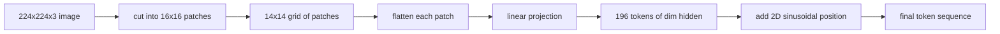

# 비전 코더 패치

> 픽셀을 읽는 시선 모델은 픽셀에 대한 토큰이 필요합니다. 패치 임베디션은 그 토큰이입니다. 이미지를 광장 그리드로 잘라, 각 광장을 평평하게 만들어, 한 선형 층을 통해 투영하고, 2D 위치 신호를 추가하여 트랜스포머가 원래 이미지에서 각 광장이 어디에 앉아 있는지 알 수 있습니다.

**Type:** Build
**Languages:** Python
**Prerequisites:** Phase 19 lessons 30-37 (Track B foundations)
**Time:** ~90 minutes

## 학습 목표

- 패치 임베디션의 고정 길이의 순서로 이미지를 토큰화하십시오.
- `Conv2d`- 팩 프로젝션 기반의 팩 프로젝션
- 2D 시노수이드 위치를 만들어서 토큰 순서가 공간 위치를 암호화합니다.
- 패치 수, 임베디션 형태를 확인하고`Conv2d`/합성 장치에 대한 동등성을 배포한다.

## 문제

트랜스포머는 일련의 벡터를 잡아먹습니다. 이미지는 3채널 그리드입니다. 모든 픽셀을 토큰으로 읽는 것은 순서 길이의 폭발을 일으킨다. 224x224 RGB 이미지는 150,528 토큰입니다. 12층 트랜스포머는 주목을 받을 수 없습니다. 하나의 거대한 평면 벡터로 이미지를 읽는 것은 주의층이 회복할 수 없는 위치를 버립니다. 코더 앞쪽의 작업은 픽셀 그리드를 몇 백 개의 토큰으로 압축하는 것입니다. 각각의 토큰은 사각형 영역을 요약합니다.

패치 임베디션은 하나의 선형 투명으로 문제를 해결합니다. 16x16 패치로 갈라진 224x224 이미지에서는 196 패치의 14x14 그리드가 생성됩니다. 각 패치는`(3, 16, 16) = 768`픽셀 값은 하나의 벡터로 표시되고, 선형층은 모델의 숨겨진 차원으로 매핑합니다. 트랜스포머는 196개의 차원의 도큰을 볼 수 있습니다.`hidden`(일반적으로 768) + CLS 토큰. 그 순서로 네트워크의 나머지

## 개념



### 왜 픽셀이 아닌 패치가

주의는 순서 길이의 사각형입니다. 196 토큰 순서 비용이 듭니다.`196 * 196 = 38,416`각 계층에 1인당 주의 점수; 150,528개의 토큰 순서값 `150,528 * 150,528 = 22.6 billion`패치는 주의 계산의 590,000배 감소를 구매하고, 단일 16x16 영역은 고 수준의 시각 작업에 충분한 신호를 가지고 있습니다. 비용은 하나의 패치 내부의 미세한 공간 세부 사항의 손실입니다. 그렇기 때문에 하류 멀티모달 스택은 미세한 현지화 문제가 될 때 종종 두 번째 고 해상도의 분사를 실행합니다.

### 왜 선형 투수가 충분할까요?

각 패치 는 독립적 인 벡터 로 취급 됩니다. 투사 는 기본 을 배우게 됩니다. 가장자리 탐지 장치, 색상 필터, 간단한 텍스처.`768 * 768 = 589,824`더 깊은 구전 줄기 ("하이브리드" ViT) 가 존재하지만 평평한 선형 투자는 표준이며 대부분의 현대 오픈 웨이트 코더는 정확히 이 모양으로 배포됩니다.

### `Conv2d`트릭

A`Conv2d(in_channels=3, out_channels=hidden, kernel_size=patch_size, stride=patch_size)`이 없는 상태에서 이 풀린 후 선형과 같은 수학적 결과를 얻습니다. 왜냐하면 각 출력 위치 도트는 하나의 필터에 대한 패치 픽셀을 생성하기 때문입니다. convolution는 패치 투영입니다. 대부분의 생산 코드베이스들은 GPU에서 더 빠르고 1 개 더 적은 재형이 사용되기 때문에 그렇게 전송합니다.

### 위치 임베디션

토큰은 투영에서 순서를 가져오지 않습니다. 2D 시노스오이드 임베디션은 각각의 토큰에 고정된 신호를 부여하여 그 암호를 암호화합니다.`(row, col)`위치. 임베디션 차원의 절반은 여러 주파수에서 sin/cos로 줄 위치를 암호화하고, 다른 절반은 열 위치를 암호화합니다. 코딩은 결정적인 것으로, 따라서 재교육 없이 해상도를 교환할 수 있으며, 훈련 시 본 적이 없는 네트워크로 깔끔하게 인터폴레이션됩니다.

| Component | Shape | Parameters |
|-----------|-------|------------|
| Patch projection (`Conv2d`) | `(hidden, 3, patch, patch)` | `3 * P * P * hidden + hidden` |
| Position embedding (fixed) | `(num_patches, hidden)` | 0 (computed, not learned) |
| CLS token (learned) | `(1, hidden)` | `hidden` |

224 해상도 ViT-Base/16: 투사에서 590,592 파라미터, CLS 토큰에서 768 파라미터, 그리고 시노사이드 위치에서 0 파라미터. 다음 수업 (59) 은 이 전면 끝 위에 12 층 트랜스포머를 쌓는다.

### 정신 건강 검증으로 동등성

패치 단계에는 두 개의 글씨가 있습니다: a `Conv2d`이 실험은 이 실험의 결과와 같은 결과를 가져오도록 합니다. 만약 그렇지 않다면, 이 실험은 잘못된 것이고, 나머지 코딩은 모래에 기반을 둔 것입니다.

```figure
ch-patch-tokenizer
```

## 건설 해

`code/main.py`이 도구는

- `PatchEmbed`,`nn.Module`포장`Conv2d`패치 투영을 위한
- `sinusoidal_2d(grid_h, grid_w, dim)`, 2D 위치 테이블을 만드는 무국부 함수
- `VisionFrontEnd`,는 패치 임베디션, CLS 프리펜드, 그리고 포지션 추가로 한 번 앞으로 전달되는 것을 구성합니다.
- A`synthesize_image(seed)`                             `numpy.random`- 그래
- 앞쪽을 통해 하나의 고정된 이미지를 실행하고 출력 모양, CLS 토큰 표준 및 위치 임베디션의 한 줄을 인쇄하는 데 필요한 데모

실행하세요:

```bash
python3 code/main.py
```

출력: 224x224 고정은 모양의 순서로 표기됩니다 `(1, 197, 768)`. 첫 번째 토큰은 CLS이고 다음 196은 패치 토큰입니다. 위치 임베디션 규범은 선 내에서 균일합니다. 이것은 시노사이드 서명입니다.

## 사용 하 고

모든 현대 시각 언어 모델에서 동일한 패치 전면이 나타납니다: CLIP ViT-L/14, SigLIP, DINOv2, Qwen-VL 가족, 그리고 InternVL 스택은 모두`Conv2d`패치 투영과 위치 신호. 가족 간의 차이점은 하류 (CLS vs no-CLS 펀딩, 레지스터 토큰, 패치 크기가 14 vs 16, 인터폴레이션 위치로 역동적 해상도) 이다. 이 수업의 전면은 각각의 모델이 서있는 초판입니다.

## 시험

`code/test_main.py`커버:

- 패치 카운트 `(image_size / patch_size) ** 2`
- 출력 모양의 일치`(batch, num_patches + 1, hidden)`
- `Conv2d`작은 고정 위에 수동으로 펴는 직선형
- 시노수이드 위치 테이블은 호출을 통해 결정적입니다
- CLS 토큰 방송은 배치를 통해 누출 없이 니다

실행:

```bash
python3 -m unittest code/test_main.py
```

## 운동

1. 시노수이드 위치를 학습된 위치로 교체합니다`nn.Parameter`그리고 작은 합성 분류 작업에 첫 시대 손실을 비교합니다. 학습된 위치가 고정된 해상도로 승리합니다. 훈련 후 해상도를 변경하면 시노사이드 승리가 있습니다.

2.              `Conv2d`명시적으로`nn.Unfold`더하기`nn.Linear`그리고 출력들이 플롯 용납량 내에서 일치한다고 주장합니다. 같은 수학, 두 가지 방법으로 문법합니다.

3. 비평형 패치 크기의 지원을 추가하고 (예를 들어 넓은 측면 입력용 32x16) 위치 테이블이 비평형 그리드를 처리하는지 확인합니다.

4. 패치 단계 를 1, 8, 64 배트 크기로 프로파일 한다. 패치 투영 은 거의 불구멍 이 아니다. 하류 아래의 관심층 이 지배 한다.

5. 4급 합성 모양 데이터 세트 (순환, 광장, 삼각형, 별) 에 얼어붙은 기능 추출기로서 전면을 훈련하십시오. CLS 토큰 출력은 선형적으로 분리되어야 합니다.

## 주요 용어

| Term | What it means |
|------|---------------|
| Patch | A square sub-region of the image, typically 14x14 or 16x16 |
| Patch embedding | Linear projection of one flattened patch to the hidden dim |
| Sequence length | Number of tokens after patch tokenization, usually plus CLS |
| Sinusoidal position | Fixed sin/cos signal that encodes 2D grid coordinates |
| CLS token | Learned vector prepended to the sequence as the pooling head |

## 더 많은 읽기

- 애 이미지 는 원래 패치 엠베드 프레임링에 16x16 단어 (ViT, 2021) 를 합치다.
- 2D에 적응된 시노사이드 위치 공식에 대한 관심은 당신이 필요로하는 모든 것입니다 (2017)
- 레지스터 토큰을 위한 DINOv2 페이퍼, 연습 6으로 추가할 수 있는 확장
