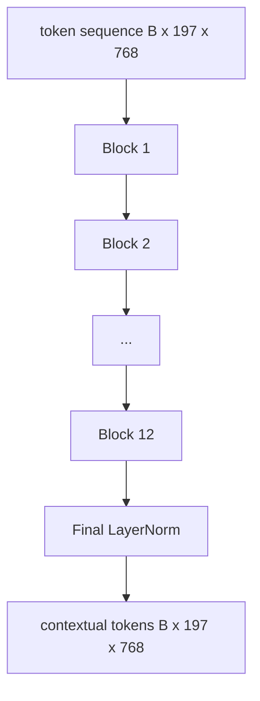
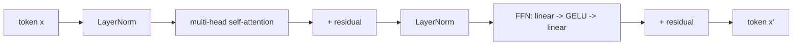

# 비전 트랜스포머 엔코더

> 패치만으로는 볼 수 없습니다. 12 개의 주의 헤드 (A Attention Head) 을 가진 12 층 전-LN 트랜스포머는 패치 토큰의 순서를 맥락 토큰의 순으로 변환하고, CLS 토큰은 최종 숨겨진 상태에서 전체 이미지 기능을 모으고 있습니다. 이 교훈은 모든 현대 시각 언어 모델의 엔진룸입니다.

**Type:** Build
**Languages:** Python
**Prerequisites:** Phase 19 lessons 30-37 (Track B foundations)
**Time:** ~90 minutes

## 학습 목표

- 다발자력 자기주의와 전전전하 하위층을 갖춘 LN 전 트랜스포머 블록을 구현한다.
- 12개의 헤드를 가진 12개의 블록을 쌓아서 ViT-Base 코더를 만들어냅니다.
- 58강의 패치 앞쪽을 코더로 연결하고 앞으로의 패스를 실행하세요.
- CLS 토큰이 모든 패치에서 정보를 집계하는지 확인합니다.

## 문제

패치 임베디션은 197개의 토큰의 연속을 생성합니다. 각각의 벡터는 다른 패치에 대한 인식이 없습니다. 고양이의 사진에는 어떤 반지가 콧수염을 포함하고, 어떤 반지가 배경을 포함하고, 어떤 반지가 눈을 포함하는지 알기 위해 모든 반지가 필요합니다. 트랜스포머는 그 인식을 만드는 메커니즘입니다. 한 번에 하나의 주의층을 만듭니다. 이 패치 없이는 패치 앞쪽은 이해가 없는 똑똑한 토큰이 됩니다.

표준 레시피는 12 블록 깊이, 12개의 머리 너비, 전 레이어노르름 배치, GELU 활성화, 4x의 포드 포워드 확장 그 레시피는 CLIP ViT-L, SigLIP, DINOv2, Qwen-VL 가족, InternVL, 그리고 2025-2026년의 다른 오픈 웨이트 비전 코딩의 척추입니다. 이 레시피는 충분히 안정되어 있습니다. 그 논문을 읽고, 다른 내용이 명시되지 않는 한, 이 블록 모양을 가정할 수 있습니다.

## 개념





### 전 전 전 전 전 전 전 전 전 전 전 전 전 전 전 전 전 전 전 전 전 전 전 전 전 전 전 전 전 전 전 전 전 전 전 전 전 전 전 전 전 전 전 전 전 전 전 전 전 전 전 전 전 전 전 전 전 전 전 전 전 전 전 전 전 전 전 전 전 전 전 전 전 전 전 전 전 전 전 전 전 전 전 전 전 전 전 전 전 전 전 전 전 전 전 전 전 전 전 전 전 전 전 전 전 전 전 전 전 전 전 전 전 전 전 전 전 전 전 전 전 전 전 전 전 전 전 전 전 전 전 전 전 전 전 전 전 전 전 전 전 전 전 전 전 전 전 전 전 전 전 전 전 전 전 전 전 전 전 전 전 전 전 전 전 전 전 전 전 전 전 전 전 전 전 전 전 전 전 전 전 전 전 전 전 전 전 전 전 전 전 전 전 전 전 전 전 전 전 전 전 전 전 전 전 전 전 전 전 전 전 전 전 전 전 전 전 전 전 전 전 전 전 전 전 전 전 전 전 전 전 전 전 전 전 전 전 전 전 전 전 전 전 전 전 전 전 전 전 전 전 전 전 전 전 전 전 전 전 전 전 전 전 전 전 전 전 전 전 전 전 전 전 전 전 전 전 전 전 전 전 전 전 전 전 전 전 전 전 전 전 전 전 전 전 전 전 전 전 전 전 전 전 전 전 전 전 전 전 전 전 전 전 전 전 전 전 전 전 전 전 전 전 전 전 전 전 전 전 전 전 전 전 전 전 전 전 전 전 전 전 전 전 전 전 전 전 전 전 전 전 전 전 전 전 전 전 전 전 전 전 전 전 전 전 전 전 전 전 전 전 전 전 전 전 전 전 전 전 전 전 전 전 전 전 전 전 전 전 전 전 전 전 전 전 전 전 전 전 전 전 전 전 전 전 전 전 전 전 전 전 전 전 전 전 전 전 전 전 전 전 전 전 전 전 전 전 전 전 전 전 전 전 전 전 전 전 전 전 전 전 전 전 전 전 전 전 전 전 전 전 전 전 전 전 전 전 전 전 전 전 전 전 전 전 전 전 전 전 전 전 전 전 전 전 전 전 전 전 전 전 전 전 전 전 전 전 전 전 전 전 전 전 전 전 전 전 전 전 전 전 전 전 전 전 전 전 전 전 전

원래 트랜스포머는 잔류 후 레이어노르먼트를 배치했다. 프리-LN (각 하위층 전에 레이어노르먼트) 는 모든 현대 시각 언어 모델이 사용하는 버전입니다. 왜냐하면 학습 속도 온화 트릭 없이 안정적으로 훈련하기 때문입니다. 차이는 앞 패스의 한 줄이고, 깊이 12+에서 기하급수 흐름은 낮과 밤입니다.

### 여러 머리 자기주의

각 머리는 기호 벡터를 자신의 벡터로 프로젝합니다`(query, key, value)`3개 크기로`head_dim = hidden / num_heads`- `hidden = 768`그리고`heads = 12`, 각 머리에는`dim = 64`. 12개의 머리는 평행하게 참석하고, 그 결과물은 768 차원으로 다시 연결되어 출력 투명을 통과합니다. 다중 머리의 포인트는 한 머리는 "고양 눈에 참석할 수 있습니다" 다른 머리는 " 배경 기하급수에 참석할 수 있습니다" 방해 없이 학습합니다.

### 왜 4x의 전력 확장

FFN가 가`hidden -> 4 * hidden -> hidden`GELU가 중간에 있는 경우, 4 요인은 경험적이며 2017년부터 언어와 시각 변환기에서 유지되고 있습니다. 작은 (2x) 부적절; 큰 (8x) 고정된 데이터 예산에서 과잉. MLP는 모델이 배운 사실 중 대부분을 저장하고, 넓은 중간에 앉아 있습니다.

| Component | Parameters at ViT-Base scale |
|-----------|------------------------------|
| qkv projection per block | `3 * 768 * 768 = 1.77M` |
| output projection per block | `768 * 768 = 590K` |
| FFN per block (4x expansion) | `2 * 768 * 4 * 768 = 4.72M` |
| LayerNorm per block | `4 * 768 = 3K` |
| Total per block | about 7.1M |
| 12 blocks | about 85M |
| Plus front end | about 86M total |

ViT-Base는 86M 파라미터의 코더입니다. 2026 표준에 비해 작습니다 (SigLIP-So400M는 400M, Qwen-VL ViT는 675M), 그러나 아키텍처는 너비와 깊이까지 동일합니다.

### 인과적인 마스크가 아니면 그렇지 않나요?

비전 트랜스포머는 단지 코더로 사용되며 쌍방향: 토큰`i`시카고에 참석할 수 있습니다`j`디코더 측의 간접주의는 가상의 마스크를 사용하지만, 시각 코더 내부에서는 주의가 완전히 연결되어 있습니다.

### CLS 토큰이 배운 것은

CLS 토큰은 학습된 매개 변수로 시작되며, 자체적으로 패치 콘텐츠를 가지고 있지 않으며, 각 블록을 통해 관심을 통해 정보를 축적합니다. 마지막 층에 의해 CLS 줄은 전체 이미지의 벡터 요약입니다. 하류 헤드들은 텍스트 디코더를 위한 클래스 로그이트, 대조적 임베디션 또는 크로스-아테크먼트 키로 이 단일 벡터를 프로젝합니다.

```figure
ch-cls-funnel
```

## 건설 해

`code/main.py`이 도구는

- `MultiHeadSelfAttention`,`qkv`그리고 출력 예측, 점 점 점 점 점수 생산 관심 수학, 그리고 모양 주장.
- `FeedForward`, 4x 확장 GELU MLP
- `Block`, LN 전 블록은 잔류를 가진 관심과 feed-forward 하위층을 구성합니다.
- `ViT`, 12 블록의 쌓여있는 마지막 레이어노르름
- `VisionEncoder`, 어떤 케이블`VisionFrontEnd`58강에서`ViT` `forward()`컨텍스트 순서와 pooled CLS 벡터를 반환합니다.
- 전체 코더를 통해 합성된 224x224 고정 이미지를 실행하고 입력 형태, 출력 형태, 매개 변수 수와 CLS 규범을 다른 모든 계층에서 인쇄하는 데모

실행하세요:

```bash
python3 code/main.py
```

출력: 장치가 a로 암호화됩니다`(1, 197, 768)`CLS 표준은 층이 구성되는 동안 위로 이동하고 최종 LayerNorm에서 안정됩니다. 전체 매개 변수는 약 86M에 나타납니다.

## 사용 하 고

여기서 정의된 코더는, 너비와 깊이까지, 2025-2026년 모든 오픈 웨이트 VLM 내부에 배포되는 동일한 블록 스택입니다. 차이점은:

- **Width and depth.**비트-라지`hidden=1024, depth=24, heads=16`; SigLIP So400M는`hidden=1152, depth=27, heads=16`- 같은 블록
- **Pooling head.**CLS (이 수업) vs 평균 (SigLIP) vs 관심 (이후 VLM)
- **Position handling.**고정된 시노수다형 (강습 58) vs 학습된 1D vs ALiBi vs 2D RoPE. 블록 수학은 변하지 않습니다.
- **Register tokens.**DINOv2는 4개의 추가로 학습된 토큰을 준비합니다.

이 블록 스택은 초판입니다. 다음 수업 (60-63) 은 그 위에 있습니다.

## 시험

`code/test_main.py`커버:

- 단일 블록은 모양을 유지하며 입력 배트 크기에 변하지 않습니다
- 주의 점수는 키 축을 따라 1으로 합쳐집니다 (softmax sanity)
- 잔여 경로는 케이블 (실수 입력은 여전히 CLS 토큰을 통해 0이 아닌 출력을 생성합니다)
- 4층의 앞쪽으로 쌓인 패스는 올바른 모양을 만들어냅니다
- CLS 출력에서 패치 투명으로 기하급수 흐름

실행:

```bash
python3 -m unittest code/test_main.py
```

## 운동

1. 레지스터 토큰 (4 개의 학습 벡터 CLS 이후 전속) 을 추가하고 다시 실행하십시오. 마지막 층에 있는 소프트맥스 분포의 엔트로피를 통해 주의 지도의 매끄러움을 비교하십시오.

2. LN 전과 LN 후의 양식을 바꾸고 합성 모양 분류기에 한 시대를 열고, LR 온화 없이 안정적으로 열을 열고 있는 양을 관찰하십시오.

3. `attn_mask`이 블록은 디코더 블록으로 재사용될 수 있도록`(seq, seq)`, 아래 삼각형

4.                   `torch.profiler`MLP 계층은 주의를 돌리지 않고 벽 시간을 지배합니다.

5. 한 주의 머리의 q-k-v 프로젝션을 낮은 순위 LoRA 어댑터로 교체하고 나머지는 얼어붙이고 그라디엔트가 예상되는 곳으로만 흐르는 것을 확인하세요.

## 주요 용어

| Term | What it means |
|------|---------------|
| Pre-LN | LayerNorm applied before each sub-layer instead of after |
| Self-attention | Each token attends to every other token in the same sequence |
| Multi-head | The hidden dim is split across `H` independent attention heads |
| FFN expansion | The feed-forward layer widens to `4 * hidden` before contracting |
| CLS pooling | Use the first token's final hidden state as the image summary |

## 더 많은 읽기

- 에코더 레시피에 대한 이미지 값은 16x16 단어 (ViT, 2021) 이다.
- 등록 토큰 및 자율 감독 사전 훈련 목표에 대한 DINOv2 (2023).
- 수업 62에서 사용되는 평균 pooling 변수와 sigmoid 반조 손실에 대한 SigLIP (2023)
