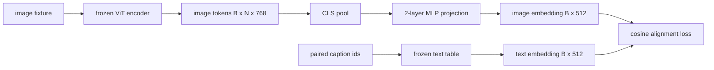

# 모다리티 조화를 위한 투영층

> 시각 앵코더는 이미지 토큰을 생성한다. 텍스트 디코더는 텍스트 토큰을 소비한다. 두 개의 색상은 서로 다른 벡터 공간에 살고 있다. 작은 두층 MLP는 텍스트를 내장하는 공간에 이미지 토큰을 투 chiếu하고, 쌍용 캡션에 대한 코시네스 조율 손실은 두 공간을 합의로 끌어들이고 있다. 그 투영은 시각 언어 모델의 가장 작은 조각이며 전송에 가장 중요합니다.

**Type:** Build
**Languages:** Python
**Prerequisites:** Phase 19 lessons 30-37 (Track B foundations)
**Time:** ~90 minutes

## 학습 목표

- 텍스트에 삽입된 공간에 이미지 특징을 지도하는 2층 MLP 프로젝션을 구축하십시오.
- 가짜 텍스트 임베디션 테이블을 구축하십시오 (예전에 훈련된 토케니저가 없으며 실제 코퍼스가 없습니다).
- 투영된 이미지 토큰과 쌍용 캡션 임베디션 사이에 코시네스 조항 손실을 계산한다.
- 얼어붙은 시각 코더와 얼어붙은 텍스트 테이블로 프로젝션을 혼자 훈련하십시오.

## 문제

시각 코더 (목적 58-59) 가 차원의 지표를 생성합니다`vision_hidden = 768`- 텍스트 디코더가 있고, 위쪽에 삽입된 크기를 넣고 싶네요`text_hidden = 512`(다른 숫자는 똑같이 그럴듯하다). 디코더는 텍스트 모양의 토큰을 기대합니다. 이미지 토큰은 텍스트 모양이 아닙니다. 그들은 디코더의 단어 벡터와 아무런 관련이없는 시각 전 훈련 중에 익힌 기반에서 살고 있습니다.

두 층 MLP 투영 (선형, GELU, 선형) 은 격차를 다다르게 합니다.`768 * 1024 + 1024 * 512 = 1.3M`매개 변수) 는 단일 GPU에서 몇 분 안에 훈련 할 수 있으며, 조화 단계에서 배워야 할 유일한 조각입니다. 시각 코더는 얼어붙습니다. 텍스트 임베디션 테이블은 얼어붙습니다. 프로젝션만 움직입니다. 이것은 2023년에 배포된 LLaVA 레시피입니다. BLIP-2는 Q-Former로 재프라메이트되었으며, 이후 모든 오픈 웨이트 VLM는 어떤 형태로 채택했습니다.

## 개념



### 투영 전에 집합

비전 코더는 197 토큰을 발급한다. 텍스트 측면은 단일 캡션 레벨 임베디션을 가지고 있다. 그것들을 정렬하려면 샘플당 한 이미지 레벨 벡터가 필요합니다. CLS 펀딩은 가장 간단합니다. 코더에서 첫 번째 토큰을 가져다가 프로젝합니다. 모든 197 토큰을 통한 평균 펀딩은 또 다른 옵션이며 SigLIP이 사용하는 것입니다. 둘 중 하나는 197 벡터를 하나로 묶습니다.

### 왜 두 층이 하나 아닌데

단일 선형 투자는 회전 및 재 확장할 수 있지만 두 공간의 곡선 불합이있는 경우 기초를 고정할 수 없습니다. 두 선형 층 사이의 GELU는 투사에 비선형 곡선을 부여하는데, 이는 CLIP 스타일의 특징을 언어 모델 임베디션에 맞추기 위해 경험적으로 충분합니다. 더 깊은 투사 (LLaVA-NeXT는 GLU를 사용했고, Qwen-VL는 주의층을 사용했다) 는 확장이다. 두층 MLP는 가전적 기본 라인이며 BLIP-2의 Q-Former 투사 선박이 뚜 아래에 있는 것입니다.

| Layer | Shape | Parameters |
|-------|-------|------------|
| fc1 | `(vision_hidden, projection_hidden)` | `768 * 1024 + 1024` |
| activation | GELU | 0 |
| fc2 | `(projection_hidden, text_hidden)` | `1024 * 512 + 512` |

약 1.3M의 매개 변수`768 -> 1024 -> 512`머리

### 코시네 조율 손실

조율은 `image_emb == text_emb`- 조율하는 것`image_emb``text_emb`관절 공간에서 코시네스 손실은`1 - cos_sim(image, text)`, 0 (완전하게 조화 된) 에서 2 (반대의) 까지의 범위에서. 훈련은 쌍당 0으로 이끄는. 레슨 62 은 반대의 대조적 배트 (InfoNCE) 로 일반화되어, 각 이미지는 배트의 다른 배트보다 자신의 캡션에 더 가깝게 있어야합니다. 이 수업은 쌍당 버전을 사용합니다. 따라서 역학이 눈에 띄습니다.

### 냉동 코딩은 트릭입니다

시력 코더는 86M의 매개 변수를 가지고 있습니다. 텍스트 테이블에는 몇 백만 명이 더 있습니다. 가짜 코퍼스에서 훈련하는 것은 시작이 되지 않는 일입니다. 두 가지를 모두 얼어붙이는 것은 1.3M의 기호가 변하는 유일한 것을 의미하며 합성 쌍에 몇 백 단계가 손실을 줄이기 위해 충분합니다. 이것은 모든 어댑터 기반 VLM의 작동 형태입니다. 무거운 부품은 얼어붙고, 가벼운 다리 열차는 얼어붙습니다.

```figure
ch-projection-bridge
```

## 건설 해

`code/main.py`이 도구는

- `MLPProjector(in_dim, hidden_dim, out_dim)`, GELU 활성화를 가진 2층 선형 MLP
- `MockTextEmbedding(vocab_size, dim)`, 씨앗에서 결정적 인 초기와 함께 얼어붙은 임베디션 테이블
- `make_pair(seed, vocab_size)`,는 하나의 쌍 (사진, 캡션) 샘플을 합성합니다. 캡션은 짧은 ID 순서입니다. 캡션 임베디션은 토큰 임베디션에 평균적으로 결합됩니다.
- `cosine_alignment_loss(image_emb, text_emb)`, 쌍당`1 - cos_sim`객관적
- 32개의 합성 쌍 (주주) 에 걸쳐 200단계로 투영을 실행하는 훈련 루프, 비전 코더와 텍스트 테이블이 얼어붙어 25단계마다 손실을 인쇄합니다.

실행하세요:

```bash
python3 code/main.py
```

출력: 훈련 보고서는 200 단계 내에 초기 손실 1.07에서 0.80 정도로 떨어지며, 투사만으로 이미지 토큰을 텍스트 공간으로 끌어당길 수 있음을 보여줍니다.

## 사용 하 고

같은 패턴은 모든 오픈 웨이트 VLM에서 나타납니다:

- **LLaVA 1.5.**CLIP-ViT-L에서 숨겨진 2층 GELU MLP 투영 LLaMA에 담겨있는 희미. 얼어붙은 비전 코더, 얼어붙은 LLM, 투영만 훈련 (이후 두 번째 단계에서 LLM를 해제)
- **BLIP-2.**Q-Former는 32개의 학습된 질의 토큰을 이미지 토큰에 대한 간접주의를 통해 가져다가 LLM 임베디션 덤으로 프로젝션합니다. Q-Former의 끝부분의 프로젝션 헤드는 이 수업의 MLP의 아날로그입니다.
- **MiniGPT-4.**BLIP-2 Q-Former 출력에서 Vicuna 임베디션 덤으로 단일 선형 투명
- **Qwen-VL.**여러 층의 크로스-아트레이션 어댑터, 하지만 마지막 조각은 다시 LM 임베디션 에 대한 투영입니다.

형태는 다르지만 역할은 동일합니다. 풀 이미지 토큰, 프로젝트에서 텍스트에 임베디드

## 시험

`code/test_main.py`커버:

- 프로젝터 출력 모양은 구성된 것과 일치합니다 `out_dim`
- 얼어붙은 텍스트 임베디션 테이블은 0 `requires_grad`매개 변수
- 동식 벡터에서 코시노 손실은 0이고 항상류 벡터에서는 2입니다
- 1번 뒤로 통과한 후 프로젝터 기하급수 흐름
- 훈련 루프는 단계 0에서 단계 200 사이의 손실을 줄입니다

실행:

```bash
python3 -m unittest code/test_main.py
```

## 운동

1. CLS 펀딩을 196개의 패치 토큰에 대한 평균 펀딩으로 대체하고 200 단계 후에 최종 손실을 비교하십시오. 평균 펀딩은 일반적으로 합성 데이터에서 더 빨리 훈련합니다. CLS는 자연 이미지에 더 샘플 효율적입니다.

2. 학습된 스칼라 온도를 코시네스 손실에 추가한다 (`cos / tau`) 그리고 어떤 일이 일어나는지 관찰합니다`tau`너무 작다 (진각음) 또는 너무 큰 (손실 평야 높다).

3. 두층 MLP를 하나의 선형 층으로 교환하여 손실 격차를 수치화하십시오. 비선형성은 자연스러운 이미지 특징에 더 중요하고 합성적인 특징에는 덜 중요합니다.

4. 프로젝터 무게에 작은 L2 페널티를 추가하고 코시네의 조율과 상호 작용하는 방법을 관찰하십시오 (코시네는 규모 변동이므로 페널티는 대부분 사용하지 않은 방향을 축소합니다).

5. 프로젝터 무게를 계속 유지하고, 비전 코더가 후퇴하는 것을 확인하지 않고 재충전하고 추론을 실행하여 배포 시에 프로젝터가만 필요하다는 것을 확인합니다.

## 주요 용어

| Term | What it means |
|------|---------------|
| Modality alignment | The act of making image and text embeddings comparable in one shared space |
| Projection head | The small module that maps one space to another, usually a 2-layer MLP |
| Cosine similarity | Dot product divided by the product of L2 norms |
| Frozen encoder | The vision (or text) model has all parameters with `requires_grad=False` |
| Mock corpus | Synthetic pairs used so training has no dataset download dependency |

## 더 많은 읽기

- 두 단계의 열차 (프로젝트, 그리고 LM를 해제) 에 대한 LLaVA 종이
- Q-Former에 대한 BLIP-2 종이 학습 가능한 투영 대안으로
- 더 깊은 투영 헤드로서의 크로스-아테크니컬 어댑터에 대한 Qwen-VL 기술 보고서
