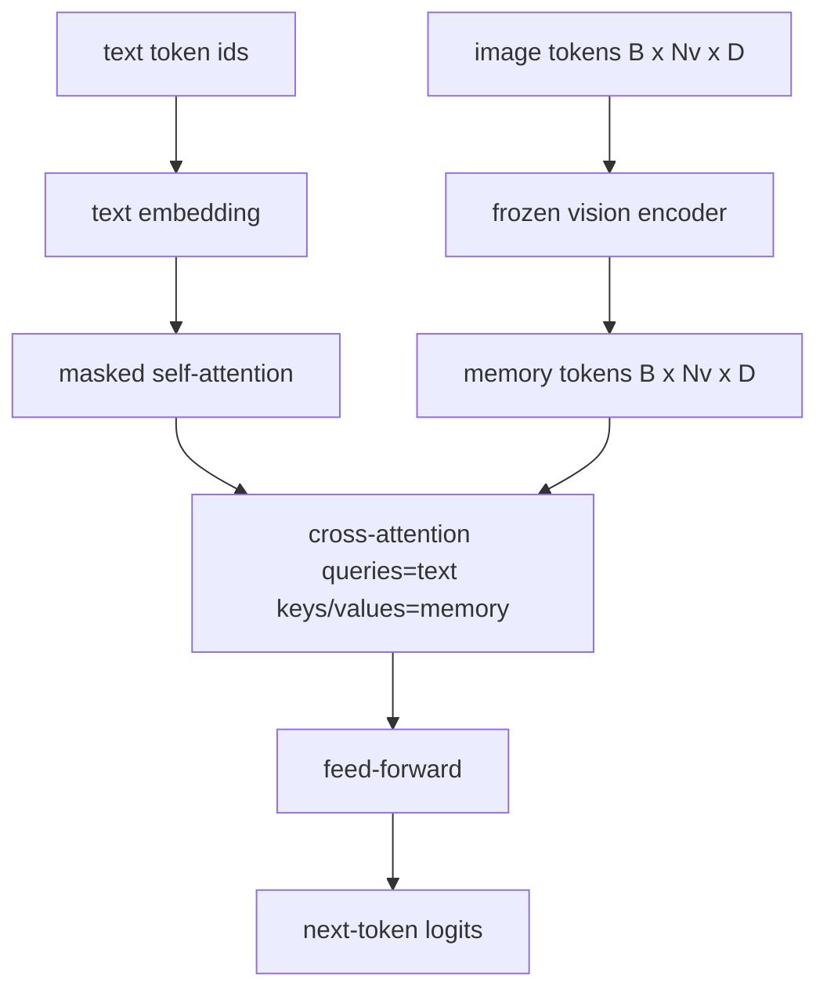
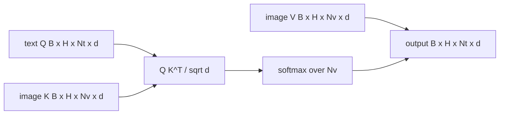

# 크로스 주의력 융합

> 투영층은 한 이미지 벡터를 한 캡션 벡터로 정렬합니다. 실제 시각 언어 디코더는 모든 텍스트 토큰을 필요로 합니다. 그래서 모델은 모든 단어를 특정 영역에 지탱할 수 있습니다. 횡단주의는 그 지형화가 일어나는 방법입니다. 텍스트 질문; 비전 키와 값은 대답. 이 수업은 교차주의 블록, 원시적인 텍스트 자기주의, 그리고 마스크 모양을 구축합니다. 두 가지 모두 합법적으로 유지됩니다.

**Type:** Build
**Languages:** Python
**Prerequisites:** Phase 19 lessons 30-37 (Track B foundations)
**Time:** ~90 minutes

## 학습 목표

- 수목 간 간접 주의를 구현하여 질의 흐름이 텍스트이고 키/값 흐름이 비전이다.
- 디코더 블록을 구성합니다. 인과적 자기주의 + 간접주의 + 전력.
- 마스크의 모양을 제대로 만들어 보세요. 자부심을 위한 인과적인 마스크, 간과적인 관심을 위한 마스크가 없습니다.
- 배팅된 텍스트 토큰과 고정된 이미지 토큰을 가진 앞 패스를 실행하십시오.

## 문제

이미지 토큰과 텍스트 토큰을 하나의 순서로 결합하는 것은 하나의 융합 옵션 (초기 융합, 샤멜레온과 Emu3의 경로) 이다. 크로스 주의는 다른 (후기 융합, 플라밍고가 도입한 경로, 그리고 이후 모든 플라밍고 모양의 디코더가 복사했다). 후기 융합에서 텍스트 디코더는 텍스트 전용 토큰으로 실행되며 각 계층에서 횡단 주의를 통해 이미지 스트림에 도달합니다.

후기 융합은 두 가지 장점을 가지고 있습니다. 첫째, 텍스트 스트림은 깨끗하고 모델은 텍스트 전용 기능을 보존합니다. 둘째, 이미지 스트림은 한 이미지에 한 번 계산되고 모든 디코딩 단계에 재사용됩니다. 따라서 길고 캡션에도 생성 비용이 저렴합니다. 비용은 블록당 한 부가적인 관심 하위 층입니다.

## 개념





### 마스크 모양

디코더 블록 내부의 두 개의 주의가 다른 마스크를 필요로 합니다.

| Attention | Query length | Key length | Mask | Why |
|-----------|--------------|------------|------|-----|
| Self-attention | `Nt` (text) | `Nt` (text) | Causal: lower-triangular `(Nt, Nt)` | Text tokens may not look ahead during autoregression |
| Cross-attention | `Nt` (text) | `Nv` (vision) | No mask | The whole image is visible to every text position |

수업에는 하나의 모양 검증 기능이 포함되어 있으므로 표면을 섞는 오류가 `ValueError`침묵으로 깨진 손실 곡선 대신에

### 왜 간접주의를 위한 마스크가 없나요?

텍스트가 생성되기 전에 이미지가 완전히 관찰됩니다.`t`글씨의 일부 변종은 여러 이미지와 텍스트 세그먼트를 잇는 경우 샘플별 마스크 패턴을 추가하지만, 하나의 이미지와 글씨가 추가되면, 크로스-아테네이션은 모든 것을 볼 수 있습니다.

### 키/값 캐시

이미지 키와 값은 디코딩 시작 시 한 번 계산되어 캐시에 보관됩니다. 새로운 텍스트 토큰마다 재회산 없이 캐시를 사용합니다. 이것은 캡션을 추론하는 데 빠르도록 만드는 것입니다. 무거운 ViT는 한 번 실행됩니다. 간접주의는 모든 단계에 대해 키와 값을 재사용합니다. 수업은 캐시를 노출하고 캐시를 타는 경로를 테스트합니다.

### 블록 구성

디코더 블록은: pre-LN -> 자기주의 -> 잔류 -> pre-LN -> 크로스주의 -> 잔류 -> pre-LN -> feed-forward -> 잔류를 실행합니다. 각이 자신의 LayerNorm를 가진 세 개의 하위 계층입니다. 플라밍고 논문은 크로스주의에 대한 학습 된 게이트를 추가하여 모델은 훈련 시간 안정 비용으로 이미지 경로를 거부할 수 있습니다. 가нони컬 기본 라인 (이 жерде 사용) 은 게이트가 없습니다.

```python
class DecoderBlock:
  def forward(self, text_tokens, image_tokens, text_mask, cross_mask):
      text_tokens = text_tokens + self.self_attn(self.ln1(text_tokens),
                                                 mask=text_mask)
      text_tokens = text_tokens + self.cross_attn(self.ln2(text_tokens),
                                                  image_tokens,
                                                  mask=cross_mask)
      text_tokens = text_tokens + self.ffn(self.ln3(text_tokens))
      return text_tokens
```

```figure
ch-crossattn-fan
```

## 건설 해

`code/main.py`이 도구는

- `CrossAttention(hidden, heads)`, 멀티 헤드 크로스 어테네이션`q`그리고`kv`예측
- `CausalSelfAttention(hidden, heads)`, 표준 디코더에서 마스크된 자기주의를
- `DecoderBlock`, 3개의 하층을 LN 전 잔재로 구성한다.
- `VisionLanguageDecoder`, 4층 디코더를 모호한 비전 엔코더 출력과 작은 텍스트 임베디션 테이블로 공급합니다.
- `causal_mask(length)`반환 `(length, length)`아래 삼각형의 볼리언 텐서
- 길이 10의 두 개의 텍스트 순서로 구성된, 길이 197의 이미지 메모리를 제공하여 출력 형태, 자기주의 마스크 모양 및 각 위치별로 가로 주의 출력 규범을 인쇄하는 데모.

실행하세요:

```bash
python3 code/main.py
```

출력: 디코더는 `(2, 10, text_vocab)`로그티스 텐서. 마스크 모양은`(10, 10)`KV 캐시 재사용 검사는 캐시된 경로와 캐시되지 않은 경로 사이에 동일한 로그팅을 확인합니다.

## 사용 하 고

두 가지 생산 가족에서 간접적인 관심은 나타납니다.

- **Flamingo and IDEFICS.**K 언어 모델 블록마다 가로 주의 하위층을, 얼어붙은 LM를 삽입한다. 시각 언어 어댑터는 가로 주의 블록과 그 게이트이다.
- **BLIP-2.**Q-Former는 고정된 32 개의 쿼리 토큰에서 쿼리를 통해 이미지 기능에 적용하고, 쿼리를 LM 임베디션 공간에 투영합니다.

이 수업의 블록의 형태는 두 가지에 직접적으로 나타납니다. 마스크 징계 (자신의 원인과 십자가의 원인은 없습니다) 은 동일합니다.

## 시험

`code/test_main.py`커버:

- 인과적 마스크는 아래 삼각형이며 예상되는 볼리형과 일치합니다
-            `(B, Nt, hidden)`키 길이가 상관없이
- KV 캐시 경로는 캐시되지 않은 경로와 부동의 용납과 일치합니다
- 텍스트와 이미지 스트림 사이의 모양의 부합은 명확하게 `ValueError`
- 전용 디코더 앞 패스는 올바른 배트 및 순서 모양을 생성합니다

실행:

```bash
python3 -m unittest code/test_main.py
```

## 운동

1. 크로스 주의력 잔류 (플라밍고 트릭) 에 학습된 톤 게이트를 추가하고 거의 0의 초기 게이트에서 훈련이 공감되는 것을 확인합니다. 게이트는 0에서 시작됩니다. 모델은 이미지 스트림을 혼합하기 전에 텍스트만 사용하는 행동을 복구합니다.

2. 동일한 디코더가 여러 이미지와 여러 텍스트 세그먼트를 소비하는 경우 간접주의를 구현하십시오. 텍스트 세그먼트 2가 이미지에 참여하지 않도록 한 샘플별 간접주의 마스크를 구축하십시오.

3.                                  `Nt=64, Nv=576`(고등 해상도의 24x24 그리드)`Nt * Nv`그리고 높은 이미지 해상도를 지배합니다.

4. 횡단주의 지도에 질의 측 drop-out을 추가하고 디모에서 캡션 다양성을 측정하십시오 (십자 지도에서 drop-out로 캡션 샘플 변수가 증가합니다).

5. 크로스-아트런션 레이어를 Q-Former 스타일의 관심 블록으로 바꾸어 놓은 경우, 고정된 32 토큰 쿼리 풀은 각 레이어마다 한 번 이미지 기능에 참여합니다.

## 주요 용어

| Term | What it means |
|------|---------------|
| Late fusion | Text and vision stay in separate streams; cross-attention bridges them at every block |
| Cross-attention | Q comes from one stream, K and V from another |
| Causal mask | Lower-triangular boolean mask that prevents looking ahead during autoregression |
| KV cache | Image keys and values stored once and reused for every decode step |
| Memory tokens | The frozen image tokens that the decoder reaches into |

## 더 많은 읽기

- 플라밍고 (2022) 는 게이트된 크로스-아테테네이션으로 캐논िकल  Late-Fusion 디자인이다.
- Q-Former에 대한 BLIP-2 (2023) 은 학습된 질의 풀처럼 옷을 입은 교차주의 블록입니다.
- 플라밍고 요리법의 열린중重 복제에 대한 IDEFICS (2023)
