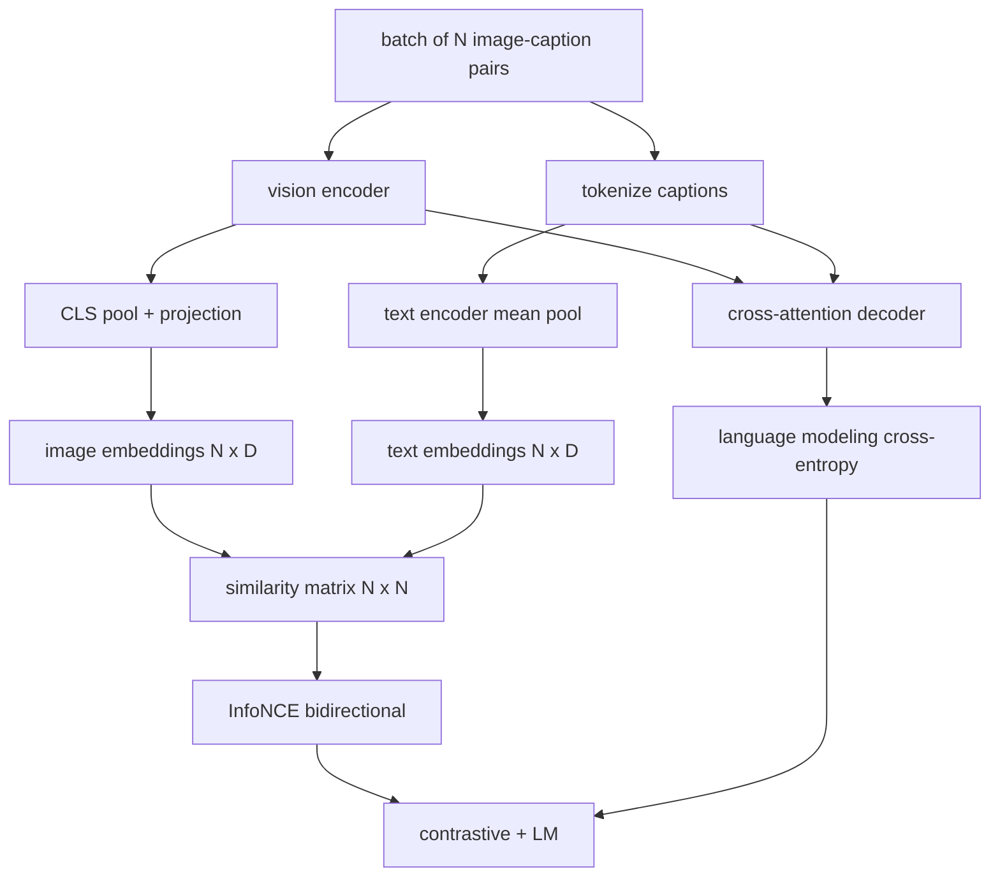

# 시각 언어 훈련

> 코더, 프로젝션, 디코더는 케이블로 연결되어 있습니다. 이제 그것들을 함께 훈련시킵니다. 두 가지 목표는 학습을 촉진합니다. 합동 임베디션 공간에서 일치하는 쌍을 끌어들이는 대조적 이미지 텍스트 손실 (InfoNCE) 와 언어 모델링 손실은 디코더에게 각 이미지를 캡션하도록 요청합니다. 결합하면 네트워크는 캡션에 대한 올바른 이미지를 찾을 수 있도록 가르칩니다. 그리고 이미지에 대한 캡션을 작성합니다.

**Type:** Build
**Languages:** Python
**Prerequisites:** Phase 19 lessons 30-37 (Track B foundations)
**Time:** ~90 minutes

## 학습 목표

- 이미지 캡션 쌍의 배열에 걸쳐 InfoNCE 대조 손실을 구현합니다.
- 모형화 손실을 자동 퇴행성 언어 손실과 합쳐
- 실제 데이터 세트 다운로드 없이 200쌍의 모인 이미지 캡션 코퍼스를 합성합니다.
- 50단계 예제 훈련 루프를 실행하고 두 손실이 감소하는 것을 관찰하십시오.

## 문제

시각 언어 모델은 두 가지 기술을 필요로 한다. 그것은 순위를 해야 한다: 캡션을 제공하여 많은 사람들 사이에서 올바른 이미지를 찾아야합니다. 그것은 생성해야 한다: 이미지를 제공하여 캡션을 작성하십시오. 하나의 기술만으로 모델을 미리 훈련하면 절반의 시스템을 제공합니다. CLIP 네일 순위를 하지만 캡션을 할 수 없습니다. GPT-4V는 캡션을 할 수 있지만 순위를 위해 별도의 검색 헤드를 사용합니다. 다목적 사전 훈련은 한 패스에서 둘 다 얻습니다.

인포NCE는 순위 반을 처리합니다. N 쌍의 배트에서 모델은 N 부쌍을 긍정적 인 것으로 취급하고 `N^2 - N`부정적 인 부쌍으로 일치하지 않는 경우, 그 결과 `(N, N)`유사성 매트릭스. LM 손실은 생성 반을 처리합니다. 이 사진은 조건화된 표준 다음 토큰 예측입니다. 두 손실은 차별화되며 코더, 프로젝터 및 디코더 무게를 공유 할 수 있습니다.

## 개념



### 한 문항으로

N 이미지 임베디션을 라인으로, N 텍스트 임베디션을 라인으로 쌓아두십시오. L2 - 둘 다 정상화하십시오.`N x N`매트릭스`S = I T^T / tau`어디`tau`이 경우, 각도 입구들은 일치하는 쌍이고, 각도 밖의 입구들은 부정적이다.`argmax`직사각형 아래로 가는 길: 행 `i`기둥에서 가장 높은 항목을 가져야 합니다 `i`두 개의 줄이 모두 합당하고, 8 줄의 CLIP 손실이 됩니다.

### 온도 문제

온도는`tau`부드러운 최대 최대 크기의 크기를 조절합니다. 너무 작습니다 (예를 들어`tau = 0.01`) 과 그라디언트는 가장 어려운 부정적인 것에서만 나온다, 훈련은 잡음입니다. 너무 큰 그리고 소프트맥스는 평평화되고 그라디언트는 사라집니다. CLIP는 배운다 `tau`이 디모는 같은 것을 합니다.

### 언어 모델링 손실

디코더는 크로스-아테테이션을 통해 이미지 메모리 토큰을 소비하고 모든 위치에서 다음 텍스트 토큰을 예측합니다. 손실은 다음 위치 목표와 표준 크로스-엔트로피입니다. 패딩 포지션은 손실에서 숨깁니다.

### 손실을 합쳐

`total = contrastive + lm_weight * lm`어디`lm_weight`이 두 손실은 코더와 투사에 gradients를 공유한다. decoder만이 LM-loss gradient을 받는다. 이것은 CoCa, BLIP, SigLIP 스타일 모델들이 모두 사용하는 다 작업 레시피입니다.

| Component | Loss surface | Affects |
|-----------|--------------|---------|
| InfoNCE | Pair ranking in the joint space | Encoder + projection + text head |
| LM | Token prediction conditioned on image | Encoder + projection + decoder |
| Combined | Multi-task | Whole stack |

### 왜 50단계만 데모를 할 수 있는 건지

모크 코퍼스는 무작위 이미지 및 무작위 캡션 아이디를 가진 합성 200 쌍 집합입니다. 50 개의 SGD 단계와 배치 크기가 16 인 후, 절대 값이 실제 데이터 모델에서 달성하는 것보다 높더라도 두 손실이 눈에 띄게 떨어집니다. 디모의 목적은 그라디언트 인수 작업이 끝에서 끝으로 이루어지고 LM 손실을 추가하면 대립 목표를 불안정시키지 않는다는 것을 확인하는 것입니다.

```figure
ch-infonce-diagonal
```

## 건설 해

`code/main.py`이 도구는

- `MultimodalModel`, 작은 ViT 코더, MLP 프로젝터, 작은 텍스트 측면 코더 (인베드된 아이디를 중계하는 풀) 와 수업 61에서 간접 주의 디코더를 결합합니다.
- `info_nce_loss(image_emb, text_emb, temperature)`, 쌍방향 CLIP 방식의 대조적 손실
- `lm_loss(logits, target_ids, padding_id)`, 다음 토큰 크로스 엔트로피를 마스크
- `make_mock_corpus(seed, n_pairs)`, 200개의 결정적 ( 이미지, caption_ids) 쌍을 반환합니다.
- 배트 크기가 16인, 아담 최적화 장치와 학습된 로그 온도 매개 변수를 가진 50단계 훈련 루프. 두 손실은 5단계마다 인쇄됩니다.

실행하세요:

```bash
python3 code/main.py
```

출력: 대조적 손실은 약`ln(16) = 2.77`2.4로 향하고, LM 손실은 `ln(512) ≈ 6.24`두 가지 감소는 그라디엔트가 올바르게 가열된다는 것을 증명합니다. 실제 모델들은 수백만 단계에 걸쳐 훈련합니다. 동력은 동일합니다.

## 사용 하 고

이 방법은 이식된 것과 같습니다.

- **CLIP (2021).**이미지 텍스트만 대조적으로, 냉동 코딩 캡션 탐사선으로
- **CoCa (2022).**한 모델에서 이미지-텍스트 대조형 + 이미지 캡션 LM 손실이 있습니다. 이 수업이 만드는 정확한 패턴입니다.
- **BLIP (2022) and BLIP-2.**대조성 + LM + 이미지- 텍스트 일치 머리 3 손실 합쳐
- **SigLIP (2023).**지그모이드 쌍 손실을 위해 InfoNCE를 전환합니다. 동일한 반조 역할, 다른 기능 형태.
- **LLaVA family.**두 단계 훈련, 첫 번째 단계는 조화 (린 LM에 대한 코시네) 이며 두 번째 단계는 얼어붙은 LM에 대한 LM 손실을 추가합니다. 60 수업은 첫 번째 단계에 지도를 만듭니다. 이 수업은 두 번째 단계에 지도를 제공합니다.

## 시험

`code/test_main.py`커버:

- InfoNCE 손실은 이미지/ 텍스트 줄에서 대칭입니다
- InfoNCE 손실은 유사성 행렬이 큰 양수의 완벽한 다이아곤일 때 0을 반환합니다
- LM 손실은 포장 위치를 올바르게 마스크합니다
- 모델 포워드 패스는 두 손실도 오류 없이 발생한다
- 5단계 훈련 루프는 합동 손실을 줄입니다

실행:

```bash
python3 -m unittest code/test_main.py
```

## 운동

1. SigLIP형 Sigmoid 쌍 손실으로 InfoNCE를 대체하고 모호한 몸체에서 konvergence를 비교하십시오.

2. 하드 네거티브 마이닝 단계 를 추가 하십시오. 다른 배트 마다, 이전 배트 에서 가장 단단 한 비방각 쌍을 선택 하고 첨부 하십시오.

3. 공동 임베디션 위에 이미지- 텍스트와 일치하는 바이너리 헤드를 추가하십시오 (실/거짓: 이 부분이 일치합니까?)

4. 모인 코퍼스를 마코프 체인에서 추출된 캡션 아이디 순서로 교체하십시오. 이 패스 매트릭스는 이미지 해시에 조건이 되어 있습니다. 실제 학습 가능한 신호가 있기 때문에 캡션 손실이 더 떨어져야합니다.

5. 같은 모델을 훈련시켜`lm_weight = 0`그리고 다시 `lm_weight = 1`- 대조적 손실을 비교하십시오. LM 손실은 순위 목표에 회귀해서는 안 됩니다.

## 주요 용어

| Term | What it means |
|------|---------------|
| InfoNCE | Noise contrastive estimation: cross-entropy on a similarity matrix |
| Temperature | Scalar that controls how peaked the contrastive softmax is |
| Hard negative | An off-diagonal pair the model finds confusing, useful for sampling |
| LM loss | Standard next-token cross-entropy on the captioning side |
| Joint embedding space | The shared space where image and text vectors live after projection |

## 더 많은 읽기

- 원래의 반조제 레시피를 위한 CLIP 종이.
- 모형 1개에 대조적 + 사본을 붙이는 CoCa 종이
- 시그모이드 쌍 손실 변종에 대한 SigLIP 종이 그리고 왜 더 잘 확장되는지
