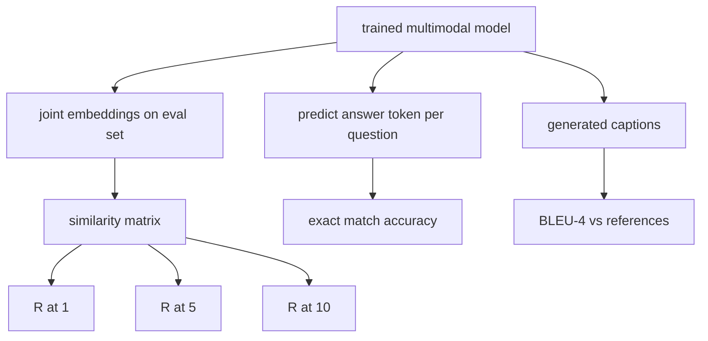

# 다모달 평가

> 훈련은 반 루프입니다. 다른 반은 측정입니다. 이 수업은 원시에서 세 가지 평가 표면을 구축합니다. R@1, R@5, R@10로 보고된 이미지 캡션 검색; 정확한 일치 정확도로 보고된 시각적 질문 응답; 그리고 BLEU-4로 보고된 이미지 캡션. 각 매트릭은 모델의 출력과 합성 평가 스위트에서 작동하는 함수입니다.

**Type:** Build
**Languages:** Python
**Prerequisites:** Phase 19 lessons 58-62 (Track E foundations: encoder, transformer, projection, cross-attention fusion, pretraining)
**Time:** ~90 minutes

## 학습 목표

- 이미지 및 캡션 임베디션 사이의 유사성 매트릭스에서 Recall@K를 계산합니다.
- 정밀 일치 VQA 정확도를 계산하여, 정해진 답변 어휘에 대한 쌍 (사진, 질문) 을 지도하는 모델에서 계산한다.
- 외부 라이브러리 없이 생성된 및 참조 토큰 순서에서 BLEU-4를 계산한다.
- 세 가지 평가들을 모두 수업 62에서 훈련된 모델 위에 만들어진 합성 스위트에 맞춰 실행하세요.

## 문제

훈련 손실 평판이 떨어지면 멀티모달 모델을 완성했다고 선언하는 유혹입니다. 훈련 손실 측정은 훈련 분포에 적합합니다. 모델이 수직 한 배열에서 쌍을 순위 할 수 있는지, 질문에 대답 할 수 있는지 또는 사람이 받아들이는 서명을 쓸 수 있는지 측정하지 않습니다. 세 가지 평가 표면은 표준입니다:

- **Retrieval (R@1, R@5, R@10).**질의 제목에 대한 공동 임베디션을 구축하고, eval 풀의 모든 이미지를 cosine로 순위화하고, 일치하는 이미지가 상위 1, 상위 5, 상위 10에 도착하는지 보고합니다.
- **Visual question answering (exact match).**주어진 (사진, 질문) 에서 모델은 응답 토큰을 내보내는데 정확한 일치는 샘플당 1 비트: 예측된 답이 참조 답변과 같습니까? 평가 집합에 대한 평균.
- **Captioning (BLEU-4).**캡션을 생성하십시오. 참고 캡션에 대한 1g부터 4g까지의 지리 평균을 계산하여 간결함 형벌을 적용하십시오. 다중 참조는 표준 형태 (하나의 이미지, 여러 참조 캡션) 이다.

매트릭은 얇은 함수입니다. 수업은 모든 것을 코드로 구성하여 수학이 구체적이고 표면이 당신의 통제하에 남아 있습니다. 실제 벤치마크 스위트 (MS-COCO, VQA v2, GQA, OK-VQA) 는 동일한 함수 모양으로 연결됩니다.

## 개념



### 유사성 매트릭스에서 Recall@K

`(N, N)`이미지 및 캡션 임베디션 사이의 코시네 유사성 매트릭스 각 줄에 대한, 줄기를 아래와 비슷한 순서로 분류. Recall@K는 위쪽 K 위치 안에 있는 디아곤럴 열 지수가 있는 줄의 분자입니다. 시메트릭 레콜@K (caption-to-image) 는 변환된 매트릭스에서 계산된다. 두 숫자는 모두 보고되었습니다. N=100 eval에 대해 R@1 = 0.6는 100개의 캡션 중 60개가 상위 일치로 올바른 이미지를 검색한 것을 의미합니다.

### VQA와 정확히 일치하는

각각의 (사진, 질문, 답변) 에 대해 이미지를 암호화하고, 질문을 삽입하고, 디코더를 통해 융합하고 다음 기호를 읽어보십시오. 예측된 토큰 ID는 참조 ID와 비교된다. 평가 집합에 대한 평균 실제 VQA 데이터 세트는 각 질문에 대해 여러 개의 인간에 의해 해명된 답변을 가지고 있으며 부드러운 정확성 공식 (1.0을 사용한다 10개 해명자 중 적어도 3명이 동의하면 아래에서 스케일링한다) 을 사용한다. 수업은 명확성을 위해 단일 답변의 정확한 일치를 사용합니다.

### BLEU-4

```math
\text{BLEU-4} = \text{BP} \cdot \exp\big(\text{mean}(\log p_1, \log p_2, \log p_3, \log p_4)\big)
```

어디`p_n`변형된 n-그램 정확성 (어떤 참조에서나 나타나는 생성된 n-그램의 절단된 수, 생성된 n-그램의 총량으로 나뉘어) 이며`BP`단기 형벌입니다

```math
\text{BP} = \begin{cases} 1 & \text{if generated length} > \text{reference length} \\ \exp(1 - r/g) & \text{otherwise, where } r \text{ is reference length and } g \text{ is generated} \end{cases}
```

작은 샘플에 가벼운 `p_n`이 구현은 첸 및 체리 "제1 방법" (무엇이든 0 셀에 1을 더하기 위해 수자 및 지명자에 추가) 를 사용하며, 이는 낮은 셀 수 수제에서 가장 안전한 기본입니다.

### 합성 평가 제품군

50 샘플 평가 스위트는 수업 62에서 사용된 동일한 모인 코퍼스 패턴에서 메모리에서 구축되어 있으며, 견지한 씨앗이 있습니다. 세 개의 목록이 스위트를 구성합니다.

- `pairs`: 50 (사진, caption_ids) 쌍을 검색할 수 있습니다.
- `vqa`: 50 (사진, 질문, 답변)
- `caps`: 50 (사진, [reference_caption_ids, ...]) 항목은 한 이미지에 최대 3개의 참조를 포함합니다.

스위트는 씨로부터 결정적이고 훈련 코퍼스에서 유지됩니다. 따라서 매트릭은 모델이 보지 못한 데이터에 의해 계산됩니다. JSON에 스위트를 계속하는 것은 연습으로 남아 있습니다 ( 아래에 참조하십시오).

| Metric | Range | Random baseline (N=50) |
|--------|-------|------------------------|
| R@1 | 0 to 1 | 0.02 (1 / N) |
| R@5 | 0 to 1 | 0.10 |
| R@10 | 0 to 1 | 0.20 |
| VQA EM | 0 to 1 | 1 / vocab |
| BLEU-4 | 0 to 1 | small but nonzero |

합성 데이터를 이용한 50단계 훈련에서 측정값은 높지 않을 것으로 예상되며, 시범표시에서 확인되는 무작위 기준보다 높을 것으로 예상된다.

```figure
ch-recall-window
```

## 건설 해

`code/main.py`이 도구는

- `recall_at_k(sim_matrix, k)`, 다시 떠 있는 것을 돌려`[0, 1]`두 방향으로
- `vqa_exact_match(predictions, references)`, 평균을 반환합니다`int`평등.
- `bleu4(generated, references, smoothing=True)`, 다중 참조 지원
- `build_eval_suite(seed, n_samples, vocab_size, max_len)`, 세 가지 결정적 평가 목록을 반환합니다.
- `evaluate(model, suite)`, 3개 매트릭을 모두 실행하고`dict`숫자의
- 초창기 초창기 다중 모형 모델을 수업 62에서 로드하는 데모는 그것을 평가하고 50 단계 동안 훈련하고 다시 평가하여 전/후 매트릭을 인쇄합니다.

실행하세요:

```bash
python3 code/main.py
```

출력: 전/후 메트릭 테이블은 모델의 학습된 신호로 거의 무작위로 부터 검색이 향상되고, VQA가 무작위로 향상되고, BLEU-4가 향상되고 (합성 구조는 4g 정밀 승강기에 충분하다).

## 사용 하 고

각 매트릭은 생산 기준에 직접적으로 지도를 그리는

- **Retrieval.**MS-COCO 5K val, Flickr30K, ImageNet 제로샷은 동일한 유사성 매트릭스에서 R@K 문제입니다. 합성 eval을 실제 파일로 교체하고 함수 서명이 변경되지 않습니다.
- **VQA.**VQA v2, GQA, OK-VQA는 동일한 정확한 일치 모양을 사용한다 (VQA v2에 대해 단일 응답 EM 대신 소프트-acc)
- **BLEU-4.**MS-COCO 캡션, NoCaps, Flickr30K 캡션 모두 BLEU-4 + CIDEr 및 METEOR를 사용합니다. CIDEr을 추가하는 것은 또 하나의 기능입니다.

실제 기준값에 대해 교환`build_eval_suite`실제 로더를 위해 함수들을 유지합니다. 수학은 기준-아고스틱입니다.

## 시험

`code/test_main.py`커버:

- recall@k는 완벽한 정체성 유사성 매트릭스에서 1.0을 반환하고 k < N에 대한 뒤집어있는 경우 0.0을 반환합니다
-                  `k <= N`상위 경계
- bleu4는 생성되면 1.0을 반환합니다
- bleu4는 분해된 어휘에 대해 0.0을 반환합니다
- vqa 정확한 일치는 동등한 쌍의 분수에 해당합니다
- build_eval_suite는 예상되는 쌍, vqa 항목 및 캡션 항목을 반환합니다

실행:

```bash
python3 -m unittest code/test_main.py
```

## 운동

1. 캡션 메트릭스에 CIDEr를 추가합니다. CIDEr는 n-그램에 TF-IDF 중량을 사용합니다.

2. 부드러운 정확성 VQA: 질문당 여러 인간 답변, 정확성 `min(human_count / 3, 1)`만약 일치한다면 VQA v2를 복제합니다.

3. NaN 안전한 변종을 추가합니다`bleu4`비공개 생성된 염기서열을 충돌 없이 처리합니다.

4. R@K 옆에 계산 평균 상호 순위 (MRR) 를 계산한다. MRR는 올바른 항목이 K 상위에서 떨어지는 곳에 민감하다. R@K는 K 상위에서 떨어지는지에 민감하다.

5. 훈련 중에 다섯 개의 체크포인트에서 모델에 대한 eval을 실행하세요 (단계 0, 10, 20, 30, 40, 50) 그리고 학습 곡선을 그려보세요.

## 주요 용어

| Term | What it means |
|------|---------------|
| R@K | Fraction of queries where the correct match lands in the top K results |
| Exact match | The simplest VQA scoring: predicted answer equals reference |
| BLEU-4 | Geometric mean of 1- to 4-gram precisions, with brevity penalty |
| Multi-reference | A captioning metric accepts several reference captions per image |
| Held-out | The eval set is sampled from a seed disjoint from the training corpus |

## 더 많은 읽기

- 부드러운 정확성 공식과 데이터 집합 통계 자료를 위한 VQA v2 문서
- TF-IDF 중량 n-그램 캡션에 대한 CIDEr 종이
- 부드러운 변수들을 위한 BLEU 원본 (Papineni et al., 2002)
- MS-COCO 캡션 평가 스크립트
