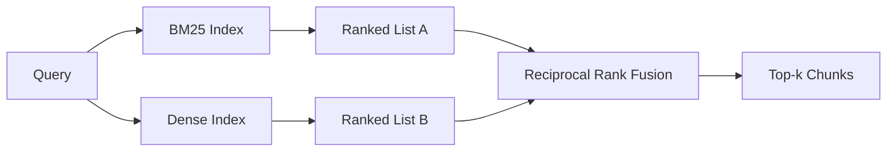

# BM25 및 밀집 임베디션으로 하이브리드 검색

> 대립 질의 배포에서 레크ಸಿಕ 및 의미적 검색이 실패합니다. 상호 순위 합병과 하이브리드 검색은 중첩되지 않고 투표합니다. 그리고 투표는 모든 질의 클래스에 승리합니다.

**Type:** Build
**Languages:** Python
**Prerequisites:** Phase 11 lessons 04 (embeddings), 06 (RAG); Phase 19 Track B foundations (lessons 20-29); Phase 19 lesson 64 (chunking strategies)
**Time:** ~90 minutes

## 학습 목표
- 로버트슨과 스파크 존스 공식에서 BM25를 처음부터 구현하여 필드 중량, 문서 길이의 정상화 및 조정 가능한 k1 및 b를 적용합니다.
- 결정적 모호한 임베디션 위에 덩치가 팽창한 리트리버를 만들어서 루프는 오프라인으로 실행됩니다.
- 2009년에 코맥, 클라크, 부트처가 발표한 것과 같은 상호 순위 합성을 구현하고, 점수중심 인터폴레이션을 왜 지배하는지 설명합니다.
- RRF k 상수와 모다리티중량을 조정하고 작은 고정체체에 상환을 읽어보십시오.

## 문제

레크시컬 검색은 문자적 식별자를 포함하면 승리합니다.`AbortMultipartOnFail`마이크로초 내에 BM25를 통해 올바른 Go 함수를 반환합니다. 동일한 질서가 임베디드되어있는 경우 세 개의 유사성 클러스터의 경계에 위치하고 있으며 밀집한 검색기는 먼저 잘못된 파일을 순위합니다.

덩치 검색은 질의가 코퍼스의 문자 표지판에서 벗어나 낙시될 때 승리합니다. "우리가 취소된 업로드를 어떻게 처리하는가"라는 질문을 하는 사용자는 결코 abort 또는 multipart라는 단어를 입력하지 않습니다. BM25는 해당 페이지에 uploads라는 단어가 포함되어 있기 때문에 "큰 파일을 업로드하는 것"에 대한 문서 조각을 반환합니다. 덩치 검색은 취소라는 내용을 담은 abort 함수를 찾습니다.

두 가지 사이의 선택은 정적 인 것이 아닙니다. 질의 분포는 변수입니다. 생산 RAG 시스템은 두 클래스를 동일한 최종점에서 처리하므로 검색은 동시에 처리해야합니다. 즉 하이브리드 검색입니다. 통합 단계는 올바른 부분이어야합니다.

## 개념



### 한 문항에서 BM25

BM25는 질의 조건에 대해 길이가 정상화되는 수정을 포함하는 포화 용어-주파수 요소로 곱한 역 문서 주파수 인수를 합하여 질의 문서 쌍을 점수합니다. 두 버튼. `k1`용어 주파수 포화 조절; 기본 1.5는 출판된 권고 사항이며 벤치마크 없이 이동해서는 안 됩니다. `b`문서 길이가 얼마나 중요한지 제어합니다. 기본 0.75는 더 긴 문서가 처벌되지만 선형적이지 않습니다.

IDF의 공식은 부드러운 로버트슨과 스파크 존스 정의를 사용합니다.`log((N - df + 0.5) / (df + 0.5) + 1)`로그 안에 있는 플러스 1은 IDF의 용어가 절반 이상에 등장하면 긍정적으로 유지됩니다. 이것은 기술적으로 희귀한 단어가 있는 작은 단체에서 중요합니다.

필드 웨이팅은 BM25에 상징 이름에 대한 일치가 신체에 있는 일치보다 더 많은 것을 알려줍니다. 구현은 덱싱 시점보다는 덱싱 시점에서 계산되는 용어의 곱셈입니다. 이는 수학을 동일하게 유지하며 각 필드에 대한 별도의 점수를 피합니다.

### 한 문장에서 밀집한 검색

임베디션 모델로 고정된 차원의 벡터에 각 조각을 삽입합니다. 질의 시간에 질의를 삽입하여, 유사성으로 모든 조각을 코시네 순위로 정하고, 상위 k를 반환합니다. 모델은 품질을 결정하는 변수입니다. 검색 알고리즘 자체는 두 줄입니다. 점 제품 및 분류.

이 수업은 결정적 해시 기반 임베디션을 사용하여 네트워크 호출 없이 융합 수학을 읽을 수 있습니다. 해시는 96 차원 벡터로 토큰 키 오프셋을 합쳐 정상화합니다. 코시네스 순위는 실행 중 결정적입니다. 이것은 테스트 스위트가 요구하는 것입니다.

### 상호 순위 합병, 발표된 공식

두 개의 순위 목록. 두 목록 중 어느 하나에 등장하는 모든 후보자들에 대해, 상호 순위 기여를 합시다. 2009 년 논문에서 사용 된 `1 / (k + rank)`k=60를 기본으로 정렬합니다. 전체 점수를 기준으로 정렬합니다.

발표된 상수 k = 60은 임의의가 아닙니다. k = 60의 경우 1 / 61의 순위 -1 기여와 10의 순위 -1 / 70의 기여가 느리게 붕괴되므로 깊은 후보들이 여전히 투표합니다. k의 작은 크기는 최고 결과를 지배합니다.

두 개의 조정 가능한 버튼이 우리의 구현에 있습니다.`k`일정. 각 모다리티 무게의 쌍, 즉, 이전에 증거가 있을 때 BM25 또는 밀도를 높일 수 있습니다. 그 중 하나는 당신의 몸매에 더 좋습니다. 질량 기여를 무게로 곱하는 것은 가장 간단한 원칙적 구현입니다. 그것은 질량 붕괴 형태를 보존하고 규모가 자유로 유지됩니다.

### 왜 핵융합은 점수중심 인터폴레이션을 이겨내는 걸까요?

BM25 점수는 무제한이며, 코푸스 의존적이다. 코시네의 유사성은 -1에서 1으로 제한된다. 선형 조합 `alpha * bm25 + (1 - alpha) * cosine`각 코퍼스 알파 조정과 재인덱스 할 때마다 휴식을 필요로 합니다. 순위 기반 융합은 그렇지 않습니다. 두 순위가 모다리들 간에 비교된다. 발표된 RRF 기본선은 2010 년 이후 모든 공개 TREC 트랙에서 점수 간섭을 이겨줍니다.

이것은 Vespa와 Weaviate 문서에서 들리는 RankFusion와 RRF에 대한 동일한 주장입니다. 그들은 같은 결론에 도달했습니다. 점수를 간섭하기 위해 매우 강력한 증거를 가지고 있지 않으면 순위를 기반으로 유지하십시오.

```figure
rrf-fusion
```

## 건설 해

`code/main.py`이 도구는

- `tokenize(text)`- 빠른 레전스 토큰화
- `BM25Index`- 현장중심,`add`그리고`search`그리고 조정 가능한 k1, b.
- `mock_embed``DenseIndex`- 같은 결정적 임베디션과 수업 64의 같은
- `rrf(rankings, k, weights)`- 다 모다리티 무게와 발표된 합성
- `HybridRetriever`- BM25와 덩어리 결합
- 시범`main()`작은 고정된 corpus를 로드하고, 각각의 검색자의 강점과 약점을 대상으로 한 세 개의 질서를 실행하고, 각각의 생산된 모다리티와 통합된 목록을 순위를 인쇄합니다.

실행하세요:

```bash
python3 code/main.py
```

데모 출력 양변을 읽어 보세요. 문자적 식별자 질의가 BM25 순위 1, 밀집 순위 4, RRF 순위 1에 도착합니다. 문호화된 질의가 BM25 순위 6, 밀집 순위 1, RRF 순위 1에 도착합니다. 모호한 질의가 BM25 순위 3, 밀집 순위 3, RRF 순위 1에 도착합니다. 융합은 타이 브레이커가 아닙니다. 모든 질의 클래스에서 승리하는 시스템입니다.

## 을 조정

| Knob | Default | Move it up when | Move it down when |
|------|---------|----------------|------------------|
| BM25 k1 | 1.5 | Terms repeat in documents and you want frequency to matter more | Documents are short and term repetition is noise |
| BM25 b | 0.75 | Long documents really do say less per word | Document length is uncorrelated with topic |
| RRF k | 60 | Deep candidates should keep voting | The top-1 should dominate |
| BM25 weight | 1.0 | Your corpus contains literal identifiers and queries match them | Your queries are user-paraphrased |
| Dense weight | 1.0 | Queries are paraphrased | Queries are literal |

수업 68의 평가 리너스를 다시 실행함으로써 구제 세트를 조정하세요. 직관으로 아닙니다.

## 실패 모드는 데모가 숨을 것입니다

**Out-of-vocabulary tokens.**BM25의 IDF는 코퍼스에서 계산되어 있으므로 질의 용어만 0을 기여한다. 밀집한 임베디션은 같은 용어에 대한 벡터를 환각시킨다. 코퍼스 밖 식별기에서 밀집한 모달리티는 유연하지만 잘못된 이웃을 반환한다. 핵융합은 BM25이 아무것도 반환하지 않기 때문에 흡수합니다. 순위 기여는 떨어집니다. 그러나 문서에 의해 복제되지 않으면서만.

**Stop-token domination.**BM25는 "the"라는 단어와 비교하여 코퍼스 전체에 대한 균일한 순위를 생성합니다. 지표에서 스톱 토큰을 필터링하거나 IDF 용어가 자연스럽게 지배한다는 것을 받아들이십시오.

**Identical content across modalities.**만약 당신의 몸집이 BM25의 상위 1가 밀집의 상위 1가 될 정도로 작다면, RRF는 동일한 이웃과 같은 상위 1를 제공합니다. 이것은 올바른 행동이며 실패가 아닙니다. 그러나 그것은 핵융합을 보이지 않게 만듭니다. 핵융합이 실제로 작동하는지 확인하기 위해 평가에 적립 질의 쌍을 추가하십시오.

## 사용 하 고

생산 패턴:

- BM25 지표가 진행중입니다. 병목은 벡터가 아니라 용어 주파수 사전입니다.
- 개별 매장에서 밀집 벡터를 지표 (이 수업에서는 평평한 목록을 사용하지만 생산에서는 HNSW를 사용 할 것입니다).
- 두 개의 조사를 병렬로 실행하세요. 합병은 조합에 대한 지속적인 시간 합병입니다.
- 검색된 모든 타격의 모달이 유지되므로 하류 리렌커는 어떤 모달이 투표를 했는지 볼 수 있습니다.

## 선박

수업 66은 이 수업에서 융합된 상위 k를 가져가 크로스 코더로 재열합니다. 수업 68은 정확성, 회수, MRR, nDCG로 전체 파이프라인을 평가합니다. 이 수업의 하이브리드 리트리버는 수업 69의 엔드-투-엔드 시스템의 첫 번째 단계입니다.

## 운동

1. 대체`mock_embed`네 공급자의 실제 모델을 가지고 다시 디모를 실행하고
2. 세 번째 모다를 추가: 개별적으로 지목된 조각 요약과 세 번째 순위 목록으로 통합된.
3. 10, 30, 60, 100, 200를 가로지르는 RRF k를 68 수업에서 recall@k 곡선을 그려내어, 곡선이 코퍼스에서 최고를 차지하는 k의 값을 보고하십시오.
4. BM25F를 제대로 구현 (분야 길이 정상화 대신 곱셈 트릭) 하고, 상징 일치가 가장 중요한 코퍼스에서 비교하십시오.

## 주요 용어

| Term | What people say | What it actually means |
|------|-----------------|------------------------|
| BM25 | "Lexical search" | Probabilistic ranking with idf x saturating tf x length normalization |
| RRF | "Rank fusion" | Sum of 1 / (k + rank) across ranked lists; k = 60 default |
| k1 | "TF saturation" | Controls how fast a repeated term stops adding more score |
| b | "Length penalty" | 0 means ignore document length, 1 means full normalization |
| Field weighting | "Symbol boost" | Repeat tokens during indexing to boost matches in that field |
| Rank-based vs score-based fusion | "Why RRF beats linear" | Ranks are comparable across modalities; scores are not |

## 더 많은 읽기

- 코맥, 클라크, 부에치, "반응적 순위 합병은 콘도르셋과 개별 순위 학습 방법을 능가한다" SIGIR 2009
- 로버트슨, 워커, 보울리우, 개트포드, 페이인, "TREC-3에서 오카피" (본 BM25 논문)
- [Vespa: Hybrid Retrieval with BM25 and Embeddings](https://docs.vespa.ai/en/tutorials/hybrid-search.html)
- [Weaviate: Hybrid Search](https://weaviate.io/developers/weaviate/search/hybrid)
- 단계 11 수업 06 - RAG 기본
- 19단계 수업 64 - 생산량이 여기에 지표되어 있는 커
- 19단계 수업 66 - 융합된 상위 k를 소비하는 크로스코더 리렌커
