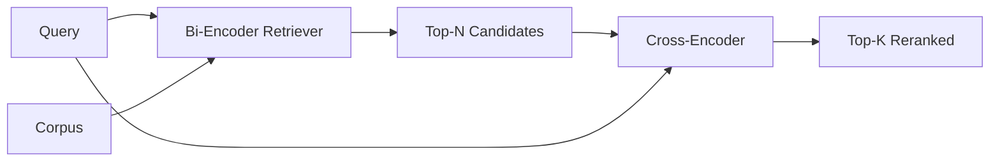

# 크로스 엔코더 리렌커

> 이중 앵코더는 쿼리와 문서를 독립적으로 삽입한다. 십계 앵코더는 그것들을 연결하고 동시에 읽는다. 십계 앵코더는 가장 똑똑한 독자이며 가장 느린다. 이중 앵코더의 상위 k에서 두 번째 단계로 사용되며, 스스로 지불한다.

**Type:** Build
**Languages:** Python
**Prerequisites:** Phase 11 lesson 06 (RAG), Phase 11 lesson 07 (advanced RAG); Phase 19 Track B foundations (lessons 20-29); Phase 19 lesson 65 (hybrid retrieval feeding this stage)
**Time:** ~90 minutes

## 학습 목표
- 2개 앵코더 리트리버와 크로스 앵코더 리렌커를 입력 형태, 매개 변수 수와 쿼리 비용에 따라 구별한다.
- 작은 크로스 코더를 처음부터 트랜스포머 블록으로 구현하여 포장된 (쿼리, 문서) 순서를 소비하고 단일 관련 스칼러를 발송합니다.
- 두 단계의 검색-이후 재등급 파이프라인을 연결: 저렴한 검색기 (Retriever) 로 상위 N을 검색, 크로스 코더로 상위 K로 N을 재등급, K를 반환.
- 작은 고정된 큐퍼스에서 지연량과 품질의 대상을 측정하고 주어진 지연 예산에 맞는 N을 선택하십시오.

## 문제

이중 앵코더는 질의와 문서를 동일한 벡터 공간에 지도하여 코시네에 의해 순위를 매긴다. 두 앵코딩은 결코 서로를 볼 수 없습니다. 모델은 문서를 위한 유용한 모든 것을 하나의 벡터로 압축해야 합니다. 질의에 눈부신 것입니다. 이것은 빠르고 - 인덱스 시간에 문서를 한 개, 질의 시간에 한 개 임베딩 - 그리고 corpus 규모에서 순위를 매기는 유일한 방법입니다.

비용은 정확성입니다. 같은 전체적인 주제를 가진 두 문서가 한 문서가 질의에 답하고 다른 문서가 대답하지 않더라도 거의 동일한 임베디션을 가질 수 있습니다.

크로스 코더는 질의와 문서를 함께 읽음으로써 이를 해결합니다. 모델은 `[query] [SEP] [document]`하나의 순서로, 결합을 통해 전체 관심을 실행하고, 관련성 스칼라를 생성합니다. 문서의 모든 토큰은 질의의 모든 토큰에 참석할 수 있습니다. 모델은 전체 맥락으로 점수를 결정합니다.

비용은 처리량입니다. 이중 앵코더가 한 번 내장하고 영원히 쿼리를 하면, 크로스 앵코더는 한 쌍 (쿼리, 문서) 로 1 번 실행됩니다. 10 백만 개의 문서 코퍼스에서 쿼리에 1 백만 개의 앞면이 있습니다. 요청 예산에서 실행되지 않습니다.

이 방법은 단계화입니다. 상위 N를 검색하기 위해 이중코더를 사용하십시오. 십계코더를 사용하여 N를 상위 K로 다시 순위를 부여하십시오. N는 작다 (50~200) 그리고 크로스코더의 품질 상승은 중요한 곳에 집중됩니다. 전체 지연은 요청 예산에 남아 있습니다. 전체 품질은 N에서 이중코더의 회수로 제한되는 십계코더의 품질입니다.

## 개념



### 크로스 코더의 입력 형태

표준 포장은`[CLS] query_tokens [SEP] document_tokens [SEP]`. CLS 위치 출력은 관련 스칼라를 출력하는 단일 선형 헤드에 입력된다. 일부 구현은 CLS 대신 평균 pooling을 사용합니다. 차이점은 작습니다.

22M 파라미터 크로스 코더 (published `ms-marco-MiniLM-L-6-v2`중력급) 은 전형적인 생산점이다. 작은 모델들은 지연시간을 절약하는 것보다 더 빨리 품질을 잃는다.`bge-reranker-v2-m3`568M 매개 변수) 에서 오프라인 재등급 또는 K가 작을 경우 첫 페이지 재등급을 할 수 있습니다.

### 왜 이 수업은 작은 사람을 훈련시키는 걸까요?

실제 크로스 앵코더는 피니 튜닝 앵코더 트랜스포머입니다. 제작에서 체크포인트를 로드하고 실행합니다. 이 수업에서 목표는 모델의 모양과 지연성 품질 곡선의 모양을 보여주기 위해서입니다. 최신 랭커를 훈련시키는 것이 아닙니다. 그래서 우리는 작은 앵커를 만들죠.`nn.Module`하나의 트랜스포머 블록, 멀티 헤드 관심 (4 헤드 기본적으로) 및 한 회귀 헤드. 그것은 씨앗에서 결정적으로 초기화되어 디스크에 무게 없이 재생 가능한 데모를 제공합니다.

장난감 모델은 고정된 장체에서 올바른 모양을 학습합니다. 관련 질의 문서 쌍은 비관리적인 쌍보다 높은 예측 점수를 가지고 있습니다. 끝에서 끝까지 파이프 라인은 이중 앵코더의 출력을 재열하고 재열의 상위 k는 금 레이블과 상관관합니다.

### 질과 늦은 시간

두 단계의 파이프라인은 1개의 조정 가능한 N입니다. 5에서 100까지 N을 수직 질의 세트에 스캔하고 곡선을 얻을 수 있습니다.

| N | Recall@1 of stage 2 | Cross-encoder forward passes per query | Latency |
|---|--------------------|---------------------------------------|---------|
| 5 | 0.62 | 5 | low |
| 20 | 0.81 | 20 | medium |
| 50 | 0.86 | 50 | high |
| 100 | 0.86 | 100 | very high |

위의 숫자는 이 장치에서 측정된 형태가 아니라 형태를 잘 보여줍니다. 형태는 실제입니다. 항상 20~50명의 후보가 있는 무릎이 있습니다.

평가 곡선에서 N을 선택하고 지연기계획을 추가합니다. 크로스 앵코더는 N에서 이중 앵코더의 지연기보다 더 높은 회수량을 올릴 수 없습니다. 따라서 낮은 N는 지연기보다는 품질을 제한합니다.

```figure
rerank-funnel
```

## 건설 해

`code/main.py`이 도구는

- `CrossEncoder`- 작은`torch.nn.Module`: 토큰 임베디션, 다중 헤드 주의를 가진 하나의 트랜스포머 블록과 피드퍼드, 평균 펄러드 헤드
- `tokenize_pair(query, document)`- 두 문자열을 한 개의 ID 순서로 묶어, 경계, 결정적 및 stdlib을 표시하는 타입 ID를 넣습니다.
- `train_tiny(pairs)`- 수령 교육의 한 번의 통과는 수동으로 표시된 트리플 리스트 (소문, 문서, 관련성) 에 의해 이루어집니다. 따라서 모델은 고정된 장치에 대해 합리적인 점수를 제공합니다.
- `rerank(query, candidates, top_k)`- 생산 인터페이스
- `pipeline(query, retriever, top_n, top_k)`- 두 단계의 흐름
- 시범`main()`65강의 패턴에서 코퍼스를 로드하고, N를 상위에서 K로 랭크하고, 두 개의 리스트를 옆으로 인쇄하고, 각 단계의 지연을 보고합니다.

실행하세요:

```bash
python3 code/main.py
```

출력 결과에는 이중 앵코더의 상위 N, 십계 앵코더의 상위 K, 시간 요약이 표시됩니다. 십계 앵코더는 통화를 통해 더 오래 걸지만 전체 코퍼스에서 실행되지 않습니다. 이중 앵코더가 두 번째 또는 세 번째 순위를 차지하는 답변을 선택하면서 요청 예산 내에서 두 단계의 총수가 유지됩니다.

## 실패 모드는 데모가 숨을 것입니다

**Cross-encoder is not symmetric.** `rerank(q, d)`그리고`rerank(d, q)`항상 먼저 질서를 입력해 주세요. 실수로 교환하면 회수 붕괴됩니다.

**N is too low to expose the bug.**N = K를 설정하면 크로스 코더가 재편할 수 없으며, 재중화할 수 있습니다. 리프트는 0이 보입니다. N을 최소 3배 K로 선택하세요.

**Training data leaks into the eval.**수동으로 표시된 훈련쌍들이 평가 질의들을 포함한다면, 재등급은 마법처럼 보입니다. 훈련과 평가를 엄격히 분리합니다. 심지어 고정된 경우에도요.

**Production weights are dense.**22M 매개 변수 크로스 코더는 float32에서 88MB입니다. sub-100ms p95을 약속하기 전에 모델 서버의 메모리를 계획하십시오.

**Batching matters.**실제 크로스코더는 N 후보자를 한 배트로 실행합니다. 이 수업은`_batch_encode`, 즉, 팩 ID와 타입 ID 텐서들을`torch.tensor(...)`그리고 1번의 전진을 실행합니다. 배치를 건너뛰면

## 사용 하 고

생산 패턴:

- 이중코더, 크로스코더, N를 묶어 놓으면 eval이 무효화됩니다.
- 재상계의 출력을 (쿼리, 문서_ID) 해시로 캐시하십시오. 안정적인 코퍼스에 대한 동일한 질서가 동일한 순서에 있습니다. 캐시 히트는 무료 지연 절감을 제공합니다.
- 1등급 크로스 코더 점수를 기록하십시오. 1등급 크로스 코더 점수가 코퍼스 특정 문턱 아래의 질의가 범주 밖의 타격입니다. "나는 확신하지 않는다"라고 LLM에 표면하십시오.

## 선박

68학습은 이 2단계 파이프라인을 끝에서 끝으로 평가한다. 69학습은 이 리너커를 65학습에서 하이브리드 리트리버 뒤에 답 생성기의 앞에 연결한다. 리너커는 끝에서 끝으로 시스템의 두 번째 단계이다.

## 운동

1. 5에서 50까지 N를 스캔하고 다시 순위된 출력의 recall@1를 표시하고 이 고정된 무릎을 찾아보세요.
2. 크로스 코더를 한 시대 대신 10 시대를 훈련 시키고 각 시대에서 긍정적 인 쌍과 부정적인 쌍 사이의 점수-마지나를 측정하십시오.
3. 평균 융합을 CLS 로 표시된 헤드로 교체하고 이 고정에서 융합을 비교하십시오.
4. 두 번째 크로스 코더 헤드를 추가하여 이중 "문서에서 이 답이 있습니까?"라는 표기를 예측합니다. 두 헤드를 모두 추론하는 데 사용하십시오. 한쪽은 순위, 한쪽은 문턱에 있습니다.
5. 결정적 모호한 쌍용코더를 65강의 한 단계로 교체하고 두 단계의 연쇄를 가집니다.

## 주요 용어

| Term | What people say | What it actually means |
|------|-----------------|------------------------|
| Bi-encoder | "Vector retriever" | Encodes query and doc independently; cosine ranks them |
| Cross-encoder | "Reranker" | Encodes (query, doc) jointly; outputs one relevance scalar |
| Two-stage pipeline | "Retrieve and rerank" | Cheap retriever returns N, expensive reranker keeps K |
| N (candidate budget) | "Rerank pool" | The number of candidates the cross-encoder scores per query |
| Mean-pooling head | "Mean of last hidden" | Average the encoder's last-layer outputs into one vector |

## 더 많은 읽기

- 노구에이라, 쇼, "BERT로 통과 재등급", 2019 - 가톨릭 십계 앵코더 랭커 종이
- 리머스, 구레비치, "Sentence-BERT: Sentence Embeddings using Siamese BERT-Networks", 2019 - 바이코더와 크로스코더에 대한
- [SentenceTransformers Cross-Encoders documentation](https://www.sbert.net/examples/applications/cross-encoder/README.html)
- [BGE Reranker v2 model card](https://huggingface.co/BAAI/bge-reranker-v2-m3)
- 19단계 65강습 - 이 재등급 단계에 공급되는 하이브리드 리트리버
- 19단계 수업 68 - 이 재등급이 제공하는 승강량을 측정하는 평가
