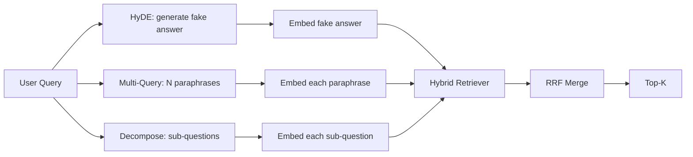

# 쿼리 재쓰기: HyDE, 멀티 쿼리, 그리고 분해

> 사용자가 입력하는 질의는 검색기관이 원하는 질의가 아닙니다. 검색하기 전에 격차를 줄이기 위해 다시 작성하면, 지수는 응답이 어떻게 보이는지 보다 가까운 것을 볼 수 있습니다.

**Type:** Build
**Languages:** Python
**Prerequisites:** Phase 11 lessons 04 (embeddings), 06 (RAG); Phase 19 Track B foundations (lessons 20-29); Phase 19 lessons 64 and 65
**Time:** ~90 minutes

## 학습 목표
- 가설 문서 임베디션을 구현 (HyDE): 가짜 답변을 생성하고 임베디드하여 질의 벡터 대신 해당 벡터에 대해 검색합니다.
- 다중 질의 확장: 한 질의를 N 문장으로 다시 작성하고, 각 문장으로 검색하고, 상호 순위 합병을 통해 조합을 통합합니다.
- 질의 분해를 구현: 복잡한 질문을 하위 질문으로 나눌 수, 하위 질문마다 검색하고 통합합니다.
- 세 가지 재편자를 비교해 보세요. 그리고 각각의 전략이 언제 승리하는지 설명해 주세요.
- 정렬된 결정적인 출력을 생성하는 가짜 LLM를 연결해 다시 작성하는 루프가 오프라인으로 실행됩니다.

## 문제

사용자가 "이하 업로드가 실패하고 예산이 없어지면 우리 팀은 어떻게합니까?" 이 코퍼스는 "AbortMultipartOnFail는 비행 중 S3 다중부 업로드를 중단하고 업로드가 실패하면 버킷 개회 예산을 감소시킵니다".라고 하는 문서를 포함합니다. 질의와 문서에는 명목 문구가 없습니다. BM25가 미쳤어 이중 앵코더는 문서의 세 번째 또는 네 번째 순위를 부여합니다. 왜냐하면 질의 벡터는 파산된 업무를 위한 문서가 아닌 파산된 업로드에 대한 문서가 선호하는 임베디션 공간의 지역에 착륙하기 때문입니다. 66강의 2단계 재등록은 N 위에 앉아 있는 경우 답을 구할 수 있지만, N 위까지 도달하지 못하면, 재등록자는 결코 그것을 볼 수 없습니다.

해결 방법은 검색기까지 닿기 전에 질의를 다시 작성하는 것입니다. 2023년 논문 "정확한 제로샷 밀도 있는 검색 (Relevance Labels) 없이" (Gao et al.) 는 HyDE를 도입했다: LLM가 질의에 답하는 문서를 작성하도록 요청하고, 가상의 문서를 삽입하고, 그 삽입을 검색 벡터로 사용한다. 가상의 문서는 임베디션 공간의 오른쪽 영역에 위치하고 있습니다. 왜냐하면 그것은 코퍼스의 목소리로 기록되기 때문입니다. 질의 벡터는 그렇지 않았습니다.

두 가지 사촌 기술과 HyDE가 결합됩니다. 멀티 쿼리 확장 (마이크로소프트의 그래프RAG 용어) 은 쿼리의 N 구상 문장을 생성하고 각각의 문장을 검색하고, 합쳐집니다. 분해 (스탠퍼드 DSPy 연구 2024에서 "소부문 분해"로 대중화) 는 "이하 업로드가 실패하고 예산이 사라지면 우리 팀이 어떻게 하는가"를 두 가지 질문으로 나눈다. "이하 업로드가 실패하면 어떻게 될까요?" 두 가지 검색, 하나의 합병 결과, 두 가지 답은 모두 도달할 수 있습니다.

이 교훈은 세 가지를 모두 실행하고 같은 고정된 몸체에 맞게 실행합니다.

## 개념



### HyDE에 대한 자세한 사항

HyDE는 사용자의 질의 벡터를 LLM에 작성된 가설 문서 벡터로 대체합니다.

```
You are a domain expert. Write a one-paragraph passage that answers the question
below. Use the same vocabulary and phrasing the documentation in this domain would
use. Do not refuse. Do not say you do not know.

Question: {user_query}

Passage:
```

LLM의 대답은 사실적인 답변으로 잘못되었습니다. LLM는 당신의 corpus를 알지 못하기 때문입니다. 괜찮아요 리트리버는 사실의 정확성에 신경쓰지 않고, 단지 표본 분포에 대해서만 신경쓰고 있습니다. 가설적인 구절에는 "출산", "다부", "구덩이", "예산"이라는 단어들이 포함되어 있습니다. 왜냐하면 이 주제에 대한 문서 문서는 그렇게 말할 것이기 때문입니다. 그 문으로 들어가 벡터는 실제 통로 근처에 착륙합니다.

제작에서 가상의 문서를 2~3 문장으로 제한하고, 더 긴 가상의 문서는 더 많은 소음을 수집하고, 더 짧은 문서는 HyDE가 필요로 하는 가사적 신호를 잃습니다.

### 다중 요청의 확장

사용자 요청의 N 문장을 생성합니다. 가장 간단한 명령어:

```
Rewrite the following question in {N} different ways. Each rewrite must preserve
the original intent. Number them 1 to {N}. Do not add explanations.
```

각 문장에서 상위 k를 검색하고, N 순위 리스트를 RRF (강좌 65에서 같은 알고리즘) 로 통합합니다.

멀티쿼리는 사용자의 문장들이 질문을 하는 많은 방법 중 하나로서 똑같이 유효하며, 다시 작성한 방법 중 어느 하나라도 더 잘 해냈을 것입니다. 모든 다시 작성이 똑같이 나쁜 경우 손실됩니다. 원본이 똑같이 나쁜 것이기 때문입니다.

### 세부적인 분해

단일 검색은 다방면 질문을 만족시킬 수 없습니다. 분해는 LLM에게 질문을 하위 질문으로 나누고 시스템이 하위 질문마다 검색합니다.

```
The following question may require information from multiple distinct topics.
Decompose it into a list of sub-questions. Each sub-question must be answerable
independently. If the question is already atomic, return it unchanged.

Question: {user_query}
```

분해는 합성, 복합, 복합, 또는 서로 연관되지 않은 두 가지 주제에 대한 올바른 도구입니다. 원자문 문제에 대한 잘못된 도구. 분해자의 일은 단일 질문을 반환하고 가짜 하위 질문을 발명하지 않는 것입니다.

### 왜 세 가지 모두 존재하는가

이 세 가지 요소는 상호 보완적이다. HyDE는 질의-체포 토큰 격차를 다룹니다. 멀티 질의는 변언 변형을 다루고 있다. 분해는 멀티 주제 질의를 다루고 있다. 생산 시스템은 세 가지 모두 실행하고 질의별 전략을 선택한다.

## 모크 LLM

수업은 오프라인에서 실행됩니다. 모인 LLM는 사용자의 질의에 키로 된 작은 검색 테이블이며, 사용자가 보지 못한 질의에 대한 백업입니다. 검색 테이블에는 다음과 같은 내용이 있습니다.

- 각각의 고정된 질문: 글자적 가설적 구절, 세 개의 문장, 그리고 분해.
- 알려지지 않은 질의 경우: 결정적 변환: 질의 내용 단어들을 가져와 동의어 지도를 통해 확장하고 결과를 반환합니다.

모크의 형태가 중요하지만 데이터가 아닙니다. 제작에서는 모크를 실제 모델 호출에 교환합니다. 리트리버는 변하지 않습니다.

```figure
cd-hyde-vector
```

## 건설 해

`code/main.py`이 도구는

- `MockLLM`- 위에서 설명한 결정적 대립
- `HyDERewriter`- 가설적인 문서를 작성하도록 LLM를 호출하고, 재쓰기 출력을`RewriteResult`가설적인 텍스트와 검색자가 사용해야 하는 질의와 함께
- `MultiQueryRewriter`- LLM에 N 문장을 불러, 질문 목록을 반환합니다.
- `DecomposeRewriter`- LLM가 분해하도록 요청하고,
- `retrieve_with_rewriter`- 리버라이버와 리트리버를 가져가서 리버라이버를 실행하고 결과를 합쳐줍니다.
- 3개의 재편자를 고정된 장치에 실행하고 어떤 전략이 먼저 금 답변 문서를 반환하는지 인쇄하는 데모

리트리버 모양은 65 수업에서 재사용된다 (히브리드 BM25 + 밀집). 융합은 동일한 RRF이다. 유일한 새로운 모양은 작은 리트리버 인터페이스입니다.

실행하세요:

```bash
python3 code/main.py
```

출력은 전략별 순위와 최종 요약이다. HyDE는 문장-불합성 질의에서 승리한다. 다중 질의는 대구-변화 질의에서 승리한다. 분해는 다중 주제 질의에서 승리한다. Fallback (पुनः 작성자 없다) 는 적어도 세 가지 중 하나를 잃는다.

## 실패 모드는 데모가 숨을 것입니다

**HyDE hallucinates corpus-specific identifiers wrong.**모델은 함수 이름을 발명한다. 가설의 BM25 점수는 오른쪽 문서에서 붕괴됩니다. 왜냐하면 발명된 이름은 이제 지표에 나타나지 않는 고중력 토큰이기 때문입니다. 가설의 길이가 BM25 무게가 융합에서 낮아집니다.

**Multi-query rewrites all converge.**약한 모델은 거의 동일한 3개의 패러프레이스를 생성합니다. N 검색은 동일한 상위 k를 반환합니다. RRF 융합은 단일 검색보다 낫지 않습니다. 재쓰기 프롬프트에 명시적인 다양성 명령어를 추가하고 Jaccard의 복제자를 감지합니다.

**Decomposition over-splits.**분해기 는 원자문 을 목록 으로 변환 한다. 모든 검색 은 동일한 문서 를 반환 하지만 순위가 감소 한다. 합병 은 원래 보다 더 나쁘다.

**Latency multiplies.**HyDE는 LLM 호출 한 번에 걸립니다. 복수 질의 비용은 N 재쓰기를 생성하기 위해 LLM 호출 한 번에 걸립니다. 그 다음 N 검색. 분해는 분해하기 위해 LLM 호출 한 번에 걸립니다. 그 다음 M 검색. 검색은 병렬로 실행됩니다. LLM 호출은 바닥입니다.

## 사용 하 고

생산 패턴:

- 질의 길이에 따라 전략 선택: 원자 단기 질의가 멀티 질의가, 복잡한 멀티 klaus루 질의가 분해, 용어 무거운 질의가 HyDE가 됩니다.
- 검색 해시로 재쓰기 출력을 캐시합니다. 많은 질의가 반복됩니다.
- 이 세 가지 모두 병렬로 실행하고 3개의 결과 세트를 RRF로 하나로 합쳐라. 비용은 3개의 LLM 호출과 1개의 융합입니다. 품질은 세 가지 전략의 커버리의 결합입니다.

## 선박

레슨 69은 리트리버가 레슨 65에서 리트리버가 레슨 66에서 리트리버가 리트리버를 리트리버로 리트리버로 리트리버로 리트리버로 리트리버로 리트리버로 리트리버로 리트리버로 리트리버로 리트리버로 리트리버로 리트리버로 리트리버로 리트리버로 리트리버로 리트리버로 리트리버로 리트리버로 리트리버로 리트리버로 리트리버로 리트리버로 리트리버로 리트리버로 리트리버로 리트리버로 리트리버로 리트리버로 리트리버를 리트리버로 리트리버로 리트리버로 리트리버로 리트리버로 리트리버로 리트리버를 리트리버링하는 단계가 됩니다.

## 운동

1. 재편자의 문장들이 의도적으로 다양하게 적용되는 RAG-Fusion (다중 질의 2024 변종) 를 구현하면, 재등급 단계 (강습 66) 는 최종 목록을 선택합니다.
2. 네 번째 전략: 뒤로 물러나기 (더 일반적인 질문을 LLM에게 물어보고, 그 문제를 다시 찾아내서 좁게)
3. 분해기 를 훈련 시키면 "문제 는 원자"라는 표 를 추가 하여 원자 의 질문 을 인식 할 수 있습니다.
4. 가짜 LLM를 실제 모델 호출으로 대체해
5. 다시 쓰기마다 신뢰 점수를 추가하고 다시 쓰기를 열기보다 낮게 하거나, 회수에 미치는 영향을 측정합니다.

## 주요 용어

| Term | What people say | What it actually means |
|------|-----------------|------------------------|
| HyDE | "Fake-document retrieval" | LLM writes the answer; embed and retrieve on that instead of the query |
| Multi-query | "Paraphrase expansion" | N rewrites of the query; retrieve N times, merge by RRF |
| Decomposition | "Subquery split" | Multi-topic queries split into sub-questions, retrieved separately |
| Atomic query | "Single-topic" | Cannot be decomposed without inventing fake sub-questions |
| Step-back | "Abstract the query" | Ask the more general question, retrieve, then narrow |

## 더 많은 읽기

- 가오, 마, 린, 칼런, "정확한 제로샷 밀도 검색, 관련 레이블 없이" (HyDE), 2023
- 마이크로소프트 리서치, "복수용 멀티 쿼리 확장"
- 스탠퍼드 DSPy, "멀티-홉 QA에 대한 하부분열"
- [LlamaIndex query transformations documentation](https://docs.llamaindex.ai/en/stable/optimizing/advanced_retrieval/query_transformations/)
- 단계 11 수업 07 - 고급 RAG 패턴
- 19단계 65강습 - 이 재편기
- 19단계 수업 68 - 재쓰기 리프트를 측정하는 평가
