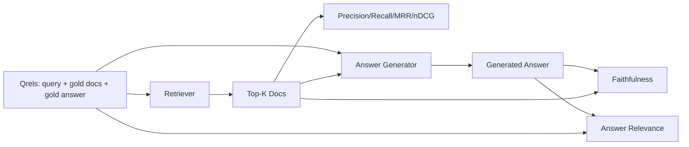

# RAG 평가: 정확성, 회수, MRR, nDCG, 신뢰성, 응답의 관련성

> 만약 동시에 검색과 응답을 평가할 수 없다면, 시스템을 배포할 수 없습니다. 두 가지 메트릭은 동일하지 않으며, 동일한 명령어는 다른 축에 실패합니다.

**Type:** Build
**Languages:** Python
**Prerequisites:** Phase 11 lessons 06 (RAG), 10 (evaluation); Phase 19 Track B foundations (lessons 20-29); Phase 19 lessons 64, 65, 66, 67
**Time:** ~90 minutes

## 학습 목표
- 금 qrels에서 4개의 검색 메트릭을 계산하십시오: 정확성@k, 회수@k, MRR (평균 상호 순위) 및 nDCG@k.
- 답급 기준 두 가지의 계산을 한다. 신뢰성 (모든 주장은 검색된 맥락에 근거하고) 그리고 응답의 관련성 (응답은 질문에 대응한다).
- eval가 끝까지 읽히는 고정 qrels 파일을 (쿼리, 골드 doc id, 골드 답 텍스트) 구축하십시오.
- 파이프라인에서 실패하는 곳을 진단하기 위해 측정값을 읽으십시오: 검색, 순위, 생성 또는 지형.

## 문제

RAG 시스템은 적어도 네 개의 움직이는 부분 (chunker, retriever, reranker, generator) 을 가지고 있습니다. 그 중 어느 하나라도 잘못된 답변의 원인이 될 수 있습니다. 각 단계 매개 변수를 하지 않으면 당신은 맹목적으로 날아갑니다.

사용자가 잘못된 답을 보고합니다. 커가 응답 기간을 줄이기 때문일까요? 커가 커를 상위 k에 포함하지 않았기 때문일까요? 커가 오른쪽 커를 1 위를 밀어 넣었기 때문일까요? 커가 커를 무시하고 무언가를 만들어냈기 때문일까요?

- 리트리버에서 나온 것을 평가하기 위한 검색 측정값
- 오른쪽 부분의 순서대로 순서를 매겨서
- 생성기가 검색된 맥락 안에 남아 있는지 여부를 평가하는 충실성
- 답변의 관련성 여부는 질문에 대한 답을 전혀 충족시키는 여부를 평가합니다.

이 수업은 모두 6가지의 파일을 고정된 qrels 파일 위에 구축합니다. 평가는 오프라인 및 결정적입니다. 제작에서는 가짜 LLM-as-judge를 실제로 교환합니다.

## 개념



### Precision@k

리트리버가 반환한 상위 k 문서 중 금 세트에는 얼마나 많은 분자가 있습니까? 금이 세 개의 문서가 있고 상위 3 개가 두 개의 문서와 잘못된 하나를 반환하면, 정확성@3는 2 / 3. 중요하지 않은 검색 된 조각의 비용이 높을 때 정확성을 사용하십시오 (제너터가 그 위에 토큰을 낭비하거나 조각은 답을 독성합니다).

### 픽업

금 문서 중, 상위 k에는 어떤 분자가 있습니까? 금은 세 개의 문서가 있고 상위 5은 모두 포함하면, recall@5는 1.0. 미흡한 답변의 비용이 높을 때 회수 사용 (전면 답변을 완전히 놓치지 않는 것보다 한 가지 추가 잘못된 부분을 보는 것이 좋습니다).

생산 RAG에서 일반적으로 인용되는 메트릭은 recall@k입니다. 세대들은 비관적인 조각을 쉽게 떨어뜨릴 수 있습니다.

### MRR (평균 상호 순위)

각 질의 경우 순위 목록에서 첫 번째 관련 문서의 위치를 찾아보십시오. 상호 순위는 1 / 위치입니다. 질의 집합 전체에 평균입니다. MRR는 검색자가 최고의 답을 가장 위에 얼마나 잘 배치하는지 단수 요약입니다.

MRR는 위치-1을 중량합니다. 금 문서가 1위에서 있는 질의는 1.0을 기여합니다. 2위에서는 0.5을 기여합니다. 10위에서는 0.1을 기여합니다. 메트릭은 목록의 상단에 의해 지배됩니다.

### nDCG@k

정상화 된 할인 누적 이익: 전체 공식은 검색된 각 문서에 이득을 부여합니다 (일반적으로 관련한 문서에 대해 1 개, 그렇지 않은 문서에 대해 0 개), 위치 로그에 따라 할인, 금액 및 이상 DCG (완벽하게 순위하면 얻을 수있는 DCG) 로 나눈다. 0에서 1 범위.

nDCG는 계층적 관련성을 수용합니다. 금은 "doc A는 3, doc B는 2, doc C는 1"라고 말할 수 있습니다. MRR 및 recall@k는 모든 것을 바이너리로 평평하게 만듭니다.

### 충실함

생성된 답변의 각 주장에 대해 검색된 맥락에서 주장이 뒷받침되는지 확인합니다. 표준 구현은 LLM-as-judge prompt을 사용하여 (고용, 맥락) 를 받아 예 또는 아니오를 반환합니다. 메트릭은 통과되는 주장의 분배입니다.

신뢰는 생성자 실패 모드를 잡는데, 그 모형은 내용을 발명한다. 복원기가 올바른 조각을 반환해도 환각을 일으키는 생성기가 깨진다. 신뢰는 지형성, 지원, 배정이라고도 부른다.

이 교훈은 결정적인 가짜 판사와 함께 충실함을 구현하여 각 주장의 토큰이 검색된 맥락을 문턱으로 덮는지 여부를 확인합니다. 제작에서는 실제 모델 호출으로 교환합니다. 메트릭의 모양은 동일합니다.

### 답변의 관련성

진실성 은 "사답 은 맥락 에 근거 합니까?"라는 질문 을 던진다. 관련성 은 "사답 은 질문 에 근거 합니까?"라는 질문 을 던진다. 충실 한 하지만 주제 밖 에 있는 대답 은 신뢰성 과 관련성 과 관련성 과 관련성 과 관련성 과 관련성 과 관련성 과 관련성 과 관련성 과 관련성 과 관련성 과 관련성 과 관련성 과 관련성 과 관련성 과 관련성 과 관련성 과 관련성 과 관련성 과 관련성 과 관련성 과 관련성 과 관련성 과 관련성 과 관련성 과 관련성 과 관련성 과 관련성 과 관련성 과 관련성 과 관련성 과 관련성 과 관련성 과 관련성 과 관련성 과 관련성 과 관련성 과 관련성 과 관련성 과 관련성 과 관련성 과 관련성 과 관련성 과 관련성 과 관련성 과 관련성 과 관련성 과 관련성 과 관련성 과 관련성 과 관련성 과 관련성 과 관련성 과 관련성 과 관련성 과 관련성 과 관련성 과 관련성 과 관련성 과 관련성 을 고려한다.

표준 구현은 또한 LLM-as-judge: take (문제, 대답) 를 사용하며, 답이 질문에 대응하는지 물어보십시오. 이 수업은 토큰 겹치기 + 판사 대립을 구현합니다.

## 속기

```python
{
  "qid": "q1",
  "query": "what is the abort threshold for multipart uploads",
  "gold_doc_ids": ["d1", "d3"],
  "gold_answer_substring": "three failed parts",
  "graded_relevance": {"d1": 3, "d3": 2},
}
```

각 질의에는 다음과 같은 내용이 있습니다.
- 질문 문자열
- 금 문서 ID (정확성/ 회수/MRR)
- 등급 관련성 명령 (nDCG)
- 금답 하위 문자열 (각 qrel에 대한 참조 메타데이터로 유지된다; 이 수업의 충실성은 이 하위 문자열에 대한 것이 아니라, 검색된 맥락에 대한 추출된 주장을 판단함으로써 계산된다).

이 수업은 손으로 만든 장치를 보내서 평가가 틀에서 빠져나갑니다.

```figure
ci-rag-metric-ladder
```

## 건설 해

`code/main.py`이 도구는

- `precision_at_k(retrieved, gold, k)`- 문자 그대로 정의
- `recall_at_k(retrieved, gold, k)`- 문자 그대로 정의
- `mean_reciprocal_rank(retrieved_list_of_lists, gold_list)`- 질문들에 대한 악의
- `ndcg_at_k(retrieved, graded_relevance, k)`- DCG/IDCG 이산 또는 계층 이득
- `extract_claims(answer)`- 답은 문장을 형성한 주장으로 나뉘어
- `faithfulness(claims, context_texts, judge)`- 지원된 것으로 판단된 청구의 분자
- `answer_relevance(question, answer, judge)`- 답변이 질문에 맞는지 판단한다.
- `MockJudge`- 결정적인 토큰 오버라프 판사가 되므로 평가가 오프라인으로 실행됩니다.
- `evaluate_pipeline(pipeline_fn, qrels, ks)`- 모든 매트릭을 실행하는 오케스트레이터
- 3개의 파이프라인 변종 (커 기본 라인, 하이브리드 검색, 하이브리드 + 재등급) 을 qrels에 대한 데모를 실행하고 메트릭스 테이블을 인쇄합니다.

실행하세요:

```bash
python3 code/main.py
```

출력은 하나의 측정 표의 각 변수와 관련하여 정확성@k, recall@k, MRR, nDCG@k, 충실성 및 응답 관련성을 보여줍니다. 하이브리드 검색 행은 회수 시 커 기본선을 이겨내고, 리랜크 행은 MRR에서 하이브리드를 이겨냅니다.

## 실패를 진단하기 위해 측정값을 읽는

| Symptom | Likely cause | What to fix |
|---------|-------------|-------------|
| Low recall@k, low precision@k | Chunker cut the answer or retriever cannot find it | Chunker boundaries (lesson 64) or retriever modality (lesson 65) |
| Decent recall@k, low MRR | Right chunk is in top-k but not at position 1 | Reranker (lesson 66) |
| High MRR, low faithfulness | Generator invents content despite right context | Generation prompt; force-cite-or-refuse |
| High faithfulness, low relevance | Answer is grounded but off-topic | Query rewriter (lesson 67) or generation prompt |
| All four high, users still complain | Eval set is unrepresentative | Expand qrels with real user queries |

## 실패 모드는 데모가 숨을 것입니다

**LLM-as-judge bias.**모델은 자신의 출력을 자신보다 더 충실하게 판단합니다.

**Qrels rot.**금은 코퍼스 변화와 함께 변합니다. 2024년 1월 Q1에 금이 된 문서는 2024년 10월에는 더 이상 올바른 답이 아닙니다. 팀의 이름이 변경되었기 때문에 기능입니다.

**Faithfulness micro-checks miss macro-claims.**전체 답변의 구조가 잘못되는 동안 문장 성립성 충실성이 지나갈 수 있습니다. 자동화된 측정값 위에 샘플 수준의 질적 검토를 추가하십시오.

**Recall@k masks per-query failures.**평균 90%의 회수량은 하나의 질의 클래스가 항상 놓치는 것을 숨길 수 있습니다. 질의 클래스에 따라 qrels를 나눌 수 있습니다 (언어 문자, 문구, 다목적) 그리고 슬라이즈별 보고를 할 수 있습니다.

## 사용 하 고

생산 패턴:

- 모든 검색기나 생성기 변경에 대한 eval를 실행하고, recall@k 회귀를 테스트 실패로 간주하십시오.
- 검색에 따라 메트릭 추적을 유지하십시오. 사용자가 불평할 때, 해당하는 qrels 항목을 검색하고 그것이 잡혀 있는지 확인하십시오.
- Qrels를 계층화: CI로 실행되는 20개의 질의 집합, 밤마다 실행되는 200개의 회귀 집합, 주간적으로 실행되는 2000개의 깊은 집합.

## 선박

레슨 69은 전체 파이프라인 (커, 리트리버, 리렌커, 생성기) 를 전하하고 이 평가를 엔드-투-엔드 시스템에 실행합니다.

## 운동

1. 다섯 번째 검색 메트릭을 추가하십시오: hit-rate@k. 이를 recall@k와 비교하십시오.
2. 0 (지원되지 않은), 1 (부부분적으로 지원된), 2 (전면 지원된) 등등된 충실성을 구현하고, 그에 따라 메트릭을 업데이트하십시오.
3. 가짜 판사를 실제 모델 호출으로 교체하고, 실제 판사와 가짜 판사 사이의 불일치를 측정합니다.
4. 질의 클래스 슬라이스를 ("문자적", "분자적", "다목적") 추가 합니다.
5. "응답 길이가"를 추가하고, 충실과 상관관계를 맺어 곡선을 그려라.

## 주요 용어

| Term | What people say | What it actually means |
|------|-----------------|------------------------|
| Precision@k | "Hit rate over retrieved" | Fraction of top-k that are gold |
| Recall@k | "Hit rate over gold" | Fraction of gold in top-k |
| MRR | "First-hit position" | Mean of 1 / rank of first relevant document |
| nDCG@k | "Graded ranking quality" | DCG over the top-k divided by ideal DCG |
| Faithfulness | "Groundedness" | Fraction of answer claims supported by retrieved context |
| Answer relevance | "Did it address the question?" | Whether the answer matches the question's intent |
| Qrels | "Gold labels" | The labeled set of queries and their gold documents and answers |

## 더 많은 읽기

- 버클리, 워헤스, "평가 측정 안정성을 평가하는 것", SIGIR 2000 - 순위 측정에 관한 가공
- Jarvelin, Kekalainen, "IR 기술들의 누적 이익 기반 평가" - nDCG 논문
- [Ragas: Automated Evaluation of RAG Pipelines](https://docs.ragas.io)
- [Anthropic, Introducing Contextual Retrieval](https://www.anthropic.com/engineering/contextual-retrieval)- 1 미이너스 리콜@20로 검색 점수를 얻습니다
- 11단계 10강 - 평가 프레임워크 기초
- 단계 19 수업 64-67 - 여기에 평가된 구성요소
- 19단계 수업 69 - 이 평가 성과의 끝에서 끝까지의 파이프라인
