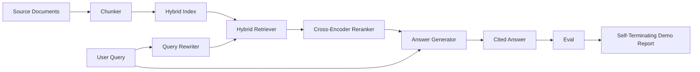

# 끝에서 끝까지 RAG 시스템

> 6개의 부품 수업, 1개의 파이프라인, 1개의 평가 루프, 1개의 자기결정 디모시스템,

**Type:** Build
**Languages:** Python
**Prerequisites:** Phase 11 lessons 06 (RAG), 10 (evaluation); Phase 19 Track B foundations (lessons 20-29); Phase 19 lessons 64, 65, 66, 67, 68
**Time:** ~90 minutes

## 학습 목표
- 커, 하이브리드 리트리버, 쿼리 리워터, 크로스코더 리렌커, 그리고 응답 생성기를 하나의 엔드-투-엔드 파이프라인으로 구성합니다.
- 답전생기를 구현해서, 자신의 주장을 쪼개서 어 인용해, 거부감과 낮은 신뢰성으로 되돌려 놓습니다.
- 68강의 평가와 함께 구성된 파이프라인을 실행하고 각 매트릭에 대한 단계적 구축이 동일한 구성 요소에 대해 분리적으로 승리한다는 것을 증명하십시오.
- 고정된 쿼리 세트를 실행하고, 요약 보고서로 0을 종료하는 자멸하는 CLI 디모를 구축합니다.

## 문제

6개의 요소가 따로 있는 것은 아무것도 증명하지 않습니다. 커는 recall@5에 대해 corpus에 대해 이길 수 있고 시스템의 recall@5에 대해 잃을 수 있습니다. 왜냐하면 리트리버가 커가 방출하는 것을 순위화 할 수 없기 때문입니다. 리엔커는 합성 후보자 풀에서 MRR를 끌어올릴 수 있고 실제 바이엔코더 후보에서 실패할 수 있습니다. 왜냐하면 리엔커 예산에서 바이엔코더의 회수량은 너무 낮기 때문입니다. 질의 재편자는 하나의 질의에서 금 문서를 홍보하고 다음에 중단할 수 있습니다. LLM 모크가 퇴행한 가설을 반환하기 때문입니다.

통합 테스트는 모든 파이프라인의 끝에서 끝까지 같은 고정된 qrels와 동일한 매트릭, 모든 것을 함께 연결하는 하나의 오케스트레이터 파일로 진행됩니다. 이것이 이 수업이 만드는 것입니다. 통합 파이프라인의 매트릭이 각 단계의 개별 디모에 있는 매트릭을 이길 경우, 당신은 시스템을 증명했습니다.

## 개념



### 케이블 선택

파이프라인은 작은 그래프입니다. 각 단계는 명확한 서명이 있는 함수입니다.

| Stage | Input | Output |
|-------|-------|--------|
| Chunker | Document text | List of Chunk records |
| Retriever | Query string | Top-N Chunk records |
| Rewriter (optional) | Query string | List of rewrites + hypothetical |
| Reranker | Query, candidates | Top-K Chunk records with cross scores |
| Generator | Query, top-K Chunk records | Answer string with citations |

작곡은 모든 서명이 안정되면 간단합니다.`Pipeline`클래스는 5단계와`query`각 단계마다 교환이 가능합니다. 다른 커, 리트리버, 리루터, 리렌커, 또는 생성기를 통과하면 파이프라인이 여전히 실행됩니다.

### 인용문으로 답변 생성기

발전기는 마지막 단계이고 깨지기 가장 쉬운 단계입니다.

1. K의 상위 순위를 바꾸어 놓은 조각을 가져갑니다.
2. 최대 두 개의 덩어리를 선택하여 텍스트가 질의와 가장 높은 내용 토큰이 겹치는 텍스트를 포함합니다.
3. 각 문장을 선택한 부분에서 한 문장을 합쳐서`[doc_id:chunk_index]`앵커
4. 쓰레기 배출량 이상으로 겹치는 조각이 없다면 인용 없이 "나는 모른다"라고 합니다.

제작에서는 실제 LLM 호출에 모형을 prompt 템플릿으로 교환합니다.

```
You are answering a question using only the snippets below.
Cite every claim with the anchor in parentheses.
If the snippets do not answer the question, say "I do not know".

Question: {query}

Snippets:
{enumerated chunks with anchors}

Answer:
```

저 신뢰성 경로로로 인해 크로스코더 순위 1 점수가 기록됩니다. 만약 코퍼스 문턱 아래에 있다면, 생성기는 거절합니다. 이것은 환각된 응답에 대한 안전 밸브입니다.

### 자기멸종 시범

데모는 모든 것을 끝에서 끝으로 실행합니다. 한 질의 단계별 분리를 인쇄하고, 네 개의 고정 qrels에 대한 eval을 실행하고, 측정 표를 인쇄하고, 모든 수업 68 메트릭이 데모에서 설정된 문턱을 충족하면 상태 0으로 종료합니다. 어느 메트릭이 문턱보다 낮으면, 데모는 0이 아닌 상태와 실패한 메트릭을 지정하는 메시지로 종료됩니다.

이것은 CI 흡연 테스트의 형태입니다. 파이프라인은 오프라인에서 실행됩니다. 빠르고 결정적입니다. 문턱은 고의적으로 고정되어 있습니다. 그래서 6가지 수업 중 어느 하나에서 회귀는 데모를 실패합니다.

```figure
rag-pipeline-flow
```

## 건설 해

`code/main.py`이 도구는

- `Chunk`- 모든 단계에 걸쳐 진행된 기록 (학습 64의 모양을 chunk_index 및 소스 doc_id로 확장합니다).
- `Chunker`- 수업 64 (전립 재발전적 분할) 에서 전략을 선택합니다.
- `HybridIndex`- BM25 + 덩치 + RRF가 있는 반 65
- `Rewriter`(선택) - 수요함수, 수요함수, 수요 길이를 따라 67 수업에서 분해
- `Reranker`- 66강의 훈련된 크로스코더, 작은 고정 훈련 세트를 가지고 있어 초 안에 공감한다.
- `Generator`- 인용과 낮은 신뢰에 대한 거부
- `Pipeline`- 5단계들을 구성하고`query(question)`반환하는 방법`Result(answer, top_k, latency_ms_per_stage)`- 그래
- `run_demo()`- 코퍼스를 흡수하고, 세 개의 고정 질의를 실행하고, 평가를 실행하고, 결과를 인쇄하고, 임계로 출력 코드를 설정합니다.

실행하세요:

```bash
python3 code/main.py
```

출력은 하나의 인쇄된 질의 추적, 전체 평가 테이블, 그리고 최종 통과/실패 상태입니다. 정비에서 출력 코드 0을 반환합니다.

## 실패 모드는 데모가 숨을 것입니다

**Chunker boundary drift.**eval qrels 라벨링 패스와 데모 사이에 커 전략을 교환하면 금 문서 아이디가 더 이상 순차되지 않습니다. qrels 파일에서 커 전략을 잠금하십시오. 데모에는 커 이름을 붙인 헤더가 있습니다.

**Reranker training set leaks into the eval.**수업 66의 14개의 트리플은 eval 질의와 유사한 질의들을 포함합니다. 제작에서는 eval 질의들을 엄격하게 수행합니다.

**Mock generator hides hallucination risk.**모크는 환각을 할 수 없는데, 왜냐하면 모크는 검색된 조각에서 텍스트만 방출하기 때문입니다. 수업은 이것을 지적하고 실제 모델로 생산 교환 경로를 가리키고 있습니다.

**No streaming.**파이프라인은 각 단계의 끝에서 전체 답을 반환합니다. 생산 시스템은 생성기의 출력을 스트리밍합니다. 스트리밍은 범위를 벗어납니다. 응답급 매트릭은 최종 문자열에 어느 쪽이든 작동합니다.

**Latency is offline.**가짜 LLM 호출은 일정 시간입니다. 실제 LLM 호출은 지배적입니다. 요청 범위에서 지연 예산을 계획하십시오. 수업의 각 단계 시간대는 CPU 작업을 측정합니다.

## 사용 하 고

생산 패턴:

- 튜브 파일은 하나의 오케스트레이터로 엑스플리시티 스테이지 인터페이스로 전송하고
- 에볼이 한 단계에 닿는 모든 융합 전에 eval를 실행하세요. eval이 떨어지면 융합이 착륙하지 않습니다.
- CI 실행에 대한 메트릭 추적을 유지하여 단계 교환에 회귀를 할 수 있습니다.
- 20개의 질의 (회복 집합의 하위 집합) 를 포함하여 30초 이하의 시간 내에 실행되는 연연 집합을 추가하고, 전체 회복 집합은 밤마다 실행된다.

## 선박

이 수업의 파이프라인 파일은 19 단계의 트랙 F 수업의 나머지 부분이 취하는 모양입니다. 이후 수업은 섭취 자동화, 점진적 재인덱스, 텔레메트리, 그리고 상단에 서비스 레이어를 추가합니다. 검색, 재등급, 재쓰기, 평가 반은 여기에서 완료됩니다.

## 운동

1. 리우라이터 내부에 쿼리별 전략 선택자를 추가하십시오: 67 수업의 유리스틱 (장, 합성, 용어 비율) HyDE, 멀티 쿼리 또는 분해를 선택하십시오.
2. ENV 플래그 뒤에 있는 생성기에 실제 LLM 호출을 추가하고, 모호에 기본값을 추가하고,
3.                                                                                                                                                                                                                                                                                                   `--corpus path`실제 코퍼스를 로드하는 플래그, 재검토와 임계 검사를 실행하세요.
4. `--strategy`커에 대한 표지판. 각 전략이 종결으로 회수하는 데 기여하는 부분을 측정합니다.
5. 스트리밍 생성기 인터페이스를 추가하고 eval에 입력하여, 스트리밍 프리픽스에 아닌 마지막 문자열에 대한 충실성이 계산되었는지 확인합니다.

## 주요 용어

| Term | What people say | What it actually means |
|------|-----------------|------------------------|
| Pipeline | "RAG pipeline" | The composed stages from ingestion to cited answer |
| Citation anchor | "Source link" | The (doc_id, chunk_index) reference attached to each claim |
| Refuse-on-low-confidence | "I do not know" | Generator returns no answer when the reranker top-1 score sits below threshold |
| Smoke set | "CI eval" | The minimal qrels subset that runs in every PR check |
| Stage interface | "Function signature" | The stable input and output type of each pipeline stage |

## 더 많은 읽기

- [Anthropic, Building search and retrieval](https://www.anthropic.com/news/contextual-retrieval)
- [Pinterest, MCP internal search](https://medium.com/pinterest-engineering)- 참조 생산 건축물
- [Ragas: Automated Evaluation of RAG Pipelines](https://docs.ragas.io)
- 단계 11 수업 06 - RAG 기본
- 19단계 수업 64-68 - 여기에 구성된 구성요소
