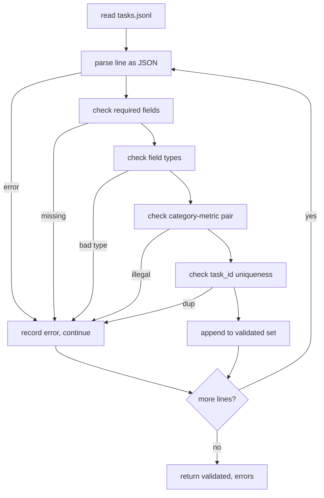

# 작업 특산 형식

> 평가용은 계약이 수행하는 작업만큼만 좋습니다. 단일 점수 함수를 작성하기 전에 JSONL 모양과 측정 용어 구성을 얼어붙이십시오.

**Type:** Build
**Languages:** Python
**Prerequisites:** Phase 19 Track B foundations
**Time:** ~90 min

## 학습 목표

- 한 형태로 수학적, 복수 선택, 코드 실행, 분류 및 자유 텍스트 요약을 포함하는 JSONL 작업 기록 스키마를 정의하십시오.
- 메트릭 이름의 닫힌 어휘를 붙여서 하류 수업 (71-73) 은 하나의 필드에 전송될 수 있습니다.
- 몇 번의 촬영 예제와 처리 후 규칙을 실행자가 아닌 작업의 일부로 지정하여 동일한 프롬프트가 모델마다 동일한 목표를 생성합니다.
- 잘못된 기록이 경주자에게 도달하기 전에 거부하는 엄격한 검증기를 구현하십시오.
- 스펙의 모든 분포를 실행하는 10 작업 장치 세트를 보내서 검증자가 진짜 무언가를 재는 것이 좋습니다.

```figure
ci-task-spec-gate
```

## 왜 얼어붙은 스펙

연구 코드베이스는 테스트를 축적하는 것보다 더 빨리 평가 스크립트를 축적합니다. 6개월 후에 모든 노트북은 자신의 JSON 형태를 가지고 있으며, 모든 매트릭은 두 번 재시행되며, 실행 중에서는 아무것도 비교할 수 없습니다. 수정은 지루합니다. 스케마를 선택하십시오. 검증기를 작성하십시오. 다른 모든 것을 거부합니다. 이 수업은 그렇게합니다.

형태는 BIG-bench, HELM, Lm-eval 스타일의 배너에서 아이디어를 빌려서, 하지만 필드 이름은 우리입니다. 각 필드는 하나의 소유자를 가지고 있습니다. 달리기는 작업을 읽습니다. 메트릭은 목표를 읽습니다. 프로세스 후 단계가 발생을 정상화합니다. 필드는 중추 파이프라인을 변경하지 않습니다.

## 기록 모양

작업은 하나의 라인에서 JSON 객체입니다.`tasks.jsonl`그리고 각 라인을 독립적으로 검증합니다. 나쁜 라인은 그 기록을 제거합니다.

```json
{
  "task_id": "arith_001",
  "category": "arithmetic",
  "prompt": "Compute the result. Question: 17 + 24\nAnswer:",
  "targets": ["41"],
  "metric_name": "exact_match",
  "few_shot_examples": [
    {"prompt": "Question: 2 + 2\nAnswer:", "completion": "4"}
  ],
  "post_process": "strip_whitespace",
  "metadata": {"difficulty": "easy"}
}
```

필요한 필드는`task_id``category``prompt``targets``metric_name``post_process`-`few_shot_examples`그리고`metadata`알 수 없는 상위 레벨 필드는 검증되지 않습니다.

## 현장 규칙

`task_id`화이트 스페이스가 없는 문자열입니다. 검증기는 파일 전체에 고유성을 적용합니다.

`category`이 중 하나입니다`arithmetic``mcq``code_exec``classification``summary`. 범주에서는 어떤 메트릭쌍과 후 과정쌍이 합법적인지는 제한됩니다.`code_exec`작업은 사용해야 합니다`metric_name = code_exec`그리고`mcq`작업은 사용해야 합니다`metric_name = exact_match`단 글자 목표에 맞서

`prompt`비공개 문자열입니다. 검증기는 백공간을 추적하는 것을 금지하고 이미 임플릿 체내에 몇 샷 블록을 포함한 기록을 거부합니다. 몇 샷 렌더링은 런러에서 발생합니다. 작가가 아닙니다.

`targets` 문자열의 빈 목록이 아닙니다.`exact_match`, 어떤 요소도 일치하는 숫자를 계산합니다.`f1`그리고`rouge_l`가장 높은 점수를 받은 목표가 승리합니다.`mcq`, 목록은 정확히 하나의 요소를 포함합니다.

`metric_name`이 중 하나입니다`exact_match``f1``bleu_4``rouge_l``accuracy``code_exec`새로운 매트릭은 새로운 수업과 새로운 항목이 필요합니다.

`few_shot_examples`이 목록은`{prompt, completion}`확인자는 리스트를 8개의 항목으로 어

`post_process`이 중 하나입니다`none``strip_whitespace``lower``extract_letter``extract_code_block``extract_first_line`각 규칙은 하나의 결정적 행동을 가지고 있습니다. 검증자는 규칙을 결합하는 것을 금지합니다.

## 검증기 동작



검증기는 검증된 기록과 오류 기록, 위반된 규칙, 오류 필드 등 두 개의 목록을 반환합니다. 실행자는 오류 목록이 비공개인 경우 시작을 거부합니다.`--allow-bad-tasks`깃발이 설정되어 있습니다.

## 몇 번의 촬영

런어는 프롬프트 앞에 빈 라인 분리자를 사용하여 몇 번의 샷 예제를 연결합니다. 모든 모델에 동일한 코드 경로가 실행되므로 변동의 유일한 원천은 모델 자체입니다. 작가는 제공자에 대한 예제를 한 번 작성하지 않습니다.

```python
def render(task):
    parts = []
    for ex in task.get("few_shot_examples", []):
        parts.append(ex["prompt"] + " " + ex["completion"])
    parts.append(task["prompt"])
    return "\n\n".join(parts)
```

## 후처리 규칙

이 단계는 메트릭보다 먼저, 세대를 따라 진행됩니다. 결정적이고 무국립적입니다.

- `none`줄이 변하지 않고 반환합니다.
- `strip_whitespace`선도 및 후속 하얀 공간
- `lower`줄을 낮게 하네요.
- `extract_letter`일치하는 첫 번째 문자를 반환합니다 `[A-E]`MCQ에 사용되죠
- `extract_code_block`코드 실행에 사용되는 첫 번째 트리플 벅틱 펜싱 블록의 몸집을 반환합니다.
- `extract_first_line`서부 분류에 사용되는 첫 비공개 선을 반환합니다.

이 목록 이외의 규칙이 필요한 작업은 새로운 수업에 속합니다.

## 이 교훈이 하지 않는 것

무점이 없고 모델이 필요 없고 코드가 필요없습니다. 71, 72 및 75 수업에서 나온 것들이죠. 이 수업은 모두 존중하는 계약을 얼어붙여줍니다.

10 작업 고정제는 2 개의 수학적 항목, 2 개의 MCQ 항목, 2 개의 코드 실행 항목, 2 개의 분류 항목 및 2 개의 요약 항목을 포함한다. 검증기는 모든 10을 전달합니다.`tasks_bad.jsonl`) 는 모든 규칙을 실행하고 검증자는 정확히 그 많은 오류를 반환합니다.

## 코드를 읽는 방법

`main.py`정의합니다`TaskSpec``validate_task``validate_file`, 그리고 CLI 입점점.`load_fixtures`. 렌더링 및 후 과정 보조기는 검증과 함께 살고 그래서 수업 75의 런어는 단일 모듈을 수입합니다.

읽으세요`main.py`위에서 아래로, 그리고 읽으십시오`code/tests/test_spec.py`테스트는 모든 검증 규칙과 모든 프로세스 후 행동들을 적어줍니다.`main.py`묶인 장치의 유효성을 확인하고 요약을 인쇄합니다.

## 더 나아가

실제 평가 스위트는 스키마가 열을 키우는 것처럼 카테고리를 키우는 것입니다. 차분한 움직임은 메트릭, 프로세스 후 규칙 및 적어도 하나의 고정 작업을 추가하지 않고 카테고리를 추가하는 것을 거부하는 것입니다. 데이터베이스 마이그레이션과 같은 스펙을 취급하십시오. 모든 변경 사항은 검토, 버전 및 테스트가 동반됩니다. 이 수업의 검증자는 게이트입니다.
