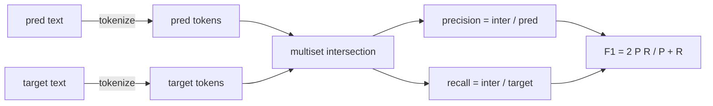
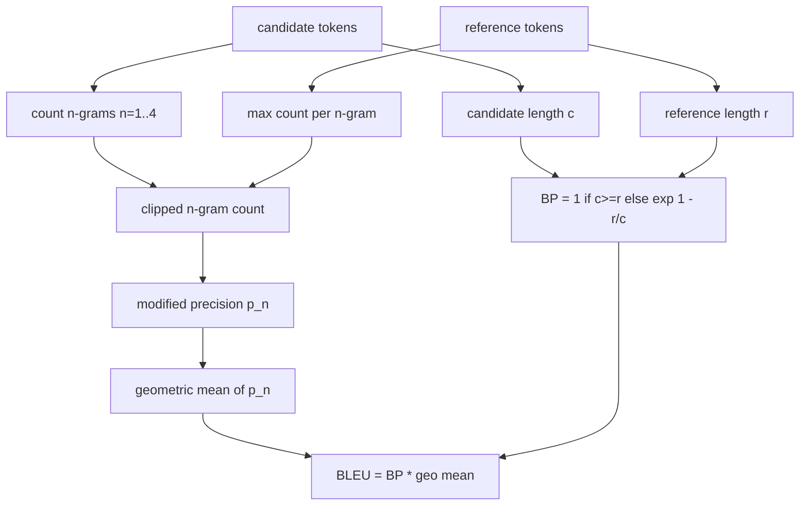

# 클래식 매트릭스

> BLEU, ROUGE-L, F1, 정확한 일치, 정확성. 아직까지 발표된 LLM 평가 숫자의 대부분을 차지하는 다섯 가지 측정값. 첫 번째 원칙에서 각각 구현하여 숫자의 의미를 알 수 있습니다.

**Type:** Build
**Languages:** Python
**Prerequisites:** Phase 19 Track B foundations, lesson 70
**Time:** ~90 min

## 학습 목표

- 토큰 레벨의 정확한 일치, F1 및 정확성을 명시적인 토큰화 규칙으로 구현합니다.
- BLEU-4를 처음부터 구현: n-그램의 정밀도 변경, n보다 지리 평균 1에서 4까지, 단기 형벌.
- 가장 긴 공통 계열을 사용하여 ROUGE-L를 구현하고, 정확성과 회수 F-beta 조합을 사용합니다.
- 70강에서 메트릭_네임 필드에 보내서 랜서는 메트릭-아고스틱으로 유지됩니다.
- 동작을 타사 라이브러리에서 아닌 작업된 예제에서 얻은 참조 벡터로 꽂아두십시오.

```figure
cd-bleu-overlap
```

## 왜 재시행해야 하는가

당신은 BLEU 28.3을 보고하고 BLEU 0.283를 보고하는 논문을 읽을 것입니다. 두 도서관에서 10점으로 차이가 있는 ROUGE-L 점수를 발견할 수 있습니다. 왜냐하면 하나는 작자로 줄이고 다른 하나는 그렇지 않기 때문입니다. 혼란을 막는 가장 빠른 방법은 직접 측정값을 작성하고, 그 다음 표기표가 결정되는 선과 부드러운 것을 적용하는 선을 가리키는 것입니다. 그 후, 논문들을 통틀어 숫자를 비교하는 것은 도서관에 대한 논쟁이 아니라, 측정 설정을 읽는 문제입니다.

STDlib + Numpy는 충분합니다. BLEU는 계산하고 클램프입니다. ROUGE-L는 동적 프로그래밍입니다. F1는 토큰의 세트 교차입니다. 가장 어려운 부분은 토큰을 선택하고 그것에 헌신하는 것입니다.

## 표기

토큰이 `re.findall(r"\w+", text.lower())`.하루사, 알파나미터리 실행, 드롭 점수. 이 수업의 모든 매트릭은 정확히 이 토큰라이저를 사용합니다. 런어는 선택 할 수 없습니다. 토큰라이저를 교환하면 다른 기준을 실행합니다.

```python
TOKEN_RE = re.compile(r"\w+", re.UNICODE)
def tokenize(text):
    return TOKEN_RE.findall(text.lower())
```

이것은 의도적인 단순화입니다. 생산 설정은 CJK, 단축, 코드 식별자를 중요하게 생각합니다. 교훈의 핵심은 토큰이 계약이 아니라 버튼이 아니라는 것입니다.

## 정확히 일치합니다

```python
def exact_match(pred, targets):
    return float(any(pred.strip() == t.strip() for t in targets))
```

작업당 1.0 또는 0.0을 반환합니다. 데이터 세트의 합은 평균입니다. 이것은 수학적, MCQ 및 짧은 분류 작업의 작업마자입니다.

## 토큰 레벨 F1

예측 및 목표의 토큰 멀티셋을 설정하십시오. 정확도는 예측의 멀티셋으로 나뉘는 멀티셋 교차입니다. 상기시키는 것은 목표의 멀티셋으로 나뉘는 동일한 교차입니다. F1는 조화 평균입니다. 구현은 빈 예측과 빈 목표 가장자리 사례를 처리합니다.



다목적 작업에 있어서, 우리는 목표 목록에서 가장 좋은 F1를 선택합니다. 이는 문헌에서 널리 보도된 SQuAD 스타일의 행동에 일치합니다.

## BLEU-4

BLEU는 정통 기계 번역 메트릭이며, 여전히 요약 작업에서 나타납니다. 우리가 사용하는 공식은 코퍼스 레벨 BLEU-4입니다. 표준 단기 형벌과 개정된 n-그램 수를 가벼워서 추가-하나가 부드럽게 되어서 1 그램이 빠진 것은 점수를 0으로 밀어 넣지 않습니다.

각 후보 참조 쌍에 대해, n = 1, 2, 3, 4에 대한 수정된 n-그램 정확도를 계산합니다. 수정된 정확도는 후보 n-그램의 최대 수를 어느 참조에서나 계산합니다. 따라서 후보자는 한 문장을 반복함으로써 부풀어 올릴 수 없습니다. 네 가지 정확성의 지리 평균은 단축 형벌로 포장됩니다.



평행 규칙은 린과 오흐가 부르는 방법 1 입니다. 로그를 취하기 전에 n-그램의 정확성 두 개 모두 수자와 분자에 하나씩 추가합니다.`log 0`참고 자료가 4g와 일치하지 않고 긴 후보자에 대한 비연화 값에 가깝게 유지되는 경우

## 로즈-L

ROUGE-L는 후보와 참조 토큰 순서 중에서 가장 긴 공통 계열을 비교합니다. LCS는 직결성을 강요하지 않고 단어 순서를 캡처합니다. 그래서 기본 요약 메트릭입니다. 우리는 표준 동적 프로그래밍 테이블을 사용하여 LCS의 길이를 계산하고, 다시 기억을 추출합니다.`lcs / reference length`, 정확성`lcs / candidate length`, 그리고 F-beta와 결합하여 F1 형식의 비타가 1과 같을 수 있습니다.

```python
def lcs_length(a, b):
    n, m = len(a), len(b)
    dp = numpy.zeros((n + 1, m + 1), dtype=int)
    for i in range(n):
        for j in range(m):
            if a[i] == b[j]:
                dp[i+1, j+1] = dp[i, j] + 1
            else:
                dp[i+1, j+1] = max(dp[i+1, j], dp[i, j+1])
    return int(dp[n, m])
```

피 테이블은 구현을 읽을 수 있게 해줍니다. 순수한 파이썬 목록도 작동합니다. ROUGE-L에 선택하는 작업은 피스 피스 피스 피스 피스 피스 피스 피스 피스 피스 피스 피스 피스 피스 피스 피스 피스 피스 피스 피스 피스 피스 피스 피스 피스 피스 피스 피스 피스 피스 피스 피스 피스 피스 피스 피스 피스 피스 피스 피스 피스 피스 피스 피스 피스 피스 피스 피스 피스 피스 피스 피스 피스 피스 피스 피스 피스 피스 피스 피스 피스 피스 피스 피스 피스 피스$O(n m)$작업당 비용은 밀리초 이하의 일반적인 요약 길이를 위해

## 정확성

다목적 분류 작업에 있어서 정확도는 단일 표준화된 목표에 대한 정확한 일치로 감소합니다. 우리는 그것을 별도의 기능으로 노출시켜서 디스퍼치가`metric_name`경주 안에서 줄을 비교하지 않고

## 배송 계약

단일 입국점은`score(metric_name, prediction, targets)`- 이봐요, 이봐요.`[0, 1]`이 표면은 75학습에서 작업 스펙에 붙여진 표면입니다.

```python
def score(metric_name, pred, targets):
    if metric_name == "exact_match":
        return exact_match(pred, targets)
    if metric_name == "f1":
        return max(f1_score(pred, t) for t in targets)
    if metric_name == "bleu_4":
        return max(bleu4(pred, t) for t in targets)
    if metric_name == "rouge_l":
        return max(rouge_l(pred, t) for t in targets)
    if metric_name == "accuracy":
        return accuracy(pred, targets)
    raise ValueError(f"unknown metric_name: {metric_name}")
```

`code_exec`72강에서 처리하고, 디스페이저에 넣습니다.

## 이 교훈이 하지 않는 것

모델은 호출하지 않습니다. 그것은 이미 수업 70의 후 과정 규칙이 한 것보다 더 많은 세대를 정상화하지 않습니다. 그것은 신뢰 간격을 계산하지 않습니다. 그것은 BLEURT 또는 BERTScore를 하지 않습니다 (그들은 모델이 필요하고 다른 수업에서 생활합니다).

## 코드를 읽는 방법

`main.py`매트릭을 자유 함수와 디스퍼터로 정의합니다.`_reference_examples`파일의 하단에 있는 블록. 데모는 디스페셔를 8개의 예를 통해 실행하고`code/tests/test_metrics.py`참조 벡터를 고 각 엣지 케이스 (공허 예측, 공허 참조, 공유 토큰이 없습니다, 정확한 일치, 반복 된 문장 절기) 를 강조합니다.

읽으세요`main.py`F1는 여섯 줄입니다. BLEU 및 ROUGE-L는 무거운 부분이며, 그들은 평행 규칙과 LCS 재발에 대한 상세한 의견을 포함합니다.

## 더 나아가

클래식 매트릭은 필요하지만 충분하지 않습니다. 그들은 표면적 중복을 보상하고 의미를 놓치고 있습니다. 고치는 모델 기반 매트릭을 위에 층으로 배치하는 것입니다 (BLEURT, BERTScore, GEval) 클래식 바닥에 신뢰하면. 이것은 나중에 교훈입니다. 현재는: 이 다섯 가지를 작동시키고 테스트로 고정시켜, 감사 할 수 있고 빠르고 재생 가능한 매트릭 스택을 갖게됩니다.
