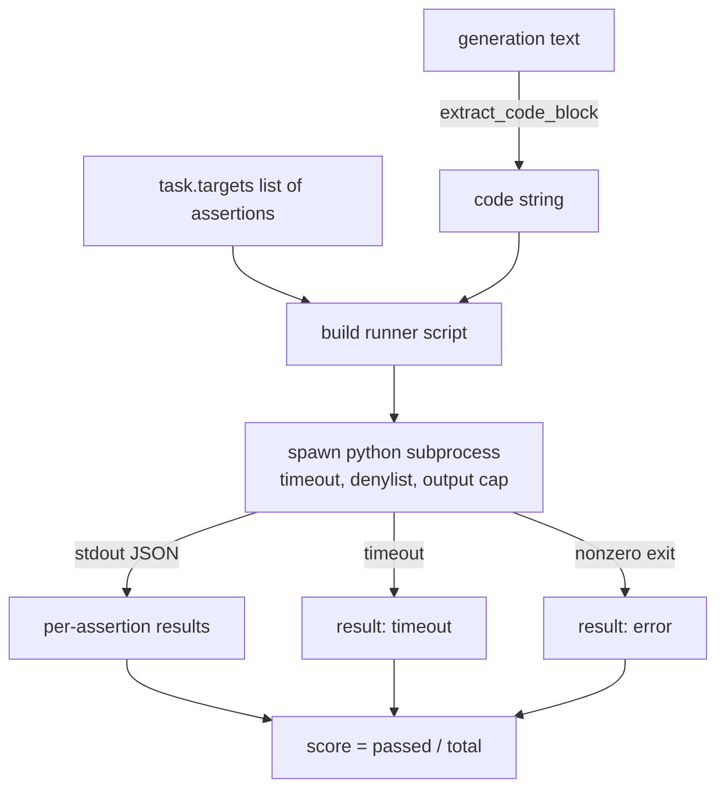
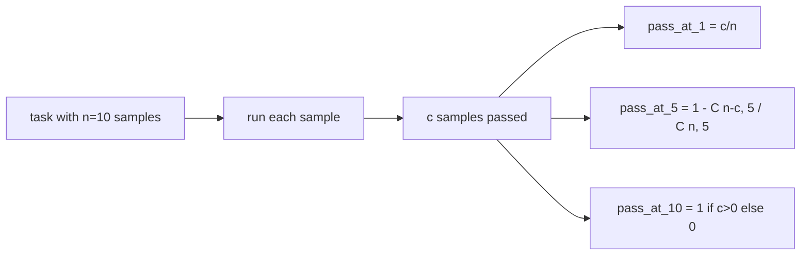

# 코드 Exec 메트릭

> 생성된 코드는 테스트를 통과하면 옳습니다. eval 하인스는 코드를 추출하고 호스트를 충돌시키지 않고 실행하고, 정직하게 합격률을 계산해야 합니다. 이 교훈은 그 표면을 구축합니다.

**Type:** Build
**Languages:** Python
**Prerequisites:** Phase 19 Track B foundations, lessons 70 and 71
**Time:** ~90 min

## 학습 목표

- 자유형 생성에서 코드 블록을 추출하여 70 수업의 프로세스 후 규칙과 일치합니다.
- 벽 시계 타임아웃, 출력 캡 및 수입 데닐리스트를 가진 개별 하위 프로세스에서 후보 코드를 실행하십시오.
- 과제를 지원된 주장 문자열의 분수로 점수하여 후보에 반대한다.
- 하나의 모델에서 여러 세대를 샘플링하는 작업에 대한 패스-아트-k 계산
- 샌드박스 충돌, 문법 오류 및 타임아웃을 달리기가 로그 할 수있는 다른 출력 코드로 1급 실패 모드로 처리하십시오.

```figure
sandbox-runner
```

## 왜 고립된 하위 과정이

직렬`exec`안전 및 안정성 위험.`while True: pass`에블리션을 영원히 차단합니다`import shutil; shutil.rmtree('/')`그것은 정확히 들릴만큼 재앙적입니다. 수정은 후보당 새로운 파이썬 인터프리터를 생성하고, stdin에 코드를 전달하고, 주장 결과를 stdout로 작성하고, 과장되면 프로세스를 죽입니다. 호스트 평가 프로세스는 계속 실행됩니다.

인적 에발, MBPP, 빅코드 벤치, 라이브 코드 벤치 같은 실제 평가들은 모두 하위 프로세스 샌드박스를 사용합니다. 일부 레이어 도커는 위에 있습니다. 우리는 하위 프로세스를 이유 때문에 중단합니다. 그것은 휴대용이며, stdlib이며, 교육 평가에 중요한 실패 모드를 잡습니다. 생산 배포는 seccomp, 네트워크 격리 및 읽기 전용 파일 시스템을 추가합니다. 이 트랙 이외의 삶을 강화하는 다음 교훈은

## 코드 실행 작업의 형태

A`code_exec`작업은 주장 문자열을 `targets`. 달리기는 그 세대로부터 울타리 코드 블록을 추출하고, 그 주위에 테스트 띠를 만들고, 결과를 실행합니다.



점수는 `[0, 1]`. 두 개의 패스 점수가 0.667인 세 가지 주장을 가진 작업. 실행자는 어떤 실패가 있더라도 동일한 모양을 반환합니다. 부 프로세스 충돌은 정상화 된 오류 코드로 매핑됩니다.

## 데닐리스트

젠일리스트는 수입 기반입니다. 후보 코드를 실행하기 전에, 런어 스크립트는 위험한 모듈의 수입을`ImportError("denied")`. 목록은 의도적으로 보수적입니다.`os.system``subprocess``socket``requests``urllib``urllib.request``urllib.error``urllib.parse``ctypes``shutil``http.client``asyncio.subprocess`- 그래

우리는 이것이 방탄소방지인 척하지 않습니다. 결정된 적대 코드는 파이썬에서 진행 중인 모든 모래 상자를 피할 수 있습니다. Denylist는 백스톱입니다. 벽 시계 타임아웃과 출력 캡은 부하 제어입니다.

```python
DENIED = {
    "os.system": True,
    "subprocess": True,
    "socket": True,
    "shutil": True,
    "requests": True,
    "urllib": True,
    "ctypes": True,
}
```

후보자를 선고받아 마무리합니다`import sys`그리고 원숭이 을  수 있는 경호가`os.system`이 더 커질 수 있습니다. 전체 템플릿은 `main.py`- 그래

## 벽 시계 시간

모든 하위 프로세스는 기본 예산이 3초의 벽 시계입니다.`subprocess.run(..., timeout=t)`타임아웃이 터지면, 뛸 수 있는 사람이 잡을 수 있습니다.`TimeoutExpired`, 프로세스를 죽이고, 기록`timeout`그 작업의 점수는 0이고, 경기가 계속됩니다.

시간 제한은 작업에 따라 구성될 수 있습니다`task.metadata.timeout_s`. 장기적인 단위 테스트는 더 많은 것을 요구할 수 있습니다. 수업 70의 검증자는 수단을 제한하기 위해 30초에 값을 제한합니다.

## 출력 모금

부 프로세스는 스터우트를 홍수하여 호스트 메모리를 지치게 할 수 있습니다. 런어는 스터우트를 버퍼에 스트리밍하여 실행 총 256 KB를 넘으면 아이를 죽인다. 결과는 256 KB로 기록됩니다.`exit_code = error`세부적인 줄이 `"output overflow"`이것은 실제로 나타나고 있습니다. 한 세대가 실수로 무한한 루프를 작성하여 인쇄할 때입니다.

## 

Pass-at-k는 HumanEval과 친구들이 사용하는 편향없는 추정치입니다.`n`임무를 통한 독립적인 샘플`c`그 중 통과하는 확률은`k``n`적어도 하나의 통과 용액을 포함하고 있습니다.

```
pass_at_k(n, c, k) = 1 - C(n - c, k) / C(n, k)
```

언제`n - c < k`숫자는 정의되지 않고 값은`1`이 실행은 가장자리 사건을 직접 처리합니다.`pass_at_k(n, c, k)`수업 74의 리더보드 계층에서 사용하도록



## 출구 코드

달리기는 5가지 결과 중 하나를 반환합니다.

- `pass`모든 주장이 지나가니
- `assertion_fail`코드가 실행됐지만 적어도 한 가지 주장이 실패했습니다.
- `syntax_error`코드가 수입되지 않았거나 문법 오류가 발생했을 때
- `timeout`벽속이 만료되었을 때
- `error`다른 충돌, 데닐리스트 타격 및 출력 과잉 (비록 과잉 과잉 표면) 을 포함하여`"output overflow"`)

점수는 여전히 분자입니다. 출력 코드는 메타데이터입니다. 하류 수업은 시간차를 0으로 계산할지 아니면 실종된 데이터로 결정할 수 있습니다.

## 이 교훈이 하지 않는 것

이 강의는 실제 샌드박스를 제공하지 않습니다. 그것은 오픈 웹에서 신뢰할 수 없는 코드를 실행하지 않습니다. 파일 I/O 또는 네트워크 호출과 같은 상태 작업을 처리하지 않습니다. 이러한 컨테이너 또는 마이크로VM가 필요합니다. 이 수업의 목적은 계약입니다.

## 코드를 읽는 방법

`main.py`정의합니다`extract_code``run_candidate``score_code_exec`그리고`pass_at_k`. 하위 프로세스 러너 스크립트는 문자열로 구성되어`-c`새로운 파이썬 인터프리터로`code/tests/test_exec.py`HumanEval 스타일에서 얻은 작업된 예제들에 대해 4개의 출력 코드와 pass-at-k를 사용한다.

읽으세요`main.py`롤러 템플릿은 로드 베어링 조각입니다. JSON 봉투가 원 프로세스에 다시 작성될 때까지 주장 루프를 쳐다보세요.

## 더 나아가

하위 프로세스 모양이 작동하면 다음 문제는 휴대성입니다. 다른 파이썬 버전들은 윈도우에서 SIGKILL를 다르게 처리합니다. 가장 깨끗한 해결책은 달리기를 도커 이미지로 만드는 것입니다. 그 다음으로, 진술 문자열을 실제 단위 테스트 파일로 교체하여, 그 시점에서 주장 문자열 테스트를 더 이상 부르지 마세요. 그들은 장난감 테스트이고 장난감 실패 모드가 있습니다.
