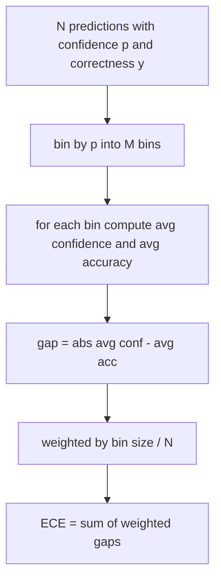
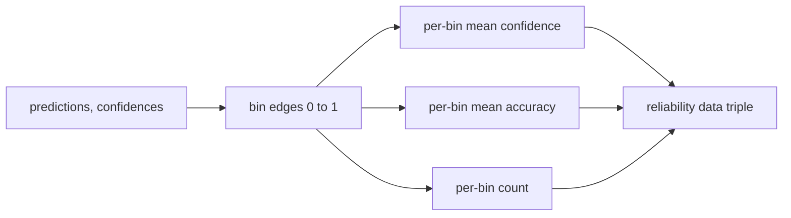

# 혼란과 기량

> 만약 당신의 모델이 1000개의 답변에 대해 90% 확신을 갖고 있고 600개의 답을 얻으면, 그것은 잘 정렬되지 않습니다. 정렬은 신뢰할 수 있는 평가의 절반입니다. 다른 절반은 혼란입니다. 이 결과는 모델이 유지된 텍스트가 사실적이라고 생각하는지 알려줍니다.

**Type:** Build
**Languages:** Python
**Prerequisites:** Phase 19 Track B foundations, lessons 70 and 71
**Time:** ~90 min

## 학습 목표

- 모델 어댑터에서 제공된 토큰 부정적인 로그 확률에서 지어진 코퍼스에서 토큰 수준의 혼란을 계산한다.
- 분류자 또는 복수 선택 평가의 예상 캘리브레이션 오류 (ECE) 를 예측된 확률에서 계산한다.
- 브리에 스코어를 계산해 보세요 (정확성 지표에 대한 평균 제곱 오류) 그리고 ECE가 하지 않는 것을 언제 하는지 설명해 주세요.
- 신뢰성-정확성 곡선을 그리기 위해 필요한 신뢰성 다이어그램 데이터를 구축하십시오.
- 3개 모두 에블 리너에 연결해 달리는 사람이 연결할 수 있도록`perplexity``ece`그리고`brier`모델 보고서에 있는 숫자

```figure
cd-reliability-diagram
```

## 혼란이 무슨 말을 하는지

혼란은 토큰당 적대적인 평균 음적 로그 확률입니다. 더 낮게는 더 낫다. 1의 복잡성은 모델이 실제 토큰에 1의 확률을 부여한다는 것을 의미합니다. 어휘의 크기의 복잡성은 모델이 균일하고 아무것도 배우지 않는다는 것을 의미합니다. 실제 숫자는 중간에서 떨어집니다. 위키텍스트-103에서 강력한 2026 기본 모델은 8에서 12에 걸쳐 있습니다. 같은 글에 나쁜 글은 50+로 올라갑니다.

리네스는 로그 확률을 직접 계산하지 않습니다. 모델 어댑터에서 나온 것입니다. 리네스는 토큰 당 로그 확률 목록을, 순서별 토큰 수 수 목록을 가져와 코퍼스 혼란을 반환합니다.

```python
def perplexity(neg_log_probs, token_counts):
    total_nll = sum(neg_log_probs)
    total_tokens = sum(token_counts)
    return math.exp(total_nll / total_tokens)
```

이 구현은 제로 토큰 가장자리 사례를 처리하고 부정적인 로그 확률이 부정적이라고 주장합니다. 부정성을 잊는 것이 일반적인 실수입니다.`log p`대신`-log p`이 함수는 계약 위반으로 그 함수를 잡습니다.

## ECE의 조치

예상된 캘리브레이션 오류는 고정된 수의 칸에 대한 신뢰에 따라 예측을 그룹화하고, 칸의 크기로 중화된 칸의 신뢰와 정확성 사이의 평균 격차를 측정합니다.



표준 공식은 10개의 동일한 너비 칸을 사용한다.`[0, 1]`이 구현은 모든 긍정적인 정수 수를 지원합니다.`bins`매개 변수, 따라서 달리기는 출판 협약 (10) 과 비교 협약 (15) 사이에서 선택할 수 있습니다.

ECE는 빈자 수와 샘플 크기에 의해 편향됩니다. 열 개의 빈자와 백 개의 예측으로, 무작위 소음에서 0.02 ECE를 구별 할 수 없습니다. 구현은 ECE와 함께 인구 빈자 수를 반환하므로 경주자가 너무 적은 샘플에 대한 단일 숫자를 보고하기를 거부할 수 있습니다.

## 브리에의 점수는 ECE가 하지 않는

ECE는 평균 격차에 대해만 신경쓰고 있습니다. 반 칸에 지나치게 자신감이 있고 다른 반에 너무 덜 자신감이 있는 모델은 지역적으로 잘 캘리브레이션되지 않은 상태에서 낮은 ECE를 가질 수 있습니다. 브리어 점수는 예측당 실제 결과에 대한 제곱 오류를 측정하므로 직접적으로 확산을 처벌합니다.

바이너리 결과 Brier는`mean((p_i - y_i)^2)`롤링은 신뢰성, 해상도, 불확실성으로 분해됩니다. 우리는 점수와 분해를 계산합니다. 경주자는 스칼러를 보고하지만 래시보드에서 분해를 기록합니다.

```python
def brier(p, y):
    return float(np.mean((p - y) ** 2))
```

## 신뢰성 다이어그램 데이터

신뢰성 다이어그램은 각 칸의 경험적 정확성에 대한 신뢰를 예측합니다. 지각은 완벽한 캘리브레이션입니다. 함수는 세 배열을 반환합니다. 칸당 평균 신뢰, 칸당 평균 정확성, 칸당 계산. 칸의 칸의 코드는 하류에 살고 있습니다. 이 교훈은 데이터 모양에서 끝납니다.



반환된 튜플은 호출 계층이 대면을 그리거나 사용자 지정 ECE 변형을 계산하기 위해 필요로 하는 것입니다 (응응성 ECE, 스파이 ECE, 등).

## 신뢰의 근원

이 배너스는 신뢰가 softmax에서 온다고 가정하지 않습니다.`[0, 1]`예측에 따라 여러 선택의 작업에 있어서 자연스러운 신뢰는`softmax over option log-likelihoods`자유 텍스트에 대한 자연 신뢰는 모델의 자기보고 확률 또는 평균 로그 확률의 기하급수입니다. 평가는 숫자를 소비합니다. 그것은 어댑터의 작업입니다.

## 가장자리 케이스

- 모든 예측이 틀렸어요. ECE는 평균 신뢰성이고, Brier는 높은 수치이고, 혼란은 모델이 텍스트에 대해 생각하는 것과 상관없습니다.
- 모든 예측은 높은 신뢰로 정확합니다. ECE는 0에 가깝고, Brier는 0에 가깝습니다.
- 완전 불확실한 예측자 p=0.5: ECE는 0.5 미이너스 정확성, Brier는 0.25 미이너스 수정 용어입니다.
- 빈 입력: ECE, Brier 및 신뢰성 반환 `0.0`(또는 0으로 가득한 매리) 의 혼란을 반환합니다`NaN`0 토큰의 경우 이 경로는 경고를 발사하지 않습니다. 경주자는 값을 검사하고 보고하거나 건너뛰는지를 결정합니다.

실제 벤치마크에 있는 실제 모델은 타격을 주지 않을 것이지만 버그 어댑터나 작은 샘플은 타격을 주지 않을 것이고, 달리기는 충돌하지 않아야 합니다.

## 파송

기밀은 F1처럼 과제별 측정기치가 아닙니다.`(confidence, correct)`전체 eval에서 쌍을 고 ECE, Brier, 그리고 신뢰성 데이터를 한 번 계산합니다. 혼란은 작업별 점수를 분리하여 유지된 텍스트 코퍼스에서 계산됩니다.

인터페이스는:

```python
report = CalibrationReport.from_predictions(confidences, correct)
report.ece          # float
report.brier        # float
report.reliability  # tuple of three numpy arrays
report.populated_bins  # int
```

`PerplexityResult.from_token_nll(neg_log_probs, token_counts)`토큰당의 혼란과 평균 음의 로그 확률을 반환합니다.

## 이 교훈이 하지 않는 것

이 모델은 모델을 호출하지 않습니다. Softmax를 구현하지 않습니다. 출력 토큰에서 신뢰를 추정하지 않습니다. 그것은 어댑터의 작업입니다. 그것은 온도 확장 또는 플래트 확장하지 않습니다. 이것들은 다른 수업에서 생활하는 포스트하크 수정입니다. 이 수업의 목적은 세 개의 숫자를 (분명성, ECE, Brier) 신뢰성 및 재생 가능하도록 만드는 것입니다.

## 코드를 읽는 방법

`main.py`정의합니다`perplexity``expected_calibration_error``brier_score``reliability_diagram`, 그리고`CalibrationReport`- `PerplexityResult`데이터 클래스: 시범은 기초적인 진실이 알려진 합성 예측을 기반으로 진행됩니다. 잘 정렬된 모델, 과잉 자신감 있는 모델, 과잉 자신감 있는 모델.`code/tests/test_calibration.py`모든 엣지 케이스를 합성 예측기 기준값을 더하기

읽으세요`main.py`함수 순서는 스칼라에서 벡터로 보고하기 위해 이동합니다. 각각의 함수는 수학과 계약에 대한 짧은 문서줄을 가지고 있습니다.

## 더 나아가

캘리브레이션은 출판된 평가에서 가장 무시되는 축입니다. 대부분의 순위표는 정확한 숫자를 보고하고 완료했다고 말합니다. 정확성에 대해 승리하고 브리에 대해 잃는 모델은 정확성에 대해 몇 점 이하의 점수를 얻지만 불확실성을 신뢰할 수 있게 보고하는 모델보다 더 나쁜 생산 배포입니다. 일단 기량 수리 파이프링이 설치되면, 수리된 검증 슬라이드에 온도 스케일링을 추가하고 ECE를 다시 계산하고 격차가 줄어드는 것을 관찰하십시오. 그건 별개의 교훈이지만, 바닥은 여기 있습니다.
