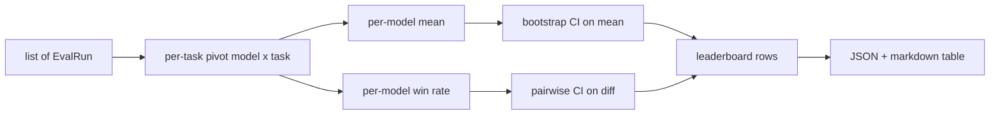
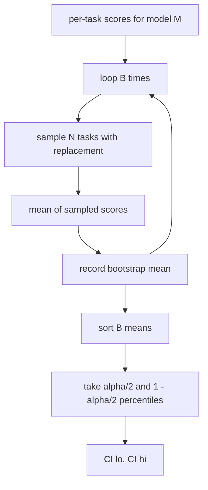

# 리더보드 집계

> 과제당 점수는 쉽다. 이질적인 과제에서 모델별 순위가 더 어렵습니다. 천 개의 예측 랭킹보드에 통계에 대한 중요성은 모든 사람들이 건너뛰는 부분입니다. 이 교훈은 그것을 건너뛰지 않습니다.

**Type:** Build
**Languages:** Python
**Prerequisites:** Phase 19 Track B foundations, lessons 70, 71, 73
**Time:** ~90 min

## 학습 목표

- 여러 모델과 여러 작업에 대한 작업 당 점수를 정리하여 모델 당 순서로 정리합니다.
- 합 합율과 BLEU 값이 합액에 과도한 영향을 미치지 않도록 이질적인 점수를 정상화한다.
- 평균 및 승률에 따라 모델을 순위하고 각각의 요약이 언제 옳은지 설명하십시오.
- 모델별 평균 점수와 쌍별 차이에 따라 부트스트랩 신뢰 간격을 계산한다.
- JSON 보고서로 순위표를 출력하고, 점검 테이블로 수업 75의 런어는 CI 댓글에 붙일 수 있습니다.

```figure
ci-leaderboard-ci
```

## 입력의 형태

집합자 는  목록을 소비한다.`EvalRun`기록:

```python
@dataclass
class EvalRun:
    model_id: str
    task_id: str
    metric_name: str
    score: float          # in [0, 1]
    category: str
```

75강의 달리는 1회에 1회 기록을 내놓는다`(model, task)`이 조수는 점수가 어떻게 생성되었는지 신경쓰지 않습니다. 그것은 이미 정상화가 일어났을 것으로 예상합니다. 모든 점수는 `[0, 1]`- 그래

## 출력

세 개의 테이블이 나오죠.



순위표 선에는 다음과 같은 내용이 있습니다. `model_id``mean_score``mean_ci_lo``mean_ci_hi``win_rate``tasks_completed`, 그리고 선택적`categories`카테고리 평균에 대한 지도

## 정상화

만약 하나의 작업이 득점을 내면`[0, 1]`그리고 또 다른 `[0, 100]`, 두 번째는 침묵으로 평균을 지배합니다. 집합자는 모든 입력 점수가`[0, 1]`이 메트릭은 이미 부분으로 반환해야 합니다. 71~73번 강의는 그 계약을 집행합니다.

## 평균 및 승률

두 가지 순위 체계는 서로 다른 목적을 가지고 있습니다.

평균 점수는 한 모델의 작업 당 점수 평균이다. 그것은 헤드라인 번호 순위표 보고서입니다. 그것은 비정상적 및 작업 불균형에 민감합니다.

승률은 동일한 작업에 대한 다른 모델을 얼마나 자주 이길 수 있는지 계산합니다. 각 작업에 대해 가장 높은 점수를 얻은 모델이 승리합니다. 승률은 모델이 점수를 가진 작업의 숫자에 의해 나누어진 승률에 해당합니다. 그것은 비정상적 값과 규모 차이에 덜 민감하지만 정보를 잃습니다.

```python
def win_rate(model_id, runs_by_task, all_models):
    wins, total = 0, 0
    for task_id, runs in runs_by_task.items():
        scores = {r.model_id: r.score for r in runs if r.model_id in all_models}
        if model_id not in scores:
            continue
        total += 1
        best = max(scores.values())
        if scores[model_id] >= best:
            wins += 1
    return wins / total if total else 0.0
```

리너스는 둘 다 보고합니다. 수업 75의 런어는 기본적으로 평균 순위를 차지하고 있습니다. 사용자가 선호하는 경우 승률을 표시하는 기둥은 바로 여기에 있습니다.

## 부트스트랩 신뢰 간격

모델별 매개체들은 작업에 대한 bootstrap 재 샘플링으로 추정되는 신뢰 간격을 가지고 있습니다. 우리는 작업 ID를 교체로 재 샘플링하고 재 샘플링된 집합에 대한 평균을 계산하고 반복합니다.`B`시간, 그리고 레벨에서 퍼센틸 간격을 `alpha`- 그래



쌍별 비교를 위해 우리는 작업당 차이를 부트스트래프합니다`score_A - score_B`이 경우, 이 차이는 알파 수준에서 상당한 차이가 있습니다. 그렇지 않으면, 랭킹보드는 모델을 무대화로 취급합니다.

낮은 수준의 보조 (`bootstrap_mean_ci``bootstrap_pairwise_diff`) 결제`B=1000`공공 집합업체 (`aggregate``pairwise_diffs`) 결제`b=500`그래서 디모와 테스트는 빠르다 기본 알파는 0.05입니다.

## 분류

만약`EvalRun.category`이 기사는 각 순위표의 열에 해당합니다.`math``reasoning``code``safety`. 그것은 랜더에게 모델이 전반적으로 좋은지, 하지만 코드로는 약한지 알 수 있게 해줍니다. 이는 제목의 의미는 숨기는 정보입니다.

## 마크다운 렌더링

순위표는 표 표로 표시됩니다.

```text
| Rank | Model | Mean | 95% CI | Win rate | Tasks |
|------|-------|------|--------|----------|-------|
| 1    | gpt   | 0.78 | 0.74-0.82 | 0.62 | 50 |
| 2    | claude| 0.75 | 0.71-0.79 | 0.34 | 50 |
| 3    | random| 0.10 | 0.07-0.13 | 0.04 | 50 |
```

표는 평균 점수를 따라 정렬됩니다. CI는 두 개의 십자수로 표시됩니다. 긴 모델 ID는 20 개의 문자로 줄입니다.

## 이 교훈이 하지 않는 것

모델을 실행하지 않습니다. 메트릭 레이어를 호출하지 않습니다. 적응 ECE 또는 다른 캘리브레이션 변형을 구현하지 않습니다. 그것은 수업 73. 작업 중량을 구현하지 않습니다. 모든 작업이 여기에 동일합니다. 생산 순위표는 무게 작업; 우리는 그 할크를 뚫고  열어 놓습니다.`weight`하지만 그 부분을 집계자에서 무시하고, 추가 수업에 중량을 추가하면

## 코드를 읽는 방법

`main.py`정의합니다`EvalRun``LeaderboardRow``aggregate``bootstrap_mean_ci``bootstrap_pairwise_diff`그리고`render_markdown`. 데모는 3가지 모델과 12가지 작업의 합성 제품군을 구축하고, 합쳐서 순위표와 쌍방향 차이 표를 인쇄합니다.`code/tests/test_leaderboard.py`부트 스트랩, 마크다운 렌더링, 승률 우회사 및 빈 입력 동작을 습니다.

읽으세요`main.py`위에서 아래로. 데이터 모양 (EvalRun, LeaderboardRow) 은 먼저, 집합자 다음, 부트스트랩 세 번째, 렌더링 마지막. 각 함수는 중점화된 계약이 있습니다.

## 더 나아가

다음 단계는 부쌍한 부트 스트랩 대신 쌍용 작업의 중요성입니다. 모델 A와 B 모두 같은 100개의 작업을 실행했다면 적절한 테스트는 우리가 구현하는 작업별 차이에 대한 부트 스트랩입니다. 그 외에도, 작업 가족을 존중하는 계층적 부트스트랩을 원합니다 (수학 문제는 서로 독립적이지 않습니다. 수학적 오류 패턴은 그 중 10개에 영향을 미친다). 그건 후속이야 이 수업의 목적은 바닥을 제대로 만드는 것입니다. 그래서 평가자는 당신이 방어할 수 있는 숫자를 보고합니다.
