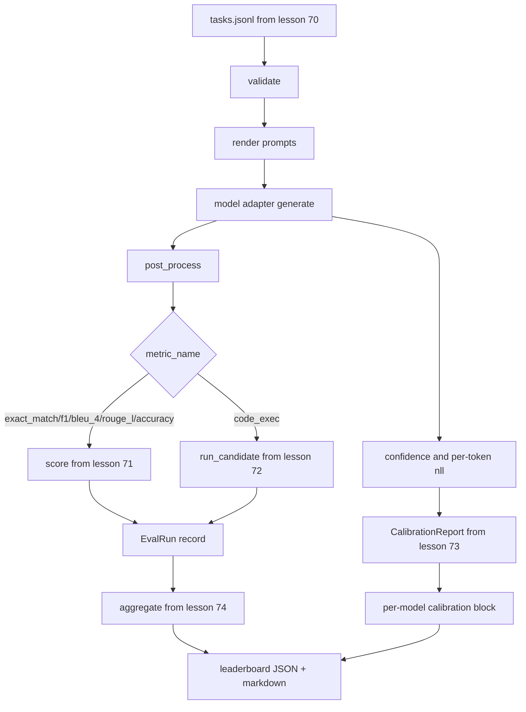

# 끝에서 끝까지의 에발 러너

> 파이프링의 다섯 가지 수업, 1 가지 수업을 붙여넣기 위해. 런어는 70 수업에서 작업 스펙을 읽고, 어댑터를 통해 모델을 호출하고, 71 및 72 수업에서 점수를 얻으며, 73 수업에서 캘리브레이션 보고서를 첨부하고, 74 수업에서 리더보드를 발송합니다. 데모는 자율적으로 종료됩니다.

**Type:** Build
**Languages:** Python
**Prerequisites:** Phase 19 Track B foundations, lessons 70 through 74
**Time:** ~90 min

## 학습 목표

- A을 정의합니다`ModelAdapter`어떤 모델 (모크, 로컬, API) 가 작은 방법 표면으로 만족할 수 있는 인터페이스.
- 작업자 풀에서 평행 작업 실행과 함께 고정 JSONL 파일에서 eval를 실행하십시오.
- 한 패스로 매립 레이어 (exact_match, F1, BLEU-4, ROUGE-L, code_exec) 를 매립한다.
- 모델별 발급`EvalRun`기록하고 순위표 집계기구로 바로 입력합니다.
- JSON 보고서와 마크다운 테이블 모두 출력; 정정 실행에서 출력 0과 실행 시간 오류에서 비 0으로 자제합니다.

```figure
eval-grid
```

## 파이프라인



런어는 통합 포인트입니다. 수업 70~74의 각 수업은 런어가 구성하는 하나의 모듈을 소유하고 있습니다. 런어는 이러한 모듈에서 논리를 복제하지 않습니다.

## 어댑터 인터페이스

어댑터는 랜더와 어떤 모델 사이의 입니다. 인터페이스는 의도적으로 작습니다.

```python
class ModelAdapter:
    model_id: str

    def generate(self, prompt: str, task: TaskSpec) -> Generation: ...
```

`Generation`는 다음과 같은 데이터 클래스입니다

- `text`: 모델의 자유형 출력
- `confidence`: `[0, 1]`답에 대한 모델의 자기보고 확률을 나타내는
- `token_nll`: 생성된 토큰에 대한 부정적 로그 확률의 선택적 합
- `token_count`: 생성된 토큰의 선택적 수

류너의 모크 어댑터는 세 가지 맛을 제공합니다: `RuleBasedAdapter`(결정적인, 거의 완벽)`NoisyAdapter`(너무 자신감 있고 종종 틀린 것)`BiasedAdapter`(한 부문에서 좋은, 다른 부문에서는 끔찍한)

## 병렬 실행

달리기는 `concurrent.futures.ThreadPoolExecutor`모델마다 작업을 병렬로 실행할 수 있습니다. 작업자 수수는 8개 중 작은 것으로 설정되어 작업 수 수입니다. 실제 모델 호출의 병목은 네트워크 I/O이기 때문에 스레드들이 충분합니다. 코드-실행 경로는 작업 내부에서 자체 하위 프로세스를 생성하고 실행자는 대기만을 계획합니다.

결정적 테스트에서, 달리기는 노출합니다`run_eval(adapters, tasks, parallel=False)`그래서 테스트는 처형 명령을 정할 수 있습니다.

## 단일 패스 점수 루프

각 작업에 대해:

1. 요청사항을 반환 (몇 번의 촬영을 위한 사전과 요청사항의 부지)
2. 어댑터를 불러 전화 시간을 잡으세요
3. 작업 규칙에 따라 세대를 처리 후
4. 메트릭 레이어로 보내
5. `EvalRun`점수와 메트릭 메타데이터로 기록합니다.
6. `(confidence, correct)`가동 시력 펌프에

`correct`신호는`score >= 1.0`exact_match 스타일 매트릭 (`exact_match``accuracy``code_exec`) 및`score >= 0.5`등급 측정값에 대한 기준은`_correct_from_score`그리고 달리기는 공공의 과장권을 노출하지 않습니다.

## 집합

모든 작업이 결과를 얻으면, 경주자가 전화를 걸죠`aggregate`그리고`pairwise_diffs`74강과`CalibrationReport.from_predictions`수업 73에서 나온 결과물은 하나의 JSON 봉투입니다.

```json
{
  "leaderboard": [...],
  "pairwise": [...],
  "calibration": {
    "model_id_a": {"ece": 0.04, "brier": 0.10, "populated_bins": 8, ...},
    ...
  },
  "summary": {
    "tasks": 10,
    "models": 3,
    "wall_seconds": 1.2
  }
}
```

런어는 또한 스도우트에 마크다운 테이블을 작성하여 사용자가 결과를 PR 리뷰에 붙일 수 있습니다.

## 자기 결말하는 데모

데모는 70 수업에서 10 개의 고정 작업에 걸쳐 3 개의 모호한 어댑터를 실행합니다. 벽 시간 10 초 이하로 유지되어야합니다. 출력 코드는 깨끗한 실행에서 0입니다.

청정 운영 기준은 다음과 같습니다.

- 모든 작업은 70강에 의해 검증되었습니다.
- 모든 작업은 71과 72번 수업에 점수를 받았습니다.
- 기량 보고서는 오류 없이 수업 73에 합쳐졌습니다.
- 순위표는 규칙에 기반한 어댑터를 게 게 게 게 게 게 게 게 게 게 게 게 게 게 게 게 게 게 게 게 게 게 게 게 게 게 게 게 게 게 게 게 게 게 게 게 게 게 게 게 게 게 게 게 게 게 게 게 게 게 게 게 게 게 게 게 게 게 게

만약 그 중 어느 하나라도 깨지면 JSON 봉투에서 구조화된 오류가 있는 런어는 0이 아닌 것을 종료합니다.

## 이 교훈이 하지 않는 것

실제 모델을 호출하지 않습니다. API 키 흐름 또는 속도 제한 처리 구현하지 않습니다. 스트리밍 또는 부분 생성 구현하지 않습니다. 어댑터는 호출당 한 세대 반환합니다. 다시 시도 또는 캐시링을 수행하지 않습니다. 이러한 문제들은 어댑터 계층에서 생깁니다. 런어는 매트릭-아고스틱 및 공급자-아고스틱입니다.

## 코드를 읽는 방법

`main.py`그것은 다른 다섯 개의 수업 모듈에서 작은 `_load_sibling`상대적인 경로로 해결하는 보조자. 데이터 클래스`Generation``EvalReport`그리고`ModelAdapter`모크 어댑터는 파일의 하단에 있습니다.

읽으세요`main.py`위에서 아래로 수입을 니다.`run_eval`그럼`_score_one`마지막에 있는 데모는 입점입니다.

`code/tests/test_runner.py`어댑터 인터페이스, 싱글 패스 루프, 병렬 대 순서적 동등성, 캘리브레이션 버퍼, JSON 봉투 모양을 .

## 더 나아가

이 실행자는 바닥입니다. 생산 평가 시스템은 추가합니다:  키로 된 결과 캐시`(task_id, model_id, model_version)`, 한 실행에 대한 달러와 토큰을 추적하는 비용 리더, 비율 제한을 뒷받침하는 재시험 계층, 패스-아트-케 작업에 대한 샘플링 정책 및 긴 스위트을위한 스트리밍 출력 형식. 이들 각각은 메트릭 또는 집합 계층을 변경하지 않고 실행자를 꽉 차있는 단일 문제입니다. 그 분리은 계약의 포인트입니다.

실제 공급업체의 어댑터를 추가하면 모이 작업이 완료됩니다. 무료 계층을 가진 하나를 선택하고, 30 줄의 접착제를 작성하고, 리더보드 조명을 지켜보세요. 다음 두 번째 공급업체를 추가하고, 배너스가 작업을 수행하도록하십시오.
