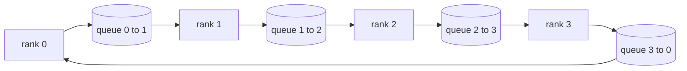

# 집단적 운영

> 분산 훈련을 함께 하는 네 가지 집단적 작업은 reduc, broadcast, allgather, and reduce_scatter입니다.`multiprocessing.Queue`매쉬, 참조 구현에 대한 확인, 그리고 나머지 트랙은 인수

**Type:** Build
**Languages:** Python
**Prerequisites:** Phase 19 Track C lessons 42-49
**Time:** ~90 min

## 학습 목표

- 임플레먼트 링 (implement ring) allreduce (reduce-scatter) 를 두 번으로 통과시켜서 (reduc-scatter) allgather) 하여, 각 순위 통신량이 2 ((N-1) /N 바이트/element에 해당하는 것을 증명한다.
- 방송을 구축, 모든 것을 수집, 그리고 포인트에서 포인트 전송 위에  reduk_scatter`multiprocessing.Queue`- 그래
- 모든 원시자를 A에 대한 검증`torch.distributed`같은 입력에 대한 참조
- 클러스터 모양, 지연지붕, 대역폭 천장 등에 대해 링과 트리 선택의 방어

## 문제

선명한 N 순위에 대한 모든 감소는 N 곱하기 서를 뿌리로 보내고 N 곱하기 다시 전송합니다.$O(N)$각 순위마다 뿌리는 병목이 되고, 벽 시계 바닥은 가장 느린 링크 곱하기 N. 링 모든 줄이는 이 을$2(N-1)$크기의 조각들$T/N$, 그래서 순위 바이트는 $2T(N-1)/N$크기의 독립적인 크기에 따라 나무는 작은 N 및 높은 지연  링크에서 승리합니다.$\log_2(N)$ 대신$2(N-1)$클러스터 모양에 대해 잘못된 토폴로지를 선택하면 가장 느린 GPU가 단계 시간을 지시합니다.

이 트랙을 읽을 모든 분산 훈련 프레임워크는 이 네 가지 원시적인 것에 달려 있습니다. PyTorch DDP는 매개 변수 버킷에 한 개의 모든 감소와 gradients를 동기화합니다. ZeRO는 reduc_scatter를 통해 최적화 상태를 쪼개고, allgather에 의해 업데이트된 매개 변수를 방송합니다. FSDP는 전면 전면을 Allgather+reduc_scatter로 변환합니다. 파이프라인 병렬 필요성, 단계 그룹 간의 활성화를 위한 방송 네 가지 집단들을 구현할 수 없다면, 훈련이 왜 정지하는지, gradient 부합이 3위에서 왜 나타나는지, 또는 대상을 교환할 때 파이프라인 거품이 왜 두 배가 되는지,

## 개념



### 반지 모두 2번으로 줄여

텐서를 N과 같은 조각으로 나눌 때 0..N-1를 지표로 나눌 수 있습니다. 각 순위는 순위와 동등한 덩어리 지수를 가지고 있습니다. 패스 1, 저하 스캐더, N-1 단계로 단계 s에서, 순위는 (r - s) mod N에 chunk (r + 1) mod N를 보내며, 순위 (r - s - 1) mod N에서 chunk (r - s - 1) mod N을 수신하여, 수신된 chunk을 로컬 복사본으로 축적합니다. N-1 단계 후에, 순위 r는 r의 전체 부수를 소유하고 있습니다. 패스 2, 모두 집합, 또 다른 N-1 단계를 실행하고 각 순위가 모든 조각의 전체 부수를 보유 할 때까지 반지를 둘러싼 완성된 조각을 회전합니다.

| Primitive | Per-rank bytes | Steps | When to use |
|-----------|---------------|-------|-------------|
| Ring allreduce | 2T(N-1)/N | 2(N-1) | Large T, fat-pipe homogeneous cluster |
| Tree allreduce | T log2(N) | 2 log2(N) | Small T or high-latency links |
| Broadcast | T | log2(N) tree | Parameter init, scalar config |
| Allgather | T(N-1)/N | N-1 | Sharded forward, ZeRO unshard |
| Reduce_scatter | T(N-1)/N | N-1 | ZeRO gradient sharding |

### NCCL의 대대역으로 줄을 잇는 매체

NCCL는 PCIe와 NVLink에서 하드웨어 부하를 줄이는 기능을 실행합니다. CPU에서는 그런 것은 없습니다.`multiprocessing.Queue`각 링 엣지 는 단일 생산자 및 단일 소비자 와 함께 주문 된 포인트-포인트 배달을 제공합니다. 감소는 사용자 공간에서 발생합니다. 따라서 당신은 파이썬 오버헤드를 지불하지만, 와이어 패턴은 NCCL 링 모든 감소와 동일합니다. 대기 버전의 정확성에 대한 이유와 클러스터 행동은 다음과 같습니다.

### 에 대한 확인

모든 원시들은 생산량을 비교하는 단위 테스트를 합니다`torch.distributed`이 테스트는 이식된 상태에서 사용되고 있는 경우, 이식된 상태에서 사용된 경우, 이식된 상태에서 사용된 상태에서 사용된 상태에서 사용된 상태에서 사용된 상태에서 사용된 상태에서 사용된 상태에서 사용된 상태에서 사용된 상태에서 사용된 상태에서 사용된 상태에서 사용된 상태에서 사용된 상태에서 사용된 상태에서 사용된 상태에서 사용된 상태에서 사용된 상태에서 사용된 상태에서 사용된 상태에서 사용된 상태에서 사용된 상태에서 사용된 상태에서 사용된 상태에서 사용된 상태에서 사용된 상태에서 사용된 상태에서 사용된 상태에서 사용된 상태에서 사용된 상태에서 사용된 상태에서 사용된 상태에서 사용된 상태에서 사용된 상태에서 사용된 상태에서 사용된 상태가 변경된 상태에서 사용된 상태에서 사용된 상태가 변경된 상태에서 사용된 상태가 변경된 상태에서 사용된 상태가 변경된 상태에서 사용된 상태가 변경된 상태가 변경된 상태가 변경된 상태가 변경된 상태입니다.

```figure
ci-ring-allreduce
```

## 건설 해

`code/main.py`이 도구는

- `Mesh`N 를 연결하는 클래스`multiprocessing.Queue`반지를 뚫고 노출시키는`send(dst, tensor)`그리고`recv(src)`순위별로
- `ring_allreduce(mesh, rank, world_size, tensor)`2번의 알고리즘을 실행합니다.
- `broadcast(mesh, rank, world_size, tensor, src)`로가리듬 나무 위에
- `allgather(mesh, rank, world_size, tensor)`N-1 회전을 이용해서
- `reduce_scatter(mesh, rank, world_size, tensor)`모든 것을 줄이는 첫 번째 반으로
- `_gloo_reference(op, world_size, tensor)`같은 입력값을 `torch.distributed`바이트와 비교하기 위해

실행하세요:

```bash
python3 code/main.py
```

출력: 1차 확인 테이블에 따라 큐-메시 및  출력을 비교하고, 2T(N-1) /N 스케일을 증명하는 순위별 바이트 카운터로 따른다.

## 야생에서의 생산 패턴

3가지 패턴은 원시적인 것을 배포할 만큼 단단하게 만듭니다.

**Bucket gradients before allreduce.**1B 파라미터 모델에는 수십만 개의 gradient tensor이 있습니다. 한 allreduce 한 tensor 한 번은 지연 바닥 N 배로 지불합니다. DDP 버킷은 gradients를 ~ 25 MB 조각으로 내며 버킷 한 번으로 모든 reducer 한 번을 발행합니다. 작은 tensors는 큰 큰 버킷의 뒷면에 달려 있습니다. 버킷하지 않고 지연 윗부분이 단계를 지배합니다.

**Overlap communication with computation.**후진은 차층별로 차층별로 계산한다. 마지막 차층의 차층이 준비된 순간, 다음 차층이 계산을 계속하는 동안 모든 줄이는 것을 시작한다. PyTorch DDP는 버킷 준비 할인과 함께 이를 전선을 연결한다. 네트워크가 느슨해지면 초복이 보이는 통신 시간을 반으로 줄인다.

**Pick ring or tree by message size, not religion.**NCCL는 1 MB 이상 및 아래의 트리에서 메시지를 위한 링을 선택하는 토폴로지 탐지기를 배포한다. 크로스오버는 대역폭 대 지연성이다. 1 MB 이상, 대역폭 용어 2T(N-1) /N가 지배하고 링이 승리한다. 1 MB 이하에서는 log2(N) 홉 카운트가 승리한다. 하드 코딩 한 토폴로지에는 잘못된 메시지 크기의 처리량이 소요된다.

## 사용 하 고

생산 패턴:

- **PyTorch DDP.**전화`dist.all_reduce`배킷 크기는 조정 가능하며, 기본 25 MB는 100Gbit 이더넷에 합리적입니다.
- **DeepSpeed ZeRO.**문제 는 쪼개진 기하급수 를 줄이고, 전면 으로 전면 매개 변수를 재구성 하기 위해 모두 모인다. 수업의 원시 는 ZeRO가 하는 호출 이 바로 그것 이다.
- **FSDP.**전면은 모든 것을 모아 층을 분해하고 계산하고, reduc_scatter로 줄이고 분해되지 않은 것을 폐기합니다. 동일한 원시, 다른 스케줄.

## 선박

77-81 수업에서 큐-메시 원시파를 사용하십시오. 77 수업에서는 모든 전선을 DDP로 줄이십시오. 78 수업에서는 ZeRO로 줄이십시오. 79 수업에서는 전선을 파이프라인 활성화로 방송합니다. 81 수업에서는 모두 끝에서 끝으로 데모를 구성합니다.

## 운동

1. 트리 (allreduced) 버전을 추가하고 메시지 크기에 따라 링과 트리를 전환하고 크로스오버를 측정합니다.
2. `recv_timeout_ms`그래서 정지된 순위는 영원히 매달려 있는 대신
3. 대체`multiprocessing.Queue`4개의 원시체에 대한 TCP 소켓이 있습니다. 동일한 테스트, 실제 와이어
4. 대역폭 기기 을 추가하여 순위당 바이트 카운터가 JSONL로 로그됩니다.
5. 1KB, 1MB, 16MB의 텐서들을 위해 4개의 순서로 반지의 벽 시계 시간을 비교해 보세요.

## 주요 용어

| Term | What people say | What it actually means |
|------|----------------|------------------------|
| Allreduce | "Sum across ranks" | After the call every rank holds the same reduced tensor |
| Ring | "The fast topology" | N-1 chunks of size T/N flow around the cycle twice |
| Tree | "The log topology" | Reduction follows a binary tree; depth is log2(N) hops |
| Allgather | "Concatenate shards" | Every rank ends with every other rank's shard |
| Reduce_scatter | "Split the sum" | Each rank ends with the sum of one chunk only |
| Bucket | "Fuse small tensors" | Coalesce N small allreduces into one large one |

## 더 많은 읽기

- [PyTorch Distributed: NCCL collectives](https://pytorch.org/docs/stable/distributed.html#collective-functions)
- [Horovod ring allreduce paper](https://arxiv.org/abs/1802.05799)
- [NCCL topology and algorithm selection](https://docs.nvidia.com/deeplearning/nccl/user-guide/docs/index.html)
- [Patarasuk and Yuan, Bandwidth optimal allreduce algorithms](https://www.cs.fsu.edu/~xyuan/paper/09jpdc.pdf)
- 10단계 05강좌 - 분산 교육 전반
- 19단계 77강습 - DDP이 이 원시물 위에 연결되어 있습니다
