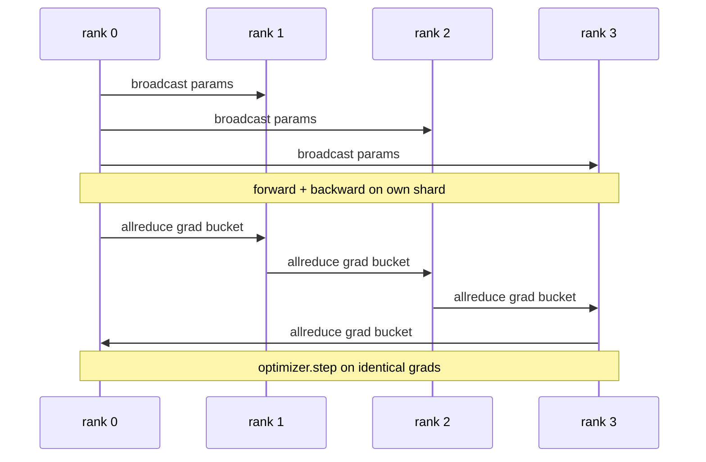

# 데이터 병렬 DDP 처음부터

> 분산 데이터 패럴은 모든 감소의 위에 있는 해크입니다. 모델을 포장하고, 모든 순위가 동일하게 시작되기 위해 0 순위에서 초기 매개 변수를 방송하고, 매 매개 변수에 모든 감소의 기하이를 내리는 후진 해크를 설치하고, 나머지는 기하급수 하락입니다. 전체 패턴은 200 라인입니다.

**Type:** Build
**Languages:** Python
**Prerequisites:** Phase 19 Track C lessons 42-49
**Time:** ~90 min

## 학습 목표

-  와이어 a`DistributedDataParallel`- 초기 매개 변수를 방출하고 후진을 줄이는 모양의 포장재
- 스파운 N CPU 순위는 `torch.multiprocessing.spawn`스 스 스 스 스 스 스 스 스 스 스 스 스 스 스 스 스 스 스 스 스 스 스 스 스 스 스 스 스 스 스 스 스 스 스 스 스 스 스 스 스 스 스 스 스 스 스 스 스 스 스 스 스 스 스 스 스 스 스 스 스 스 스 스 스 스 스 스 스 스 스 스 스 스 스 스 스 스 스 스 스 스 스 스 스 스 스 스 스 스 스 스 스 스 스 스 스 스 스 스 스 스
- 같은 모델을 동일한 데이터에 순차적으로 훈련시키고 단계별 매개 변수 동등성을 보여주며 그라디언-시크네이션의 정확성을 증명한다.
- 작동 DDP를 생산 DDP로 바꾸는 두 변화로서 덤불 (그라디언트 융합) 과 겹치는 (뒤로 이동하는 동안 커밍) 의 사용을 옹호한다.

## 문제

1조 매개 변수 모델은 12GB의 활성화를 가진 하나의 소비자 GPU에 적합하지 않습니다. 적합 할 경우에도 훈련은 몇 주 걸립니다. 데이터 평행은 N 순위에 걸쳐 배치를 나눕니다. 각 순위는 그 셔드에 대한 앞뒤를 계산하고, 각 단계에 각 순위의 기하급수들이 합쳐져 모든 N 복사본이 동일하게 유지됩니다. 합쳐진 기하급수는 최적화자가 단계가 되는 것입니다.

그라디언트 동기화 없이 N 복사체는 2 단계로 분해된다. 모델은 더 이상 "더 많은 데이터에 훈련된 한 모델"이 아니라 초기 무게를 공유하는 N 개의 별도의 모델입니다. gradient sync가 잘못 수행되면 (개 매개 변수마다 1 reduc, 겹치거나 벅팅이 없습니다) 네트워크는 병목이고 GPU는 케이블을 기다리고 있습니다. DDP의 공학은 계산에 비해 gradient 동기화를 거의 자유롭게 합니다. 가전성 PyTorch DDP는 매개 gradients, 초복 allreduce와 다음 층의 후진을 통해 NVLink에서 NCCL를 사용하여 그것을 달성합니다. 우리는 모두 CPU를 통해 GLOO를 통해 같은 교훈을 배울 수 있습니다.

## 개념



### DDP가 필요로 하는 세 가지 사업

| Stage | Collective | Why |
|-------|-----------|-----|
| Init | broadcast from rank 0 | Every rank starts with the same parameters |
| After backward | allreduce of each grad | The mean gradient is what the optimiser steps on |
| Sometimes | broadcast of buffers | Batchnorm running stats stay synchronised |

### 왜 악순위이고 합이 아닌지

월드_사이즈에 나뉘어 Allreduce-SUM는 평균 기하급수를 제공합니다. 평균은 월드_사이즈에 불변합니다. 한 순위에서 조정된 학습 속도는 4 순위에서 작동합니다. 단계별 기하급수 크기가 변하지 않기 때문에. 분할 없이 Allreduce-SUM는 클러스터 크기를 변경할 때마다 학습 속도를 재조정하도록 강요합니다. DDP는 SUM를 싸고 분할합니다. 수업에서 똑같이하십시오.

### 왜 덩어리 기하급수

트랜스포머에는 수천 개의 매개 변수 텐서가 있습니다. 한 텐서에 대한 모든 감소는 천 번씩  지연 바닥을 지불합니다. DDP는 매개 변수를 ~ 25 MB 버킷으로 그룹화하고 버킷에 대한 모든 감소를 발행합니다. 동일한 전체 바이트는 케이블을 이동하지만 지연이 버킷을 통해 amortized됩니다. 수업의 작은 모델에 대해 우리는 모든 것을 하나의 버킷으로 그룹화합니다. 구조는 전달하는 것입니다.

### 왜 씨앗을 지

모든 계급은 반드시`torch.manual_seed(seed + rank)`을 을 위해`torch.manual_seed(seed)`매개 변수 init에 대해 단일 공유 씨앗은 모든 순위가 동일한 배트 순서를 (데이터 패러럴) 볼 수 있음을 의미합니다. 매개 변수에 대한 순위별 씨앗은 초기 매개 변수를 float epsilon에 의해 일치하지 않는다는 것을 의미합니다. 그리고 그라디언 동기화는 더 이상 복제를 동일하게 만들 수 없습니다. 씨 패턴을 올바르게 얻거나 매개 변수 동등성 테스트는 1 단계에서 실패합니다.

```figure
ci-ddp-grad-sync
```

## 건설 해

`code/main.py`이 도구는

- `MiniMLP`: 3층 MLP는 초 안에 합쳐질 만큼 작고, 케이블을 노출시킬 만큼 크다.
- `DistributedDataParallel(model, world_size)`: 제작 시에 파라마를 방송하고, `sync_grads`축적된 모든 미분-합계 졸업생을 세계_위치로 나눈다.
- `worker(rank, world_size, ...)`:                    `torch.distributed`이 이 이 이 이 이 이 이 이
- `_reference_single_process_loop(...)`: 같은 모델을 같은 데이터에 따라 순차적으로 한 순위에 배열합니다.

실행하세요:

```bash
python3 code/main.py
```

출력: 4 순위에서 DDP 실행과 단일 프로세스 손실 및 매개 변수 수치를 비교하는 단계별 훈련 테이블. 두 경로는 부동의 epsilon에 동일한 손실 곡선을 생성하여 gradient 동기화가 올바르게 입증됩니다.

## 야생에서의 생산 패턴

3개의 패턴은 DDP를 배포할 만큼 단단하게 만듭니다.

**Find unused parameters.**일부 앞선 경로는 조건적으로 매개 변수를 건너뛰는다 (초출, 전문가들의 혼합 라우터). 건너뛰는 변수는 경각지대가 없지만, DDP의  준비 할 록은 여전히 그들을 기다리고 있으며 모든 을 줄인다. `find_unused_parameters=True`DDP는 어떤 파라미트가 gradients를 얻었는지 확인하기 전에 줄이는 것을 말합니다. 비용은 단계별 그래프 걸음입니다. 따라서 앞으로의 가지가 아니라면 그것을 꺼내십시오.

**Static graph optimisation.**전면이 다리를 가로지르는 데 안정되면`static_graph=True`DDP가 버킷 스케줄을 미리 계산할 수 있게 해줍니다. 최적화는 규모로 중요합니다. 사전 계산은 1 단계에 몇 ms를 절약합니다.

**Gradient accumulation needs care.**각 마이크로바치를 동기화하지 않고 K 마이크로바치에 대한 gradients를 축적하면 10x 처리량 승률을 나타냅니다. DDP는 노출합니다`no_sync()`모든 것을 줄이는 후의 컨텍스트 매니저로, 매니저를 잊어버리면 K 시간을 아무것도 없이 줄일 수 있고,

## 사용 하 고

생산 패턴:

- **PyTorch DDP.**가톨릭의 시행`torch.nn.parallel.DistributedDataParallel(model)`와이어들 부킷, 초복, 그리고 no_sync 컨텍스트
- **HuggingFace Accelerate.**을 처리하는 발사기를 추가합니다`torchrun`속과 모델 팩 같은 DDP가 모자 아래
- **Megatron-LM data parallel.**DDP를 큰 모델에 대한 텐서 평행과 결합합니다. 데이터 평행 조각은 동일한 모든 감소 후 후 후 패턴입니다.

## 선박

레슨 78 (ZeRO sharding) 은 매개 변수 allreduce를 reduc_scatter로 대체하여 각 순위가 최적화 상태의 셔트를 저장합니다. 레슨 81은 DDP를 ZeRO와 끝에서 끝까지 데모로 구성합니다.

## 운동

1. 구성 가능한 크기의 gradient buckets를 추가하고 더 깊은 모델에서 패러미터당 1개 모든 감소와 비교하여 속도를 측정합니다.
2. 시행`no_sync()`컨텍스트 매니저로서 그라디언 축적이 K 마이크로바치에 대한 단일 프로세스 기본 기준에 일치하는지 확인합니다.
3. `find_unused_parameters`앞선 경우 때때로 MLP 계층 중 하나를 건너뛰는 모드; 깃발이 없으면 경기가 무정부로 이어질 수 있습니다.
4.  로 루를 교체`torch.distributed.barrier()`-모든 줄여서 기반의 동기화와 장벽 기반의 동기화 사이의 차이를 느낄 수 있도록 동기화만 합니다.
5. 대량 1, 16, 256의 단계 시간 분수로 gradient-sync 오버헤드를 측정하고 스케일링을 설명하십시오.

## 주요 용어

| Term | What people say | What it actually means |
|------|----------------|------------------------|
| DDP | "Data parallel" | Wrapper that broadcasts params and allreduces grads each step |
| Bucket | "Fuse grads" | Group N small allreduces into one large one |
| Overlap | "Hide comm" | Issue allreduce while later layers still computing backward |
| no_sync | "Accumulate" | Skip the post-backward allreduce for gradient accumulation |
| find_unused | "Branchy forward" | Detect parameters with no grad before reducing |

## 더 많은 읽기

- [PyTorch DistributedDataParallel docs](https://pytorch.org/docs/stable/generated/torch.nn.parallel.DistributedDataParallel.html)
- [PyTorch DDP internals tutorial](https://pytorch.org/tutorials/intermediate/ddp_tutorial.html)
- [Li et al, PyTorch Distributed: Experiences on Accelerating Data Parallel Training](https://arxiv.org/abs/2006.15704)
- 19단계 76강 - 집단 DDP는
- 19단계 78강습 - ZeRO 쪼개는 1파람의 reduc_scatter로
