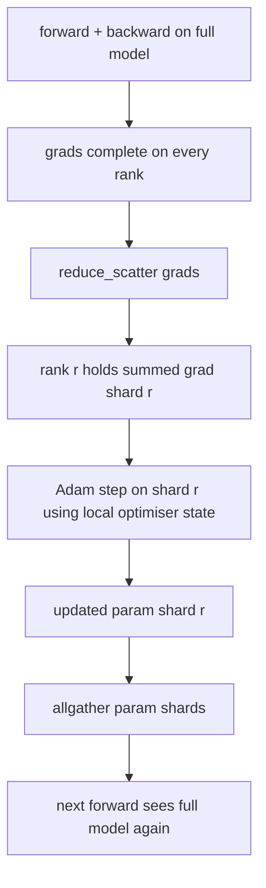

# ZeRO 최적화 상태 쪼개림

> 아담은 매개 변수당 두 개의 시점 추정치를 저장합니다. 모두 float32에서요. 7B 파라미터 모델은 56GB의 최적화 상태를 가지고 있습니다. ZeRO 단계 1은 N 순위를 가로지르는 부분을 쪼개고, 각 순위는 최적화기의 1/N를 소유하고 있습니다. 로컬 단계가 끝나면 업데이트된 파라미터 셔트는 다시 방송됩니다. 각 순위가 전체 모델을 재구성하고 다음 단계가 시작됩니다. 이승은 훈련 스택에서 가장 큰 단일 배당에 대한 선형 메모리 하락입니다.

**Type:** Build
**Languages:** Python
**Prerequisites:** Phase 19 Track C lessons 42-49
**Time:** ~90 min

## 학습 목표

- 어 최적화 상태 (첫 번째 순간, 두 번째 순간, fp32 마스터 복사) N 순위에서 각 순위가 1/N를 소유하고 있습니다.
- reduc_scatter를 사용하여 각 순위에서 그 셔드의 gradient sum만 전달하고, 업데이트된 파라미터 셔트를 다시 전송하기 위해
- 단계 1, 단계 2, 단계 3의 메모리 저장 테이블을 바닐라 DDP에 비하면 계산한다.
- 모델 크기와 대역폭 예산에 따라 1단계와 2단계와 3단계 선택의 방안을 옹호합니다.

## 문제

바닐라 DDP는 모든 것을 복제합니다. 매 순위에서 매 매개 변수, 기하급수 및 최적화 상태가 완전히 존재합니다. fp16의 7B 매개 변수 모델에서는 매 순위마다 14 GB의 매개 변수, 14 GB의 기하급수, 28 GB의 최적화 상태가 있습니다. 최적화 상태는 가장 큰 용어이며 쪼개기가 가장 쉽습니다. 왜냐하면 그것은 앞으로 또는 뒤로 한 번 만지지 않기 때문에.

제로 1단계에서는 최적화 상태가 줄어들게 됩니다. 각 순위는 아담의 순간의 1/N를 차지합니다. 뒤로 물러나서 전체 기하급수를 줄이고, 지역적으로 진입하는 대신 ZeRO는 을 줄이고 각 순위가 그 의 합계 기하급수만을 수신합니다. 순위는 기본 매개 변수의 에 최적화된 단계를 적용합니다. 업데이트된 매개 변수 조각은 모두 다시 집합되어 각 순위가 다음의 전용 모델을 가지고 있습니다. 최적화 메모리량은 N로 떨어집니다. 각 단계의 전선 트래픽은 DDP와 동일합니다: 1 reduc_scatter + 1 allgather = 1 allreduce 기억력이 승리하고, 출력은 유지됩니다.

## 개념



### ZeRO의 단계

| Stage | What is sharded | Memory per rank | Comm per step |
|-------|----------------|------------------|---------------|
| DDP | nothing | params + grads + optim | 1x allreduce |
| ZeRO-1 | optimiser state | params + grads + optim/N | 1x reduce_scatter + 1x allgather |
| ZeRO-2 | optim + grads | params + grads/N + optim/N | 1x reduce_scatter + 1x allgather |
| ZeRO-3 | optim + grads + params | params/N + grads/N + optim/N | 1x allgather per layer + 1x reduce_scatter per layer |

1단계 (FSDP) 는 가장 저렴한 승리로, 최적화 상태가 예산에 지배하고 있기 때문에. 2단계에는 gradient-shard 축적 논리가 필요하지만 대역폭은 동일하다. 3단계 (FSDP) 는 모든 앞으로와 뒤로 한 층 통신을 지불하여 매개 변수-shard 메모리 하락을 얻습니다. 수업은 1단계를 완전히 구현합니다.

### 기억 수학, 실제 숫자

P 매개 변수를 가진 모델에 대해서는 A다마와 혼합 정밀도로 훈련된 모델:

| Term | Vanilla | ZeRO-1 | Why |
|------|---------|--------|-----|
| fp16 params | 2P bytes | 2P bytes | needed for forward |
| fp16 grads | 2P bytes | 2P bytes | needed for backward |
| fp32 master copy | 4P bytes | 4P/N bytes | only the optim uses it |
| fp32 first moment | 4P bytes | 4P/N bytes | only the optim uses it |
| fp32 second moment | 4P bytes | 4P/N bytes | only the optim uses it |
| Total | 16P bytes | 4P + 12P/N bytes |   |

N=8에서 바닐라 16P, ZeRO-1 5.5P, 65% 감소. N=64에서 바닐라 16P, ZeRO-1 4.19P, 74% 감소.

### 왜 reduc_scatter beats allreduce-then-shard

모든 줄이는 모든 순위에게 전체 합당한 기하급수를 제공합니다. 만약 단지 shard r만 필요한 경우, 감소된 gradient의 (N-1) /N는 r 순위에서 낭비된다. Reduc_scatter는 각 순위가 가진 셔드를 정확히 제공합니다. 순위별 바이트는 allreduce와 동일합니다 (allreduce는 reduc_scatter + allgather이기 때문에) 하지만 두 번째 반은 나중에 매개 변수-shard allgather로 대체됩니다. 네트워크 케이블은 DDP와 동일하고 메모리는 분할되어 있습니다.

```figure
cd-zero-shard
```

## 건설 해

`code/main.py`이 도구는

- `flatten_params(module)`그리고`unflatten_into(module, flat)`이 패턴은 하나의 동위 텐서로 매장되어 배열을 풀고, 순위별로 조각을 하는 것이 바로 평면 레이아웃입니다.
- `ZeroOptimizer(model, world_size, rank, lr)`그 갱단에서 갱단된 갱단과 아담의 순간이 있습니다.
- `step()`평평한 기하급수에서 reduc_scatter를 실행하고, 순위 셔드에 Adam을 적용하고, 업데이트된 매개 변수를 모두 수집합니다.
- 3층 MLP를 20단계 동안 훈련시키고 바닐라 DDP 기본 라인과 함께 각단계 메모리 예산을 인쇄하는 데모

실행하세요:

```bash
python3 code/main.py
```

출력: 단계별 손실 및 ZeRO-1을 보여주는 메모리 테이블은 DDP의 전체 복사본에 비해 각 순위에서 최적화 상태의 1/N를 보유하고 있습니다.

## 야생에서의 생산 패턴

세 가지 패턴은 ZeRO를 배포할 만큼 단단하게 만듭니다.

**Sharded checkpointing matters.**ZeRO-1의 최적화 상태는 순위로 나뉘어 있습니다. 체크포인트는 어떤 순위가 무엇을 소유하는지 기록해야 합니다. 레슨 80는 같은 세계 크기의 ZeRO 실행을 재개하는 분자된 체크포인트 매니페스트를 만듭니다. 그 없이는 저장된 상태는 재 시작 시 읽을 수 없습니다.

**Mixed precision is the point.**ZeRO는 혼합 정확성 기술이다. fp32 마스터 복사본은 쪼개져 있다. 혼합 정확성 없이 ZeRO를 실행하면 그에 따른 fp16 앞으로 승부 없이 fp32 마스터에 대한 메모리 세금을 지불한다. 생산 실행은 항상 ZeRO와 자동 캐스트 또는 bf16 무게를 결합한다.

**Stage 1 is a near-free win.**통신은 DDP와 같은 대역폭이다. 메모리 절약은 N에서 선형이다. 유일한 비용은 최적화 셔드의 회계입니다. 매개 변수 셔드 메모리는 문제가 아니라면 생산 셔드는 기본 단계 1에 설정됩니다.

## 사용 하 고

생산 패턴:

- **DeepSpeed ZeRO.**참고 시행. `deepspeed_config.json`단계 1/2/3 및 파티션 크기를 선택합니다.
- **PyTorch FSDP.**피토르크 원주민의 대등.`ShardingStrategy.SHARD_GRAD_OP`ZeRO-2입니다.`FULL_SHARD`ZeRO-3입니다.
- **HuggingFace Accelerate.**딥스피드와 FSDP를 일정한 구성으로 묶습니다.

## 선박

레슨 79 (파이프라인 병렬) 은 정렬 쪼개림 축입니다. 같은 모델에서 최적화 상태를 쪼개는 대신 파이프라인 쪼개림은 순위 간 층을 구성합니다. 레슨 81는 엔드-투-엔드 데모에서 DDP + ZeRO를 구성합니다.

## 운동

1. 차 gradients를 sharding 함으로써 ZeRO-2까지 확장: 각 순위는 그 shard의 gradient만을 저장하고 있으며, 후진 후 비 shard 부분을 제로로 제거함으로써 달성됩니다.
2. 실제 fp32 바이트 사용량을 공식 예측과 비교하여 순위 0에서 인쇄하는 메모리 프로파일러를 추가합니다.
3. 바닐라 DDP와 ZeRO-1의 각 단계 벽 시계 시간을 측정하고 앞으로, 뒤로, 통신으로 분해한다.
4. ZeRO-1 아래의 기하급수 절단을 구현: L2 규범은 모든 을 통해 로컬 규범의 제곱을 모두 감소시켜 계산해야 합니다.
5. reduc_scatter 대신 allreduce로 "naive ZeRO"를 구현하여, 와이어 시간 차이를 측정합니다.

## 주요 용어

| Term | What people say | What it actually means |
|------|----------------|------------------------|
| ZeRO-1 | "Shard the optimiser" | Each rank holds 1/N of fp32 master + Adam moments |
| ZeRO-2 | "Shard grads too" | Each rank also drops the non-shard gradients after reduce_scatter |
| ZeRO-3 | "Shard params" | Each rank holds 1/N of fp16 params; allgather per layer in forward |
| Master copy | "fp32 weights" | The high-precision parameter copy the optimiser updates |
| Reduce_scatter | "Split the sum" | Deliver each rank only its shard's summed gradient |

## 더 많은 읽기

- [Rajbhandari et al, ZeRO: Memory Optimizations Toward Training Trillion Parameter Models](https://arxiv.org/abs/1910.02054)
- [DeepSpeed ZeRO documentation](https://www.deepspeed.ai/tutorials/zero/)
- [PyTorch FSDP documentation](https://pytorch.org/docs/stable/fsdp.html)
- 19단계 76강습 - reduc_scatter 및 allgather 이 강습은
- 19단계 80강 - ZeRO 국가에 의해 사용되어야 할 점검점
