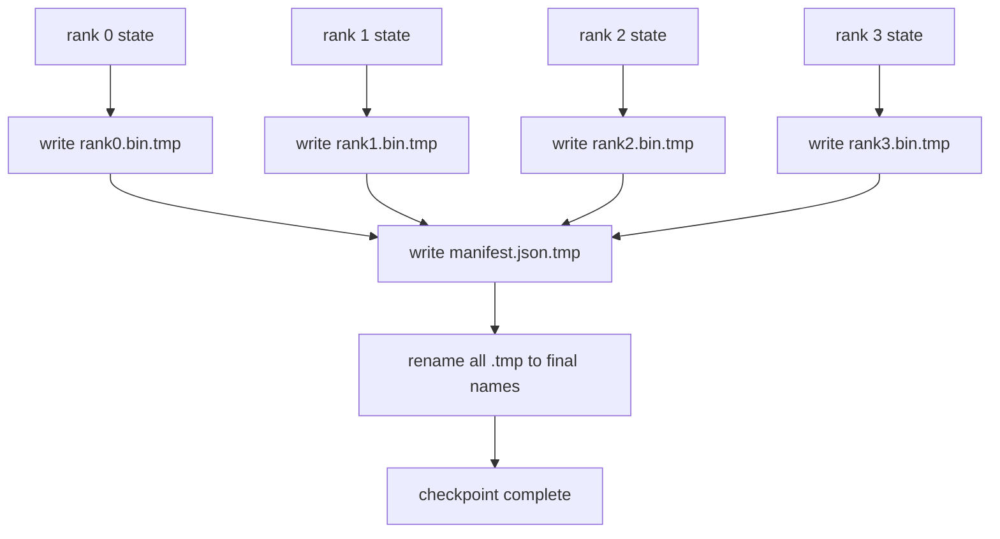

# 쪼개진 체크포인트 및 원자력서

> 70B 매개 변수 훈련 작업은 몇 시간마다 노드 실패로 중단됩니다. 체크포인트 형식은 30분이나 30시간을 잃는지 결정합니다. 쪼개진 체크포인트는 각 순위의 쪼개리를 병렬로 기록하고 소유권을 매니프에 기록합니다. 리뷰는 각 순위의 셔드를 자신의 파일에서 로드하고, 같은 세계 크기에 국가를 재구성하고, 아무 일도 일어나지 않는 것처럼 최적화된 단계를 거친다. 원자력 글쓰기는 반 완료된 체크포인트가 다음 서브라이어를 독성하지 않도록 합니다.

**Type:** Build
**Languages:** Python
**Prerequisites:** Phase 19 Track C lessons 42-49
**Time:** ~90 min

## 학습 목표

- 여러 순위 점검점을 순위별 셔드 파일로 저장하고 어떤 순위가 어떤 것을 소유하고 있는지 기록하는 매니폼을 추가합니다.
- 원자력 작성 패턴을 사용 (임시 경로로 작성하고 이름을 변경) 하여 충돌 중 작성은 결코 반 완료된 체크포인트를 생성하지 않습니다.
- 매니프스트에서 재개, fp16 매개 변수와 각 순위에서 ZeRO 최적화 상태 모두에 대해 바이트-평등 상태를 확인합니다.
- 3가지 실패 모드: 세계 크기의 변화, 쪼개리 숫자의 부합, 부분 글쓰기

## 문제

바닐라 체크포인트는 모든 매개 변수와 최적화 상태를 0 순위로 읽고, 수집하고, 하나의 파일을 작성합니다. 70B 모델에서는 1TB의 상태가 1급의 네트워크 포트를 통해 글쓰기는 다른 순위들을 차단합니다. 왜냐하면 그들은 집단을 기다리는 게으름이기 때문입니다. IO 대역폭은 단일 GPU의 네트워크 연결이 가장 느린 것입니다. 합계가 아닙니다. 실제 클러스터에서 집합하고 작성하는 단계는 이전 훈련 시간보다 더 오래 걸릴 수 있으므로 훈련 당일에는 1 개 이상의 체크포인트가 없습니다.

쪼개진 체크포인트들은 패턴을 뒤집고 있습니다. 각 순위가 자신의 쪼개진 파일을 병렬로 작성합니다. 어떤 조각이 어떤 덩어리를 소유하고 있는지에 대한 기록은 각각의 조각이 원래의 위치를 찾을 수 있습니다. 합적은 클러스터와 함께 대역폭 스케일을 작성합니다. 1 TB의 체크포인트에서 1 순위에서 4시간을 걸린 것은 64 순위에서 4분 정도 걸립니다. 그리고 매니페스트는 비합합적인 라이프러미를 위한 계약을 제공합니다. 세계적 규모의 변화가 감지될 수 있고 부분적인 글쓰기가 감지될 수 있고,

## 개념



### 공개된 스케마

```json
{
  "world_size": 4,
  "step": 1234,
  "wall_clock_seconds": 4521,
  "shards": [
    {"rank": 0, "path": "rank0.bin", "sha256": "...", "param_shard_offset": 0, "param_shard_numel": 65536},
    {"rank": 1, "path": "rank1.bin", "sha256": "...", "param_shard_offset": 65536, "param_shard_numel": 65536}
  ],
  "schema_version": 1
}
```

3개의 필드는 짐을 짊어지고 있습니다.`world_size`다른 크기의 서사진이 조용히 부패하기보다는 크게 실패합니다.`sha256`         `param_shard_offset`그리고`param_shard_numel`각 에 로더가 평평한 매개 변수 텐서를 올바른 위치에 재구성하도록 한다.

### 원자력 글쓰기

표준 패턴: 각 조각을`<name>.tmp`, 이 자문을 써`manifest.json.tmp`, fsync 각각, 그리고 이름을 변경. 같은 파일 시스템 내 POSIX 이름을 변경하는 것은 원자력입니다. 새로운 파일은 완전히 존재하거나 오래된 파일은 있습니다. 최종 변경 이전 체크포인트를 생식으로 떠나기 전에 충돌. 원자력 작성 없이는 충돌은 현재 표시가있는 부분 셔드를 남겨두고, 로드가 리수미에 최적화 상태를 손상시킬 수 있습니다.

### 3가지 실패 모드

| Failure | Symptom | Defence |
|---------|---------|---------|
| World-size change | resume on N=8 with manifest from N=4 | world_size mismatch in manifest, fail loudly |
| Shard count mismatch | resume sees fewer rank*.bin files than shards in manifest | enumerate shards, verify every one exists |
| Partial write | shard file truncated mid-flush | sha256 verification on load |

모든 방어는 나쁜 부하를 일찍 거부하고, 그 대안은 100단계 후에 손실이 NaN에 도달할 때 드러나는 침묵의 부패입니다.

### 왜 순위별 파일, 큰 파일이 아니라

 `O_APPEND`바이트-배열된 글쓰기 (byte-aligned writes) 를 위해 POSIX에서 작동하지만, 실제로는 한 셰어드 범위 내의 오프셋은 MB 크기의 영역과 잠금이 지배적이다. 각 순위 파일은 그 기본 파일 시스템이 병렬 (Lustre, GPFS) 이있을 때 반열을 가지고 있으며 이득을 얻습니다. 생산 스택 (DeepSpeed, FSDP, NeMo) 은 모두 각 순위 파일을 사용합니다.

```figure
ci-sharded-checkpoint
```

## 건설 해

`code/main.py`이 도구는

- `ShardManifest`위의 스케마와 함께 데이터 클래스`to_json`- 그래`from_json`- 그래
- `save_sharded(state_dict_per_rank, dir, step)`각 순위의 바이너리 상태를 원자적 템프-테인먼트 패턴을 사용하여 자신의 파일로 작성하고,
- `load_sharded(dir, expected_world_size)`매니프스를 읽고 각 껍데기의 sha256를 확인하고 순위별 상태 디렉트를 반환합니다.
- 반행 테스트: 순위상 상태를 구성, 저장, 로드, 바이트-평등을 주장합니다.

실행하세요:

```bash
python3 code/main.py
```

출력: 4개의 셔드 파일과 매니페스트가 작성되어, 바이트와 같은 검증으로 다시 로드됩니다.

## 야생에서의 생산 패턴

세 가지 패턴이 체크포인트를 단단히 해체할 수 있을 만큼 단단히 해체합니다.

**Async write.**생산 스택은 체크포인트를 분리된 스레드 또는 프로세스에 작성하여 훈련이 계속됩니다. 장벽은 다음 체크포인트입니다. 이전 세이브가 완료 될 때까지 다음 세이프를 시작하지 마십시오.`async_io`플래그는 정확히 이렇게 합니다. 수업은 글씨를 동기화시켜서 단계들이 눈에 띄게 합니다.

**Local fast disk first, then async upload.**로컬 NVMe (빠른) 로 작성하고, S3 또는 GCS 로 아싱크 업로드 합니다. 두 계층 패턴은 클러스터 내 체크포인트를 리수미를 위해 빠르게 유지하며, 내구성 복사본을 클러스터 밖으로 보관하기 위해 전송합니다. 매니페스트는 로컬 경로를 가지고 있으며, 업로드 매니페스트는 원격 경로를 가지고 있습니다.

**Rotation matters.**생산 경기는 마지막 K 점검점을 (일반적으로 3-5) 유지하고 가장 오래된 점검점을 회전합니다. 회전 없이 디스크가 중순으로 채워지고 다음 점검점이 실패합니다. 회전으로 다음 저장소는 가장 오래된 점검점을 먼저 삭제하여 예산을 해방시킵니다.

## 사용 하 고

생산 패턴:

- **DeepSpeed checkpointing.** `deepspeed.save_checkpoint(tag=step)`순위별 파일과 `latest`파일은 활성 태그를 가리키고 있습니다.
- **PyTorch FSDP checkpointing.** `torch.distributed.checkpoint`                    `Planner`순위별 배열에 결정하는 것입니다.
- **NeMo.**          `save_to_checkpoint`메타데이터를 추가하는 API

## 선박

레슨 81은 DDP+ZeRO의 종말에서 종말까지의 점검점을 저장하고, 재개약의 유효성을 증명하기 위해 같은 세계 크기로 다시 로드합니다.

## 운동

1. 아시크쓰기를 추가: 스레드에서 저장을 시작하여 훈련이 계속되도록하십시오. 이전 저장이 완료 될 때까지 다음 저장을 차단하십시오.
2. `last_5_steps`회전: 가장 최근의 5개의 체크포인트를 유지하고, 새로운 체크포인트를 저장하기 전에 가장 오래된 체크포인트들을 삭제합니다.
3. 내부 루프 재충전 (중환으로 체크포인트가 sha256 없이 새로운 활성 점으로 돌고) 에 대한 CRC만 있는 빠른 검증 경로를 추가한다.
4. 전 세계 크기의 로드를 추가하십시오: 셔틀 리버랜싱 N=4에서 N=8로 매니프스트, 콘카테네팅 및 재 셔틀링을 읽음으로써.
5. 가짜 S3 (제2 디렉토리) 에 업로드를 추가하고 업로드 매니페스트를 작성하십시오.

## 주요 용어

| Term | What people say | What it actually means |
|------|----------------|------------------------|
| Sharded checkpoint | "Per-rank save" | Each rank writes its own shard file in parallel |
| Manifest | "Index" | JSON file recording shard paths, offsets, and sha256 |
| Atomic write | "tmp then rename" | Write to .tmp then POSIX rename so a crash leaves the previous file live |
| Partial write | "Truncated shard" | A crash during write produces a corrupt shard; sha256 catches it |
| Rotation | "Keep last K" | Delete oldest checkpoint before writing new one to bound disk usage |

## 더 많은 읽기

- [DeepSpeed checkpointing](https://deepspeed.readthedocs.io/en/latest/model-checkpointing.html)
- [PyTorch torch.distributed.checkpoint](https://pytorch.org/docs/stable/distributed.checkpoint.html)
- [POSIX rename atomicity](https://pubs.opengroup.org/onlinepubs/9699919799/functions/rename.html)
- 19단계 78강 - ZeRO의 상태 이 체크포인트는 저장하도록 되어 있습니다
- 19단계 81강습 - 엔드-투-엔드 데모가 저장된 상태를 돌아보게 합니다
